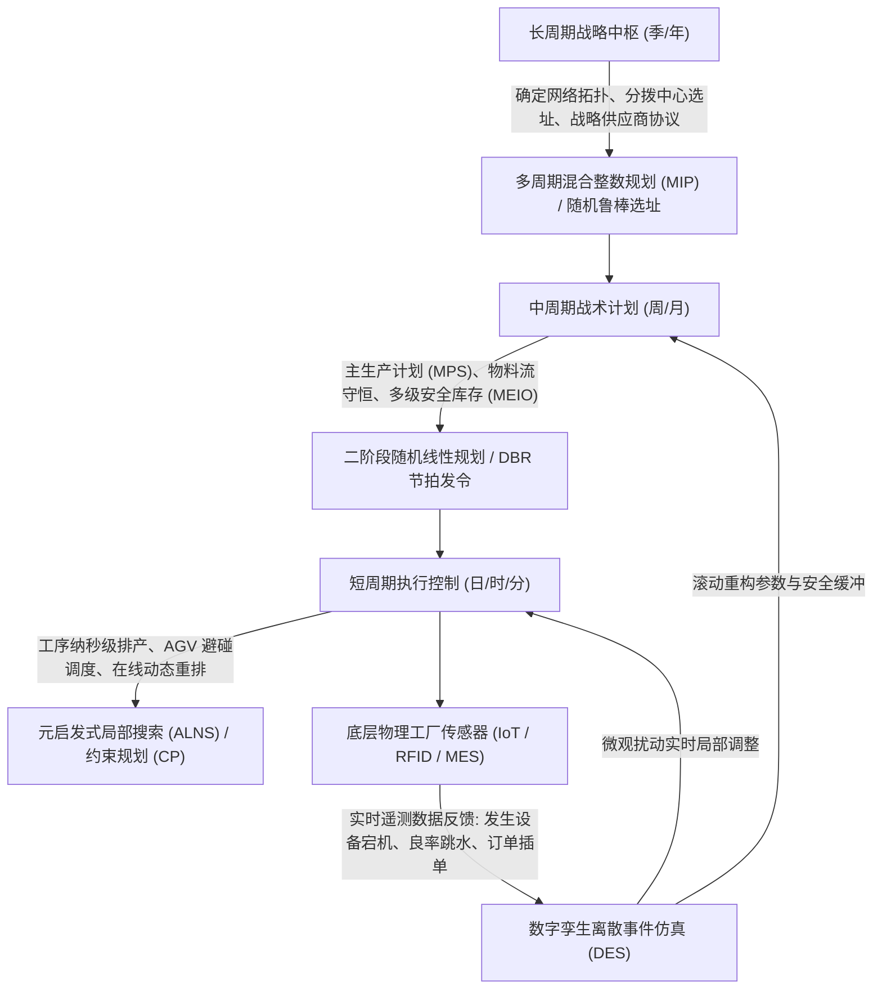

# Lec 24 制造系统综合集成与工程实践总结 (Integrated Manufacturing Systems Synthesis and Capstone)

> MIT 15.066J 制造与运营系统优化分析 (System Optimization and Analysis for Manufacturing) · 授课教师：Prof. Stephen Graves (MIT Sloan / LGO)

## TL;DR

- 全课程技术栈在制造系统顶层设计中实现从战略选址到纳秒级调度的闭环统一。
- 跨越模型与现实鸿沟的工程实战准则：数据清洗、模型可解释性与人机协同。
- 数字化孪生与运筹优化在工业 4.0 全球制造网络重构中的终极落地全景。

## 制造运筹思想的终极集成

在麻省理工学院 15.066J 漫长而硬核的学期跋涉中，我们系统攀登了现代制造与运营系统量化科学的三大理论巅峰：
1. **确定性数学规划与网络拓扑**：线性规划（LP）、对偶影子价格与灵敏度、单商品与多商品网络流、混合整数规划（MIP）与割平面；
2. **随机系统与风险控制**：多级库存基本库存控制（Base-Stock）、牛鞭效应治理、二阶段随机规划补偿（Recourse）与风险价值（VaR/CVaR）；
3. **动态仿真与高阶算法**：车间调度启发式、约束理论（TOC/DBR）、离散事件仿真（DES/SIMUL8）、基于仿真的贝叶斯代理模型优化（SBO）与非线性规划（NLP/KKT）。

站在课程终点的大作业与实战总结（Capstone Integration）的高地上，我们不再孤立地审视某个单机算法，而是审视**如何将这套全栈运筹武器库，无缝浇筑进跨国制造集团的数字化中枢神经之中**。

## 全球智能制造系统的闭环三层中枢架构

一个世界级的端到端智能制造决策引擎，绝不是由单一庞大模型驱动的，而是由不同时间尺度、不同空间颗粒度的算法模型紧密嵌套构成的立体闭环生态。在制造系统的实际运行中，不同层级的决策面临完全不同的信息确定性与响应时间要求：战略层规划往往跨越数年，需要评估宏观地缘政治与资本投资的折旧边界；战术层计划跨越数周或数月，重点在于平准化全网产能并平衡物料供需；而执行调度层则精确到分钟乃至纳秒级别，直接驱动车间机械臂、传送带与自动化导引车（AGV）的协同避让。

为了避免单一超大规模数学规划因变量爆炸而瘫痪，顶尖制造企业通过构建分层递阶控制中枢，将长期战略、中期平衡与实时调度在数字孪生空间中紧密解耦并形成双向闭环反馈：

在这套闭环体系中，各层级之间的信息流转具备严格的因果与数学映射契约：
1. **向下传递边界约束（Downward Constraint Propagation）**：高阶规划将优化求出的宏观产能分配上限、工厂启闭状态与安全库存定额，作为硬性边界条件自上而下赋权给下层模型。战术层必须在战略层划定的网络框架内运行，车间作业调度则必须严格服从战术层下发的主生产计划（MPS）交货日期。
2. **向上反馈状态能力（Upward Capacity Feedback）**：底层车间通过工业物联网传感器（IoT）采集的设备实际故障停机率、刀具磨损漂移、实时在制品堆积与工序节拍波动，实时送入离散事件数字孪生仿真引擎中进行在线聚合，将更新后的真实有效产能包络（Effective Capacity Envelope）重新向上回传给战术规划模型，驱动整个制造网络实现敏捷自适应重排。

## 模型落地的四大工程现实鸿沟

许多在学术论文中表现惊艳的运筹模型，在进入工厂车间实战时往往迅速遭遇“水土不服”甚至被一线操作工彻底弃用。麻省理工学院 LGO 项目基于数十年的全球工业领袖实践，总结了跨越模型与现实鸿沟的四大铁律：

### 1. 垃圾进，垃圾出（Garbage In, Garbage Out）
运筹模型的最优解质量完全受限于输入基础数据的纯净度。
在真实工厂中，BOM（物料清单）往往存在版本冲突，ERP 中的标准工时（Routing Run-Time）可能由十年前的工艺员主观填写，实际工时偏差高达 40%。
**卓越的运筹工程师必须将 50% 的精力投入到数据治理、异常值清洗与传感器实测校准之中**。

### 2. 模型可解释性与对偶洞察（Interpretability & Dual Intuition）
工厂厂长与调度主管绝不会盲目信任一个“黑箱输出”的复杂排产表。
算法必须输出透明的解释依据：
- 为什么要把订单 A 推迟到下周？（因为工位 3 当前的影子价格高达 $200/小时，加工订单 A 会挤占利润更高的战略订单 B）；
- 为什么必须在此时开启外协转包？（展示瓶颈产能的边际衰减曲线）。
**用对偶理论的经济学逻辑说服一线管理层，是算法获得制度合法性的必由之路**。

### 3. 人机协同（Human-in-the-Loop, HITL）
没有任何数学模型能够提前预测所有的现实黑天鹅（如地缘政治突发管制、重要客户高管的临时私人诉求）。
系统必须设计优雅的**交互式人工干预接口**：允许调度员在界面上锁定某些关键订单（Pinning），模型在人工硬约束的边界内，以最小的扰动二次重优化其余资源。

### 4. 稳健性胜于脆弱的最优性（Robustness over Fragile Optimality）
一个追求“理论极限最优”的脆弱计划，在遭遇微小扰动时会导致全线崩盘；
而一个略带冗余时间缓冲、具备容错能力的**鲁棒可行解（Robust Feasible Solution）**，在现实世界中创造的商业价值往往十倍于脆弱的纯理论解。

## 结课寄语：致未来的工业系统架构师

::: insight 运筹优化是人类理性在物质文明中最深沉的沉淀
制造从来不是冰冷的流水线与钢铁机床，它是人类智慧为了满足亿万同类对美好生活的向往，在混乱、熵增与资源匮乏的自然界中建立起的最高秩序。
从最简单的单纯形极点跳跃，到布朗运动的随机反射，再到万次离散事件仿真的时空跃迁；
**我们所学习的每一个公式、推导的每一个定理，都是人类在用数学的纯粹理性，为实体经济的每一个齿轮校准出最高效、最优雅的旋转轨迹**。
保持对物理现实的敬畏，保持对数据真相的执着，用运筹之光照亮全球智能制造的每一个角落。
:::
