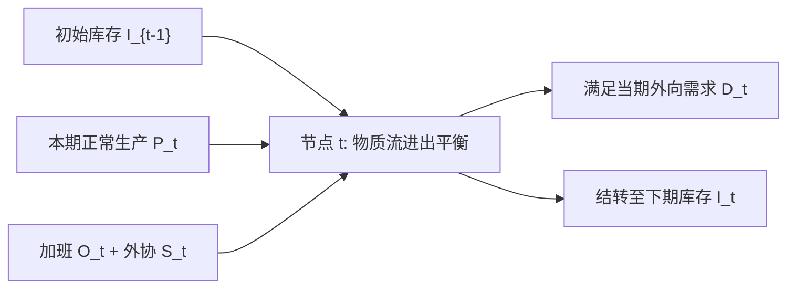

# Lec 3 线性规划应用与案例研究：复杂运营约束转化 (LP Modeling Applications and Case Studies)

> MIT 15.066J 制造与运营系统优化分析 (System Optimization and Analysis for Manufacturing) · 授课教师：Prof. Stephen Graves (MIT Sloan / LGO)

## TL;DR

- 多周期滚动计划（Aggregate Planning）将库存跨期结转与加班换线统一建模为动态流平衡。
- 混料优化问题（Blending Problem）揭示了非线性质量分数指标向严格线性约束的等价转化技巧。
- 换线惩罚与最小批量约束展示了线性规划在逼近实际工业离散特性时的边界与拓展。

## 从教科书到真实工厂的跨越

在实际工业界，制造运营约束极少以简单的标量不等式直接呈现。车间充满了跨时间动态关联、复杂的工艺物理混合配比以及动态劳动力调节。

本讲通过两大工业旗舰级经典案例，深入剖析如何将充满非线性与跨期动态的业务逻辑，无损提炼为严格的线性规划模型。

## 案例一：多周期动态综合生产计划 (Aggregate Production Planning)

在季节性需求波动强烈的行业（如家电、快消玩具、供暖设备），企业在长达 6-12 个月的计划期内，必须决定每个月的正常生产量、加班量、外协转包量、工人雇佣/解雇数量以及期末在制品与产成品库存持有量。

设计划周期为 $t = 1, 2, \dots, T$。
- **参数输入**：
  - $D_t$：第 $t$ 月预测需求量；
  - $c_t^R, c_t^O, c_t^S$：正常工时、加班工时与转包外协的单位生产成本；
  - $h_t$：单位产品月度库存持有成本；
  - $H_t, F_t$：增聘一名工人与解雇一名工人的组织调整成本；
  - $k$：每名全职工人每月的额定标准生产工时定额。

- **决策变量**：
  - $P_t$：第 $t$ 月正常产量；$O_t$：第 $t$ 月加班产量；$S_t$：第 $t$ 月外协产量；
  - $I_t$：第 $t$ 月末库存结转量（假设初始库存 $I_0$ 已知）；
  - $W_t$：第 $t$ 月雇佣的全职劳动力总数；$H_t^+, F_t^-$：增聘与解雇人数。

### 核心物理约束的严谨线性化

1. **库存物料流守恒平衡方程（Mass Balance）**：
$$
I_{t-1} + P_t + O_t + S_t - I_t = D_t, \quad \forall t = 1, \dots, T
$$
上期遗留库存加上本期全部生产来源，减去期末结转，必须精确出清当期需求。

2. **劳动力总数动态继承与变动约束**：
$$
W_t = W_{t-1} + H_t^+ - F_t^-, \quad \forall t = 1, \dots, T
$$

3. **正常产能上限与工时强绑定**：
$$
P_t \le k \cdot W_t, \quad \forall t = 1, \dots, T
$$

4. **加班工时硬上限**（依据劳动法与设备折旧限制）：
$$
O_t \le \alpha \cdot (k W_t), \quad 0 \le \alpha \le 0.25
$$

总目标函数即为全周期总运营成本最小化：
$$
\min \sum_{t=1}^T \left(c_t^R P_t + c_t^O O_t + c_t^S S_t + h_t I_t + H_t H_t^+ + F_t F_t^-\right)
$$
由于所有约束与目标均完全呈线性结构，即使跨越 24 个月、包含上千个 SKU，现代商用 LP 求解器亦可在毫秒级内输出最优解！

## 案例二：流程工业中的混料与成分约束 (The Blending Problem)

在石油炼化、钢铁冶炼与饲料加工中，最终成品的质量指标（如辛烷值、硫含量、蛋白质含量）是由多种原材料混合而成的加权平均值。

设成品需满足硫含量上限比例 $\gamma \le 0.01$（即硫质量占比不超过 1%）。
设采购原料 $i$ 的数量为 $x_i$，已知原料 $i$ 的含硫质量分数为 $s_i$。
成品中的实际含硫百分比为：
$$
\text{实际含硫率} = \frac{\sum_{i=1}^n s_i x_i}{\sum_{i=1}^n x_i} \le \gamma
$$
初学者常因为出现分母求和，误以为这是一个高度非线性的分式规划问题！

::: theorem [分式混合约束的线性转化]
由于总投料量 $\sum_{i=1}^n x_i > 0$ 恒为严格正实数，两边同乘分母并移项：
$$
\sum_{i=1}^n s_i x_i \le \gamma \left(\sum_{i=1}^n x_i\right) \iff \sum_{i=1}^n (s_i - \gamma) x_i \le 0
$$
原本看似棘手的非线性分式不等式，被瞬间无损还原为了最纯粹的标准齐次线性不等式！
:::

::: pitfall 忽视原料化学反应中的非线性体积分数变化
上述线性转化建立在**质量守恒与体积加和线性假设**之上。在某些高分子聚合与深冷化工过程中，液体混合可能存在体积收缩效应（Excess Volume of Mixing），此时强行使用线性加和会导致成分超标。运筹工程师必须严格确认物理守恒基准。
:::

::: insight 建模的本质是在物理现实与求解器算力之间搭建桥梁
很多人以为运筹学家的工作是“调包写求解器代码”。
而真正的核心壁垒在于：**能否看穿复杂业务表象下的守恒结构（Conservation Laws）**。无论是多周期的动态库存流、现金流，还是跨原料的化学组分混合，只要抓住质量与信息守恒的骨架，最复杂的运营世界也能被转化为优雅高效的凸多面体。
:::
