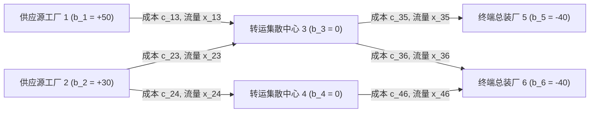

# Lec 4 物流网络流模型与多商品流架构 (Network Flow Models in Logistics and Manufacturing)

> MIT 15.066J 制造与运营系统优化分析 (System Optimization and Analysis for Manufacturing) · 授课教师：Prof. Stephen Graves (MIT Sloan / LGO)

## TL;DR

- 网络流模型用有向图顶点守恒与有界边容量抽象多基地供应链与厂内物料搬运。
- 节点-弧关联矩阵的完全单模性（TUM）保证了连续线性松弛解天然具有纯整数性。
- 多商品流（Multi-Commodity Flows）刻画了共享有限物流通道下的全局运力竞争与解耦。

## 制造与供应链的网络拓扑本质

从供应商原材料供应、工厂多工序加工、中央分拨中心（DC）中转，到最终客户交付，制造系统在物理空间上展现为一张四通八达的**有向流动网络**（Flow Network）。

网络流（Network Flows）是应用数学中最受喜爱的分支之一：它不仅拥有极具视觉直观性的图论表示，更在代数上具备惊人的完全单模性质，使得网络单纯形法（Network Simplex）的求解速度比通用单纯形法快上百倍！

## 最小费用流问题 (Minimum Cost Flow Problem, MCFP)

设物流网络表示为有向图 $G = (V, E)$，其中 $V$ 为节点集合，$E$ 为有向弧集合。
- 节点 $i \in V$ 拥有净外向供给/需求量 $b_i$：
  - $b_i > 0$：供应源点（如原材料产地、零部件供应仓）；
  - $b_i < 0$：需求汇点（如总装车间工位、终端零售商）；
  - $b_i = 0$：转运中枢节点（如越库配送中心 Cross-dock）。
  系统满足全网守恒条件：$\sum_{i \in V} b_i = 0$。
- 每条有向弧 $(i, j) \in E$ 拥有：
  - 单位运输/流转成本 $c_{ij}$；
  - 运力容量上限 $u_{ij}$；
  - 流量决策变量 $x_{ij} \ge 0$。

最小费用流线性规划形式为：
$$
\begin{aligned}
\min_{x} \quad & \sum_{(i, j) \in E} c_{ij} x_{ij} \\
\text{s.t.} \quad & \sum_{j: (i, j) \in E} x_{ij} - \sum_{k: (k, i) \in E} x_{ki} = b_i, \quad \forall i \in V \quad (\text{节点流守恒}) \\
& 0 \le x_{ij} \le u_{ij}, \quad \forall (i, j) \in E \quad (\text{容量瓶颈})
\end{aligned}
$$

## 节点-弧关联矩阵与完全单模性 (TUM)

写出上述节点守恒方程的系数矩阵 $A \in \mathbb{R}^{|V| \times |E|}$。
矩阵的每一列对应图中的一条有向弧 $e = (i, j)$。因此在这一列中：
- 节点 $i$（起点）对应的行元素为 $+1$；
- 节点 $j$（终点）对应的行元素为 $-1$；
- 其余所有节点的行元素全部严格为 $0$！

::: theorem [Poincaré 完全单模性充要定理 (Totally Unimodular)]
有向图的节点-弧关联矩阵 $A$ 是**完全单模矩阵**（Totally Unimodular, TUM）。
即矩阵 $A$ 的任意阶方阵子式（Subdeterminant）的行列式取值只能是 $0, +1$ 或 $-1$。
:::

根据 **Hoffman-Kruskal 定理**，当约束矩阵 $A$ 为完全单模且向量 $b, u$ 均为整数时：
**该线性规划的每一个极点解（基本可行解）全部必然是纯整数解！**

这意味着：我们无需开启耗时极其昂贵的分支定界离散整数规划算法，只需直接调用最快速的连续线性规划网络单纯形法，求出的物流调配箱数、卡车车次天然就是严谨的纯整数！

## 多商品流架构 (Multi-Commodity Network Flows)

在实际复杂供应链中，网络中流动的货物绝不是均质单一的。不同 SKU、不同车型的零部件（称为不同商品 Commodity $k = 1, \dots, K$）必须由各自专属的源点运输至专属的目的地。

设商品 $k$ 在节点 $i$ 的净需求为 $b_i^k$，在弧 $(i, j)$ 上的流量为 $x_{ij}^k$。
模型表述为：
$$
\begin{aligned}
\min \quad & \sum_{k=1}^K \sum_{(i, j) \in E} c_{ij}^k x_{ij}^k \\
\text{s.t.} \quad & \sum_{j: (i, j) \in E} x_{ij}^k - \sum_{m: (m, i) \in E} x_{mi}^k = b_i^k, \quad \forall i \in V, \forall k \quad (\text{各商品独立守恒}) \\
& \sum_{k=1}^K x_{ij}^k \le U_{ij}, \quad \forall (i, j) \in E \quad (\text{总容量捆绑耦合约束}) \\
& x_{ij}^k \ge 0
\end{aligned}
$$

::: pitfall 耦合容量约束打破完全单模性
单商品网络流中完美的纯整数特性在多商品流中**彻底破灭**！
因为所有商品共享了物理通道的共同总容量限制 $\sum_k x_{ij}^k \le U_{ij}$，破坏了节点-弧矩阵单一进出的优美代数结构。
多商品整数流是强 NP-hard 问题，工业界通常采用 **Dantzig-Wolfe 列生成分解** 或 **Lagrangian 松弛** 将多商品解耦为并行的独立单商品最短路子问题求解。
:::

::: insight 网络流是将时空约束具象化的拓扑语言
网络流模型之所以在运筹学中地位崇高，在于其近乎无限的表达张力：
通过在图上引入“虚拟时间分层副本”，**空间上的运输网络可以瞬间升级为时空动态网络（Time-Expanded Networks）**。机台上的工件排队、仓储中的货物滞留，全部被具象化为在时间轴向上的前向流动。这种几何化思考方式，是每一位运筹架构师的必修课。
:::
