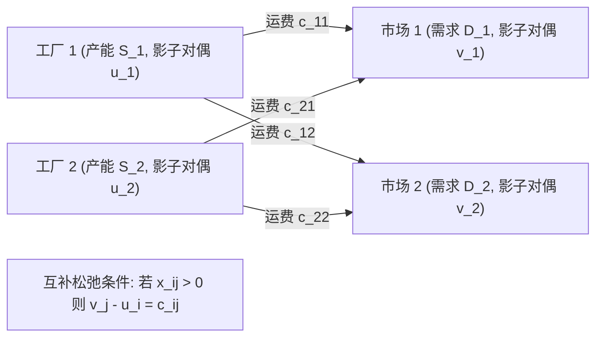

# Lec 5 生产物流协同与多工厂运输优化 (Multi-Commodity Network Flows and Transportation)

> MIT 15.066J 制造与运营系统优化分析 (System Optimization and Analysis for Manufacturing) · 授课教师：Prof. Stephen Graves (MIT Sloan / LGO)

## TL;DR

- 经典 Monge-Kantorovich 运输问题刻画了多工厂生产基地向区域配送中心的成本出清。
- 引入工厂固定启动成本与装载阶梯费率触发混合整数非凸结构。
- Benders 分解算法通过主问题决策工厂启闭、子问题快速求解网络流实现协同解耦。

## 全球化多基地协同调度

对于波音、丰田或英特尔这样的大型跨国制造巨头，生产网络绝非局限在单一车间之内，而是分布在全球多个不同国家与地区的工厂群：
- 部分工厂专注于前端高精度核心零部件的铸造与蚀刻（Capital-Intensive Hubs）；
- 部分工厂位于低成本劳动力地区，负责劳动密集型的组装与测试（Assembly & Test Facilities）；
- 最终产品通过区域中枢集散港（Regional Hubs）辐射各大洲消费市场。

如何统筹分配各工厂的生产负荷与多式联运（海运、空运、铁路班列）物流路线，是降低全球到岸总成本（Landed Cost）的核心。

## 经典运输模型与其对偶影子价格

设存在 $m$ 个生产工厂，工厂 $i$ 的最大供给产能为 $S_i$（$i = 1, \dots, m$）。
存在 $n$ 个区域市场中心，中心 $j$ 的需求量为 $D_j$（$j = 1, \dots, n$）。
从工厂 $i$ 向市场 $j$ 运送单位产品的总成本为 $c_{ij}$（包含单位生产可变成本与干线运费）。

运输平衡问题表述为：
$$
\begin{aligned}
\min_{x} \quad & \sum_{i=1}^m \sum_{j=1}^n c_{ij} x_{ij} \\
\text{s.t.} \quad & \sum_{j=1}^n x_{ij} \le S_i, \quad \forall i = 1, \dots, m \\
& \sum_{i=1}^m x_{ij} \ge D_j, \quad \forall j = 1, \dots, n \\
& x_{ij} \ge 0
\end{aligned}
$$

根据强对偶理论，为工厂产能约束指定对偶变量 $u_i \ge 0$，为市场需求约束指定对偶变量 $v_j \ge 0$。
根据**互补松弛定理**（Complementary Slackness）：
若在最优解中工厂 $i$ 向市场 $j$ 发生了实际运输（即 $x_{ij}^* > 0$），则其对偶变量必须精确满足无套利空间：
$$
v_j - u_i = c_{ij}
$$
在经济学与供应链战略上，这具有极度深刻的定价内涵：
$u_i$ 代表了**工厂 $i$ 扩建 1 单位产能给全网带来的系统边际成本削减（影子地租）**；而 $v_j$ 则代表了**在市场 $j$ 交付 1 单位产品的全网边际到岸成本（影子价格）**！

## 引入固定开启成本与阶梯运费率

在实际运营中，若启用某个物流中转枢纽或开设新的工厂班次，必须支付一笔高昂的**固定资产开启与运营运维成本** $F_i$。同时，整车运输（FTL）与零担拼车（LTL）之间存在显著的非线性规模经济（阶梯折让费率）。

设 0-1 指示变量 $y_i \in \{0, 1\}$ 表示是否开启工厂 $i$。
模型升级为混合整数规划（MIP）：
$$
\begin{aligned}
\min_{x, y} \quad & \sum_{i=1}^m F_i y_i + \sum_{i=1}^m \sum_{j=1}^n c_{ij} x_{ij} \\
\text{s.t.} \quad & \sum_{j=1}^n x_{ij} \le S_i y_i, \quad \forall i = 1, \dots, m \quad (\text{大 M 产能门禁}) \\
& \sum_{i=1}^m x_{ij} \ge D_j, \quad \forall j = 1, \dots, n \\
& y_i \in \{0, 1\}, \quad x_{ij} \ge 0
\end{aligned}
$$

## Benders 分解解耦架构 (Benders Decomposition)

面对数十个制造基地与成千上万个零售网点的超大规模混合整数网络规划，直接调用求解器往往受限于整数变量与连续流量变量的相互牵制。

**Benders 分解**提供了最优雅的工业级解耦方案：
1. **主问题（Master Problem）**：只负责决定纯离散的工厂启闭方案 $y \in \{0, 1\}^m$ 以及辅助目标变量 $\theta$；
2. **子问题（Subproblem）**：在固定工厂开启状态 $\bar{y}$ 下，问题退化为极速可解的连续标准运输问题；
3. **极点割平面反馈**：若子问题对偶解为 $(\bar{u}, \bar{v})$，将其回传为主问题：
$$
\theta \ge \sum_{j=1}^n D_j \bar{v}_j - \sum_{i=1}^m S_i \bar{u}_i y_i \quad (\text{Benders 最优性割})
$$
主子问题交替迭代，在极少轮次内逼近全局最优解！

::: pitfall 忽视大 M 约束对松弛下界的致命稀释
在约束 $\sum_j x_{ij} \le S_i y_i$ 中，若产能 $S_i$ 设得过大（例如设为全网总需求 $\sum D_j$），在连续松弛时只需极小的分数解 $y_i = 0.05$ 就能放行全部流量。这会导致根节点的 LP 松弛下界极其松弛，分支定界树呈指数级膨胀！必须用精确的紧致单工厂产能上限压紧系数。
:::

::: insight 运筹对偶性揭示了供应链全要素的真实价值
许多企业的财务部门只能计算财务报表上的历史会计成本。
而运筹对偶理论给管理层装上了一副“X 光透视镜”：**对偶影子价格 $v_j$ 清楚地指明了由于全网网络瓶颈的存在，哪一个市场的履约成本最高；$u_i$ 指明了在哪个工厂增加一台新设备能为集团带来最直接的系统级降本**。这正是数据驱动决策的终极力量。
:::
