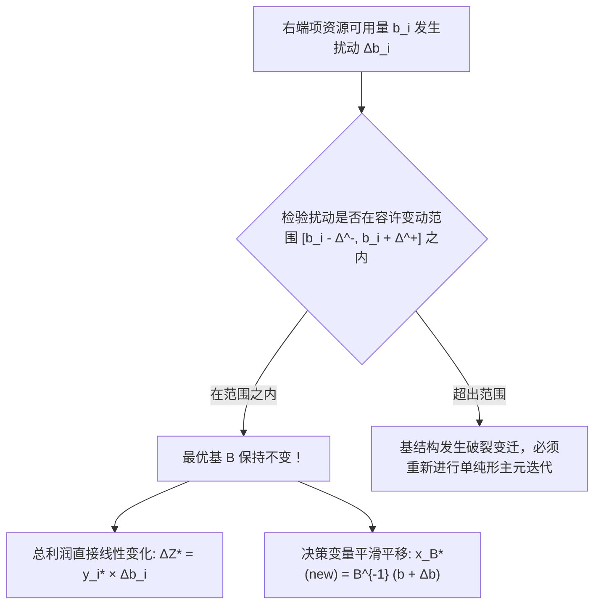

# Lec 7 LP 求解方法、对偶影子价格与灵敏度分析 (LP Solution Methods and Sensitivity Analysis)

> MIT 15.066J 制造与运营系统优化分析 (System Optimization and Analysis for Manufacturing) · 授课教师：Prof. Stephen Graves (MIT Sloan / LGO)

## TL;DR

- 单纯形检验数与对偶单纯形法揭示了资源约束边际影子价格（Shadow Prices）的经济学内涵。
- 容许变动范围（Allowable Range）确定了当前生产基结构保持最优的参数安全裕度。
- 100% 规则（100% Rule）为多参数联合波动下的系统稳健性提供了快速免重算评估。

## 静态最优解之外：不确定世界的敏感度拷问

将线性规划模型送入求解器得到一组最优生产计划 $x^*$，仅仅是运筹决策的第一步。
在实际商业运营中，外部世界永远处于持续动荡之中：
- 如果供应商因物流延误，使得某种核心芯片的到货量减少了 100 单位，工厂的总利润会暴跌多少？
- 如果销售团队提出将某款明星产品的定价上浮 50 美元，当前的生产计划是否需要全盘推翻重排？
- 生产主管向管理层申请追加 10 万美元预算用于某台冲压机台的技术改造，这笔投资究竟能否收回成本？

**灵敏度分析（Sensitivity Analysis）与对偶理论（Duality Theory）**正是专门为回答这些高级管理层关切而生的强大理论武器。

## 对偶理论与影子价格的经济学公理

考虑原问题（Primal）：
$$
\max \{c^T x : A x \le b, x \ge 0\}
$$
其对称对偶问题（Dual）为：
$$
\min \{b^T y : A^T y \ge c, y \ge 0\}
$$

根据**强对偶定理**（Strong Duality Theorem），若原问题有最优解 $x^*$，则对偶问题必有最优解 $y^*$，且目标函数值严格相等：
$$
Z^* = c^T x^* = b^T y^* = \sum_{i=1}^m b_i y_i^*
$$

::: definition [影子价格 (Shadow Price / Dual Value)]
对偶最优解 $y_i^*$ 被严格定义为资源 $i$ 的**影子价格**（Shadow Price）。
在数学上，它是最优目标收益关于资源可用量 $b_i$ 的一阶偏导数：
$$
y_i^* = \frac{\partial Z^*}{\partial b_i}
$$
它衡量了：**在保持当前最优基不变的前提下，企业若能额外获得 1 单位的资源 $i$，全厂总利润将增加多少金额**。
:::

## 容许变动范围 (Allowable Range)

影子价格 $y_i^*$ 的有效性绝非无限的。当资源 $b_i$ 增加到一定程度时，该资源将不再是全厂瓶颈，原本闲置的其他资源将变成新的制约瓶颈，从而导致多面体上的**最优基发生裂变转移**。

### 1. 右端项容许范围（Allowable Range for RHS）
在最优基矩阵 $B$ 下，基变量取值为 $x_B = B^{-1} b$。为了维持该基的可行性，必须保证基变量非负：
$$
x_B = B^{-1}(b + \Delta b_i e_i) \ge 0
$$
解此线性不等式组，即可得出该资源影子价格成立的下界与上界区间 $[b_i - \Delta_i^-, b_i + \Delta_i^+]$。

### 2. 目标系数容许范围（Allowable Range for Objective Coefficients）
若某种产品的市场毛利 $c_j$ 发生变动，只要所有非基变量的检验数（Reduced Costs）保持非正：
$$
\bar{c}_k = c_k - c_B^T B^{-1} A_k \le 0
$$
当前的最优生产决策 $x^*$ 的数值将**保持完全岿然不动**！

## 灵敏度分析经典报告解读

在 Excel Solver、Gurobi 或 CPLEX 输出的工业级灵敏度报告中，管理者可以看到以下标准结构：

| 变量 / 资源 | 最优取值 | 目标系数 / RHS | 容许增加量 (Allowable Increase) | 容许减少量 (Allowable Decrease) | 影子价格 / 检验数 |
| :--- | :---: | :---: | :---: | :---: | :---: |
| 基础款销量 $x_1$ | 20 台 | $30/台 | $20 | $5 | $0 (基变量) |
| 专业款销量 $x_2$ | 10 台 | $50/台 | $10 | $20 | $0 (基变量) |
| SMT 工时约束 | 40 小时 | 40 小时 | 10 小时 | 6.67 小时 | **$16.67/小时** |
| 组装工时约束 | 50 小时 | 50 小时 | 15 小时 | 8 小时 | **$6.67/小时** |
| 包装机台约束 | 10 台 | 16 台 | $\infty$ | 6 台 | **$0.00/小时** |

**商业洞察决策推论**：
1. SMT 工时的影子价格高达 16.67 美元/小时，而组装工时仅为 6.67 美元/小时。如果外部劳务市场提供兼职外包工时，且报价均为 12 美元/小时：**管理层应果断买入 SMT 贴片工时（净赚 4.67 美元/小时），而坚决拒绝采购组装工时（倒贴 5.33 美元/小时）**！
2. 包装机台的容许减少量为 6 台，影子价格为 0。这说明包装环节存在 6 台的冗余富余产能，哪怕变卖 3 台包装机，也不会对全厂任何产值造成丝毫影响。

## 100% 规则 (The 100% Rule)

当现实中**多个参数同时发生联运波动**时，如何不重新运行求解器就能断言基是否发生改变？

::: theorem [Bradley-Hax-Magnanti 100% 规则]
设多个右端项发生变动 $\Delta b_i$。对于每一个变动，计算其占各自单变量容许范围的变动百分比：
$$
r_i = \begin{cases}
\frac{\Delta b_i}{\text{Allowable Increase}_i}, & \Delta b_i > 0 \\
\frac{-\Delta b_i}{\text{Allowable Decrease}_i}, & \Delta b_i < 0
\end{cases}
$$
若这些变动百分比之和不超过 100%：
$$
\sum_{i=1}^m r_i \le 100\%
$$
则**当前最优基结构严格保持不变**！且总利润变化严格等于各项变动乘以各自影子价格的简单代数叠加：$\Delta Z^* = \sum y_i^* \Delta b_i$。
:::

::: pitfall 忽视变动超出容许范围后的边际报酬递减
初学者常犯的严重错误是：将影子价格当做恒定斜率无限外推。例如 SMT 容许增加量只有 10 小时，若管理者高价采购了 50 个小时，多出的 40 个小时由于被组装瓶颈卡死，其边际产出将急剧归零，带来严重的资金浪费。
:::

::: insight 影子价格是全系统内生协同的最高指挥官
在复杂的组织中，各部门往往陷于各自为政的“局部最优”：车间主任只想买最便宜的物料，HR 想尽可能压低加班费。
而灵敏度分析生成的影子价格，是**在全厂系统级联运大平衡下自然沉淀出的全要素内部转移公允定价**。它告诉每一个部门：谁才是当前阻碍公司前进的真正短板，从而驱动全组织将最宝贵的资金与精力聚焦于最具杠杆效应的战略瓶颈上。
:::
