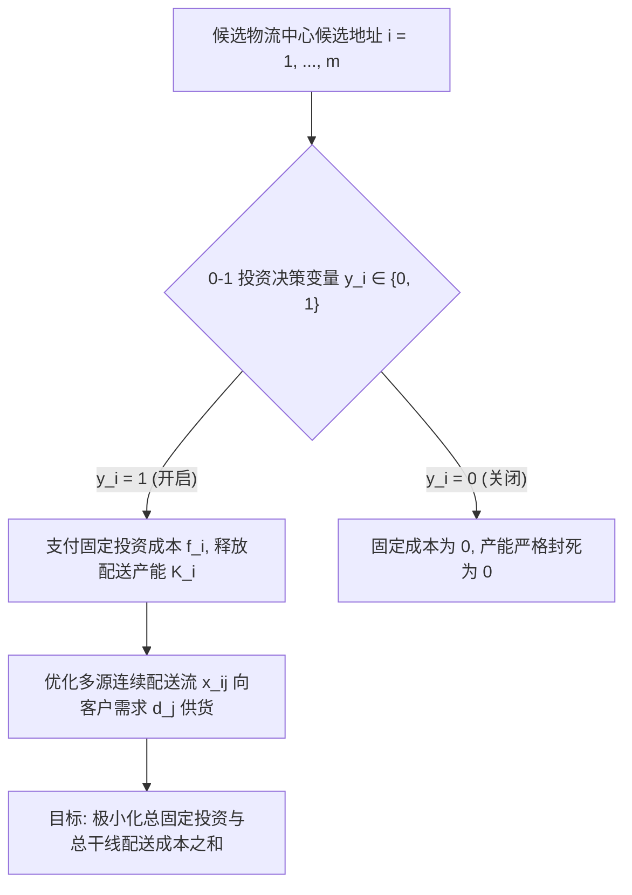

# Lec 8 整数规划在设施选址与生产平衡中的建模技术 (Integer Programming Formulations for Facility Location)

> MIT 15.066J 制造与运营系统优化分析 (System Optimization and Analysis for Manufacturing) · 授课教师：Prof. Stephen Graves (MIT Sloan / LGO)

## TL;DR

- 0-1 离散变量精准刻画设施启闭、模具切换与逻辑析取选择（Either-Or）。
- 劣质大 M 系数会导致连续松弛可行域过度膨胀并严重摧毁分支定界搜索效率。
- 紧致多面体表述（Tight Formulations）与装配线平衡（Line Balancing）模型展示了离散建模艺术。

## 突破连续世界：离散决策的不可避免性

在前面的课程中，线性规划假设所有决策变量都是连续可分的（例如生产 20.5 吨钢水、消耗 14.8 小时工时）。
然而，在制造与全球供应链体系的核心骨架中，最重大的决策往往是**非此即彼的离散不可分决策**（Discrete Indivisibilities）：
- **选址与基建投资**：是否在上海投资 5 亿美元建设新的全球分拨中心？（决策只能是 $y \in \{0, 1\}$，绝不可能建设 0.4 个分拨中心）；
- **设备防呆与工序防冲突**：工序 A 与工序 B 共享同一台五轴加工中心，必须要么先做 A 再做 B，要么先做 B 再做 A（排他性逻辑析取）；
- **批次起订量（MOQ）**：要么完全不采购，若采购则必须至少订购 1000 件以上（半连续变量 Semi-Continuous）。

整数规划（Integer Programming, IP）与混合整数规划（MIP）正是支撑这类高价值战略架构的运筹重器。

## 设施选址问题 (The Capacitated Facility Location Problem)

设企业需为 $n$ 个客户区域提供零部件配送。备选的工厂或物流中心候选地址有 $m$ 个。
- **参数定义**：
  - $f_i$：在地点 $i$ 建设并长期维持物流中心的固定投资成本；
  - $K_i$：地点 $i$ 设施的最大吞吐配送能力；
  - $d_j$：客户 $j$ 的总需求量；
  - $c_{ij}$：从设施 $i$ 向客户 $j$ 配送单位货物的综合运输履约成本。

- **决策变量**：
  - $y_i \in \{0, 1\}$：是否在地点 $i$ 开设设施；
  - $x_{ij} \ge 0$：设施 $i$ 满足客户 $j$ 需求的实际供货量（或比例）。

数学规划模型表述为：
$$
\begin{aligned}
\min_{x, y} \quad & \sum_{i=1}^m f_i y_i + \sum_{i=1}^m \sum_{j=1}^n c_{ij} x_{ij} \\
\text{s.t.} \quad & \sum_{i=1}^m x_{ij} = d_j, \quad \forall j = 1, \dots, n \quad (\text{客户需求必须出清}) \\
& \sum_{j=1}^n x_{ij} \le K_i y_i, \quad \forall i = 1, \dots, m \quad (\text{设施产能联动门禁}) \\
& y_i \in \{0, 1\}, \quad x_{ij} \ge 0
\end{aligned}
$$

## 大 M 法则的艺术与致命陷阱

在将逻辑条件转化为不等式时，运筹学中最常用的技巧是引入一个充分大的常数 $M$。
例如**要么做 A 要么做 B 约束**（Either-Or Constraints）：
要求 $f(x) \le 0$ 与 $g(x) \le 0$ 中至少有一个必须成立。引入 0-1 变量 $z \in \{0, 1\}$：
$$
f(x) \le M z
$$
$$
g(x) \le M (1 - z)
$$
当 $z = 0$ 时，$f(x) \le 0$ 且 $g(x) \le M$（自动满足）；当 $z = 1$ 时相反。

### 劣质大 M 的毁灭性影响
许多初学者习惯在代码中偷懒直接写一个巨大的天文数字（例如 $M = 10^9$ 或 $M = 9999999$）。
这会带来两大灾难：
1. **数值精度灾难（Numerical Issues）**：商用求解器在浮点数容差（Tolerance）一般设为 $10^{-6}$。当 $M = 10^9$ 时，极其微小的数值噪声 $10^{-7} M = 100$ 就会被求解器误判为有效整数，产生灾难性的“幻影解”；
2. **松弛边界稀释（Weak LP Relaxation）**：在求解树的根节点，线性松弛允许 $z$ 取连续值。若 $M$ 极大，求解器只需令 $z = 0.0001$，就可以放行庞大的业务量，导致根节点给出的松弛下界极度恶化，分支定界树搜索节点暴涨百万倍直至内存溢出！

::: definition [紧致表述法则 (Tight Formulations)]
在设施选址中，除了总产能约束 $\sum_j x_{ij} \le K_i y_i$ 之外，若添加**细粒度单客户解耦约束**：
$$
x_{ij} \le \min(d_j, K_i) y_i, \quad \forall i, j
$$
虽然增加了约束数量，但其在几何上直接切除了大量的分数松弛空间，将多面体凸包紧紧贴合在整数极点周围，使得求解速度往往提升数个数量级！
:::

## 离散装配线平衡模型 (Assembly Line Balancing)

流水线设计中另一个经典离散问题是**装配线平衡**（Line Balancing）：
有 $N$ 道工序，工序 $j$ 耗时 $t_j$。工序之间存在严格的先后拓扑偏序关系（Precedence Constraints，如必须先拧紧螺栓才能安装护盖）。
已知流水线节拍上限为 $C$（Cycle Time）。如何用最少数量的工位（Stations）容纳所有工序？

设最大候选工位数 $K$。定义指示变量：
- $x_{jk} = 1$：若工序 $j$ 被分配至工位 $k$；
- $y_k = 1$：若工位 $k$ 被实际激活启用。

$$
\begin{aligned}
\min \quad & \sum_{k=1}^K y_k \\
\text{s.t.} \quad & \sum_{k=1}^K x_{jk} = 1, \quad \forall j = 1, \dots, N \quad (\text{每道工序必须且只能分给一个工位}) \\
& \sum_{j=1}^N t_j x_{jk} \le C y_k, \quad \forall k = 1, \dots, K \quad (\text{工位节拍上限}) \\
& \sum_{k=1}^K k x_{ak} \le \sum_{k=1}^K k x_{bk}, \quad \forall (a, b) \in \text{Precedence} \quad (\text{紧前工序工位编号不得晚于紧后工序}) \\
& x_{jk} \in \{0, 1\}, \quad y_k \in \{0, 1\}
\end{aligned}
$$

::: pitfall 忽视工位编号对称性导致的组合爆炸
在上述装配线模型中，若工位 $1$ 与工位 $2$ 的负载互换，物理上是完全相同的布局。但这种**对称性（Symmetry）**会诱骗分支定界算法在成千上万个等价的同构子树中做无休止的徒劳穷举！必须添加对称性破缺约束（Symmetry Breaking Constraints）：$y_k \ge y_{k+1}$（强制靠前的工位先开启）。
:::

::: insight 离散数学是工业物理因果律的钢铁锁链
连续世界允许渐变与妥协，而离散世界要求绝对的因果分明。
无论是工厂开启与否、工序先后顺序，还是机台独占性，0-1 整数规划用最纯粹的二进制逻辑，在运筹模型中为真实工业世界铸造了不可逾越的物理因果律。**优秀的运筹学家从不依赖求解器的暴力穷举，而是在建模阶段就用最紧致的割平面与多面体投影，为算法铺平通往全局最优的康庄大道**。
:::
