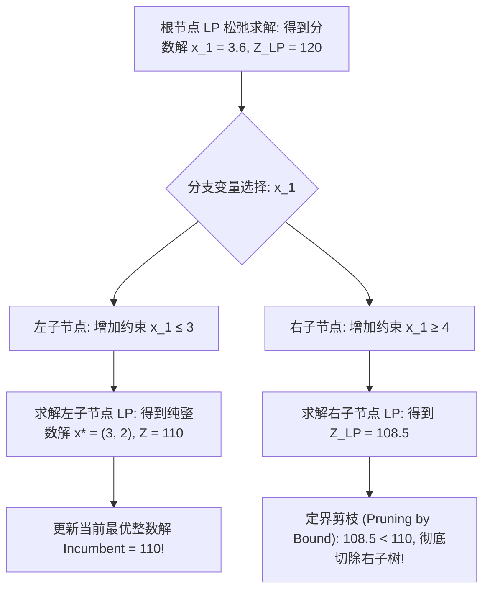

# Lec 9 整数规划核心求解算法：分支定界与割平面全景 (Integer Programming Algorithms: Branch-and-Bound and Cutting Planes)

> MIT 15.066J 制造与运营系统优化分析 (System Optimization and Analysis for Manufacturing) · 授课教师：Prof. Stephen Graves (MIT Sloan / LGO)

## TL;DR

- 分支定界树通过分治（Divide-and-Conquer）与线性松弛边界进行高效剪枝。
- Gomory 纯整数割与混合整数舍入（MIR）割动态剥离分数松弛解、收紧多面体。
- 现代 MIP 求解器通过分支割平面（Branch-and-Cut）统一树搜索与割平面生成。

## 面对 NP-Hard 的算法攻坚

在上一讲中，我们看到整数规划（IP）拥有近乎全能的建模能力，能够将复杂的离散排他逻辑表达得淋漓尽致。然而，天下没有免费的午餐：根据计算复杂性理论，通用纯整数与 0-1 混合整数规划属于 **NP-hard** 复杂度大类。

这意味着：我们绝不可能像处理连续线性规划那样，指望通过简单的多项式时间高斯消元或内点法一蹴而就。面对拥有数千个 0-1 变量的工业模型，暴力枚举（Brute-force Enumeration）需要搜索 $2^{1000} \approx 10^{300}$ 种可能性，远超全宇宙基本粒子的总和。

现代运筹学战胜组合爆炸的核心武器，正是**分支定界法（Branch-and-Bound）**与**割平面法（Cutting Planes）**的深度结合。

## 分支定界法核心机制 (Branch-and-Bound, B&B)

1960 年代 Land、Doig 与 Dakin 提出的分支定界法，是所有现代 MIP 商业求解器（Gurobi、CPLEX、SCIP）的绝对引擎中枢。

算法的核心在于构建一棵动态展开的二叉决策树，通过持续维护两个全局边界实现“聪明的隐式枚举”：
- **全局上界（Upper Bound, UB）**：对于极大化问题，已知所有尚未剪枝的子节点中最大的 LP 松弛最优值；
- **全局下界（Lower Bound, LB）**：截至目前搜索过程中，找到的**最好的可行纯整数解**的目标值（Incumbent Solution）。

::: definition [三大定界剪枝法则 (Pruning Rules)]
对于搜索树上的任意待处理子节点 $k$，求解其连续 LP 松弛。出现以下三种情况之一，该节点即可被直接**剪枝灭活**（Pruned），无需向下延伸：
1. **可行性剪枝（Pruning by Infeasibility）**：子节点的 LP 松弛无解（可行域为空）；
2. **界限剪枝（Pruning by Bound）**：子节点的 LP 松弛最优值 $Z_{\text{LP}}^{(k)} \le \text{LB}$（比当前已知的最好整数解还要差，继续深挖绝无可能诞生更优解）；
3. **整数性剪枝（Pruning by Integrality）**：子节点的 LP 松弛最优解恰好全部满足整数约束！此时更新全局下界 $\text{LB} = \max(\text{LB}, Z_{\text{LP}}^{(k)})$，并保存该解。
:::

## 割平面法与 Gomory 分数割 (Cutting Planes)

分支定界是“在空间上切分多面体”，而割平面法则是“在空间内部修削多面体”。
拉尔夫·戈莫里（Ralph Gomory）在 1958 年建立了现代整数规划历史上的奇迹定理：**无需分支枚举，单纯通过向最优单纯形表连续添加线性不等式，就能在有限步内逼近整数解！**

设连续 LP 松弛在最优基下，某个必须为整数的基变量 $x_i$ 的表达式为：
$$
x_i + \sum_{j \in N} \bar{a}_{ij} x_j = \bar{b}_i
$$
若右端项 $\bar{b}_i$ 不是整数（例如 $\bar{b}_i = 4.7$），记任何实数 $z$ 的整数部分为 $\lfloor z \rfloor$，分数部分为 $f_0 = \bar{b}_i - \lfloor \bar{b}_i \rfloor \in (0, 1)$。
将所有系数拆解为整数与分数之和：
$$
x_i + \sum_{j \in N} \lfloor \bar{a}_{ij} \rfloor x_j - \lfloor \bar{b}_i \rfloor = f_0 - \sum_{j \in N} f_j x_j
$$
由于所有变量 $x$ 最终必须是纯整数，上式左侧必然是一个严格的整数。
而右侧 $f_0 \in (0, 1)$，要使右侧等于整数，右侧必须小于等于 0！

::: theorem [Gomory 分数割平面不等式]
对于任何满足纯整数约束的可行点，以下不等式必然成立：
$$
\sum_{j \in N} f_j x_j \ge f_0 \quad \left(\text{其中 } f_j = \bar{a}_{ij} - \lfloor \bar{a}_{ij} \rfloor\right)
$$
而在当前的连续松弛最优解中，所有非基变量 $x_j = 0$，左侧等于 0，而右侧 $f_0 > 0$！
因此，**这个不等式精准地切除了当前的连续分数解，却绝对没有误杀任何一个合法的纯整数点！**
:::

## 分支割平面集成架构 (Branch-and-Cut)

纯分支定界在大规模模型下树节点过多；纯割平面法在后期会产生数值病态与慢收敛。
现代 MIP 求解器采用了**分支割平面（Branch-and-Cut）**统一架构：
在搜索树的根节点以及关键深层节点上，动态调用专用割平面分离器（Gomory 割、背包覆盖割 Knapsack Cover Cuts、流覆盖割 Flow Cover Cuts、MIR 裂项割）。通过在分支前尽可能收紧多面体边界，将原本需要搜索数百万节点的庞大决策树，急剧压缩至几百个节点以内秒级求解！

::: pitfall 无休止地添加割平面导致单纯形矩阵严重退化
割平面绝不是添加得越多越好。过度密集的割平面会导致约束矩阵变得极其稠密、条件数恶化，单纯形基逆更新耗时几何级暴增。顶尖求解器均设有严格的割平面正交性（Orthogonality）与改善增量筛选机制。
:::

::: insight 分支与割平面是几何分治与代数精修的双重合奏
分支定界是自顶向下的战略分解，它像锋利的斧头，将盘根错节的复杂离散世界大刀阔斧地劈开；
割平面是自底向上的微观修削，它像精准的手术刀，把漂浮在离散格点之外的虚假连续松弛空间逐层削去。
**这种宏观分治与微观几何的壮美协同，正是现代计算机算法战胜 NP-hard 维度灾难的最崇高胜利**。
:::
