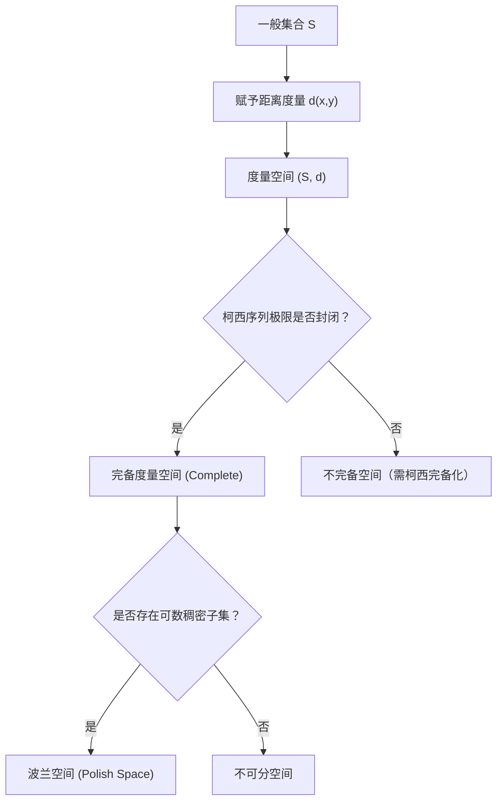

# Lec 1 度量空间拓扑、完备性与可分性 (Metric Spaces and Topology)

> MIT 15.070J 高级随机过程与离散概率 (Advanced Stochastic Processes) · 授课教师：Prof. David Gamarnik (MIT ORC)

## TL;DR

- 度量空间赋予概率样本空间与函数轨道空间公理化的距离度量结构。
- 柯西序列、完备性（Completeness）与可分性（Separability）是定义 Polish 空间的核心基石。
- 博雷尔 $\sigma$-代数（Borel $\sigma$-algebra）将连续拓扑与离散测度无缝接合，确保随机过程轨道事件可测。

## 测度与轨道的拓扑基座

在初等概率论中，随机变量通常取值于有限维欧氏空间 $\mathbb{R}^d$。然而，当我们步入高级随机过程的领域时，随机过程不再仅仅是一族孤立的标量，而是在时间轴上连续演化的随机轨道（Paths）——即样本轨道映射 $t \mapsto X_t(\omega)$ 本身就是一个函数。这类函数空间（如连续函数空间 $C[0, T]$ 或右连左极空间 $D[0, \infty)$）具有无限维的内在几何属性。

为了在这类无限维函数空间上建立严格的概率测度并研究其极限分布，我们必须退回到现代数学分析的最底层，以度量空间（Metric Spaces）的拓扑性质重构概率地基。若缺乏完备性与可分性，概率测度的扩张定理（Carathéodory 扩张定理与 Kolmogorov 扩张定理）将全面失效，许多直观的轨道事件甚至无法被证实是可测的。

::: definition [度量空间与开球拓扑 (Metric Space)]
设 $S$ 为非空集合，$d: S \times S \to [0, \infty)$ 为实值函数。若对任意 $x, y, z \in S$，满足：
1. **非退化性**：$d(x, y) = 0 \iff x = y$；
2. **对称性**：$d(x, y) = d(y, x)$；
3. **三角不等式**：$d(x, z) \le d(x, y) + d(y, z)$。
则称 $(S, d)$ 为度量空间。以开球 $B(x, r) = \{y \in S : d(x, y) < r\}$ 为拓扑基生成的拓扑 $\mathcal{T}_d$ 称为由度量 $d$ 诱导的开集拓扑。
:::

## 完备性、柯西序列与 Banach 空间

在研究随机过程极限（如弱收敛与鞅极限定理）时，我们经常需要断言某个随机函数序列是否存在极限。如果在空间内部无法通过内部“紧靠”来确定极值点，分析工具将彻底瓦解。

::: definition [柯西序列与完备空间 (Completeness)]
设 $(S, d)$ 为度量空间。序列 $\{x_n\}_{n=1}^\infty \subset S$ 被称为**柯西序列**（Cauchy Sequence），若对任意 $\epsilon > 0$，存在正整数 $N$，使得对所有 $m, n \ge N$，均有 $d(x_m, x_n) < \epsilon$。
若空间 $(S, d)$ 中的每一个柯西序列都在 $S$ 内收敛到某个极限点 $x^* \in S$，则称该度量空间具有**完备性**（Complete Metric Space）。完备的赋范线性空间被称为 **Banach 空间**。
:::

考虑区间 $[0, 1]$ 上的连续实函数空间 $C[0, 1]$。若赋予一致收敛范数（即上确界度量）：
$$
d_\infty(f, g) = \|f - g\|_\infty = \sup_{t \in [0, 1]} |f(t) - g(t)|
$$
则 $(C[0, 1], d_\infty)$ 是一个完备的度量空间。然而，若对其赋予 $L_1$ 积分度量 $d_1(f, g) = \int_0^1 |f(t) - g(t)| dt$，该空间不再完备，因为连续函数序列可以收敛到具有跳跃断点的非连续函数。

## 可分性与波兰空间 (Polish Spaces)

在随机分析中，另一个生死攸关的概念是**可分性**（Separability）。如果一个度量空间的基数过大且无法被可数集合紧密逼近，那么由开集生成的博雷尔代数将变得不可控，导致概率测度的正则性全面崩溃。

::: definition [稠密子集与可分度量空间 (Separable Space)]
设 $(S, d)$ 为度量空间。若存在一个可数子集 $D \subset S$，使得对于任意 $x \in S$ 及任意 $\epsilon > 0$，均存在 $y \in D$ 满足 $d(x, y) < \epsilon$（即 $D$ 的闭包等于 $S$），则称子集 $D$ 在 $S$ 中**稠密**（Dense），并称 $(S, d)$ 为**可分度量空间**。
一个**既完备又可分**的度量空间称为**波兰空间**（Polish Space）。
:::

::: theorem [Weierstrass 逼近定理与连续函数空间的可分性]
由带有有理数系数的代数多项式集合 $\mathbb{Q}[t]$ 在闭区间 $[0, 1]$ 上构成的函数族是可数的，且根据 Stone-Weierstrass 定理，其在一致范数 $d_\infty$ 下在 $C[0, 1]$ 中是稠密的。因此，经典连续轨道空间 $(C[0, 1], \|\cdot\|_\infty)$ 是一个波兰空间。
:::

::: pitfall 忽视不可分空间的开球可数并性质
在不可分度量空间中（例如赋予一致范数的所有有界函数空间 $\ell^\infty$），开集的并集不能化简为可数个基本开球的并。这会导致博雷尔 $\sigma$-代数严格小于柱集 $\sigma$-代数，使得最基本的概率定义产生测度漏洞。因此，现代随机分析绝大多数经典定理均建立在波兰空间之上。
:::

## 博雷尔 $\sigma$-代数与测度扩张

在度量空间 $(S, d)$ 上，我们用开集族 $\mathcal{T}$ 生成最小的 $\sigma$-代数，称为**博雷尔 $\sigma$-代数**（Borel $\sigma$-algebra），记为 $\mathcal{B}(S) = \sigma(\mathcal{T})$。

::: insight 拓扑结构是连续性与随机可测性的统一纽带
初学者常把拓扑学当做纯粹的几何抽象，而把概率测度看作纯粹的积分分析。但事实上，若没有度量诱导的开集拓扑，我们便无法定义“连续映射”；而若没有博雷尔 $\sigma$-代数，连续映射就无法保证是随机变量（可测映射）。
波兰空间之所以是高级随机过程的理想宇宙，正是因为它在确保代数分析完备（无漏洞极限）的同时，用可分性排除了病态基数灾难，使得泛函大数定律与布朗运动的存在性能够严丝合缝地成立。
:::
