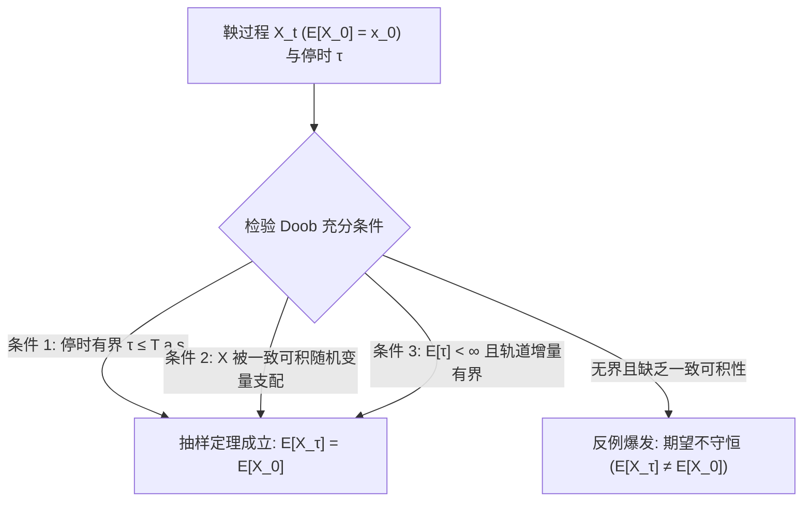

# Lec 10 鞅与停时理论 I：Doob 可选抽样定理 (Martingales and Stopping Times I: Doob's Optional Sampling)

> MIT 15.070J 高级随机过程与离散概率 (Advanced Stochastic Processes) · 授课教师：Prof. David Gamarnik (MIT ORC)

## TL;DR

- 停时将确定性时间指标升级为随样本轨道历史动态内生的随机触发时间。
- Doob 可选抽样定理严格证明了在合理一致可积或有界条件下，鞅在随机停时处期望保持不变。
- Wald 恒等式为随机步数求和与排队首达分析提供了极简代数闭式解法。

## 赌徒策略与可选停止的数学审判

古往今来的赌徒们发明了无数精巧的策略，试图通过“随机挑选离场时机”从公平赌博（鞅）甚至不利赌博（上鞅）中赚取确定性暴利。最经典的莫过于倍投法（Martingale Strategy）：输一次就将赌注加倍，只要最终赢一次就立即收手离场。

赌徒真的能通过高超的停时策略战胜数学规律吗？约瑟夫·杜布（Joseph L. Doob）在 1953 年以公理化概率论的权威，建立了概率论中最著名、最受尊崇的定理之一——**Doob 可选抽样定理**（Doob's Optional Sampling Theorem）。

## Doob 可选抽样定理 (Optional Stopping Theorem)

设 $X_t$ 为鞅，$\tau$ 为停时。一个最自然的问题是：**随机变量 $X_\tau$ 的期望值，是否依然等于初始值 $\mathbb{E}[X_0]$？**

如果对停时没有任何限制，答案显然是否定的。例如标准布朗运动 $B_0 = 0$，定义停时 $\tau = \inf\{t \ge 0: B_t = 1\}$。根据上一讲的分析，由于布朗运动的常返性，$\mathbb{P}(\tau < \infty) = 1$。如果在停时处强行停止，那么在停止时刻随机变量恒有 $B_\tau = 1$，其期望值为 $\mathbb{E}[B_\tau] = 1 \ne \mathbb{E}[B_0] = 0$！
这种佯谬的产生，是因为停时 $\tau$ 是无界的，且 $\mathbb{E}[\tau] = \infty$。

为了让期望守恒成立，必须施加合理的紧致性或可积性条件。

::: theorem [Doob 可选抽样定理 (离散与连续时间统一形式)]
设 $X = \{X_t\}_{t \ge 0}$ 为关于流 $\{\mathcal{F}_t\}$ 的一致可积鞅（Uniformly Integrable Martingale），$\sigma$ 与 $\tau$ 为两个停时，且几乎必然满足 $\sigma \le \tau$。
则停止后的随机变量 $X_\sigma$ 与 $X_\tau$ 均几乎处处可积，且满足：
$$
\mathbb{E}[X_\tau | \mathcal{F}_\sigma] = X_\sigma, \quad \text{a.s.}
$$
特别地，取 $\sigma = 0$，恒有：
$$
\mathbb{E}[X_\tau] = \mathbb{E}[X_0]
$$
若 $X$ 仅仅是普通鞅（未假定一致可积），则在以下任意一组充分条件下，结论 $\mathbb{E}[X_\tau] = \mathbb{E}[X_0]$ 依然严格成立：
1. **有界停时**：存在确定性常数 $T < \infty$，使得 $\mathbb{P}(\tau \le T) = 1$；
2. **有界轨道与有限平均停时**：$\mathbb{E}[\tau] < \infty$，且存在常数 $C$，使得对所有 $t \le \tau$，增量满足 $|X_{t \wedge \tau}| \le C$；
3. **有界增量**：$\mathbb{E}[\tau] < \infty$，且存在常数 $K$，使得 $\mathbb{E}[|X_{t+1} - X_t| | \mathcal{F}_t] \le K$。
:::

## 赌徒输光问题与双边吸收壁

考虑标准布朗运动 $B_t$，初始位于 $0$。设有两个吸收壁：下壁 $-b < 0$ 与上壁 $a > 0$。定义首次触壁时间：
$$
\tau = \inf\{t \ge 0 : B_t = a \text{ 或 } B_t = -b\}
$$
由于 $B_{t \wedge \tau}$ 被严格约束在闭区间 $[-b, a]$ 之内，轨道是有界的，Doob 可选抽样定理条件 2 完美满足！

由定理：
$$
\mathbb{E}[B_\tau] = \mathbb{E}[B_0] = 0
$$
由于轨道连续，在停止时刻 $B_\tau$ 只能取值 $a$ 或 $-b$。设触碰上壁的概率为 $p = \mathbb{P}(B_\tau = a)$，触碰下壁的概率为 $1 - p$：
$$
\mathbb{E}[B_\tau] = a \cdot p + (-b) \cdot (1 - p) = 0
$$
解此一元一次方程，瞬间得出击中上壁的无偏概率：
$$
p = \frac{b}{a + b}
$$

再利用二次鞅 $Y_t = B_t^2 - t$。由可选抽样定理：
$$
\mathbb{E}[B_\tau^2 - \tau] = \mathbb{E}[B_0^2 - 0] = 0 \implies \mathbb{E}[\tau] = \mathbb{E}[B_\tau^2]
$$
代入 $B_\tau$ 的分布：
$$
\mathbb{E}[\tau] = a^2 \cdot p + (-b)^2 \cdot (1 - p) = a^2 \left(\frac{b}{a+b}\right) + b^2 \left(\frac{a}{a+b}\right) = \frac{a b (a + b)}{a + b} = a b
$$
平均吸收时间极其优美地等于两壁间距的乘积 $a b$！

## 瓦尔德恒等式 (Wald's Identity)

在排队论与随机更新过程中，常常需要计算随机项数求和的期望。设 $X_1, X_2, \dots$ 独立同分布，期望为 $\mu$。设 $N$ 为适应于该序列流的非负整数停时，且 $\mathbb{E}[N] < \infty$。

::: theorem [Wald 第一恒等式]
随机和 $S_N = \sum_{i=1}^N X_i$ 的期望满足：
$$
\mathbb{E}\left[\sum_{i=1}^N X_i\right] = \mathbb{E}[N] \cdot \mathbb{E}[X_1]
$$
:::

若进一步假设 $\text{Var}(X_1) = \sigma^2 < \infty$：

::: theorem [Wald 第二恒等式]
$$
\mathbb{E}\left[(S_N - N \mu)^2\right] = \sigma^2 \mathbb{E}[N]
$$
:::

::: pitfall 误将非停时随机变量套用 Wald 公式
Wald 恒等式要求指标 $N$ 必须是**停时**（即决定是否在 $N=n$ 停止只能依赖于前 $n$ 步的历史信息）。如果允许“窥探未来”（例如定义 $N = \arg\max_{1 \le i \le 10} X_i$），$N$ 不再是停时，Wald 恒等式将彻底失效。
:::

::: insight 抽样定理是对投机心理的终极封杀
从数学哲学的维度来看，Doob 可选抽样定理是一座不可逾越的理性丰碑：**在任何一个没有真实价值增量创造的零和博弈中，无论你设计出多么复杂的动态对冲、止盈止损线或离场算法，这些精妙的停时策略都无法将系统的期望收益提升哪怕一个微元**。
真正的增量只能来自非鞅系统的漂移项（Drift），而不是对波动的自欺欺人。
:::
