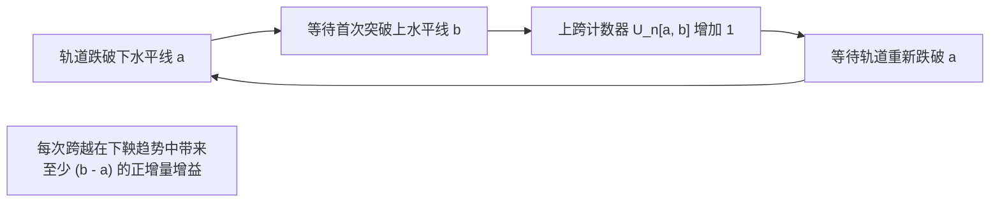

# Lec 11 鞅与停时理论 II：收敛定理与 Doob 极大值不等式 (Martingales and Stopping Times II: Convergence and Maximal Inequalities)

> MIT 15.070J 高级随机过程与离散概率 (Advanced Stochastic Processes) · 授课教师：Prof. David Gamarnik (MIT ORC)

## TL;DR

- Doob 上跨不等式（Upcrossing Inequality）是证明下鞅几乎必然收敛的核心分析利器。
- 一致可积下鞅与 $L^1$ 有界下鞅拥有几乎必然极限，架起了无穷远端 $\mathcal{F}_\infty$ 的桥梁。
- Doob 极大值不等式控制了轨道全区间上确界的 $L^p$ 范数，是随机分析中最强大的定常估计工具。

## 鞅在时间无穷远处的极限命运

一个随时间不断向前演化的鞅过程 $X_t$，当时间走向无穷大（$t \to \infty$）时，是否会像很多发散震荡的函数一样陷入混乱的混沌？还是会收敛到一个明确的极限随机变量 $X_\infty$？

在确定性分析中，判定函数序列收敛通常需要逐点验证柯西准则。但在随机过程中，轨道的每一个样本点都在随机漫游。约瑟夫·杜布通过极其精巧的组合计数——**上跨数**（Upcrossings），建立了近代概率论中最震撼的收敛理论。

## Doob 上跨不等式 (Doob's Upcrossing Inequality)

设 $[a, b]$ 为实数轴上的任意闭区间（$a < b$）。对于离散时间随机过程 $X_0, X_1, \dots, X_n$，我们记录轨道自下而上穿过该区间的次数：
每一次轨道从低于 $a$ 的水平跨越到高于 $b$ 的水平，称为一次**上跨**（Upcrossing）。
记 $U_n[a, b]$ 为在 $0 \le k \le n$ 步内完成的上跨总次数。

::: theorem [Doob 上跨引理 (Upcrossing Lemma)]
设 $X = \{X_k\}_{k=0}^n$ 为下鞅。则对于任意实数 $a < b$：
$$
(b - a) \mathbb{E}[U_n[a, b]] \le \mathbb{E}[(X_n - a)^+] - \mathbb{E}[(X_0 - a)^+] \le \mathbb{E}[(X_n - a)^+]
$$
由此得出上跨期望次数的核心上界：
$$
\mathbb{E}[U_n[a, b]] \le \frac{\mathbb{E}[(X_n - a)^+]}{b - a} \le \frac{\mathbb{E}[|X_n|] + |a|}{b - a}
$$
:::

### 上跨引理的经济与博弈论直觉
证明的核心极其通俗：在下鞅博弈中，赌徒采取“在跌破 $a$ 时买入 1 单位资产，在突破 $b$ 时卖出平仓”的策略。每一次成功的上跨都稳定锁定至少 $(b - a)$ 的利润。由于下鞅本身的期望增量有限，总套利利润的期望不可能无限膨胀，因此上跨的期望次数必然被终点值 $\mathbb{E}[|X_n|]$ 所封顶！

## Doob 几乎必然收敛定理

::: theorem [Doob 下鞅几乎必然收敛定理 (Martingale Convergence Theorem)]
设 $X = \{X_n\}_{n \ge 0}$ 为下鞅，且满足 $L^1$ 一致有界性：
$$
\sup_{n \ge 0} \mathbb{E}[|X_n|] < \infty
$$
则存在一个几乎处处有限的随机变量 $X_\infty$（满足 $\mathbb{E}[|X_\infty|] < \infty$），使得当 $n \to \infty$ 时：
$$
X_n \xrightarrow{\text{a.s.}} X_\infty
$$
:::

**证明机制的分析之美**：
如果序列 $X_n(\omega)$ 不收敛，意味着其下极限与上极限不相等：$\liminf X_n(\omega) < \limsup X_n(\omega)$。
那么在它们之间必然可以插入一对有理数 $a, b \in \mathbb{Q}$，使得该轨道在 $a$ 与 $b$ 之间发生**无穷多次振荡上跨**（即 $U_\infty[a, b] = \infty$）。
然而，根据上跨不等式与单调收敛定理：
$$
\mathbb{E}[U_\infty[a, b]] = \lim_{n \to \infty} \mathbb{E}[U_n[a, b]] \le \frac{\sup_n \mathbb{E}[|X_n|] + |a|}{b - a} < \infty
$$
这说明无穷多次上跨的事件概率必须为 0！由于有理数对 $\mathbb{Q} \times \mathbb{Q}$ 是可数的，可数个零测度集的并集依旧是零测度集。因此不收敛轨道的概率测度严格为 0，几乎必然收敛定理彻底获证！

## Doob 极大值不等式与 $L^p$ 极大不等式

在分析连续轨道与极值界时，单纯知道终点分布是不够的，我们需要控制整个时间区间内轨道的**运行最大值**（Running Maximum）：
$$
X_t^* = \sup_{0 \le s \le t} |X_s|
$$

::: theorem [Doob 极大值弱型不等式]
设 $X$ 为非负下鞅或任意鞅。对任意 $\lambda > 0$ 及 $t \ge 0$：
$$
\lambda \mathbb{P}\left(\sup_{0 \le s \le t} X_s \ge \lambda\right) \le \mathbb{E}[X_t \mathbf{1}_{\{\sup_{s \le t} X_s \ge \lambda\}}] \le \mathbb{E}[X_t]
$$
:::

::: theorem [Doob $L^p$ 极大不等式 (Doob's $L^p$ Inequality)]
设 $p > 1$。若 $X$ 是鞅且满足 $\mathbb{E}[|X_t|^p] < \infty$，则其运行最大值的 $L^p$ 范数被终点值的 $L^p$ 范数严格控制：
$$
\left\|\sup_{0 \le s \le t} |X_s|\right\|_{L^p} \le \frac{p}{p - 1} \|X_t\|_{L^p}
$$
即：
$$
\mathbb{E}\left[\left(\sup_{0 \le s \le t} |X_s|\right)^p\right] \le \left(\frac{p}{p - 1}\right)^p \mathbb{E}[|X_t|^p]
$$
:::

特别地，对于 $p = 2$，前置常数 $\left(\frac{2}{2-1}\right)^2 = 4$。这意味着整个区间最大值的平方期望，绝不会超过终点值平方期望的 4 倍！

::: pitfall p = 1 时 Doob 极大不等式失效
注意 Doob $L^p$ 不等式中的常数 $\frac{p}{p-1}$ 当 $p \to 1^+$ 时趋于无穷大。在 $p = 1$ 时该不等式不成立（极大值的 $L^1$ 范数一般不能由终点的 $L^1$ 范数控制，除非满足 $L \log^+ L$ 可积性条件）。
:::

::: insight 上确界控制与随机微分方程的稳定性
在偏微分方程中，控制梯度的极大值往往需要繁重的 Sobolev 嵌入定理。
而在随机分析中，Doob $L^p$ 极大不等式宛如一把锋利的几何钥匙：**它将整条随机路径在连续时间区间上不可数个点可能爆发的最大震荡，轻而易举地约束在终点单个截面时刻的代数范数之内**。后续证明伊藤积分存在性与随机微分方程解的唯一性时，这一不等式是贯穿始终的第一支柱。
:::
