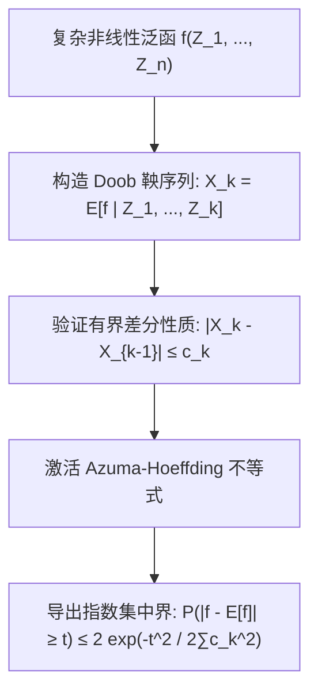

# Lec 12 鞅集中不等式与 Azuma-Hoeffding 极限界 (Martingale Concentration Inequalities)

> MIT 15.070J 高级随机过程与离散概率 (Advanced Stochastic Processes) · 授课教师：Prof. David Gamarnik (MIT ORC)

## TL;DR

- Azuma-Hoeffding 不等式将经典 Hoeffding 集中界从独立变量扩展至有界差分鞅差序列。
- Doob 鞅构造法（Doob Martingale Process）将任意复杂高维泛函转化为逐步信息展开鞅。
- McDiarmid 有界差分不等式为随机图色数、组合优化目标提供了亚高斯指数集中保证。

## 从独立性到鞅差依赖的集中革命

经典的 Hoeffding 不等式与 Chernoff 界为独立同分布随机变量的和提供了指数级的尾部集中保证。然而，在现代计算机算法分析、组合图论、统计物理与机器学习泛化界证明中，我们关心的随机目标函数往往是极其复杂的**非线性整体泛函**（例如随机图的团数、旅行商问题的最短巡回路径长度、深度神经网络在测试集上的经验风险）。

这些函数无法直接拆解为独立变量的简单相加。面对这种复杂的全局变量，概率学家通过构建 **Doob 鞅展开**，并结合 **Azuma-Hoeffding 集中不等式**，彻底化解了非线性依赖的困境。

## 鞅差序列与 Azuma-Hoeffding 不等式

::: definition [鞅差序列 (Martingale Difference Sequence, MDS)]
适应于流 $\{\mathcal{F}_n\}$ 的可积过程序列 $\{D_n\}_{n=1}^\infty$ 称为**鞅差序列**，若对所有 $n \ge 1$ 均满足：
$$
\mathbb{E}[D_n | \mathcal{F}_{n-1}] = 0, \quad \text{a.s.}
$$
若设 $X_n = X_0 + \sum_{k=1}^n D_k$，则 $X_n$ 构成一个标准的离散鞅。
:::

::: theorem [Azuma-Hoeffding 不等式 (Azuma, 1967; Hoeffding, 1963)]
设 $X = \{X_n\}_{n=0}^N$ 为关于流 $\{\mathcal{F}_n\}$ 的鞅，且其步长增量满足几乎必然有界性：
$$
|X_n - X_{n-1}| \le c_n, \quad \text{a.s.} \quad \forall 1 \le n \le N
$$
其中 $c_n > 0$ 为确定性常数。
则对于任意 $t > 0$，其尾部偏离满足亚高斯（Sub-Gaussian）指数集中界：
$$
\mathbb{P}(X_N - X_0 \ge t) \le \exp\left(-\frac{t^2}{2 \sum_{n=1}^N c_n^2}\right)
$$
双边对称形式为：
$$
\mathbb{P}(|X_N - X_0| \ge t) \le 2 \exp\left(-\frac{t^2}{2 \sum_{n=1}^N c_n^2}\right)
$$
:::

### 核心引理：条件 Hoeffding 引理
证明 Azuma 不等式的核心在于证明以下指数矩母函数局部界：
若零均值随机变量 $Z$ 满足 $A \le Z \le B$ a.s.，则对于任意 $\theta \in \mathbb{R}$：
$$
\mathbb{E}[e^{\theta Z}] \le \exp\left(\frac{\theta^2 (B - A)^2}{8}\right)
$$
由于条件期望下 $\mathbb{E}[D_n | \mathcal{F}_{n-1}] = 0$ 且 $-c_n \le D_n \le c_n$，区间宽度为 $2 c_n$，因此：
$$
\mathbb{E}[e^{\theta D_n} | \mathcal{F}_{n-1}] \le \exp\left(\frac{\theta^2 (2c_n)^2}{8}\right) = \exp\left(\frac{\theta^2 c_n^2}{2}\right)
$$
利用重期望法则，递归相乘即可得出全局 MGF 上界，再应用 Chernoff 优化即完成证明！

## Doob 鞅方法与 McDiarmid 有界差分定理

如何将 Azuma 不等式应用到一般的非线性多元函数 $f(Z_1, Z_2, \dots, Z_n)$ 上？

设 $Z_1, \dots, Z_n$ 为相互独立的随机变量，取值于空间 $\mathcal{Z}$。
定义由逐次揭露信息构成的 **Doob 鞅过程**：
$$
X_k = \mathbb{E}[f(Z_1, \dots, Z_n) | Z_1, \dots, Z_k], \quad k = 0, 1, \dots, n
$$
显然：
- 当 $k = 0$ 时，没有任何变量被揭示：$X_0 = \mathbb{E}[f(Z_1, \dots, Z_n)]$ 是常数期望；
- 当 $k = n$ 时，全部变量被揭示：$X_n = f(Z_1, \dots, Z_n)$ 是最终的目标真实值！

::: theorem [McDiarmid 有界差分不等式 (McDiarmid, 1989)]
设独立随机变量 $Z_1, \dots, Z_n$，函数 $f: \mathcal{Z}^n \to \mathbb{R}$ 满足**有界差分条件**（Bounded Differences Condition）：若对任意指标 $k \in \{1, \dots, n\}$，改变第 $k$ 个坐标的值最多使函数值变动 $c_k$：
$$
\sup_{z_1, \dots, z_n, z_k'} |f(z_1, \dots, z_k, \dots, z_n) - f(z_1, \dots, z_k', \dots, z_n)| \le c_k
$$
则对于任意 $t > 0$：
$$
\mathbb{P}(|f(Z_1, \dots, Z_n) - \mathbb{E}[f]| \ge t) \le 2 \exp\left(-\frac{2 t^2}{\sum_{k=1}^n c_k^2}\right)
$$
:::

## 经典应用：Erdős-Rényi 随机图的色数集中

考虑随机图 $G(n, p)$，在 $n$ 个顶点之间，每一对边以独立概率 $p$ 存在。设 $\chi(G)$ 为图的**色数**（Chromatic Number，即给顶点染色使得任意相邻顶点颜色不同所需的最小颜色数）。

求 $\chi(G)$ 是强 NP-hard 问题，其分布极其复杂。然而，改变单个顶点的连边状态，色数 $\chi(G)$ 最多改变 1（即 $c_k = 1$）。
定义以顶点为单步揭示历史的 Doob 鞅：
$$
\sum_{k=1}^n c_k^2 = n \cdot 1^2 = n
$$
直接代入 McDiarmid 不等式：
$$
\mathbb{P}(|\chi(G) - \mathbb{E}[\chi(G)]| \ge t \sqrt{n}) \le 2 e^{-2 t^2}
$$
这证明了一个震惊世界组合数学界的结论：**无论图的结构多么复杂，随机图的色数几乎严格浓缩在一个宽度仅为 $\mathcal{O}(\sqrt{n})$ 的极窄区间之内！**

::: insight 信息逐级揭示的滤波美学
Doob 鞅构造展示了一种无与伦比的思想美：面对看似浑然一体、难以解析的全局函数，我们无需强行解开其内部结构，只需像摄像机镜头拉焦一样，**一步一步揭露一个输入维度的局部信息**。
每一步带来的条件期望跳跃幅度，自然刻画了该维度对全局的不确定性贡献。只要没有任何单一维度能对系统产生灾难性的颠覆（有界差分），大系统在宏观上就必然像高斯分布一样坚不可摧地凝聚在期望周围。
:::
