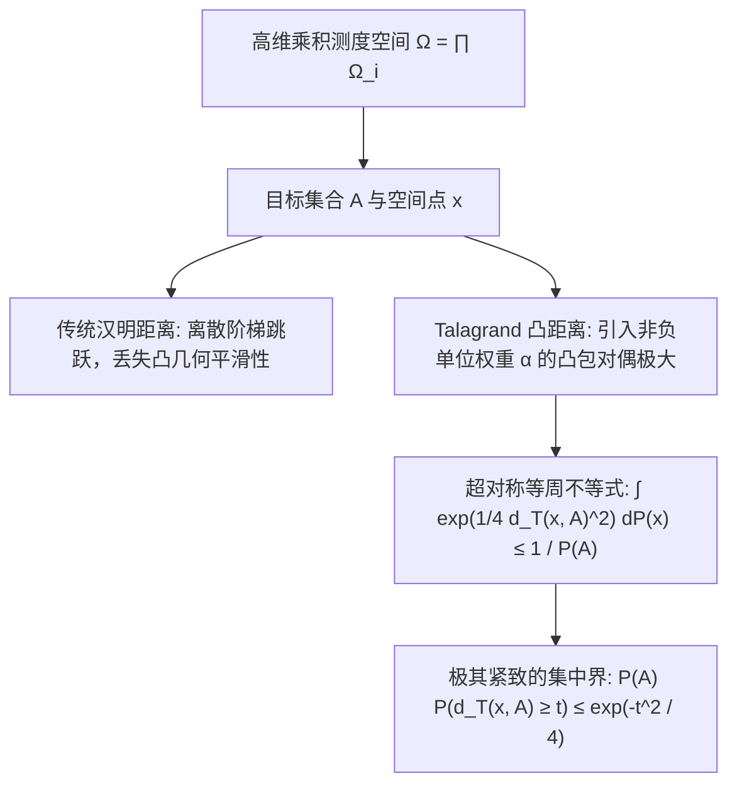

# Lec 13 Talagrand 凸距离不等式与高维几何集中 (Talagrand's Concentration Inequality)

> MIT 15.070J 高级随机过程与离散概率 (Advanced Stochastic Processes) · 授课教师：Prof. David Gamarnik (MIT ORC)

## TL;DR

- Talagrand 凸距离不等式在高维乘积测度下超越了传统汉明距离与 McDiarmid 界。
- 引入凸包距离（Convex Distance）巧妙吸收局部重排列与稀疏支集带来的大扰动。
- 在最长递增子序列（LISS）与随机仓储组合优化中展现了更紧致的次高斯集中。

## 突破有界差分的瓶颈

在上一讲中，McDiarmid 不等式要求函数满足统一的最坏情况有界差分条件：
$$
\sup |f(z) - f(z')| \le c_k
$$
然而，在许多极具代表性的运筹学与概率组合问题中，**最坏情况的跳跃可能非常大，但在绝大多数典型情境下，改变一个输入坐标对函数值的影响极其微弱**。

最经典的例子是随机排列的最长递增子序列（Longest Increasing Subsequence, LIS）问题：
设 $X_1, \dots, X_n$ 为区间 $[0, 1]$ 上的独立均匀采样点。记 $L_n$ 为其最长递增子序列的长度。
如果最坏情况下改变一个点，最坏差分界只能写出 $c_k = 1$，此时 $\sum_{k=1}^n c_k^2 = n$。McDiarmid 只能给出 $\mathbb{P}(|L_n - \mathbb{E}[L_n]| \ge t) \le 2 e^{-2t^2 / n}$，这只能保证波动尺度在 $\mathcal{O}(\sqrt{n})$ 级别。
但事实上，著名的 Baik-Deift-Johansson 定理（结合 Tracy-Widom 分布）指出，真正的波动尺度其实是在 $\mathcal{O}(n^{1/6})$ 甚至 $\mathcal{O}(n^{1/4})$ 这一小得多的阶数！

法国数学家米歇尔·塔拉格兰（Michel Talagrand，2024年阿贝尔奖得主）在 1990 年代建立了现代概率几何最顶峰的成就——**Talagrand 凸距离不等式**。

## 凸距离定义与几何投影

设 $\Omega = \prod_{i=1}^n \Omega_i$ 为乘积概率空间，赋予乘积测度 $\mathbb{P} = \bigotimes_{i=1}^n \mu_i$。
对于空间中的点 $x = (x_1, \dots, x_n)$ 和子集 $A \subset \Omega$，传统汉明距离只统计不匹配的坐标个数：$d_H(x, A) = \min_{y \in A} \sum_{i=1}^n \mathbf{1}_{\{x_i \ne y_i\}}$。

Talagrand 提出了革命性的**加权凸凸包距离**：

::: definition [Talagrand 凸距离 (Talagrand Convex Distance)]
对于向量 $\alpha \in \mathbb{R}^n$ 且 $\|\alpha\|_2 = 1$，定义加权汉明距离：
$$
d_\alpha(x, A) = \inf_{y \in A} \sum_{i=1}^n \alpha_i \mathbf{1}_{\{x_i \ne y_i\}}
$$
定义点 $x$ 到集合 $A$ 的 **Talagrand 凸距离** $d_T(x, A)$ 为：
$$
d_T(x, A) = \sup_{\|\alpha\|_2 = 1, \alpha \ge 0} d_\alpha(x, A)
$$
几何上，$d_T(x, A)$ 等价于从原点到由向量集合 $V_A(x) = \{\mathbf{1}_{\{x \ne y\}} : y \in A\}$ 的凸闭包之间的欧氏距离！
:::

## Talagrand 凸距离不等式定理

::: theorem [Talagrand 凸距离不等式 (Talagrand, 1995)]
设 $\mathbb{P}$ 为乘积概率空间 $\Omega = \prod_{i=1}^n \Omega_i$ 上的任意乘积概率测度。对于任意非空博雷尔可测子集 $A \subset \Omega$，均满足：
$$
\int_\Omega \exp\left(\frac{1}{4} d_T(x, A)^2\right) d\mathbb{P}(x) \le \frac{1}{\mathbb{P}(A)}
$$
由此立即推导出经典的双边集中尾部不等式：对于任意 $t > 0$：
$$
\mathbb{P}(A) \cdot \mathbb{P}(x : d_T(x, A) \ge t) \le \exp\left(-\frac{t^2}{4}\right)
$$
若取 $A = \{x : f(x) \le M\}$（其中 $M$ 为中位数），则只要 $f(x)$ 满足关于凸距离的 Lipschitz 条件，系统将展现出极致的指数集中。
:::

## 具有自证明证书的组合泛函集中

Talagrand 不等式对于一类具有**紧致可验证凭证**（Certificates）的优化问题具有无与伦比的杀伤力。

::: definition [可配置与自证明函数]
称泛函 $f: \Omega \to \mathbb{R}$ 具有常数 $a > 0$ 的证书性质，若对任意满足 $f(x) \ge k$ 的点 $x$，存在一个大小不超过 $a \cdot k$ 的坐标索引子集 $I \subset \{1, \dots, n\}$，使得只要任意点 $y$ 在这些指标上与 $x$ 一致（即 $y_i = x_i, \forall i \in I$），就必然有 $f(y) \ge k$。
:::

::: example [最长递增子序列的次高斯集中]
对于最长递增子序列 $L_n(X)$，若 $L_n(x) = k$，则其自身就是一张完美的证书！只需保留构成这 $k$ 个递增子序列的坐标索引（数量恰好为 $k$），任何在这个子集上与 $x$ 相同的序列 $y$，其最长递增子序列长度至少也为 $k$。
利用 Talagrand 不等式，可以严格证明：
$$
\mathbb{P}(|L_n - \text{Med}(L_n)| \ge t) \le 4 \exp\left(-\frac{t^2}{4 \text{Med}(L_n)}\right)
$$
由于已知 $\text{Med}(L_n) \approx 2 \sqrt{n}$，分母不再是 McDiarmid 中的 $n$，而是急剧收缩至 $\sqrt{n}$！
这意味着 $L_n$ 的离散波动尺度严格落在：
$$
t \sim \mathcal{O}(n^{1/4})
$$
这一界比经典鞅方法紧凑了整整一个阶数！
:::

::: insight 从离散组合到连续凸分析的高阶跨越
Talagrand 凸距离不等式代表了 20 世纪下半叶数学中最具穿透力的思想飞跃之一：**高维空间之所以产生强烈的测度集中，根源不是独立的代数运算法则，而是高维几何中凸体表面积相对体积的极端萎缩（等周性质，Isoperimetry）**。
通过在离散坐标之间构建“虚拟连续凸包”，Talagrand 抹平了离散组合扰动的剧烈断崖，使得分析学家能够用连续微积分的优美工具，精准捕获高维组合系统的微观涨落。
:::
