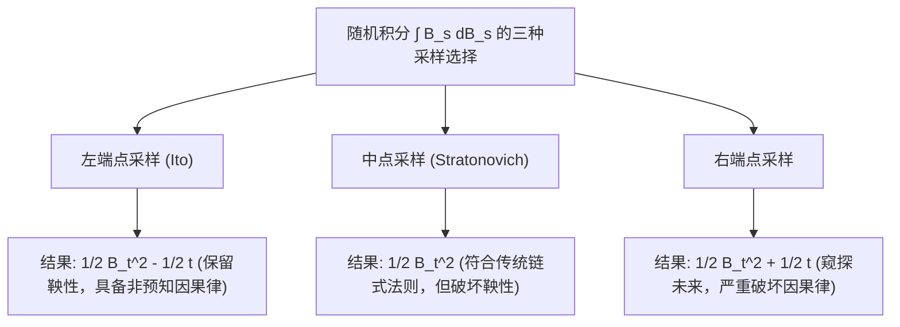

# Lec 14 伊藤微积分启航：非预知过程与随机微分基础 (Introduction to Ito Calculus)

> MIT 15.070J 高级随机过程与离散概率 (Advanced Stochastic Processes) · 授课教师：Prof. David Gamarnik (MIT ORC)

## TL;DR

- 经典微积分在面对布朗运动无界全变差与处处不可微性时全面崩溃。
- 伊藤积分通过严格限制采样点在区间左端点（非预知性 Non-anticipating）捍卫了鞅性。
- 伊藤-等距性质（Ito Isometry）将空间积分的均方范数转化为确定性时间积分。

## 经典积分体系在布朗运动前的崩溃

在微积分的发展史上，为了给形如：
$$
I(t) = \int_0^t H_s dB_s
$$
的表达式赋予严格的数学含义，人类历经了近半个世纪的数学危机。

在牛顿-莱布尼茨理论与黎曼-斯蒂尔杰斯积分中，积分和定义为：
$$
S(\Pi) = \sum_{i=1}^n H(\tau_i) (B_{t_i} - B_{t_{i-1}})
$$
其中采样点 $\tau_i$ 可以在子区间 $[t_{i-1}, t_i]$ 内任意选取（如左端点、中点或右端点）。只要被积路径或者导引路径具有良好的光滑性，当分割模长趋于 0 时，无论选取哪个点，极限都唯一存在且相等。

然而在第 8 讲中，我们已经证明了标准布朗运动轨道具有**严格正的二次变差** $[B, B]_t = t$ 且**全变差无穷发散**。
这一事实导致了一个灾难性的后果：**采样点 $\tau_i$ 在小区间内的微小位置差异，将在宏观积分极限中产生完全不可忽略的确定性系统漂移偏差！**

## 采样点位置决定的命运分叉

让我们考察最简单的积分：计算 $\int_0^t B_s dB_s$。

设区间 $[0, t]$ 的均等分割为 $t_i = i \frac{t}{n}$。我们考察三种不同的采样策略：

### 1. 左端点采样：$\tau_i = t_{i-1}$（伊藤积分 Ito Integral）
$$
S_{\text{Ito}} = \sum_{i=1}^n B_{t_{i-1}} (B_{t_i} - B_{t_{i-1}})
$$
利用恒等式 $a(b - a) = \frac{1}{2}(b^2 - a^2) - \frac{1}{2}(b - a)^2$：
$$
S_{\text{Ito}} = \frac{1}{2} \sum_{i=1}^n (B_{t_i}^2 - B_{t_{i-1}}^2) - \frac{1}{2} \sum_{i=1}^n (B_{t_i} - B_{t_{i-1}})^2 = \frac{1}{2}(B_t^2 - B_0^2) - \frac{1}{2} V^{(2)}(\Pi_n)
$$
当 $n \to \infty$ 时，二次变差 $V^{(2)}(\Pi_n) \to t$！因此：
$$
\int_0^t B_s dB_s = \frac{1}{2} B_t^2 - \frac{1}{2} t
$$

### 2. 中点采样：$\tau_i = \frac{t_{i-1} + t_i}{2}$（斯特拉托诺维奇积分 Stratonovich Integral）
代入中点值展开，二次变差项相互抵消，极限为：
$$
\int_0^t B_s \circ dB_s = \frac{1}{2} B_t^2
$$

### 3. 右端点采样：$\tau_i = t_i$
$$
S_{\text{Right}} = \sum_{i=1}^n B_{t_i} (B_{t_i} - B_{t_{i-1}}) = \frac{1}{2}(B_t^2 - B_0^2) + \frac{1}{2} V^{(2)}(\Pi_n) \to \frac{1}{2} B_t^2 + \frac{1}{2} t
$$

同一道积分，左端点、中点与右端点的计算结果竟然分别相差 $\frac{1}{2}t$ 与 $t$！这在经典微积分中是绝对不可思议的。

## 为何日本数学家伊藤清（Kiyosi Itô）坚决选择左端点？

面对这一分叉，日本数学家伊藤清在 1944 年做出了影响整个现代应用数学的伟大决断：**必须死死守住左端点！**

其背后的物理与现实原因具有绝对的压倒性：**因果律与非预知性（Non-anticipating Property）**。
在现实决策、金融交易与物理反馈控制中，我们在时刻 $t_{i-1}$ 决定持仓量或控制输入 $H(t_{i-1})$ 时，我们**只能使用已经发生的信息** $\mathcal{F}_{t_{i-1}}$，绝不可能穿越到区间内部 $\tau_i \in (t_{i-1}, t_i]$ 提前预知未来的布朗增量！

::: definition [循序可测过程 (Progressively Measurable Process)]
设 $(\Omega, \mathcal{F}, \{\mathcal{F}_t\}_{t \ge 0}, \mathbb{P})$ 为滤过概率空间。过程 $H = \{H_t\}_{t \ge 0}$ 称为**非预知或循序可测的**（Non-anticipating / Progressively Measurable），若对每个 $t \ge 0$，映射：
$$
[0, t] \times \Omega \to \mathbb{R}, \quad (s, \omega) \mapsto H_s(\omega)
$$
关于乘积 $\sigma$-代数 $\mathcal{B}([0, t]) \otimes \mathcal{F}_t$ 是可测的。
:::

## 伊藤积分的核心性质：鞅性与伊藤等距 (Ito Isometry)

选择左端点带来的最大数学红利，是彻底继承了概率论最核心的皇家血统——**鞅性**。

由于 $H_{t_{i-1}}$ 是 $\mathcal{F}_{t_{i-1}}$-可测的，而未来的增量 $\Delta B_i = B_{t_i} - B_{t_{i-1}}$ 独立于 $\mathcal{F}_{t_{i-1}}$ 且期望为 0：
$$
\mathbb{E}[H_{t_{i-1}} (B_{t_i} - B_{t_{i-1}}) | \mathcal{F}_{t_{i-1}}] = H_{t_{i-1}} \mathbb{E}[B_{t_i} - B_{t_{i-1}} | \mathcal{F}_{t_{i-1}}] = H_{t_{i-1}} \cdot 0 = 0
$$
这意味着：**伊藤积分过程 $I_t = \int_0^t H_s dB_s$ 是一个零期望的严格鞅！**

::: theorem [伊藤等距定理 (Ito Isometry)]
设 $H \in \mathcal{H}^2$，即 $H$ 是循序可测过程且满足 $\mathbb{E}\left[\int_0^t H_s^2 ds\right] < \infty$。
则随机伊藤积分的二阶矩，严格等于被积过程平方的时间积分：
$$
\mathbb{E}\left[\left(\int_0^t H_s dB_s\right)^2\right] = \mathbb{E}\left[\int_0^t H_s^2 ds\right]
$$
:::

::: insight 左端点选择是因果律在微积分中的法印
斯特拉托诺维奇（Stratonovich）积分保留了普通微积分的微积分形式（复合求导无需修正项），在微分几何与黎曼流形动力学中广受青睐；
但伊藤积分是**整个量化金融、随机最优控制与机器学习扩散模型（Diffusion Models）的唯一真神**。
因为物理现实永远受制于单向流淌的时间之箭。伊藤清对左端点的顽强坚守，本质上是在数学的象牙塔中，为“因果律绝不可倒流”这一宇宙铁律立下的永恒法印。
:::
