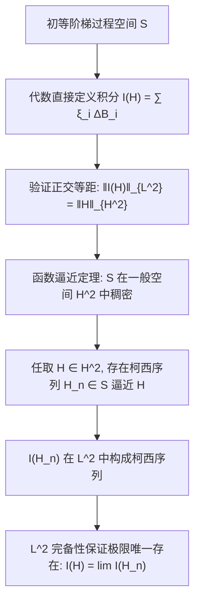

# Lec 15 初等过程的伊藤积分构造与 L2 完备化 (Ito Integral for Simple Processes)

> MIT 15.070J 高级随机过程与离散概率 (Advanced Stochastic Processes) · 授课教师：Prof. David Gamarnik (MIT ORC)

## TL;DR

- 伊藤积分通过初等分段阶梯过程（Simple Processes）奠定离散有限和定义基准。
- 在初等过程类上证明无偏鞅性 $\mathbb{E}[I_t] = 0$ 与正交等距 $\mathbb{E}[I_t^2] = \mathbb{E}[\int_0^t H_s^2 ds]$。
- 利用 Hilbert 空间稠密性与柯西完备化，将伊藤积分严格延拓至全体循序可测平方可积过程空间。

## 从阶梯逼近到抽象积分

与勒贝格积分的经典构造策略完全一致，要在一族高度复杂的随机过程上建立积分：
$$
I(H) = \int_0^T H_t dB_t
$$
严谨的数学路径绝不是直接强行求和，而是**两步走战略**：
1. 先定义一类最简单的、无需极限即可直接计算的**初等阶梯过程**（Simple/Elementary Processes），在其上验证全部优良代数与等距性质；
2. 证明这族初等过程在平方可积函数空间中是稠密的，再利用柯西完备化将积分映射以等距同构（Isometry）的方式唯一延拓到整个抽象 Hilbert 空间。

## 初等过程的代数定义

设固定时间上限 $T < \infty$。记 $\mathcal{H}^2[0, T]$ 为定义在滤过概率空间 $(\Omega, \mathcal{F}, \{\mathcal{F}_t\}_{t \in [0, T]}, \mathbb{P})$ 上、满足循序可测且平方可积的随机过程集合，赋予 Hilbert 范数：
$$
\|H\|_{\mathcal{H}^2} = \left(\mathbb{E}\left[\int_0^T H_t^2 dt\right]\right)^{1/2} < \infty
$$

::: definition [初等过程 (Simple / Elementary Process)]
过程 $H \in \mathcal{H}^2[0, T]$ 称为**初等过程**（记为 $H \in \mathcal{S}$），若存在确定性时间分割 $0 = t_0 < t_1 < \dots < t_n = T$，以及一族关于 $\mathcal{F}_{t_{i-1}}$ 可测且 $\mathbb{E}[\xi_i^2] < \infty$ 的随机变量 $\xi_i$，使得 $H$ 具有有限分段阶梯结构：
$$
H_t(\omega) = \sum_{i=1}^n \xi_i(\omega) \mathbf{1}_{(t_{i-1}, t_i]}(t)
$$
:::

对这类最简单的过程，其随机积分无需任何极限，直接定义为有限项代数相乘求和：

::: definition [初等过程的伊藤积分]
对于初等过程 $H \in \mathcal{S}$，其关于布朗运动 $B_t$ 的伊藤积分定义为：
$$
I(H) = \int_0^T H_t dB_t = \sum_{i=1}^n \xi_i (B_{t_i} - B_{t_{i-1}})
$$
相应地，截止到任意时刻 $t \in [0, T]$ 的积分过程定义为 $I_t(H) = \int_0^T H_s \mathbf{1}_{[0, t]}(s) dB_s$。
:::

## 核心等距与鞅性的代数验证

::: theorem [初等伊藤积分的基本性质]
对于任意初等过程 $H, G \in \mathcal{S}$ 及常数 $\alpha, \beta \in \mathbb{R}$：
1. **线性性**：$I(\alpha H + \beta G) = \alpha I(H) + \beta I(G)$；
2. **零均值无偏性**：$\mathbb{E}[I_t(H)] = 0$ 对所有 $t \in [0, T]$ 成立；
3. **鞅性**：过程 $\{I_t(H)\}_{t \in [0, T]}$ 是关于流 $\{\mathcal{F}_t\}$ 的平方可积连续鞅；
4. **伊藤等距定理 (Ito Isometry)**：
$$
\mathbb{E}\left[\left(\int_0^T H_t dB_t\right)^2\right] = \mathbb{E}\left[\int_0^T H_t^2 dt\right] = \|H\|_{\mathcal{H}^2}^2
$$
:::

**等距性质的严格推导**：
展开二阶矩和式：
$$
\mathbb{E}\left[(I(H))^2\right] = \mathbb{E}\left[\left(\sum_{i=1}^n \xi_i \Delta B_i\right)^2\right] = \sum_{i=1}^n \mathbb{E}[\xi_i^2 (\Delta B_i)^2] + 2 \sum_{1 \le i < j \le n} \mathbb{E}[\xi_i \xi_j \Delta B_i \Delta B_j]
$$
考察平方项：由于 $\xi_i$ 是 $\mathcal{F}_{t_{i-1}}$-可测的，而增量 $\Delta B_i = B_{t_i} - B_{t_{i-1}}$ 独立于 $\mathcal{F}_{t_{i-1}}$：
$$
\mathbb{E}[\xi_i^2 (\Delta B_i)^2] = \mathbb{E}[\xi_i^2 \mathbb{E}[(\Delta B_i)^2 | \mathcal{F}_{t_{i-1}}]] = \mathbb{E}[\xi_i^2 (t_i - t_{i-1})]
$$
考察交叉项（$i < j$）：由于时间区间不重叠，$\Delta B_j$ 独立于包括 $\xi_i, \xi_j, \Delta B_i$ 在内的全部历史信息 $\mathcal{F}_{t_{j-1}}$：
$$
\mathbb{E}[\xi_i \xi_j \Delta B_i \Delta B_j] = \mathbb{E}\left[\xi_i \xi_j \Delta B_i \mathbb{E}[\Delta B_j | \mathcal{F}_{t_{j-1}}]\right] = \mathbb{E}[\xi_i \xi_j \Delta B_i \cdot 0] = 0
$$
全部交叉项因正交独立性彻底归零！两边相加：
$$
\mathbb{E}\left[(I(H))^2\right] = \sum_{i=1}^n \mathbb{E}[\xi_i^2] (t_i - t_{i-1}) = \mathbb{E}\left[\int_0^T \sum_{i=1}^n \xi_i^2 \mathbf{1}_{(t_{i-1}, t_i]}(t) dt\right] = \mathbb{E}\left[\int_0^T H_t^2 dt\right]
$$
等距性完美达成！

## 稠密性逼近与连续线性扩张

有了初等过程上的等距性质，普适积分的构造只需依靠经典的泛函分析扩张定理。

::: theorem [逼近引理]
初等过程空间 $\mathcal{S}$ 在 Hilbert 空间 $\mathcal{H}^2[0, T]$ 中是**范数稠密的**。
即对任意 $H \in \mathcal{H}^2[0, T]$，均存在初等过程序列 $\{H_n\}_{n=1}^\infty \subset \mathcal{S}$，使得：
$$
\lim_{n \to \infty} \|H_n - H\|_{\mathcal{H}^2} = \lim_{n \to \infty} \mathbb{E}\left[\int_0^T |H_n(t) - H(t)|^2 dt\right] = 0
$$
:::

根据伊藤等距性：
$$
\|I(H_n) - I(H_m)\|_{L^2(\Omega)} = \|I(H_n - H_m)\|_{L^2(\Omega)} = \|H_n - H_m\|_{\mathcal{H}^2}
$$
由于 $\{H_n\}$ 在 $\mathcal{H}^2$ 中是柯西序列，随机变量序列 $\{I(H_n)\}$ 在完备空间 $L^2(\Omega, \mathcal{F}, \mathbb{P})$ 中也必然构成柯西序列！由完备性，其必存在唯一的极限随机变量，记为：
$$
I(H) = \int_0^T H_t dB_t = \lim_{n \to \infty} I(H_n) \quad (\text{在 } L^2 \text{ 意义下})
$$
且该极限独立于逼近序列 $\{H_n\}$ 的具体选择。

::: insight 伊藤积分的泛函精髓：用时间范数度量随机性
初学者往往被随机积分的随机变量外表所困扰。
而伊藤清的构造展现出纯粹的泛函几何之美：**他根本没有去逐个样本点纠缠布朗轨道的无穷变差，而是通过等距同构，将极其棘手的随机测度空间积分映射，直接等价为了确定性 $L^2([0, T] \times \Omega)$ 上的内积逼近**。这一跨越彻底将随机分析带入了现代公理化数学的高地。
:::
