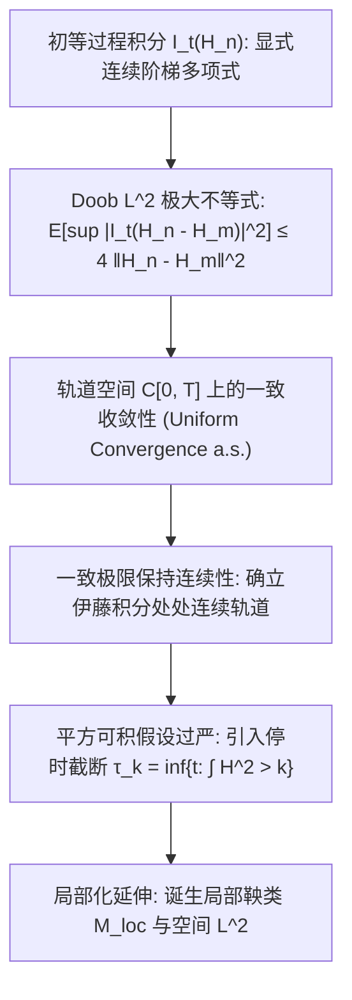

# Lec 16 通用伊藤积分的轨道连续性与局部鞅延拓 (Properties of the Ito Integral and Local Martingales)

> MIT 15.070J 高级随机过程与离散概率 (Advanced Stochastic Processes) · 授课教师：Prof. David Gamarnik (MIT ORC)

## TL;DR

- 利用 Doob 极大值不等式严格确立通用伊藤积分过程几乎必然具有连续样本轨道。
- 局部化技术（Localization）与停时序列成功将平方可积条件放宽至几乎必然可积 $\mathcal{L}^2$。
- 局部鞅（Local Martingales）概念为处理非线性爆破与无界扩散提供了最广泛的微积分承载框架。

## 从终点随机变量到连续轨道过程

在上一讲中，我们通过 $L^2(\Omega)$ 完备化定义了终点时刻的随机变量 $I_T(H) = \int_0^T H_t dB_t$。然而，在应用中，我们关切的绝不仅仅是终点单点值，而是整个动态演化过程：
$$
I_t = \int_0^t H_s dB_s, \quad t \in [0, T]
$$
这个过程具有怎样的轨道性质？它是否能够像布朗运动本身一样，拥有几乎处处处连续的样本轨道？

如果仅仅依靠逐个时刻 $t$ 的 $L^2$ 收敛，我们只能得到一个版本（Modification），而无法直接断言其轨迹连续性，因为在不可数个时间点上，零测度集的并集可能会膨胀为非零测度。

为了克服这一困难，我们需要再次祭出我们在第 11 讲学到的神兵利器——**Doob 极大值不等式**。

## 轨道连续性的严谨证明

设 $H \in \mathcal{H}^2[0, T]$，取初等过程序列 $\{H_n\} \subset \mathcal{S}$ 使得 $\|H_n - H\|_{\mathcal{H}^2} \to 0$。
对于初等过程 $H_n$，其积分过程 $I_t(H_n) = \sum \xi_i (B_{t \wedge t_i} - B_{t \wedge t_{i-1}})$ 显然是关于时间 $t$ 连续的。

考虑两个初等过程的差 $I(H_n) - I(H_m)$。由于它是连续鞅，应用 **Doob $L^2$ 极大值不等式**：
$$
\mathbb{E}\left[\sup_{0 \le t \le T} |I_t(H_n) - I_t(H_m)|^2\right] \le 4 \mathbb{E}\left[|I_T(H_n) - I_T(H_m)|^2\right] = 4 \|H_n - H_m\|_{\mathcal{H}^2}^2
$$
利用 Borel-Cantelli 引理与 Chebyshev 不等式，可以选取一个充分快速衰减的子序列 $n_k$，使得：
$$
\sum_{k=1}^\infty \mathbb{P}\left(\sup_{0 \le t \le T} |I_t(H_{n_{k+1}}) - I_t(H_{n_k})| > 2^{-k}\right) < \infty
$$
根据 Weierstrass M-判别法，连续函数列 $t \mapsto I_t(H_{n_k})(\omega)$ 在闭区间 $[0, T]$ 上以概率 1 **一致收敛**！
连续函数在一致收敛极限下必然保持连续性。由此我们正式得出：

::: theorem [伊藤积分轨道连续性定理]
对于任意 $H \in \mathcal{H}^2[0, T]$，随机积分过程：
$$
I_t = \int_0^t H_s dB_s, \quad 0 \le t \le T
$$
存在一个几乎处处轨道连续的修改版本，且其本身是关于自然流 $\{\mathcal{F}_t\}$ 的平方可积连续鞅。
:::

## 局部化技术与局部鞅 (Local Martingales)

在很多物理非线性系统与金融模型中，平方可积条件 $\mathbb{E}\left[\int_0^T H_t^2 dt\right] < \infty$ 往往过于严苛。例如当股票价格由指数函数驱动时，其高阶矩增长极快，全局期望可能发散；但对于几乎每一个具体的样本轨道，其积分路径积分值在任意有限时间内都是良态且有限的。

我们定义更宽广的局部平方可积过程空间：

::: definition [空间 $\mathcal{L}^2$]
记 $\mathcal{L}^2[0, T]$ 为所有循序可测过程 $H$，满足其样本路径在有限区间内几乎必然积分有限：
$$
\mathbb{P}\left(\int_0^T H_t^2 dt < \infty\right) = 1
$$
（注意此处无需对概率空间取数学期望 $\mathbb{E}$，仅要求样本轨道 a.s. 成立）。
:::

如何将伊藤积分延拓到这个庞大的空间？答案是**停时局部化**（Localization）。

::: definition [局部化停时序列]
对于 $H \in \mathcal{L}^2[0, T]$，定义递增停时序列：
$$
\tau_n = \inf\left\{t \in [0, T] : \int_0^t H_s^2 ds \ge n\right\} \wedge T
$$
截断过程 $H_t^{(n)} = H_t \mathbf{1}_{\{t \le \tau_n\}}$ 满足：
$$
\mathbb{E}\left[\int_0^T (H_t^{(n)})^2 dt\right] \le n < \infty
$$
因此 $H^{(n)} \in \mathcal{H}^2$。
:::

对于任意 $t \le \tau_n$，定义 $\int_0^t H_s dB_s = \int_0^t H_s^{(n)} dB_s$。由于当 $n \to \infty$ 时，$\mathbb{P}(\tau_n = T) \to 1$，该定义在全概率测度下是一致相容且唯一的！

由此引出了现代随机分析中最重要的过程分类——**局部鞅**：

::: definition [局部鞅 (Local Martingale)]
适应连续过程 $M = \{M_t\}_{t \ge 0}$ 称为**局部鞅**（记为 $M \in \mathcal{M}_{\text{loc}}$），若存在一族单调递增且发散至无穷的停时序列 $\{\tau_n\}_{n=1}^\infty$（$\tau_n \uparrow \infty$ a.s.），使得对每一个 $n$，停止后的过程：
$$
M_t^{\tau_n} = M_{t \wedge \tau_n}
$$
都是关于流 $\{\mathcal{F}_t\}$ 的正规真鞅。
:::

::: theorem [通用伊藤积分的鞅结构]
若被积核 $H \in \mathcal{L}^2$，则伊藤积分 $I_t = \int_0^t H_s dB_s$ 是**连续局部鞅**。
若进一步满足 Novikov 条件或 $\mathbb{E}\left[\int_0^T H_s^2 ds\right] < \infty$，则局部鞅退化为严格的**真鞅**。
:::

::: pitfall 误将局部鞅当做真鞅使用期望不变性
局部鞅不一定是真鞅！最著名的反例是在三维空间中离开原点的布朗运动的倒数 $M_t = \|B_t\|^{-1}$。它是一个合法的局部鞅，但它的期望值随时间严格单调衰减：$\mathbb{E}[M_t] < \mathbb{E}[M_0]$，它实际上是一个严格的**超鞅**（Strict Local Martingale）。若盲目对其套用 $\mathbb{E}[M_t] = \mathbb{E}[M_0]$，金融衍生品定价将产生灾难性的套利漏洞！
:::

::: insight 局部化是微积分摆脱整体有限性束缚的羽翼
在确定性微积分中，只要函数局部连续，我们就可以在其上建立定积分，无需假设函数在无穷远处整体有界。
局部化技术在随机分析中扮演了完全相同的角色：**停时序列像一道道柔性的安全闸门，每当随机轨道出现潜在的无穷大能量爆发时，停时便适时切断风险，把问题锁定在良态的紧致子域中**。这使得伊藤微积分能够从容驾驭绝大多数非线性微分方程。
:::
