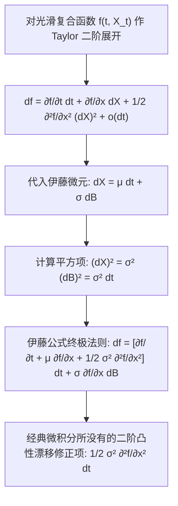

# Lec 17 伊藤引理与随机微积分链式法则 (Ito Process and Ito's Formula)

> MIT 15.070J 高级随机过程与离散概率 (Advanced Stochastic Processes) · 授课教师：Prof. David Gamarnik (MIT ORC)

## TL;DR

- 伊藤过程将确定性漂移积分与无偏扩散积分统一表述为连续半鞅基础结构。
- 伊藤公式通过二阶泰勒展开与 $(dB_t)^2 = dt$ 导出了震惊世界的随机微积分链式法则。
- 多维与含时伊藤引理构成了随机微分方程（SDE）解析求解与概率偏微分方程转化的通义核心。

## 经典链式法则的破灭与重生

在牛顿微积分中，对于光滑可微函数 $f(x)$ 与平滑曲线 $x(t)$，复合函数的导数遵循链式法则（Chain Rule）：
$$
\frac{d}{dt}f(x(t)) = f'(x(t)) \frac{dx}{dt} \iff df(x) = f'(x) dx
$$
然而，当系统的底层坐标由充满分形微观震荡的随机过程驱动时，经典一阶微元展开 $df \approx f' dx$ 将遗漏致命的确定性漂移！

1944 年，伊藤清推导出了随机分析领域最著名的核心公式——**伊藤公式**（Itô's Lemma / Itô's Formula）。它是随机微积分世界的“微积分基本定理”，构成了整个量化金融、随机最优控制与物理非平衡统计的语法中枢。

## 伊藤过程（半鞅）定义

为了确立普遍的微积分运算法则，我们首先定义一类足够广泛且对光滑变换保持代数封闭的随机过程族——**伊藤过程**（Itô Process，又称连续半鞅 Continuous Semimartingale）。

::: definition [伊藤过程 (Itô Process)]
设 $B_t$ 为一维标准布朗运动。过程 $X = \{X_t\}_{t \ge 0}$ 称为**伊藤过程**，若其可以分解为初始值、漂移项（有限变差过程）与扩散项（连续局部鞅）的和：
$$
X_t = X_0 + \int_0^t \mu_s ds + \int_0^t \sigma_s dB_s
$$
微分简写形式为：
$$
dX_t = \mu_t dt + \sigma_t dB_t
$$
其中漂移系数 $\mu_t$ 与扩散系数 $\sigma_t$ 是适应过程，且几乎必然满足 $\int_0^t |\mu_s| ds < \infty$ 和 $\int_0^t \sigma_s^2 ds < \infty$。
:::

根据第 8 讲关于二次变差的理论，伊藤过程的二次变差由扩散项完全支配：
$$
d[X, X]_t = (dX_t)^2 = \sigma_t^2 (dB_t)^2 + 2 \mu_t \sigma_t dt dB_t + \mu_t^2 (dt)^2 = \sigma_t^2 dt
$$
因为按照随机分析基本微元运算法则：
$$
(dB_t)^2 = dt, \quad dt \cdot dB_t = 0, \quad (dt)^2 = 0
$$

## 伊藤公式（一维形式）

::: theorem [一维伊藤公式 (Itô's Formula)]
设 $X_t$ 为伊藤过程 $dX_t = \mu_t dt + \sigma_t dB_t$。设函数 $f(t, x): [0, \infty) \times \mathbb{R} \to \mathbb{R}$ 在时间 $t$ 上连续一阶可导（$C^1$），在空间坐标 $x$ 上连续二阶可导（$C^2$）。
则复合随机过程 $Y_t = f(t, X_t)$ 仍然是一个伊藤过程，且其微分满足：
$$
df(t, X_t) = \frac{\partial f}{\partial t}(t, X_t) dt + \frac{\partial f}{\partial x}(t, X_t) dX_t + \frac{1}{2}\frac{\partial^2 f}{\partial x^2}(t, X_t) (dX_t)^2
$$
展开代入 $dX_t = \mu_t dt + \sigma_t dB_t$ 后得到显式微分方程：
$$
df(t, X_t) = \left(\frac{\partial f}{\partial t} + \mu_t \frac{\partial f}{\partial x} + \frac{1}{2}\sigma_t^2 \frac{\partial^2 f}{\partial x^2}\right) dt + \sigma_t \frac{\partial f}{\partial x} dB_t
$$
写成积分形式即为：
$$
f(t, X_t) - f(0, X_0) = \int_0^t \left(\frac{\partial f}{\partial s} + \mu_s \frac{\partial f}{\partial x} + \frac{1}{2}\sigma_s^2 \frac{\partial^2 f}{\partial x^2}\right) ds + \int_0^t \sigma_s \frac{\partial f}{\partial x} dB_s
$$
:::

## 经典案例演练

::: example [案例 1：计算 $B_t^2$ 的微积分]
取 $f(x) = x^2$，则 $f'(x) = 2x, f''(x) = 2$。底层过程为标准布朗运动 $dX_t = dB_t$（$\mu = 0, \sigma = 1$）。
由伊藤引理：
$$
d(B_t^2) = f'(B_t) dB_t + \frac{1}{2} f''(B_t) dt = 2 B_t dB_t + \frac{1}{2}(2) dt = 2 B_t dB_t + dt
$$
两边在 $[0, t]$ 上积分：
$$
B_t^2 - B_0^2 = 2 \int_0^t B_s dB_s + t \implies \int_0^t B_s dB_s = \frac{1}{2}B_t^2 - \frac{1}{2}t
$$
我们用不到三行计算，瞬间重新推导出了第 14 讲中耗费繁琐黎曼和求极限才艰难得出的结果！
:::

::: example [案例 2：几何布朗运动 (Geometric Brownian Motion)]
考察股票价格模型 $S_t$，其遵循相对收益漂移与扩散：
$$
\frac{dS_t}{S_t} = \mu dt + \sigma dB_t \iff dS_t = \mu S_t dt + \sigma S_t dB_t
$$
为了求解此微分方程，我们对对数价格 $Y_t = \ln S_t$ 应用伊藤引理。
设 $f(x) = \ln x$，导数为 $f'(x) = \frac{1}{x}, f''(x) = -\frac{1}{x^2}$。
代入伊藤公式：
$$
d(\ln S_t) = f'(S_t) dS_t + \frac{1}{2} f''(S_t) (dS_t)^2 = \frac{1}{S_t} (\mu S_t dt + \sigma S_t dB_t) + \frac{1}{2}\left(-\frac{1}{S_t^2}\right) (\sigma^2 S_t^2 dt)
$$
化简得出震惊金融界的著名结论：
$$
d(\ln S_t) = \left(\mu - \frac{1}{2}\sigma^2\right) dt + \sigma dB_t
$$
两边直接积分：
$$
\ln S_t - \ln S_0 = \left(\mu - \frac{1}{2}\sigma^2\right) t + \sigma B_t \implies S_t = S_0 \exp\left(\left(\mu - \frac{1}{2}\sigma^2\right)t + \sigma B_t\right)
$$
:::

## 多维伊藤公式 (Multidimensional Itô's Lemma)

设 $\mathbf{X}_t = (X_t^1, \dots, X_t^d)^T$ 为 $d$ 维伊藤过程向量，$f(t, \mathbf{x}): [0, \infty) \times \mathbb{R}^d \to \mathbb{R}$ 为 $C^{1, 2}$ 函数。则：
$$
df(t, \mathbf{X}_t) = \frac{\partial f}{\partial t} dt + \sum_{i=1}^d \frac{\partial f}{\partial x_i} dX_t^i + \frac{1}{2} \sum_{i=1}^d \sum_{j=1}^d \frac{\partial^2 f}{\partial x_i \partial x_j} d[X^i, X^j]_t
$$

特别地，两随机过程乘积的**伊藤分部积分法则**（Integration by Parts）为：
$$
d(X_t Y_t) = X_t dY_t + Y_t dX_t + d[X, Y]_t
$$

::: pitfall 忽视波动率拖累修正项 -1/2 σ²
在几何布朗运动中，投资者常误以为平均对数复合增长率等于漂移率 $\mu$。但伊藤引理明确无误地指出：真实的复合增长率是 $\mu - \frac{1}{2}\sigma^2$！
这额外的 $-\frac{1}{2}\sigma^2$ 称为**波动率拖累**（Volatility Drag）：波动性本身就会天然拉低复利增长的中位数。忽视这一伊藤修正项，是金融投资与资产负债管理中最经典的认知灾难。
:::

::: insight 二阶修正项是时空微观曲率的物理代偿
为什么确定性微积分无需二阶项，而随机微积分必须加上 $\frac{1}{2}\sigma^2 f''(x)$？
因为在确定性微积分中，微分尺度满足 $\Delta x \sim \Delta t$，其平方 $(\Delta x)^2 \sim (\Delta t)^2$ 是高阶无穷小，自然被忽略；
而在布朗世界中，扩散的物理尺度是 $\Delta B \sim \sqrt{\Delta t}$！它的平方恰好与时间微元 $\Delta t$ 处于完全相同的数量级。
**这个二阶导数修正项，本质上就是随机微粒在高维非线性曲面上无规则横向震荡时，由于曲面本身的凸度（Curvature）而不得不向下或向上产生的宏观流向补偿**。
:::
