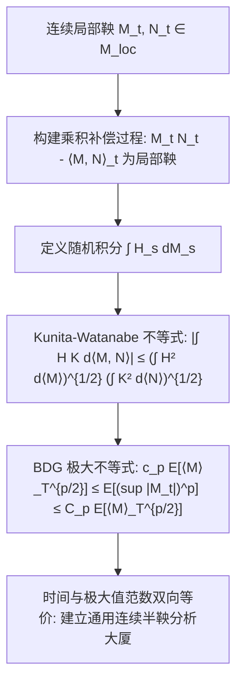

# Lec 18 连续半鞅积分与 Kunita-Watanabe 不等式 (Integration with Respect to Martingales)

> MIT 15.070J 高级随机过程与离散概率 (Advanced Stochastic Processes) · 授课教师：Prof. David Gamarnik (MIT ORC)

## TL;DR

- 将伊藤积分推广至任意通用连续局部鞅，奠定无坐标依赖的现代半鞅分析。
- 可积协变差与尖括号过程 $\langle M, N \rangle_t$ 确立了鞅空间上的随机内积结构。
- Kunita-Watanabe 不等式与 Burkholder-Davis-Gundy (BDG) 极值不等式构建了现代随机分析的完备估计体系。

## 超越高斯假设：走向一般连续半鞅

在前几讲中，驱动随机系统的核心噪声源始终是标准布朗运动 $B_t$。然而在现代随机分析、宏观计量经济学与非线性滤波理论中，驱动过程可能本身就是某个极其复杂的自适应系统输出（例如经过非线性变换后的连续局部鞅 $M_t$）。

如何为形如：
$$
I_t = \int_0^t H_s dM_s
$$
赋予严格的数学定义，其中 $M_t$ 仅是一个抽象的连续局部鞅？

日本数学家国田宽（Hiroshi Kunita）与渡边信三（Shinzo Watanabe）在 1967 年完成了这一终极跃迁，建立了适用于全体连续半鞅的无坐标形式随机积分理论。

## 尖括号过程（可积协变差）

对于两个连续局部鞅 $M, N \in \mathcal{M}_{\text{loc}}$，我们需要一种工具来度量它们之间的“相互瞬时方差与协方差”。

::: definition [尖括号过程 (Predictable Bracket Process)]
设 $M, N \in \mathcal{M}_{\text{loc}}$ 为连续局部鞅。
存在唯一的（在不可区分意义下）连续且具有局部有界变差的适应过程，记为 $\langle M, N \rangle_t$（或二次协变差 $[M, N]_t$），满足：
1. $\langle M, N \rangle_0 = 0$ a.s.；
2. 乘积校正过程：
$$
M_t N_t - \langle M, N \rangle_t
$$
是一个连续局部鞅。
当 $M = N$ 时，$\langle M, M \rangle_t$（简记为 $\langle M \rangle_t$）是几乎处处非减的连续过程，称为 $M$ 的**二次变差过程**。
:::

根据偏振恒等式（Polarization Identity）：
$$
\langle M, N \rangle_t = \frac{1}{4}\left(\langle M + N \rangle_t - \langle M - N \rangle_t\right)
$$

## Kunita-Watanabe 不等式

在一般鞅空间中建立随机积分，核心难点在于估算交叉积分的范数。Kunita 与 Watanabe 建立了著名的柯西-施瓦茨（Cauchy-Schwarz）不等式在随机测度积分上的终极推广：

::: theorem [Kunita-Watanabe 不等式 (Kunita-Watanabe, 1967)]
设 $M, N \in \mathcal{M}_{\text{loc}}$ 为连续局部鞅，$H, K$ 为循序可测过程。
则对于几乎所有样本轨道 $\omega$，在任意时间区间 $[0, t]$ 上均满足：
$$
\int_0^t |H_s K_s| |d\langle M, N \rangle_s| \le \left(\int_0^t H_s^2 d\langle M \rangle_s\right)^{1/2} \left(\int_0^t K_s^2 d\langle N \rangle_s\right)^{1/2}
$$
并且对数学期望同样严格成立：
$$
\mathbb{E}\left[\int_0^t |H_s K_s| |d\langle M, N \rangle_s|\right] \le \left(\mathbb{E}\left[\int_0^t H_s^2 d\langle M \rangle_s\right]\right)^{1/2} \left(\mathbb{E}\left[\int_0^t K_s^2 d\langle N \rangle_s\right]\right)^{1/2}
$$
:::

利用 Kunita-Watanabe 不等式，通用积分 $I(H) = \int_0^t H_s dM_s$ 的等距同构性得以完整保持：
$$
\left\langle \int_0^\cdot H_s dM_s, \int_0^\cdot K_s dN_s \right\rangle_t = \int_0^t H_s K_s d\langle M, N \rangle_s
$$
特别地，当 $M$ 为标准布朗运动时，$\langle B \rangle_t = t$，上式退化为经典伊藤等距！

## Burkholder-Davis-Gundy (BDG) 极值不等式

在整个概率论与偏微分方程领域，如果说有什么不等式能够像泰山北斗一样支撑起所有先验估计，那非 **BDG 不等式** 莫属。

它解答了一个至关重要的问题：**随机过程在全区间的最大振荡幅度的期望，能否完全由其二次变差过程的终点值所完全控制？**

::: theorem [Burkholder-Davis-Gundy (BDG) 不等式]
设 $M$ 为满足 $M_0 = 0$ 的连续局部鞅。记 $M_t^* = \sup_{0 \le s \le t} |M_s|$。
对于任意指数 $p \in (0, \infty)$，存在**仅依赖于 $p$ 的通用正实数常数** $c_p$ 与 $C_p$（独立于过程 $M$ 和时间 $t$），使得对所有 $t \ge 0$ 均满足：
$$
c_p \mathbb{E}\left[\langle M \rangle_t^{p/2}\right] \le \mathbb{E}\left[(M_t^*)^p\right] \le C_p \mathbb{E}\left[\langle M \rangle_t^{p/2}\right]
$$
:::

### BDG 不等式的震撼含义
注意两边的夹逼是对称的！这意味着：
**连续局部鞅的最大路径偏离的 $L^p$ 范数，与二次变差在代数上完全双向等价（Norm Equivalent）！**
只要我们掌握了二次变差 $\langle M \rangle_t$ 的积分大小，我们就无死角地掌握了整条轨道可能发生的最大暴跌或暴涨。

::: pitfall 混淆尖括号过程 ⟨M⟩_t 与方差 Var(M_t)
初学者极易将二次变差 $\langle M \rangle_t$ 简单理解为方差。对于布朗运动，两者恰巧相等（均为 $t$）。但在通用鞅体系中，$\langle M \rangle_t$ 是一个随着轨道动态演化的**随机过程**（由历史路径波动累计而成），而方差是一个确定性标量期望。BDG 不等式控制的是逐条样本轨道上的内在几何时间。
:::

::: insight 抽象鞅分析打破布朗运动的独裁
长期以来，随机微积分被认为是布朗运动的高斯专属技巧。
而 Kunita-Watanabe 与半鞅积分理论向世人宣告：**只要一个随机系统满足连续局部鞅结构，它就内在地蕴含了一套完全自洽的内积度量与微积分世界，布朗运动不过是其中二次变差恒等于物理时钟 $t$ 的最平庸特例**。这种超越坐标系的视角，是 20 世纪下半叶法国概率学派（Meyer, Dellacherie）最辉煌的思想遗产。
:::
