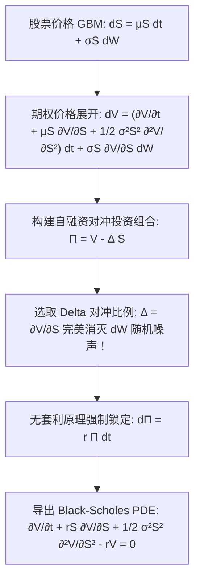

# Lec 19 金融经济学应用：Black-Scholes 偏微分方程与 Girsanov 测度变换 (Applications of Ito Calculus to Financial Economics)

> MIT 15.070J 高级随机过程与离散概率 (Advanced Stochastic Processes) · 授课教师：Prof. David Gamarnik (MIT ORC)

## TL;DR

- 无套利原理通过构建瞬时无风险自融资对冲投资组合消除了资产价格的布朗随机性。
- Black-Scholes-Merton 偏微分方程将衍生品定价转化为经典热传导方程的变体。
- Girsanov 测度变换定理严格消除了资产的真实漂移率，奠定了风险中性等价鞅测度（Q 测度）公理底座。

## 现代量化金融的思想革命

1973 年费希尔·布莱克（Fischer Black）与麦隆·斯科尔斯（Myron Scholes）发表了划时代的论文《期权定价与公司负债》，罗伯特·默顿（Robert C. Merton）随后以严谨的连续时间随机微积分完善了数学证明（二人于 1997 年荣获诺贝尔经济学奖）。

在 BSM 模型出现之前，人类给金融期权定价时普遍认为：看涨期权的价值应当取决于投资人对未来牛市上涨概率的心理预期，即与股票的主观预期收益率 $\mu$ 强相关。
而随机微积分给出的革命性回答彻底颠覆了人类的直觉：**在完备无套利市场中，衍生品的公允价格完全独立于股票的真实预期增长率 $\mu$！**

## Black-Scholes 模型的数学框架

设金融市场由两种资产构成：
1. **无风险货币账户**（无风险利率 $r \ge 0$）：
$$
dB_t = r B_t dt \implies B_t = e^{r t}
$$
2. **风险标的股票资产** $S_t$，遵循几何布朗运动（GBM）：
$$
dS_t = \mu S_t dt + \sigma S_t dW_t
$$
其中 $W_t$ 为真实物理概率测度 $\mathbb{P}$ 下的标准布朗运动，$\mu$ 为预期收益率，$\sigma > 0$ 为波动率。

设有一份欧式看涨期权，在到期日 $T$ 的支付为 $\Phi(S_T) = (S_T - K)^+$。设时刻 $t$ 的期权价格为 $V(t, S_t)$。

## 无套利 Delta 对冲与偏微分方程推导

根据伊藤引理，期权价格微分展开为：
$$
dV = \left(\frac{\partial V}{\partial t} + \mu S_t \frac{\partial V}{\partial S} + \frac{1}{2}\sigma^2 S_t^2 \frac{\partial^2 V}{\partial S^2}\right) dt + \sigma S_t \frac{\partial V}{\partial S} dW_t
$$
构造一个包含 **1 份多头期权** 与 **$\Delta$ 份空头股票** 的投资组合：
$$
\Pi_t = V(t, S_t) - \Delta_t S_t
$$
其瞬时微元变动为：
$$
d\Pi_t = dV - \Delta_t dS_t = \left(\frac{\partial V}{\partial t} + \mu S_t \frac{\partial V}{\partial S} + \frac{1}{2}\sigma^2 S_t^2 \frac{\partial^2 V}{\partial S^2} - \Delta_t \mu S_t\right) dt + \left(\sigma S_t \frac{\partial V}{\partial S} - \Delta_t \sigma S_t\right) dW_t
$$
为了彻底消灭投资组合中不可预测的高斯白噪声，我们令布朗微元 $dW_t$ 的系数恒为 0：
$$
\Delta_t = \frac{\partial V}{\partial S}(t, S_t) \quad (\text{Delta 对冲法则})
$$
代入后，噪声项完全消失！投资组合 $\Pi_t$ 在微元尺度上变成了一个**完全确定性的无风险资产**。
根据金融市场**无套利公理**（No-Arbitrage Principle），在任何瞬时区间内，一个完全无风险的投资组合的收益率必须严格等于市场无风险基准利率 $r$：
$$
d\Pi_t = r \Pi_t dt = r \left(V - \frac{\partial V}{\partial S} S_t\right) dt
$$
两边对比 $dt$ 项系数：
$$
\frac{\partial V}{\partial t} + \frac{1}{2}\sigma^2 S_t^2 \frac{\partial^2 V}{\partial S^2} = r V - r S_t \frac{\partial V}{\partial S}
$$
移项整理，即得出震惊全球学术界与华尔街的 **Black-Scholes-Merton 偏微分方程**：

::: theorem [Black-Scholes-Merton PDE]
$$
\frac{\partial V}{\partial t} + r S \frac{\partial V}{\partial S} + \frac{1}{2}\sigma^2 S^2 \frac{\partial^2 V}{\partial S^2} - r V = 0
$$
满足终值边界条件 $V(T, S) = (S - K)^+$。
:::

注意到：原本股票运动方程中的真实漂移率 $\mu$ 在推导过程中**被完全对消抵消**，方程中仅留下了无风险利率 $r$ 与波动率 $\sigma$！

## Girsanov 定理与风险中性等价鞅测度 (Risk-Neutral Measure)

Black-Scholes 方程为何能完全摆脱主观预期收益率 $\mu$？
数学大师伊戈尔·吉尔萨诺夫（Igor Girsanov）在 1960 年建立的**测度变换定理**给出了终极的概率测度论解释。

::: theorem [Girsanov 定理 (一维形式)]
设 $W_t$ 为物理测度 $\mathbb{P}$ 下的标准布朗运动。设适应过程 $\theta_t$ 满足 Novikov 条件：
$$
\mathbb{E}_{\mathbb{P}}\left[\exp\left(\frac{1}{2}\int_0^T \theta_t^2 dt\right)\right] < \infty
$$
定义 Radon-Nikodym 导数过程（Doléans-Dade 指数鞅）：
$$
Z_T = \frac{d\mathbb{Q}}{d\mathbb{P}} = \exp\left(-\int_0^T \theta_t dW_t - \frac{1}{2}\int_0^T \theta_t^2 dt\right)
$$
则在新的等价概率测度 $\mathbb{Q} \sim \mathbb{P}$ 下，过程：
$$
W_t^{\mathbb{Q}} = W_t + \int_0^t \theta_s ds
$$
是一个标准的布朗运动！
:::

在金融市场中，取**市场风险溢价**（Market Price of Risk）：
$$
\theta_t = \frac{\mu - r}{\sigma}
$$
代入股票方程：
$$
dS_t = \mu S_t dt + \sigma S_t (dW_t^{\mathbb{Q}} - \theta_t dt) = r S_t dt + \sigma S_t dW_t^{\mathbb{Q}}
$$
在测度 $\mathbb{Q}$ 下，股票的预期贴现收益率恰好等于无风险利率 $r$！折现股票价格 $\tilde{S}_t = e^{-r t} S_t$ 成为一个严格的鞅（此测度因此被称为**等价鞅测度**或**风险中性测度**）。

::: theorem [风险中性定价公式 (Feynman-Kac 对偶)]
根据 Feynman-Kac 定理，BSM PDE 的解析解严格等价于在等价鞅测度 $\mathbb{Q}$ 下的折现期望：
$$
V(t, S_t) = e^{-r(T - t)} \mathbb{E}_{\mathbb{Q}}\left[(S_T - K)^+ \middle| \mathcal{F}_t\right] = S_t \Phi(d_1) - K e^{-r(T - t)} \Phi(d_2)
$$
其中：
$$
d_1 = \frac{\ln(S_t / K) + (r + \frac{1}{2}\sigma^2)(T - t)}{\sigma \sqrt{T - t}}, \quad d_2 = d_1 - \sigma \sqrt{T - t}
$$
$\Phi(\cdot)$ 为标准正态累积分布函数。
:::

::: insight 测度变换是平行宇宙间的价值标定
为什么期权定价不需要知道明天的股票是涨还是跌？
Girsanov 定理以不可思议的深刻性揭示了金融对冲的本质：**通过在市场上连续动态调整标的资产的持仓比例，交易员实际上在现实世界与一个“人人都对风险完全中性、所有资产增长率都恒等于无风险利率”的平行虚拟宇宙 $\mathbb{Q}$ 之间建立了不可分割的价值引力索**。
无论物理世界中的漂移率 $\mu$ 发生怎样的剧烈动荡，期权的公允价格都已经被风险中性测度下的期望严丝合缝地锁死了。
:::
