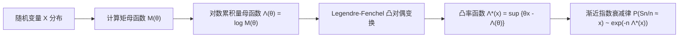

# Lec 2 大偏差理论基础与 i.i.d. 指数衰减律 (Large Deviations for i.i.d. Random Variables)

> MIT 15.070J 高级随机过程与离散概率 (Advanced Stochastic Processes) · 授课教师：Prof. David Gamarnik (MIT ORC)

## TL;DR

- 大偏差理论研究样本均值偏离大数定律均值的罕见事件概率指数衰减速率。
- 对偶矩母函数与累积量母函数通过 Legendre-Fenchel 变换导出凸率函数（Rate Function）。
- Chernoff 界为样本均值上尾概率提供了紧致的渐近指数上界。

## 超越大数定律与中心极限定理

大数定律（LLN）指出，对于独立同分布的随机变量序列 $X_1, X_2, \dots, X_n$（假设期望 $\mathbb{E}[X_1] = \mu < \infty$），样本均值 $S_n/n = \frac{1}{n}\sum_{i=1}^n X_i$ 以概率 1 收敛至真值 $\mu$。中心极限定理（CLT）进一步刻画了波动尺度为 $\mathcal{O}(1/\sqrt{n})$ 的渐近正态分布：
$$
\sqrt{n}\left(\frac{S_n}{n} - \mu\right) \xrightarrow{d} \mathcal{N}(0, \sigma^2)
$$
然而，在金融风险对冲、排队系统缓冲区溢出、密码学破译以及统计物理亚稳态演化中，核心关切往往是：**当样本均值偏离期望达到宏观常数级别（即 $S_n/n \ge a$ 且 $a > \mu$）时，这一罕见事件发生的概率有多大？**

中心极限定理仅适用于原点周围 $\mathcal{O}(1/\sqrt{n})$ 的微小扰动领域，若将其强行外推到固定常数 $a > \mu$ 的远端尾部，会导致严重的偏差甚至量级错误。**大偏差理论**（Large Deviations Theory）正是专门量化此类宏观罕见事件指数级衰减速率的严谨数学分支。

## 矩母函数与对偶凸共轭

大偏差理论的代数核心是**对数矩母函数**（又称累积量母函数，Cumulant Generating Function, CGF）。

::: definition [累积量母函数 (Cumulant Generating Function)]
设 $X$ 为实值随机变量。其矩母函数定义为 $M(\theta) = \mathbb{E}[e^{\theta X}]$。对数矩母函数 $\Lambda(\theta): \mathbb{R} \to (-\infty, +\infty]$ 定义为：
$$
\Lambda(\theta) = \log M(\theta) = \log \mathbb{E}[e^{\theta X}]
$$
由 Hölder 不等式可知，$\Lambda(\theta)$ 是凸函数，且满足 $\Lambda(0) = 0, \Lambda'(0) = \mathbb{E}[X] = \mu$。
:::

根据切比雪夫不等式的指数形式（Chernoff 技巧），对于任意 $\theta \ge 0$ 及任意 $a > \mu$：
$$
\mathbb{P}\left(\frac{S_n}{n} \ge a\right) = \mathbb{P}\left(e^{\theta S_n} \ge e^{n \theta a}\right) \le e^{-n \theta a} \mathbb{E}\left[e^{\theta \sum_{i=1}^n X_i}\right] = e^{-n \theta a} \left(\mathbb{E}[e^{\theta X_1}]\right)^n = \exp\left(-n [\theta a - \Lambda(\theta)]\right)
$$
为了获得最紧致的上界，我们可以在所有 $\theta \ge 0$ 上最大化指数衰减项：

::: definition [Legendre-Fenchel 变换与率函数 (Rate Function)]
对于对数累积量母函数 $\Lambda(\theta)$，其 Legendre-Fenchel 变换（凸共轭）定义为：
$$
\Lambda^*(x) = \sup_{\theta \in \mathbb{R}} \{\theta x - \Lambda(\theta)\}
$$
$\Lambda^*(x)$ 被称为大偏差**率函数**（Rate Function）。
:::

## 率函数的核心几何与分析性质

::: theorem [率函数基本性质]
率函数 $\Lambda^*(x)$ 具有以下优良性质：
1. **非负性**：$\Lambda^*(x) \ge 0$，且当 $x = \mu = \mathbb{E}[X]$ 时，$\Lambda^*(\mu) = 0$；
2. **严格凸性**：若 $X$ 不是退化常数，则 $\Lambda^*(x)$ 在其有效定义域上严格凸；
3. **极小值唯一**：在 $x = \mu$ 处取得全局唯一最小值 0；
4. **下半连续性**：对于任意 $\alpha \ge 0$，下水平集 $\{x \in \mathbb{R} : \Lambda^*(x) \le \alpha\}$ 是闭集（若此闭集紧致，则称为良率函数 Good Rate Function）。
:::

::: example [标准正态分布的率函数]
设 $X_i \sim \mathcal{N}(0, 1)$。其矩母函数为 $M(\theta) = e^{\theta^2 / 2}$，故累积量母函数为：
$$
\Lambda(\theta) = \log e^{\theta^2 / 2} = \frac{\theta^2}{2}
$$
其 Legendre-Fenchel 对偶变换为：
$$
\Lambda^*(x) = \sup_{\theta \in \mathbb{R}} \left\{\theta x - \frac{\theta^2}{2}\right\}
$$
令导数等于零：$x - \theta = 0 \implies \theta^* = x$。代入得：
$$
\Lambda^*(x) = x \cdot x - \frac{x^2}{2} = \frac{x^2}{2}
$$
这精确对应了高斯尾部概率 $\mathbb{P}(S_n/n \ge a) \approx \exp\left(-n \frac{a^2}{2}\right)$。
:::

::: example [伯努利分布的率函数与相对熵]
设 $X_i \sim \text{Bernoulli}(p)$，取值于 $\{0, 1\}$。则：
$$
\Lambda(\theta) = \log (1 - p + p e^\theta)
$$
求解 $\sup_{\theta} \{\theta x - \log(1 - p + p e^\theta)\}$，求导置零解得 $e^{\theta^*} = \frac{x(1-p)}{(1-x)p}$。代入得：
$$
\Lambda^*(x) = x \log\frac{x}{p} + (1 - x)\log\frac{1 - x}{1 - p} = D_{\text{KL}}(x \| p)
$$
即率函数精确等于两个伯努利分布之间的 **Kullback-Leibler 散度**（相对熵）！
:::

::: insight 相对熵与信息几何在大偏差中的物理本质
大偏差理论揭示了一个惊人的信息几何真理：在 i.i.d. 随机试验中，样本均值呈现反常统计行为（如硬币正面朝上频率高达 80%）并非源于“小概率奇迹的任意爆发”，而是因为**真实的微观概率测度在信息流空间中发生了最小相对熵的指数倾斜（Exponential Tilting）**。
率函数 $\Lambda^*(x)$ 衡量了观察到异常均值所需要付出的最小信息散度成本（Information Divergence Cost）。
:::
