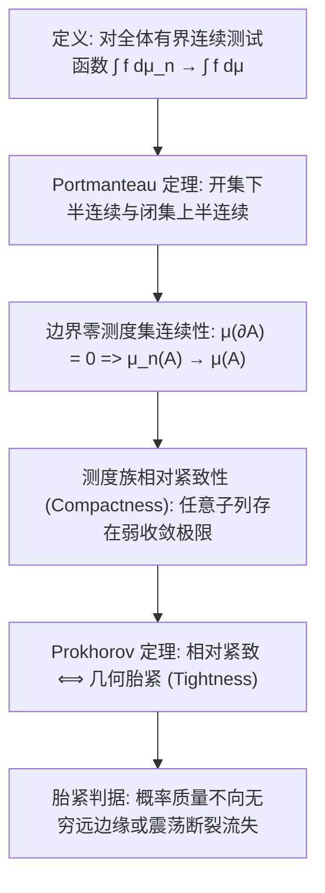

# Lec 20 弱收敛拓扑、波兰空间概率测度与 Prokhorov 紧致性 (Theory of Weak Convergence and Prokhorov's Theorem)

> MIT 15.070J 高级随机过程与离散概率 (Advanced Stochastic Processes) · 授课教师：Prof. David Gamarnik (MIT ORC)

## TL;DR

- 概率测度的弱收敛定义为全体有界连续测试函数期望的代数收敛。
- Portmanteau 定理建立了开集、闭集、边界测度与分布函数弱收敛的五重等价判据。
- Prokhorov 紧致性定理确立了度量空间上测度族相对紧致与几何胎紧（Tightness）的充要对应。

## 超越单点概率：函数空间中的极限分布

在初等概率论中，我们熟悉实随机变量序列的“依分布收敛”（Convergence in Distribution）：$X_n \xrightarrow{d} X \iff F_n(x) \to F(x)$（在分布函数 $F$ 的所有连续点处成立）。
然而，当我们进入高阶随机过程，我们要研究的随机变量往往不再是一个实数，而是**一整条连续时间轨道** $X_n \in C[0, T]$。在无限维的连续函数空间中，根本不存在所谓的“一维累积分布函数 $F(x)$”！

为了在波兰空间（如 $C[0, T]$ 或 Skorokhod 空间 $D[0, T]$）上严谨地谈论“随机过程轨道的极限分布是什么”，我们必须构建抽象度量拓扑空间上的**弱收敛理论**（Weak Convergence of Probability Measures）。

## 弱收敛的公理化定义

设 $(S, d)$ 为度量空间，$\mathcal{B}(S)$ 为其博雷尔 $\sigma$-代数。记 $\mathcal{P}(S)$ 为定义在 $(S, \mathcal{B}(S))$ 上的所有概率测度全体。记 $C_b(S)$ 为定义在 $S$ 上的所有**实值有界连续函数**集合。

::: definition [概率测度的弱收敛 (Weak Convergence)]
设 $\{\mu_n\}_{n=1}^\infty \subset \mathcal{P}(S)$ 为概率测度序列，$\mu \in \mathcal{P}(S)$。
称测度序列 $\mu_n$ **弱收敛**于 $\mu$，记为 $\mu_n \xrightarrow{w} \mu$（或 $\mu_n \Rightarrow \mu$），若对于任意有界连续测试函数 $f \in C_b(S)$，均满足：
$$
\lim_{n \to \infty} \int_S f(x) d\mu_n(x) = \int_S f(x) d\mu(x)
$$
若 $X_n, X$ 为取值于 $S$ 的随机元，且其诱导分布为 $\mathcal{L}(X_n) \Rightarrow \mathcal{L}(X)$，则称 $X_n$ 弱收敛于 $X$。
:::

## Portmanteau 宏伟等价定理

弱收敛在分析、几何与拓扑上有多种互为表里的等价视角。1968 年比灵斯利（Patrick Billingsley）在其名著《Convergence of Probability Measures》中系统总结了这一基石定理：

::: theorem [Portmanteau 定理 (五重等价性)]
设 $(S, d)$ 为度量空间，$\mu_n, \mu \in \mathcal{P}(S)$。以下命题严格等价：
1. $\mu_n \xrightarrow{w} \mu$（对全体 $f \in C_b(S)$ 积分收敛）；
2. 对全体有界且一致连续的函数 $f \in U_b(S)$，$\int f d\mu_n \to \int f d\mu$；
3. 对于任意闭集 $F \subset S$：
$$
\limsup_{n \to \infty} \mu_n(F) \le \mu(F)
$$
4. 对于任意开集 $G \subset S$：
$$
\liminf_{n \to \infty} \mu_n(G) \ge \mu(G)
$$
5. 对于任意满足 $\mu(\partial A) = 0$ 的 $\mu$-连续博雷尔集 $A$（即边界测度为 0）：
$$
\lim_{n \to \infty} \mu_n(A) = \mu(A)
$$
:::

## 相对紧致与胎紧性 (Tightness)

在实数分析中，Bolzano-Weierstrass 定理指出：有界数列必有收敛子列。
在概率测度空间 $\mathcal{P}(S)$ 中，什么样的概率测度子集具有类似的性质？

::: definition [相对紧致与胎紧 (Tightness)]
1. 概率测度族 $\Pi \subset \mathcal{P}(S)$ 称为是**弱相对紧致的**（Relatively Compact），若 $\Pi$ 中的任意序列都包含一个在 $\mathcal{P}(S)$ 中弱收敛的子序列；
2. 概率测度族 $\Pi \subset \mathcal{P}(S)$ 称为是**胎紧的**（Tight），若对任意 $\epsilon > 0$，都存在一个紧致子集 $K_\epsilon \subset S$，使得对所有测度 $\mu \in \Pi$，均有一致下界：
$$
\mu(K_\epsilon) \ge 1 - \epsilon \quad \left(\text{即 } \sup_{\mu \in \Pi} \mu(S \setminus K_\epsilon) \le \epsilon\right)
$$
:::

胎紧性的几何物理直觉极其直观：**它防止概率测度序列的质量“泄漏”到无穷远处的虚空中**。例如在 $\mathbb{R}$ 上， Dirac 测度序列 $\mu_n = \delta_n$ 会把概率质量一路推向 $+\infty$，导致没有紧集能包住它，因此该序列不是胎紧的，也没有弱收敛极限。

## Prokhorov 紧致性定理

苏联数学家尤里·普罗霍洛夫（Yuri Prokhorov）在 1956 年建立了将拓扑紧致性与概率分析完美统一的殿堂级定理：

::: theorem [Prokhorov 紧致性定理 (Prokhorov's Theorem)]
设 $S$ 为度量空间，$\Pi \subset \mathcal{P}(S)$ 为概率测度族：
1. **直接性**：若 $\Pi$ 是胎紧的，则 $\Pi$ 在弱收敛拓扑下是相对紧致的；
2. **逆命题（波兰空间等价性）**：若空间 $S$ 是**完备且可分的度量空间（波兰空间）**，则 $\Pi$ 是相对紧致的**当且仅当** $\Pi$ 是胎紧的！
:::

::: pitfall 忽视不可分空间中 Prokhorov 逆命题的失效
如果度量空间不具备可分性或完备性，相对紧致并不一定蕴含胎紧。这再次证明了我们在第 1 讲中开门见山强调的公理：现代随机过程与极限理论必须坚决建立在波兰空间之上，否则拓扑分析的地基将发生倾斜。
:::

::: insight 弱收敛是处理不可微世界的最强防护服
为什么概率论不追求强烈的逐点连续收敛，而极度推崇弱收敛？
因为随机轨道充满了微观分形与不可数不可测的荆棘。逐点路径收敛在现实复杂系统中几乎永远不可能达成。
**弱收敛通过在测试函数积分的“滤波护目镜”下观察世界，将不可数无穷维维度的震荡毛刺全部平滑化**。Prokhorov 定理则向我们保证：只要你能证明概率测度不会在空间边缘逃逸（胎紧性），你就一定能在数学上捕获它的极限！这一框架是下一讲 Donsker 定理诞生的大门。
:::
