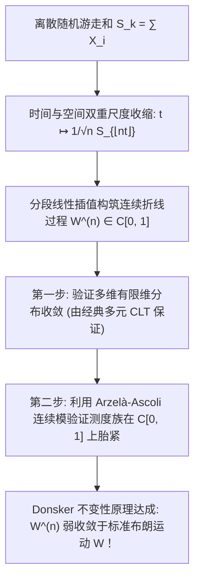

# Lec 21 泛函中心极限定理与维纳测度的连续性构建 (Functional Limit Theorems and Donsker's Invariance Principle)

> MIT 15.070J 高级随机过程与离散概率 (Advanced Stochastic Processes) · 授课教师：Prof. David Gamarnik (MIT ORC)

## TL;DR

- Donsker 不变性原理将经典中心极限定理升华至连续函数空间 $C[0, 1]$ 上的泛函中心极限定理（FCLT）。
- 分段线性插值随机游走轨道在弱收敛意义下全局逼近标准布朗运动轨道。
- Arzelà-Ascoli 定理与连续模（Modulus of Continuity）构成了验证连续轨道胎紧性的分析核心。

## 从有限点到连续轨道的维度跃迁

经典的 Lindeberg-Lévy 中心极限定理告诉我们：对于独立同分布随机变量序列 $X_1, X_2, \dots$（期望为 0，方差为 1），在任意固定的终点时刻 $t = 1$，归一化和式弱收敛于标准正态分布：
$$
\frac{S_n}{\sqrt{n}} = \frac{1}{\sqrt{n}}\sum_{i=1}^n X_i \xrightarrow{d} \mathcal{N}(0, 1)
$$
但是，这仅仅是一个孤立时间点的截面投影！
如果我们把求和过程看成一条随时间折线行进的**随机漫步轨道**，这条随机折线是否会随着步数趋向无穷大，整体弱收敛至一条真正的**标准布朗运动连续曲线**？

1951 年，门罗·唐斯克（Monroe D. Donsker）在维纳测度理论的基础上，证明了震撼世界的**不变性原理**（Invariance Principle，又称泛函中心极限定理 Functional Central Limit Theorem, FCLT）。

## 随机折线轨道的数学构建

设 $X_1, X_2, \dots$ 为 i.i.d. 零均值单位方差随机变量，$S_k = \sum_{j=1}^k X_j$，$S_0 = 0$。
在闭时间区间 $[0, 1]$ 上，我们通过分段线性插值构造连续时间随机过程 $W^{(n)} = \{W_t^{(n)}\}_{t \in [0, 1]}$：
$$
W_t^{(n)} = \frac{1}{\sqrt{n}}\left(S_{\lfloor n t \rfloor} + (n t - \lfloor n t \rfloor) X_{\lfloor n t \rfloor + 1}\right), \quad t \in [0, 1]
$$
显然对于每一个固定的样本点 $\omega$，$t \mapsto W_t^{(n)}(\omega)$ 是区间 $[0, 1]$ 上的连续折线函数，即 $W^{(n)}$ 是取值于波兰度量空间 $(C[0, 1], \|\cdot\|_\infty)$ 的随机元！

## Donsker 不变性原理 (Donsker's Invariance Principle)

::: theorem [Donsker 不变性原理 (Donsker, 1951)]
设 $X_i$ 独立同分布，$\mathbb{E}[X_1] = 0, \mathbb{E}[X_1^2] = 1$。
则由上述插值构造的连续随机过程序列 $W^{(n)}$ 在空间 $(C[0, 1], \|\cdot\|_\infty)$ 上弱收敛于标准布朗运动 $B = \{B_t\}_{t \in [0, 1]}$（即其在 $C[0, 1]$ 上诱导的测度弱收敛于维纳测度 $\mathcal{W}$）：
$$
W^{(n)} \xrightarrow{w} B \quad \text{in } (C[0, 1], \|\cdot\|_\infty)
$$
:::

### 证明的两大公理支柱
根据 Prokhorov 定理，证明函数空间中的弱收敛必须且只需完成两步：
1. **有限维分布收敛（f.i.d.o.）**：
对任意有限时刻 $0 \le t_1 < t_2 < \dots < t_k \le 1$，联合向量 $(W_{t_1}^{(n)}, \dots, W_{t_k}^{(n)})$ 弱收敛至 $(B_{t_1}, \dots, B_{t_k})$。这由经典多维中心极限定理直接保证。
2. **空间胎紧性（Tightness）**：
测度序列在 $C[0, 1]$ 中必须是胎紧的，确保质量不发生高频震荡分形破裂。

## Arzelà-Ascoli 定理与连续模胎紧性判据

在函数空间 $C[0, 1]$ 中，什么样的子集是紧集？经典的 **Arzelà-Ascoli 定理**指出：集合 $K \subset C[0, 1]$ 是相对紧致的，当且仅当其**一致有界**且**等度连续**（Equicontinuous）。

::: definition [连续模 (Modulus of Continuity)]
对于函数 $x \in C[0, 1]$ 及 $\delta > 0$，定义其连续模为：
$$
w(x, \delta) = \sup_{|s - t| \le \delta, s, t \in [0, 1]} |x(s) - x(t)|
$$
:::

::: theorem [Billingsley 胎紧性充分定理]
过程序列 $W^{(n)}$ 在 $C[0, 1]$ 上是胎紧的，若满足：
1. 初始点紧致：对任意 $\epsilon > 0$，存在 $M < \infty$ 使得 $\mathbb{P}(|W_0^{(n)}| > M) \le \epsilon$；
2. 等度连续震荡受控：对任意 $\epsilon > 0, \eta > 0$，存在 $\delta \in (0, 1)$ 及整数 $N_0$，使得对所有 $n \ge N_0$：
$$
\mathbb{P}(w(W^{(n)}, \delta) \ge \epsilon) \le \eta
$$
:::

## 连续映射定理与强大推论 (Continuous Mapping Theorem)

Donsker 定理之所以被称为“不变性原理”，是因为它不仅给出了轨道的收敛，更允许我们**将任意连续泛函直接套用在极限上**！

::: theorem [连续映射定理 (Continuous Mapping Theorem)]
若 $X_n \xrightarrow{w} X$，且映射 $h: S \to S'$ 几乎处处连续，则 $h(X_n) \xrightarrow{w} h(X)$。
:::

利用连续映射定理，无数离散组合极值与排队统计量，可以直接无缝转化为连续布朗运动的解析积分！

::: example [随机漫步最大值的极限分布]
考察连续泛函 $h(x) = \sup_{t \in [0, 1]} x(t)$。显然上确界映射是范数连续的！
根据 Donsker 定理与连续映射定理：
$$
\max_{0 \le k \le n} \frac{S_k}{\sqrt{n}} = h(W^{(n)}) \xrightarrow{d} h(B) = \sup_{0 \le t \le 1} B_t = M_1
$$
由第 7 讲的反射原理，我们已经精确算出了 $M_1 \sim |B_1| \sim |\mathcal{N}(0, 1)|$。
这直接证明了：**任意离散 i.i.d. 零均值方差为 1 的随机漫步，其前 $n$ 步最大值的极限分布，严格服从折叠半正态分布！其微观底层分布细节（不管是骰子、抛硬币还是连续采样）完全被抹平消失！**
:::

::: insight 不变性原理是宇宙大一统审美的极致
为什么物理学家与概率学家对 Donsker 定理心驰神往？
因为它展现了一种震撼人心的“物理普适性”（Universality）：**微观粒子的离散碰撞细节并不重要，只要满足有限方差与大数定律，当时间与空间尺度拉伸到宏观尺度时，一切随机漫步最终都无可避免地坍缩、凝聚为了唯一的绝对真神——维纳测度与布朗运动**。
这就是现代统计物理与随机分析最崇高的大一统之美。
:::
