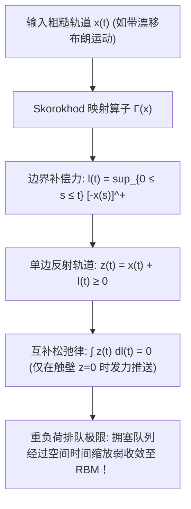

# Lec 22 Skorokhod 映射定理、反射布朗运动与重负荷排队极限 (Skorokhod Mapping and Reflected Brownian Motion)

> MIT 15.070J 高级随机过程与离散概率 (Advanced Stochastic Processes) · 授课教师：Prof. David Gamarnik (MIT ORC)

## TL;DR

- Skorokhod 映射定理通过最小局部时补偿力构造单边或双边边界反射轨道。
- 反射布朗运动（RBM）作为非负随机过程，在零点边界处经历反弹漂移。
- 重负荷排队极限（Heavy-Traffic Approximation）将拥塞离散队列精确逼近为连续 RBM 扩散。

## 物理边界与受限随机漫步

在现实工程系统中，绝大多数物理量都受到严格的单边或双边物理边界约束：
1. **排队与物流缓存**：排队系统的队列长度 $Q(t)$ 永远不可能跌破 0（非负性约束 $Q(t) \ge 0$）；
2. **水库与大坝调度**：水库蓄水量受到枯水死库容 $0$ 与满蓄防洪限额 $K$ 的双重刚性拦截；
3. **资产价格与汇率走廊**：央行目标汇率制在浮动区间的上下限设置了强制外汇干预线。

自由的标准布朗运动可以在全实数域 $(-\infty, +\infty)$ 自由穿梭。当一条充满剧烈震荡的随机轨道遭遇不可逾越的刚性边界时，系统在微观与宏观上会呈现出怎样的动力学？

苏联杰出数学家阿纳托利·斯科罗霍德（Anatoliy Skorokhod）在 1961 年提出了著名的 **Skorokhod 边界问题与映射定理**。

## Skorokhod 映射定理（单边反射问题）

设 $C[0, \infty)$ 为连续函数空间。给定一条从原点出发的任意连续输入轨道 $x = \{x(t)\}_{t \ge 0}$（满足 $x(0) \ge 0$）。

我们要寻找一对连续函数 $(z, l)$，满足：
1. **轨道分解**：$z(t) = x(t) + l(t)$ 对所有 $t \ge 0$ 成立；
2. **非负约束**：$z(t) \ge 0$ 对所有 $t \ge 0$ 恒成立；
3. **局部时单调补偿**：$l(t)$ 是非减连续函数，满足 $l(0) = 0$；
4. **最小干预原则（互补松弛性）**：补偿过程 $l(t)$ 只有在轨道触碰到边界 $z(t) = 0$ 时才能增加，即：
$$
\int_0^\infty z(t) dl(t) = 0
$$

::: theorem [Skorokhod 映射定理 (Skorokhod, 1961)]
对于任意连续输入轨道 $x \in C[0, \infty)$ 且 $x(0) \ge 0$，上述 Skorokhod 问题存在**唯一的显式连续解**对 $(z, l)$，且由以下闭式公式唯一给出：
$$
l(t) = \sup_{0 \le s \le t} \max(0, -x(s)) = -\inf_{0 \le s \le t} \min(0, x(s))
$$
$$
z(t) = x(t) + \sup_{0 \le s \le t} (-x(s))^+
$$
映射 $\Gamma: C[0, \infty) \to C[0, \infty), x \mapsto z$ 称为 **Skorokhod 映射算子**。
更为关键的是，算子 $\Gamma$ 在一致收敛拓扑下是 **Lipschitz 连续的**：
$$
\|\Gamma(x_1) - \Gamma(x_2)\|_\infty \le 2 \|x_1 - x_2\|_\infty
$$
:::

## 反射布朗运动 (Reflected Brownian Motion, RBM)

将自由的布朗运动送入 Skorokhod 映射算子，便诞生了**一维反射布朗运动**。

::: definition [漂移反射布朗运动 (RBM)]
设 $X_t = x_0 + \mu t + \sigma B_t$ 为带漂移布朗运动（$x_0 \ge 0$）。
其通过 Skorokhod 算子映射后的过程：
$$
Z_t = \Gamma(X)_t = X_t + L_t
$$
称为参数为 $(\mu, \sigma^2)$、具有左边界 $0$ 的**反射布朗运动**（RBM）。
非减过程 $L_t$ 称为过程在零点处的**边界局部时**（Local Time at Zero）。
:::

### RBM 的平稳稳态分布
当漂移率 $\mu < 0$ 时，过程受到向左拉回原点的负向恒力。此时 RBM 存在唯一的平稳极限分布！

::: theorem [RBM 稳态指数分布定理]
若漂移率 $\mu < 0$，则当 $t \to \infty$ 时，反射布朗运动 $Z_t$ 弱收敛于参数为 $\gamma = \frac{2|\mu|}{\sigma^2}$ 的**指数分布**：
$$
\lim_{t \to \infty} \mathbb{P}(Z_t \le z) = 1 - \exp\left(-\frac{2|\mu|}{\sigma^2} z\right), \quad z \ge 0
$$
其平稳稳态期望值为：
$$
\mathbb{E}[Z_\infty] = \frac{\sigma^2}{2 |\mu|}
$$
:::

## 重负荷排队近似 (Heavy-Traffic Approximation)

Skorokhod 映射与 RBM 最辉煌的工程成就，是麻省理工学院运筹学中心在网络通信与服务系统中的核心基石——**Kingman 重负荷极限定理**。

考虑单服务台 $GI/GI/1$ 排队系统。设顾客到达间隔时间为 $U_i$（期望为 $1/\lambda$，方差为 $\sigma_a^2$），服务台处理时间为 $V_i$（期望为 $1/\mu_s$，方差为 $\sigma_s^2$）。
服务强度定义为 $\rho = \frac{\lambda}{\mu_s}$。当系统极其繁忙、接近饱和状态（即 $\rho \uparrow 1$）时，系统处于所谓**重负荷极限**（Heavy-Traffic Regime）。

此时排队队长序列 $Q(t)$ 极其庞大且剧烈波动。根据 Lindley 递归方程，队列长度与到达、服务的净累积量满足关系：
$$
Q(t) = \Gamma(A - S)_t
$$
其中 $A(t)$ 为累积到达数，$S(t)$ 为可能服务数，$\Gamma$ 恰恰就是单边 Skorokhod 映射！

::: theorem [Iglehart-Whitt 重负荷扩散逼近定理 (1970)]
令服务强度 $\rho_n \uparrow 1$。对离散时间队列长度过程进行空间与时间二次缩放：
$$
\tilde{Q}^{(n)}(t) = \frac{Q(n t)}{\sqrt{n}}
$$
根据 Donsker 不变性原理，净输入过程在空间上弱收敛至带漂移布朗运动。
由于 Skorokhod 算子 $\Gamma$ 是全局连续映射，根据连续映射定理，缩放后的离散队列过程在 $D[0, \infty)$ 上弱收敛至**反射布朗运动**：
$$
\tilde{Q}^{(n)} \xrightarrow{w} \text{RBM}\left(\mu_{\text{eff}}, \sigma_{\text{eff}}^2\right)
$$
其中有效漂移为 $\mu_{\text{eff}} = \lim \sqrt{n}(\lambda_n - \mu_{s, n})$，有效扩散为 $\sigma_{\text{eff}}^2 = \lambda \sigma_a^2 + \mu_s \sigma_s^2$。
:::

::: insight 刚性物理边界在随机动力学中的终极升华
Skorokhod 映射定理揭示了连续与离散世界间深刻的同构性：**在宏观微观复杂的工业排队网络中，离散的顾客进出、复杂的排队规则，在重负荷极限下统统退化为连续空间中的反射布朗运动**。
局部时过程 $L_t$ 犹如在零点处设置的一面完美刚性弹性墙，它以极其克制而优雅的微元冲量，将离散运筹优化的数学难题，转化为热传导偏微分方程的闭式边值求解。这正是高级随机过程为现代工业制造与运筹科学献上的最华美谢幕曲。
:::
