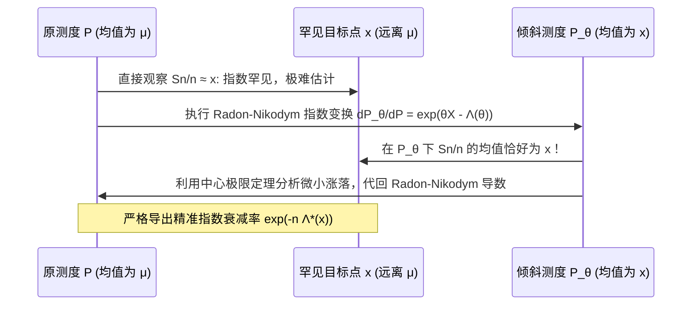

# Lec 3 Cramér 定理与大偏差原理渐近拓扑 (Large Deviations Theory: Cramér's Theorem)

> MIT 15.070J 高级随机过程与离散概率 (Advanced Stochastic Processes) · 授课教师：Prof. David Gamarnik (MIT ORC)

## TL;DR

- Cramér 定理确立了一维实轴上 i.i.d. 样本均值大偏差原理（LDP）的充要完整数学表述。
- 开集下界由测度指数倾斜（Exponential Change of Measure）方法严格证明。
- 闭集上界通过紧致覆盖与凸对偶切比雪夫界一致达成。

## 经典 Cramér 定理的数学表述

1938 年瑞典数学家 Harald Cramér 建立了概率论历史上划时代的里程碑定理，将初等的 Chernoff 尾部上界升华为了完备的大偏差上下界渐近相等理论。

在现代测度拓扑语境下，一个概率测度序列的大偏差行为是通过开集（Open Sets）与闭集（Closed Sets）的双向包含界来刻画的。

::: theorem [Cramér 定理 (Cramér's Theorem, 1938)]
设 $X_1, X_2, \dots, X_n$ 为独立同分布实随机变量，假设对数累积量母函数 $\Lambda(\theta) = \log \mathbb{E}[e^{\theta X_1}]$ 在原点的一个开邻域内有限，记 $\Lambda^*(x) = \sup_\theta \{\theta x - \Lambda(\theta)\}$ 为其率函数。设 $\mu_n$ 为样本均值 $S_n/n = \frac{1}{n}\sum_{i=1}^n X_i$ 的概率分布律。
则对于任意闭集 $F \subset \mathbb{R}$，有：
$$
\limsup_{n \to \infty} \frac{1}{n} \log \mu_n(F) \le -\inf_{x \in F} \Lambda^*(x)
$$
对于任意开集 $G \subset \mathbb{R}$，有：
$$
\liminf_{n \to \infty} \frac{1}{n} \log \mu_n(G) \ge -\inf_{x \in G} \Lambda^*(x)
$$
若博雷尔集 $\Gamma \subset \mathbb{R}$ 满足 $\inf_{x \in G} \Lambda^*(x) = \inf_{x \in \bar{\Gamma}} \Lambda^*(x) = I(\Gamma)$（称为 $\Lambda^*$-连续集），则极限严格成立：
$$
\lim_{n \to \infty} \frac{1}{n} \log \mathbb{P}\left(\frac{S_n}{n} \in \Gamma\right) = -\inf_{x \in \Gamma} \Lambda^*(x)
$$
:::

## 测度指数变换（Esscher 变换与 Cramér 倾斜）

证明 Cramér 定理下界的核心思想，是统计物理与精算数学中极为辉煌的技巧——**测度的指数倾斜**（Exponential Tilting / Esscher Transform）。

为了证明样本均值落在目标点 $x_0$ 附近开区间的下界，直接计算原始测度下的概率极为困难，因为事件是超罕见的小概率事件。但如果我们人为改变概率测度，使得在这个新测度下，目标点 $x_0$ 恰恰成为系统的“正常均值”（期望值），那么在新测度下，大数定律和弱极限定理就可以被直接激活！

::: definition [指数倾斜测度 (Tilted Measure)]
对于参数 $\theta$，定义随机变量 $X$ 的指数倾斜概率测度 $\mathbb{P}_\theta$ 满足：
$$
\frac{d\mathbb{P}_\theta}{d\mathbb{P}}(X) = \frac{e^{\theta X}}{\mathbb{E}[e^{\theta X}]} = \exp(\theta X - \Lambda(\theta))
$$
在测度 $\mathbb{P}_\theta$ 下，$X$ 的期望为：
$$
\mathbb{E}_\theta[X] = \frac{\mathbb{E}[X e^{\theta X}]}{\mathbb{E}[e^{\theta X}]} = \frac{d}{d\theta}\Lambda(\theta) = \Lambda'(\theta)
$$
:::

设我们要研究的点为 $x \in (\mu, \infty)$。由于 $\Lambda(\theta)$ 严格凸，必存在唯一的 $\theta_x$ 使得 $\Lambda'(\theta_x) = x$。
此时在测度 $\mathbb{P}_{\theta_x}$ 下，样本均值 $S_n/n$ 的期望值刚好就是 $x$！

## 下界的严谨逆转推导

考虑小开区间 $B_\delta(x) = (x - \delta, x + \delta)$。我们写出概率变换关系：
$$
\mathbb{P}\left(\frac{S_n}{n} \in B_\delta(x)\right) = \int_{\{\frac{S_n}{n} \in B_\delta(x)\}} d\mathbb{P} = \int_{\{\frac{S_n}{n} \in B_\delta(x)\}} \exp\left(-\theta_x S_n + n \Lambda(\theta_x)\right) d\mathbb{P}_{\theta_x}
$$
在积分区域内，$S_n \le n(x + \delta)$，因此：
$$
\mathbb{P}\left(\frac{S_n}{n} \in B_\delta(x)\right) \ge \exp\left(-n[\theta_x x - \Lambda(\theta_x)] - n \theta_x \delta\right) \mathbb{P}_{\theta_x}\left(\frac{S_n}{n} \in B_\delta(x)\right)
$$
注意到 $\theta_x x - \Lambda(\theta_x) = \Lambda^*(x)$，且在新测度 $\mathbb{P}_{\theta_x}$ 下，由弱大数定律：
$$
\lim_{n \to \infty} \mathbb{P}_{\theta_x}\left(\left|\frac{S_n}{n} - x\right| < \delta\right) = 1
$$
两边取对数并除以 $n$：
$$
\liminf_{n \to \infty} \frac{1}{n} \log \mathbb{P}\left(\frac{S_n}{n} \in B_\delta(x)\right) \ge -\Lambda^*(x) - \theta_x \delta
$$
令 $\delta \to 0$，即彻底证明了开集的渐近下界！

::: insight 倾斜变换是罕见事件模拟的灵魂（重要性采样）
在实际大规模蒙特卡洛计算中，直接模拟 $\mathbb{P}(S_n/n \ge a)$ 需要 $10^{12}$ 次以上的巨大抽样量才能撞见一次罕见事件，方差极大。
Cramér 定理的证明机制直接催生了现代运筹优化中最顶级的加速技术——**基于率函数的最优重要性采样（Importance Sampling）**：在模拟中直接将采样分布倾斜为 $\mathbb{P}_{\theta^*}$，仅需数十次抽样即可精确算出极其罕见的尾部概率，且方差呈指数级缩减。
:::
