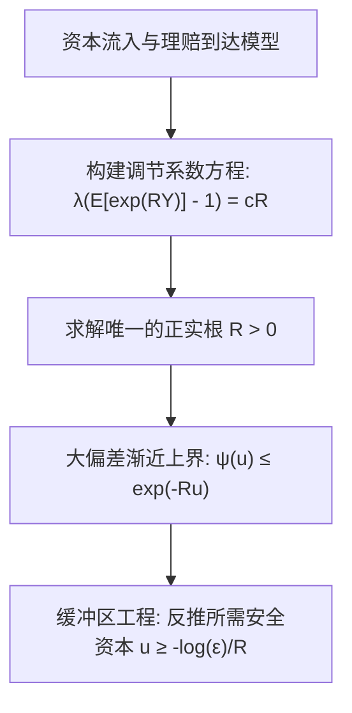

# Lec 4 大偏差技术的工程应用：排队、通信与破产风险 (Applications of the Large Deviations Technique)

> MIT 15.070J 高级随机过程与离散概率 (Advanced Stochastic Processes) · 授课教师：Prof. David Gamarnik (MIT ORC)

## TL;DR

- 大偏差技术精准刻画单服务台排队队列缓冲区溢出的渐近指数破产概率。
- Cramér-Lundberg 保险破产模型揭示了资本盈余的指数安全边界与调节系数。
- 网络有效带宽（Effective Bandwidth）理论量化了统计复用下服务质量保证（QoS）。

## 动态系统与罕见事件工程

在运筹学、电信网络设计与金融保险工程中，系统的核心设计约束往往不是平均负载（Average Throughput），而是**极端可靠性指标**：
1. **网络通信**：路由器有限缓存区（Buffer Overflow）发生数据包丢弃的概率必须低于 $10^{-9}$；
2. **金融保险**：保险公司的净资产是否会因为理赔浪涌而击穿最低资本金警戒线（破产概率 Ruin Probability）；
3. **计算系统**：云端多租户微服务在突发流量下的服务等级协议（SLA）违反概率。

大偏差理论将复杂的随机过程稳态极值概率，化简为代数可计算的几何凸优化极值问题。

## Cramér-Lundberg 保险破产模型

考虑经典保险盈余过程（Cramér-Lundberg Model）。设保险公司的初始资本储备为 $u > 0$，保费以恒定速率 $c > 0$ 连续流入，理赔事件按参数为 $\lambda$ 的泊松过程到达，第 $i$ 次理赔金额为独立同分布随机变量 $Y_i$（期望为 $\mathbb{E}[Y] = \mu_Y$）。
时刻 $t$ 的总盈余为：
$$
U(t) = u + c t - \sum_{i=1}^{N(t)} Y_i
$$
为了保证保险公司长期不亏损，必须满足净利润条件：$c > \lambda \mu_Y$。破产时刻定义为 $\tau = \inf\{t > 0: U(t) < 0\}$，我们关心的核心破产概率为 $\psi(u) = \mathbb{P}(\tau < \infty)$。

::: theorem [Lundberg 不等式与调节系数 (Lundberg Inequality)]
设理赔额 $Y$ 存在对数矩母函数 $\Lambda_Y(\theta)$。若方程：
$$
\lambda (\mathbb{E}[e^{R Y}] - 1) = c R
$$
存在严格正实数解 $R > 0$（称为 **Lundberg 调节系数**，Adjustment Coefficient），则破产概率满足严格指数衰减：
$$
\psi(u) \le e^{-R u}, \quad \lim_{u \to \infty} \frac{1}{u} \log \psi(u) = -R
$$
:::

## 单服务台排队系统的缓冲区溢出 (Buffer Overflow)

考虑离散时间单服务台排队队列。设 $A_t$ 为时隙 $t$ 到达的工作载荷，$c$ 为固定的服务器处理速率。队列长度序列 $Q_t$ 遵循 Lindley 递归方程：
$$
Q_{t+1} = \max(0, Q_t + A_t - c)
$$
假设到达过程是平稳遍历的，且平均到达率 $\mathbb{E}[A_1] < c$。在稳态下，队列长度超过阈值 $B$ 的概率满足大偏差渐近性：

::: theorem [排队缓冲区大偏差渐近律]
设 $A_t$ 的对数累积量母函数为 $\Lambda_A(\theta)$。设 $\theta^*$ 为满足 $\Lambda_A(\theta^*) = \theta^* c$ 的非零正根，则当缓冲区容量 $B \to \infty$ 时：
$$
\lim_{B \to \infty} \frac{1}{B} \log \mathbb{P}(Q_\infty \ge B) = -\theta^*
$$
:::

## 有效带宽理论 (Effective Bandwidth)

在电信宽带与多媒体网络设计中，不同业务流（如视频会议、网页浏览、后台下载）具有不同的突发统计特性。如何决定一条链路能同时承载多少个异构业务源？

::: definition [有效带宽 (Effective Bandwidth)]
对于到达过程 $A_t$，在服务质量参数 $\theta^*$（对应丢包率衰减指数）下的**有效带宽**定义为：
$$
\alpha(\theta^*) = \frac{\Lambda_A(\theta^*)}{\theta^*} = \frac{1}{\theta^*} \log \mathbb{E}[e^{\theta^* A_1}]
$$
:::

当多个独立的数据流 $1, 2, \dots, K$ 汇聚到容量为 $C$ 的交换机时，只要满足：
$$
\sum_{k=1}^K \alpha_k(\theta^*) \le C
$$
系统即可严格保证缓冲队列溢出概率受控在 $\mathbb{P}(Q_\infty \ge B) \lesssim e^{-\theta^* B}$ 之内！

::: pitfall 盲目使用峰值带宽导致资源极大浪费
传统电信工程为确保 0 丢包，往往按照各业务的峰值速率（Peak Rate）进行网络资源预留，导致带宽利用率极低（通常低于 15%）。大偏差有效带宽理论证明，只要业务流之间具有独立性，统计复用（Statistical Multiplexing）能够让总所需带宽大幅回落至接近平均速率的水平，同时在数学上以可控指数下界保障 QoS。
:::

::: insight 调节系数是对偶极值在物理世界中的投影
从 Cramér 定理到 Lundberg 破产理论，我们看到同一个数学实体——对偶参数 $\theta^*$。在数学上，它是 Fenchel 凸共轭的最优解；在物理与工程世界中，它代表了**系统抗击随机灾难的天然弹性阻尼系数**。
一个系统的 $\theta^*$ 越大，说明其抵抗罕见大偏差的阻尼越强，每增加一单位的缓冲区或资本金储备，换来的安全度倍增效率就越高。
:::
