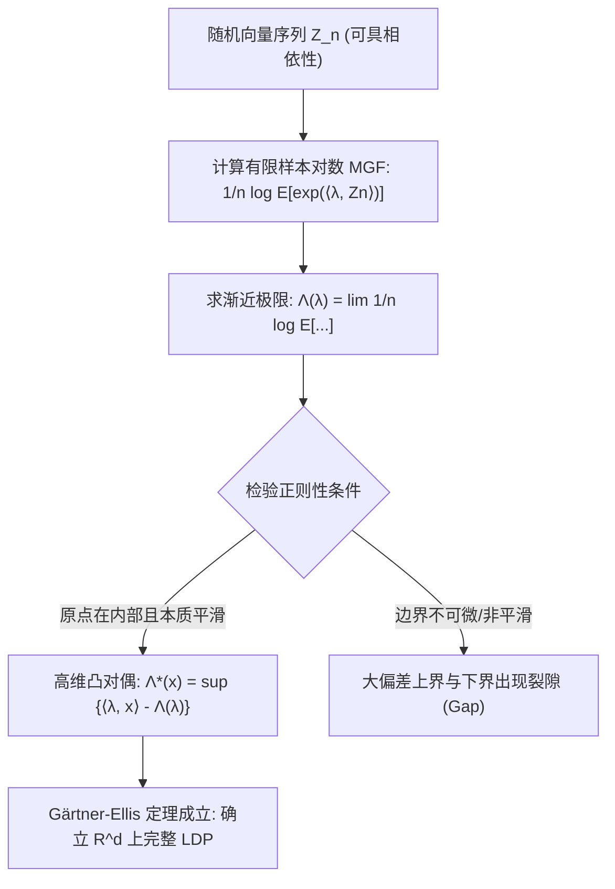

# Lec 5 高维大偏差与相依过程：Gärtner-Ellis 定理 (Extension of LD to R^d and Gärtner-Ellis Theorem)

> MIT 15.070J 高级随机过程与离散概率 (Advanced Stochastic Processes) · 授课教师：Prof. David Gamarnik (MIT ORC)

## TL;DR

- Gärtner-Ellis 定理将 Cramér 定理从一维 i.i.d. 标量拓展至高维空间及一般弱相依随机过程。
- 引入极限对数矩母函数 $\Lambda(\lambda) = \lim \frac{1}{n}\log \mathbb{E}[e^{\langle \lambda, S_n \rangle}]$ 处理非独立性。
- 本质平滑性（Essential Smoothness）条件确保了凸对偶变换的正则性与大偏差原理成立。

## 冲破 i.i.d. 假设的牢笼

经典的 Cramér 定理要求两个极其苛刻的假设：
1. **独立同分布（i.i.d.）**：现实中的金融时间序列、隐马尔可夫模型、物理自旋系统均具有深刻的时间自相关性与空间相依性；
2. **一维实数域（$\\mathbb{R}$）**：现代复杂系统往往需要联合刻画多个相互约束的宏观参量（如联合吞吐量、平均时延与丢包率向量），决策空间天然是高维向量空间 $\mathbb{R}^d$ 乃至拓扑向量空间。

为了将大偏差理论推进至马尔可夫链、平稳遍历高斯过程以及更一般的相依动力系统，Gärtner（1977）与 Ellis（1984）建立了现代大偏差分析中普适性最强的基石定理——**Gärtner-Ellis 定理**。

## 极限对数矩母函数与本质平滑性

设 $Z_n$ 为取值于 $\mathbb{R}^d$ 的随机向量序列（例如 $Z_n = \frac{1}{n}\sum_{i=1}^n X_i$，其中 $X_i$ 是马尔可夫链的转移状态）。

::: definition [极限对数矩母函数]
对于任意 $\lambda \in \mathbb{R}^d$，定义归一化的渐近对数矩母函数：
$$
\Lambda(\lambda) = \lim_{n \to \infty} \frac{1}{n} \log \mathbb{E}\left[\exp(\langle \lambda, Z_n \rangle)\right]
$$
假设上述极限在全空间 $\mathbb{R}^d$ 或原点包含的某个区域内存在（允许取值为 $+\infty$）。记其有效定义域为 $\mathcal{D}_\Lambda = \{\lambda \in \mathbb{R}^d : \Lambda(\lambda) < \infty\}$。
:::

根据 Hölder 不等式，$\Lambda(\lambda)$ 仍然是 $\mathbb{R}^d$ 上的凸函数。其高维 Fenchel-Legendre 凸共轭定义为：
$$
\Lambda^*(x) = \sup_{\lambda \in \mathbb{R}^d} \{\langle \lambda, x \rangle - \Lambda(\lambda)\}, \quad x \in \mathbb{R}^d
$$

为了确保高维凸对偶能够建立起严格的大偏差上下界，对偶函数不能在边界处产生非受控的突变跳跃。

::: definition [本质平滑性 (Essential Smoothness)]
称凸函数 $\Lambda(\lambda)$ 为**本质平滑的**，若：
1. $\mathcal{D}_\Lambda^\circ = \text{int}(\mathcal{D}_\Lambda)$ 非空；
2. $\Lambda(\lambda)$ 在 $\mathcal{D}_\Lambda^\circ$ 上处处可微；
3. 对于任意趋向于边界 $\partial \mathcal{D}_\Lambda$ 的序列 $\{\lambda_k\}$，梯度模长发散：$\lim_{k \to \infty} \|\nabla \Lambda(\lambda_k)\| = \infty$（陡峭性 Steepness）。
:::

## Gärtner-Ellis 定理的完整陈述

::: theorem [Gärtner-Ellis 定理 (Gärtner-Ellis Theorem)]
设 $Z_n$ 为 $\mathbb{R}^d$ 上的随机向量序列，其渐近对数矩母函数 $\Lambda(\lambda)$ 处处收敛。
若 $0 \in \mathcal{D}_\Lambda^\circ$，且 $\Lambda(\lambda)$ 是本质平滑的下半连续凸函数，
则测度序列 $\mu_n = \mathcal{L}(Z_n)$ 在 $\mathbb{R}^d$ 上满足大偏差原理（LDP），且其良率函数为 $\Lambda^*(x)$：
1. 对任意闭集 $F \subset \mathbb{R}^d$：
$$
\limsup_{n \to \infty} \frac{1}{n} \log \mu_n(F) \le -\inf_{x \in F} \Lambda^*(x)
$$
2. 对任意开集 $G \subset \mathbb{R}^d$：
$$
\liminf_{n \to \infty} \frac{1}{n} \log \mu_n(G) \ge -\inf_{x \in G \cap \mathcal{F}} \Lambda^*(x)
$$
其中 $\mathcal{F}$ 为曝光点（Exposed Points）集合。在全空间可微条件下 $\mathcal{F} = \mathbb{R}^d$。
:::

## 马尔可夫链的大偏差与 Perron-Frobenius 谱半径

Gärtner-Ellis 定理最具威力的应用在于**有限状态不可约非周期马尔可夫链**。
设状态空间为 $S = \{1, 2, \dots, m\}$，转移概率矩阵为 $P = (p_{ij})$。设随机变量函数为 $f: S \to \mathbb{R}$，我们要考察经验均值：
$$
Z_n = \frac{1}{n}\sum_{t=1}^n f(X_t)
$$
此时各个 $f(X_t)$ 显然不再独立。然而，利用马尔可夫性，矩母函数可表示为矩阵乘幂：
$$
\mathbb{E}\left[\exp\left(\theta \sum_{t=1}^n f(X_t)\right)\right] = \pi_0 \left(P^{(\theta)}\right)^n \mathbf{1}
$$
其中倾斜转移矩阵定义为 $P^{(\theta)}_{ij} = p_{ij} e^{\theta f(j)}$。

::: theorem [Perron-Frobenius 谱定理与马氏大偏差]
由于 $P$ 是不可约非周期的，倾斜正矩阵 $P^{(\theta)}$ 具有唯一的最大实正特征值 $\rho(P^{(\theta)})$（Perron-Frobenius 谱半径），且对应的特征向量严格为正。根据矩阵谱展开定理：
$$
\lim_{n \to \infty} \frac{1}{n} \log \mathbb{E}\left[\exp\left(\theta \sum_{t=1}^n f(X_t)\right)\right] = \log \rho\left(P^{(\theta)}\right)
$$
因此，极限对数矩母函数为：
$$
\Lambda(\theta) = \log \rho\left(P^{(\theta)}\right)
$$
由于最大特征值作为解析矩阵函数关于 $\theta$ 是无穷阶光滑的，Gärtner-Ellis 定理条件完美满足！马尔可夫链经验均值的率函数直接等于：
$$
\Lambda^*(x) = \sup_{\theta \in \mathbb{R}} \left\{\theta x - \log \rho\left(P^{(\theta)}\right)\right\}
$$
:::

::: insight 谱半径是大偏差在相依动力系统中的守恒量
对于独立过程，矩母函数直接是因式连乘积；而对于马尔可夫动力系统，状态转移历史将微观相依性深度编织进了转移矩阵中。
Perron-Frobenius 谱半径 $\rho(P^{(\theta)})$ 极其优雅地将**全局渐近增长的支配模式**从繁复的时间相依性中提纯出来。这再次彰显了代数谱理论与分析大偏差在更高维度的壮丽汇合。
:::
