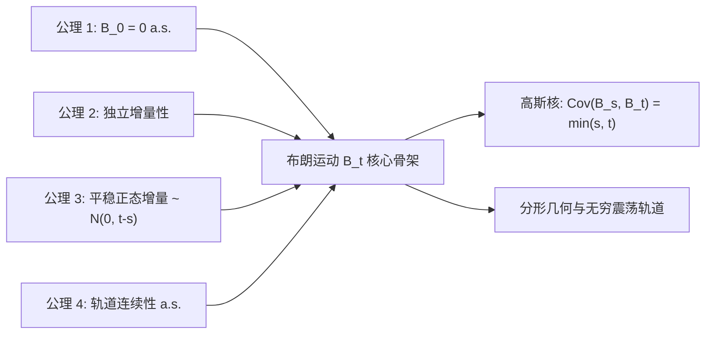

# Lec 6 布朗运动公理化构建与轨道性质 (Introduction to Brownian Motion)

> MIT 15.070J 高级随机过程与离散概率 (Advanced Stochastic Processes) · 授课教师：Prof. David Gamarnik (MIT ORC)

## TL;DR

- 布朗运动是具有独立平稳正态增量且样本轨道几乎必然处处连续的随机过程。
- 高斯过程有限维分布族由均值函数与协方差核 $K(s, t) = \min(s, t)$ 唯一确定。
- 柯尔莫哥洛夫连续性定理严格保证了连续轨道修正版本的存在性。

## 物理微粒与连续时间随机极限

1827 年英国植物学家罗伯特·布朗在显微镜下观察悬浮在水中的花粉颗粒时，发现了永不停歇的杂乱无章随机运动。爱因斯坦（1905）与佩兰（1908）建立了这一现象的分子动力学统计解释：布朗微粒的位移是由液体分子每秒数十亿次无规则碰撞叠加而成的宏观极限。

1923 年诺伯特·维纳（Norbert Wiener）首次在严谨的现代测度论体系下，完成了连续时间布朗运动（Wiener 过程）的公理化数学构造。布朗运动是整个现代随机分析、伊藤微积分、金融工程以及偏微分方程概率解法的绝对核心基石。

::: definition [标准标准布朗运动 / 维纳过程 (Standard Brownian Motion)]
定义在概率空间 $(\Omega, \mathcal{F}, \mathbb{P})$ 上的连续时间随机过程 $B = \{B_t\}_{t \ge 0}$ 称为**一维标准布朗运动**（Standard Brownian Motion），若满足以下公理：
1. **初始确定性**：$B_0 = 0$ 几乎必然（a.s.）成立；
2. **独立增量性**：对任意 $0 \le t_0 < t_1 < \dots < t_k$，增量序列 $B_{t_1} - B_{t_0}, B_{t_2} - B_{t_1}, \dots, B_{t_k} - B_{t_{k-1}}$ 相互独立；
3. **平稳正态增量**：对任意 $0 \le s < t$，增量 $B_t - B_s \sim \mathcal{N}(0, t - s)$；
4. **轨道连续性**：对于几乎所有样本点 $\omega \in \Omega$，映射 $t \mapsto B_t(\omega)$ 是关于时间 $t$ 的连续函数。
:::

## 高斯过程与协方差核结构

布朗运动是最典型、最重要的连续参数**高斯过程**（Gaussian Process）。

::: definition [高斯过程与有限维分布]
若随机过程 $X = \{X_t\}_{t \ge 0}$ 的任意有限时刻子集 $(t_1, t_2, \dots, t_k)$ 上的联合分布都是多维正态分布，则称 $X$ 为高斯过程。
高斯过程的概率分布律完全由其**均值函数** $m(t) = \mathbb{E}[X_t]$ 与**协方差核函数** $K(s, t) = \text{Cov}(X_s, X_t)$ 唯一决定。
:::

对于标准布朗运动，对任意 $s \le t$：
$$
m(t) = \mathbb{E}[B_t] = 0
$$
利用独立增量性，协方差核为：
$$
\text{Cov}(B_s, B_t) = \mathbb{E}[B_s B_t] = \mathbb{E}[B_s (B_s + (B_t - B_s))] = \mathbb{E}[B_s^2] + \mathbb{E}[B_s(B_t - B_s)] = s + 0 = s
$$
因此，对任意 $s, t \ge 0$，布朗运动的协方差核统一定义为：
$$
K(s, t) = \min(s, t) = s \wedge t
$$

## 维纳过程的存在性：Kolmogorov 连续性定理

根据 Kolmogorov 扩张定理，只要有限维分布族满足相容性条件，在无限积样本空间上便必然存在一个随机过程具有上述有限维正态分布。然而，Kolmogorov 扩张定理**完全无法保证**轨道是连续函数！因为连续性是不可数个时间点的联合事件，在积 $\sigma$-代数中甚至不可测。

真正确立布朗运动连续轨道存在性的，是概率论中极其优美的 **Kolmogorov-Chentsov 连续性定理**。

::: theorem [Kolmogorov 连续性定理 (Kolmogorov's Continuity Theorem)]
设 $X = \{X_t\}_{t \ge 0}$ 为实随机过程。若存在正常数 $\alpha > 0, \beta > 0, C > 0$，使得对所有 $s, t \ge 0$，均满足：
$$
\mathbb{E}[|X_t - X_s|^\alpha] \le C |t - s|^{1 + \beta}
$$
则存在 $X$ 的一个修改版本 $\tilde{X}$（即对所有 $t$，$\mathbb{P}(X_t = \tilde{X}_t) = 1$），其样本轨道几乎处处是局部 Hölder 连续的，其 Hölder 指数对于任意 $\gamma \in (0, \beta/\alpha)$ 均成立。
:::

对于布朗运动，取增量 $B_t - B_s \sim \mathcal{N}(0, |t-s|)$。计算其四阶矩（正态分布高阶矩）：
$$
\mathbb{E}[|B_t - B_s|^4] = 3 (t - s)^2
$$
对比定理参数，取 $\alpha = 4, \beta = 1, C = 3$。由此直接得出：
$$
\frac{\beta}{\alpha} = \frac{1}{4}
$$
若取更高阶偶数矩 $\alpha = 2m$：
$$
\mathbb{E}[|B_t - B_s|^{2m}] = (2m-1)!! |t - s|^m = C_m |t - s|^{1 + (m-1)}
$$
此时 $\frac{\beta}{\alpha} = \frac{m-1}{2m} = \frac{1}{2} - \frac{1}{2m}$。令 $m \to \infty$，我们得到震撼性的推论：

::: theorem [布朗运动轨道的 Hölder 连续性]
标准布朗运动存在一个样本轨道修正版本，其在任意闭区间 $[0, T]$ 上几乎必然是 $\gamma$-Hölder 连续的，其中 Hölder 指数可取任意 $\gamma \in \left(0, \frac{1}{2}\right)$。
:::

## 轨道的分形与处处不可微性

尽管布朗运动轨道几乎处处是连续的，但它在微观尺度上的剧烈抖动使其与经典微积分彻底决裂。

::: theorem [Paley-Wiener-Zygmund 定理 (处处不可微性)]
对于几乎所有样本轨道 $\omega$，布朗运动轨道 $t \mapsto B_t(\omega)$ 在时间轴上**处处不可导**（Nowhere Differentiable）。
:::

::: pitfall 试图对布朗运动轨道计算普通导数 dB/dt
在物理文献中，常有人写出“白噪声 $\xi(t) = \frac{dB_t}{dt}$”。在严谨的数学分析中，由于布朗运动轨道的变差无限且处处不可微，$\frac{dB_t}{dt}$ 在经典连续函数意义下根本不存在（只能作为广义函数的 Schwartz 分布理解）。这正是为什么后续必须发明伊藤微积分（Ito Calculus）来代替经典微积分！
:::

::: insight 粗糙轨道（Rough Paths）与连续性的极限博弈
布朗运动是数学分析中最精巧的矛盾体：它拥有最平滑的概率规律（无限阶光滑的高斯转移核），却生长在最粗糙、最崎岖的物理骨架之上（分形维数为 1.5，处处不可导，局部 1/2-Hölder 连续）。
这一张力构成了现代随机分析全部壮美诗篇的起点。
:::
