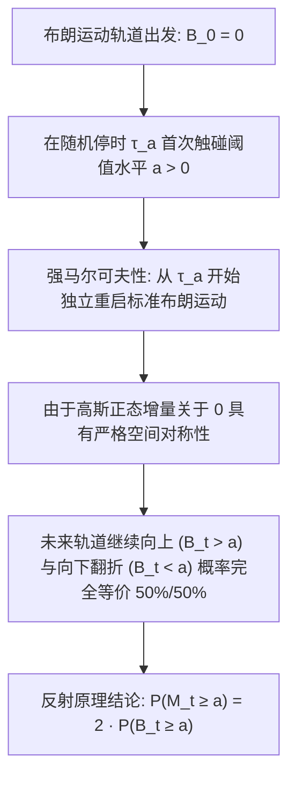

# Lec 7 强马氏性、反射原理与极值分布 (The Reflection Principle and Maximum of Brownian Motion)

> MIT 15.070J 高级随机过程与离散概率 (Advanced Stochastic Processes) · 授课教师：Prof. David Gamarnik (MIT ORC)

## TL;DR

- 停时（Stopping Times）与强马氏性（Strong Markov Property）允许布朗运动在随机时间点无记忆重启。
- 几何反射原理（Reflection Principle）通过对称性将极值分布精确转化为端点正态概率。
- 运行极值（Running Maximum）的概率密度分布是计算金融障碍期权定价的解析利器。

## 随机时间与强马尔可夫性

对于确定性时刻 $s \ge 0$，布朗运动的马尔可夫性指出：给定当前值 $B_s$，过程在未来的演化 $\{B_{s+t} - B_s\}_{t \ge 0}$ 独立于过去的整条历史路径 $\{B_u\}_{0 \le u \le s}$，且其本身重新构成一个独立的标准布朗运动。

然而在现实物理与金融世界中，关键的决策时刻往往不是预先给定的固定时刻，而是**由轨道本身所触发的随机时刻**——例如股票价格首次触及止损线时刻、排队队长首次打满缓冲区时刻。这类由历史信息决定的随机时间被称为**停时**（Stopping Times）。

::: definition [自然流与停时 (Stopping Times)]
设 $(\Omega, \mathcal{F}, \{\mathcal{F}_t\}_{t \ge 0}, \mathbb{P})$ 为滤过概率空间。非负随机变量 $\tau: \Omega \to [0, \infty]$ 称为流 $\{\mathcal{F}_t\}$ 上的**停时**，若对任意 $t \ge 0$，事件 $\{\tau \le t\} \in \mathcal{F}_t$。
定义在停时 $\tau$ 处的停止 $\sigma$-代数（Stopping $\sigma$-algebra）为：
$$
\mathcal{F}_\tau = \{A \in \mathcal{F} : A \cap \{\tau \le t\} \in \mathcal{F}_t, \forall t \ge 0\}
$$
:::

::: theorem [布朗运动的强马尔可夫性 (Strong Markov Property)]
设 $B$ 为标准布朗运动，$\tau$ 为几乎必然有限的停时。则过程：
$$
\tilde{B}_t = B_{\tau + t} - B_\tau, \quad t \ge 0
$$
也是一个独立的标准布朗运动，且独立于历史 $\sigma$-代数 $\mathcal{F}_\tau$。
:::

## 几何反射原理 (The Reflection Principle)

强马尔可夫性最天才的几何应用，是法国数学家 Désiré André 提出的**反射原理**。

考虑首达时（First Hitting Time）：对于给定的水平阈值 $a > 0$，定义首达时间为：
$$
\tau_a = \inf\{t \ge 0 : B_t = a\}
$$
显然 $\tau_a$ 是一个合法的停时。

定义布朗运动在时间区间 $[0, t]$ 内的**运行最大值**（Running Maximum）：
$$
M_t = \sup_{0 \le s \le t} B_s
$$
我们要计算联合事件 $\mathbb{P}(M_t \ge a, B_t < a)$ 与全概率 $\mathbb{P}(M_t \ge a)$。

根据对称性，在时刻 $\tau_a$ 之后，轨道向上走与向下走是完全对称且无偏的。若我们在 $\tau_a$ 之后将轨道沿水平线 $y = a$ 进行镜面几何反射：
$$
B_s^* = \begin{cases}
B_s, & 0 \le s \le \tau_a \\
2a - B_s, & s > \tau_a
\end{cases}
$$
由于空间反射后的过程 $\tilde{B}_u = -(B_{\tau_a + u} - a)$ 依然具有与原增量完全相同的正态概率分布律，反射后的轨道在测度意义下与原轨道毫无差别！

::: theorem [反射原理核心等价公式]
对于任意 $a > 0$ 及 $x \le a$：
$$
\mathbb{P}(M_t \ge a, B_t \le x) = \mathbb{P}(B_t \ge 2a - x)
$$
特别地，当 $x = a$ 时，由于连续性 $\mathbb{P}(B_t = a) = 0$：
$$
\mathbb{P}(M_t \ge a) = \mathbb{P}(M_t \ge a, B_t \ge a) + \mathbb{P}(M_t \ge a, B_t < a) = \mathbb{P}(B_t \ge a) + \mathbb{P}(B_t \ge a) = 2 \mathbb{P}(B_t \ge a)
$$
:::

## 极值分布与首达时概率密度

由反射原理，我们能够直接写出运行最大值 $M_t$ 的精确累积分布函数：
$$
\mathbb{P}(M_t \ge a) = 2 \mathbb{P}(B_t \ge a) = 2 \int_a^\infty \frac{1}{\sqrt{2\pi t}} e^{-\frac{u^2}{2t}} du = \sqrt{\frac{2}{\pi t}} \int_a^\infty e^{-\frac{u^2}{2t}} du
$$
对 $a$ 求导，即得到 $M_t$ 的概率密度函数：
$$
f_{M_t}(a) = \sqrt{\frac{2}{\pi t}} \exp\left(-\frac{a^2}{2t}\right), \quad a \ge 0
$$
这说明：**标准布朗运动在时刻 $t$ 的运行极大值 $M_t$，与时刻 $t$ 的绝对值 $|B_t|$ 具有完全同等的概率分布律！**

类似地，由于事件 $\{M_t \ge a\}$ 等价于首达时 $\{\tau_a \le t\}$：
$$
\mathbb{P}(\tau_a \le t) = \mathbb{P}(M_t \ge a) = 2 - 2 \Phi\left(\frac{a}{\sqrt{t}}\right)
$$
对时间 $t$ 求导，即获得首达时 $\tau_a$ 的著名的 **Lévy 分布密度**：
$$
f_{\tau_a}(t) = \frac{a}{\sqrt{2\pi t^3}} \exp\left(-\frac{a^2}{2t}\right), \quad t > 0
$$

::: pitfall 尾部重尾性与首达时的期望发散
考察首达时分布 $f_{\tau_a}(t)$ 在 $t \to \infty$ 时的渐近行为：
$$
f_{\tau_a}(t) \sim \frac{a}{\sqrt{2\pi}} t^{-3/2}
$$
由于 $t^{-3/2}$ 幂律衰减，积分 $\int_0^\infty t f_{\tau_a}(t) dt \sim \int^\infty t^{-1/2} dt = \infty$。
这揭示了一个经典佯谬：**布朗运动几乎必然（概率为 1）会触碰到任意高的正水平线 $a > 0$，但其首次触碰该水平线的平均期望时间是无穷大！**
:::

::: insight 几何对称性战胜不可数微分复杂性
初学者在面对运行极值 $M_t = \sup_{s \le t} B_s$ 时常常望而生畏，因为上确界涉及连续区间内不可数个随机变量的最大值。
然而反射原理通过简单的镜面对称性，轻描淡写地将这一高难度的无穷维极值问题，降维映射到了单个确定性时间点 $B_t$ 的一维正态高斯积分。这种几何之美不仅是概率论的艺术品，更直接推动了金融华尔街对触碰期权、回望期权（Lookback Options）与障碍期权（Barrier Options）的秒级无套利闭式定价。
:::
