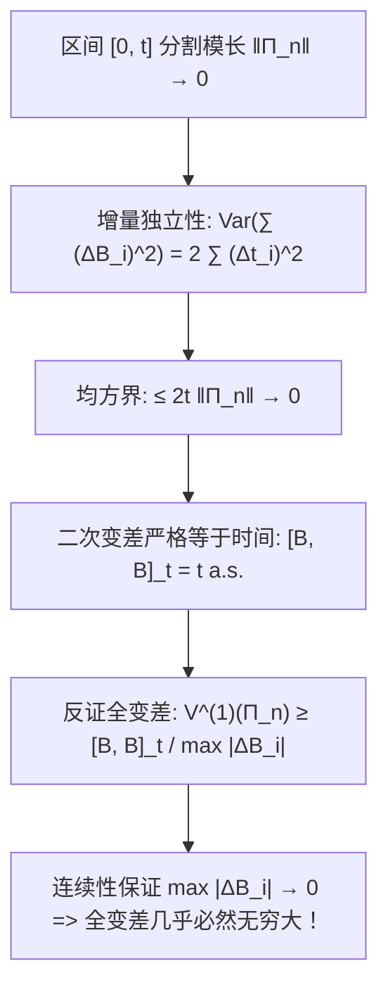

# Lec 8 布朗运动的二次变差与全变差发散性 (Quadratic Variation of Brownian Motion)

> MIT 15.070J 高级随机过程与离散概率 (Advanced Stochastic Processes) · 授课教师：Prof. David Gamarnik (MIT ORC)

## TL;DR

- 布朗运动样本轨道的全变差几乎处处无穷发散，粉碎了经典黎曼-斯蒂尔杰斯积分应用前提。
- 区间 $[0, t]$ 上的二次变差在 $L^2$ 与概率意义下几乎必然严格恒等于时间常数 $t$。
- 二次变差的存在奠定了现代随机微积分中非零微元法则 $(dB_t)^2 = dt$ 的严谨数学源头。

## 经典微积分的基石塌陷

在传统牛顿-莱布尼茨微积分与黎曼-斯蒂尔杰斯（Riemann-Stieltjes）积分理论中，对于积分 $\int_0^t f(s) dg(s)$，被积导引函数 $g(s)$ 通常要求具有**有界变差**（Bounded Total Variation），或者至少是绝对连续的。若 $g(s)$ 具有有界变差，则其全变差有限：
$$
V_{[0, t]}(g) = \sup_{\Pi} \sum_{i=1}^n |g(t_i) - g(t_{i-1})| < \infty
$$
然而，当我们试图用布朗运动轨道 $B_t(\omega)$ 充当积分导引路径时，经典微积分的根基将瞬间塌陷。

::: definition [变差与二次变差 (Quadratic Variation)]
设 $\Pi_n = \{0 = t_0 < t_1 < \dots < t_n = t\}$ 为区间 $[0, t]$ 的任意分割，记模长 $\|\Pi_n\| = \max_{1 \le i \le n} (t_i - t_{i-1})$。
定义过程沿着分割序列的原变差与二次变差和式为：
$$
V^{(1)}(\Pi_n) = \sum_{i=1}^n |B_{t_i} - B_{t_{i-1}}|
$$
$$
V^{(2)}(\Pi_n) = \sum_{i=1}^n (B_{t_i} - B_{t_{i-1}})^2
$$
若当 $\|\Pi_n\| \to 0$ 时，$V^{(2)}(\Pi_n)$ 在某种意义下收敛到极限，则该极限称为轨道在 $[0, t]$ 上的**二次变差**，记为 $[B, B]_t$ 或 $\langle B \rangle_t$。
:::

## 二次变差定理及其严格收敛性

对于平滑函数（如连续可微函数 $g(t)$），其中每一段微分 $(g(t_i) - g(t_{i-1}))^2 \approx (g'(\xi_i))^2 (\Delta t_i)^2$，其二次变差求和正比于 $\sum (\Delta t_i)^2 \le \|\Pi\| \sum \Delta t_i = \|\Pi\| t \to 0$。因此在经典平滑微积分中，二次变差恒等于 0。

但布朗运动展现出截然不同的奇异物理特性：

::: theorem [布朗运动二次变差定理]
设 $\Pi_n$ 为区间 $[0, t]$ 上模长 $\|\Pi_n\| \to 0$ 的任意分割序列。
则当 $n \to \infty$ 时，二次变差和式在均方意义（$L^2$）下严格收敛至确定性时间常数 $t$：
$$
\lim_{\|\Pi_n\| \to 0} \mathbb{E}\left[\left(\sum_{i=1}^n (B_{t_i} - B_{t_{i-1}})^2 - t\right)^2\right] = 0
$$
若进一步假设分割序列满足 $\sum_{n=1}^\infty \|\Pi_n\| < \infty$，则收敛几乎必然（a.s.）成立：
$$
[B, B]_t = \lim_{\|\Pi_n\| \to 0} \sum_{i=1}^n (B_{t_i} - B_{t_{i-1}})^2 = t, \quad \text{a.s.}
$$
:::

### 定理的严格证明

记 $\Delta B_i = B_{t_i} - B_{t_{i-1}}$，$\Delta t_i = t_i - t_{i-1}$。由于增量独立且服从正态分布 $\Delta B_i \sim \mathcal{N}(0, \Delta t_i)$，我们有：
$$
\mathbb{E}[(\Delta B_i)^2] = \Delta t_i
$$
$$
\text{Var}((\Delta B_i)^2) = \mathbb{E}[(\Delta B_i)^4] - (\mathbb{E}[(\Delta B_i)^2])^2 = 3 (\Delta t_i)^2 - (\Delta t_i)^2 = 2 (\Delta t_i)^2
$$
考察二次变差与 $t$ 的均方差：
$$
\mathbb{E}\left[\left(\sum_{i=1}^n (\Delta B_i)^2 - t\right)^2\right] = \mathbb{E}\left[\left(\sum_{i=1}^n \left((\Delta B_i)^2 - \Delta t_i\right)\right)^2\right]
$$
由于不同区间的增量相互独立，交叉项期望为 0：
$$
\sum_{i=1}^n \text{Var}((\Delta B_i)^2) = \sum_{i=1}^n 2 (\Delta t_i)^2 \le 2 \|\Pi_n\| \sum_{i=1}^n \Delta t_i = 2 t \|\Pi_n\|
$$
当分割模长 $\|\Pi_n\| \to 0$ 时，上式严格趋向于 0！均方收敛得证。

## 全变差的发散性与经典积分的终结

有了二次变差等于 $t$ 的铁律，我们可以轻而易举地证明布朗运动轨道的全变差必然无穷发散：

::: theorem [布朗运动全变差发散定理]
在任意非退化时间区间 $[0, t]$（$t > 0$）上，标准布朗运动轨道的全变差几乎必然无穷大：
$$
V_{[0, t]}(B) = \sup_{\Pi} \sum_{i=1}^n |B_{t_i} - B_{t_{i-1}}| = \infty, \quad \text{a.s.}
$$
:::

**证明思路**：
注意到对任意分割：
$$
\sum_{i=1}^n (B_{t_i} - B_{t_{i-1}})^2 \le \left(\max_{1 \le i \le n} |B_{t_i} - B_{t_{i-1}}|\right) \sum_{i=1}^n |B_{t_i} - B_{t_{i-1}}| = \left(\max_{1 \le i \le n} |B_{t_i} - B_{t_{i-1}}|\right) V^{(1)}(\Pi_n)
$$
若全变差 $V_{[0, t]}(B) < \infty$ 有限，那么当模长趋于 0 时，由布朗运动轨道的连续一致收敛性，$\max_i |B_{t_i} - B_{t_{i-1}}| \to 0$。
这将导致左边二次变差必收敛至 0。但这与前面已经严格证明的 $[B, B]_t = t > 0$ 产生致命矛盾！因此，全变差只能发散至无穷大。

::: pitfall 将全变差发散等同于不连续
初学者容易产生直觉错觉，认为“全变差无穷大的函数必然剧烈跳跃或断裂”。这是不对的：布朗运动轨道是处处连续的（Hölder 指数接近 1/2），但正是由于其在无限微观层次上的分形分形折叠，使得其在有限时间内的累计走廊长度达到了无穷大。
:::

::: insight 微元法则 (dB_t)^2 = dt 的数学纯度
物理学与金融学中常写出著名的符号公理：$(dB_t)^2 = dt$。很多工程文献将其含糊地归结为“高斯随机微元的经验近似”。
而二次变差定理以无可辩驳的测度论推导证实：**$(dB_t)^2 = dt$ 不是一阶泰勒展开的粗暴妥协，而是当时间微元分割趋向无穷精细时，依概率 1 发生的大数定律式确定性收敛**。这一非零项正是撕开经典微积分、诞生伊藤微积分的关键裂缝。
:::
