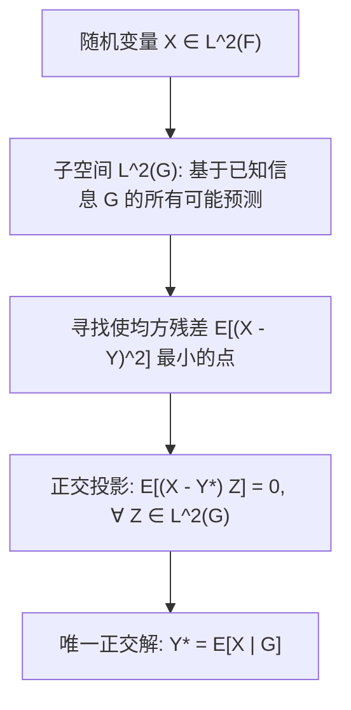

# Lec 9 条件期望的 L2 投影、信息流与鞅结构 (Conditional Expectations, Filtration and Martingales)

> MIT 15.070J 高级随机过程与离散概率 (Advanced Stochastic Processes) · 授课教师：Prof. David Gamarnik (MIT ORC)

## TL;DR

- 条件期望 $\mathbb{E}[X|\mathcal{G}]$ 是 Hilbert 空间 $L^2$ 上向子空间的正交投影算子。
- 滤过流 $\{\mathcal{F}_t\}$ 公理化刻画了观察者掌握的动态信息增长历史。
- 鞅性质 $\mathbb{E}[X_t|\mathcal{F}_s] = X_s$ 表达了随机博弈的绝对公平性与无偏趋势。

## 从有限分割到通用测度条件期望

在初等概率论中，给定事件 $B$ 的条件概率定义为简单的几何比值 $\mathbb{P}(A|B) = \frac{\mathbb{P}(A \cap B)}{\mathbb{P}(B)}$。然而，当条件信息不再是具有正概率的离散事件，而是连续随机变量的取值（例如“已知当前股票价格 $S_t = 100.5$”，其单个点概率为 0），经典的初等条件期望立刻遇到分母除以零的未定义灾难（Borel-Kolmogorov 佯谬）。

1933 年柯尔莫哥洛夫基于 Radon-Nikodym 定理，建立了普适于任意 $\sigma$-代数的代数条件期望体系。

::: definition [抽象条件期望 (Radon-Nikodym 定义)]
设 $(\Omega, \mathcal{F}, \mathbb{P})$ 为概率空间，$X$ 为可积随机变量（$\mathbb{E}[|X|] < \infty$），$\mathcal{G} \subset \mathcal{F}$ 为子 $\sigma$-代数。
称随机变量 $Y$ 为 $X$ 关于 $\mathcal{G}$ 的**条件期望**，记为 $Y = \mathbb{E}[X|\mathcal{G}]$，若满足以下双重契约：
1. **$\mathcal{G}$-可测性**：$Y$ 本身是 $\mathcal{G}$-可测随机变量；
2. **积分守恒律**：对于任意集合 $G \in \mathcal{G}$，均有：
$$
\int_G Y d\mathbb{P} = \int_G X d\mathbb{P} \quad \left(\text{即 } \mathbb{E}[Y \mathbf{1}_G] = \mathbb{E}[X \mathbf{1}_G]\right)
$$
根据 Radon-Nikodym 定理，满足此契约的 $Y$ 在概率为 1 意义下唯一确定。
:::

## Hilbert 空间中的几何直觉：$L^2$ 正交投影

当 $X \in L^2(\Omega, \mathcal{F}, \mathbb{P})$（即 $\mathbb{E}[X^2] < \infty$）时，条件期望具有无比震撼的几何含义——**正交投影**（Orthogonal Projection）。

::: theorem [条件期望的最优均方逼近定理]
设 $L^2(\mathcal{G})$ 为所有均方有限的 $\mathcal{G}$-可测随机变量构成的封闭线性子空间。
则条件期望 $\mathbb{E}[X|\mathcal{G}]$ 是原变量 $X$ 在子空间 $L^2(\mathcal{G})$ 上的唯一正交投影点：
$$
\mathbb{E}\left[\left(X - \mathbb{E}[X|\mathcal{G}]\right) Z\right] = 0, \quad \forall Z \in L^2(\mathcal{G})
$$
且其使得均方预测误差达到全局最小：
$$
\mathbb{E}[X|\mathcal{G}] = \arg\min_{Y \in L^2(\mathcal{G})} \mathbb{E}[(X - Y)^2]
$$
:::

## 滤过信息流 (Filtration) 与适应过程

为了建模随机系统随时间流逝而不断展开的动态信息，我们引入**滤过流**的概念。

::: definition [流与适应过程 (Filtration and Adapted Processes)]
概率空间 $(\Omega, \mathcal{F}, \mathbb{P})$ 上的**滤过流**（Filtration）是一族非降的子 $\sigma$-代数序列 $\{\mathcal{F}_t\}_{t \ge 0}$：
$$
\mathcal{F}_s \subset \mathcal{F}_t \subset \mathcal{F}, \quad \forall 0 \le s \le t
$$
$\mathcal{F}_t$ 代表了截至时刻 $t$ 为止所有历史事件的可观测信息集合。
若对于每一个 $t \ge 0$，随机变量 $X_t$ 都是 $\mathcal{F}_t$-可测的，则称过程 $X = \{X_t\}_{t \ge 0}$ 是**适应于流**（Adapted）的。
由随机过程本身的历史生成的最小自然流为 $\mathcal{F}_t^X = \sigma(X_s, 0 \le s \le t)$。
:::

## 鞅、下鞅与上鞅 (Martingales)

在流 $\{\mathcal{F}_t\}$ 的框架下，我们能够精确定义公平赌博与带有单调漂移的随机动态：

::: definition [鞅、下鞅与上鞅 (Martingale, Submartingale, Supermartingale)]
设适应过程 $X = \{X_t\}_{t \ge 0}$ 满足对所有 $t \ge 0$ 均有 $\mathbb{E}[|X_t|] < \infty$。
对任意 $0 \le s \le t$：
1. **鞅（Martingale）**：若 $\mathbb{E}[X_t | \mathcal{F}_s] = X_s$ a.s.；
2. **下鞅（Submartingale）**：若 $\mathbb{E}[X_t | \mathcal{F}_s] \ge X_s$ a.s.（趋势向上）；
3. **上鞅（Supermartingale）**：若 $\mathbb{E}[X_t | \mathcal{F}_s] \le X_s$ a.s.（趋势向下）。
:::

::: example [布朗运动生成的三大经典鞅]
设 $B_t$ 为关于自然流 $\mathcal{F}_t$ 的标准布朗运动。以下过程均为严格的连续时间鞅：
1. **线性鞅**：$X_t = B_t$。由于独立增量且期望为 0：
$$
\mathbb{E}[B_t | \mathcal{F}_s] = \mathbb{E}[B_s + (B_t - B_s) | \mathcal{F}_s] = B_s + \mathbb{E}[B_t - B_s] = B_s
$$
2. **二次鞅**：$Y_t = B_t^2 - t$。由方差性质易证 $\mathbb{E}[B_t^2 - t | \mathcal{F}_s] = B_s^2 - s$。
3. **指数鞅（Wald 鞅）**：对于任意实参数 $\theta \in \mathbb{R}$，过程：
$$
Z_t = \exp\left(\theta B_t - \frac{1}{2}\theta^2 t\right)
$$
是严格的单位期望鞅，其在 Girsanov 测度变换与衍生品定价中扮演核心角色。
:::

::: insight 条件期望是信息不全下的最高理性
在物理世界中，我们永远无法掌握宇宙所有的微观粒子初值；在金融市场中，我们永远无法预测明天的突发新闻。
条件期望 $\mathbb{E}[X|\mathcal{F}_t]$ 是现代科学给出的最深刻回答：**当上帝只允许你透过信息窗口 $\mathcal{F}_t$ 观察世界时，正交投影为你锁定了当前信息边界内方差最小、最无偏、最理性的唯一估计**。而鞅结构保证了随着时间流逝，这种理性的自我修正是完全公平且无套利机会的。
:::
