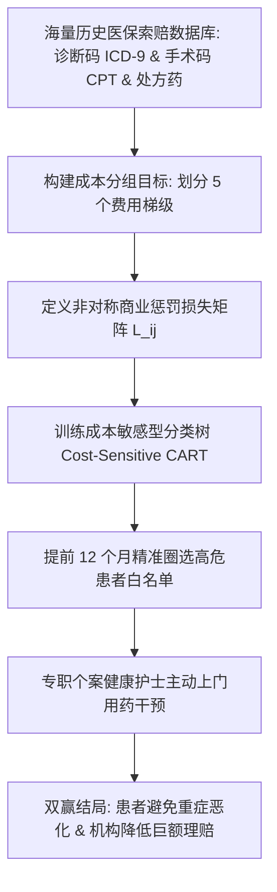

# Lec 10 D2Hawkeye 医疗索赔案例：分类树与高医疗成本患者识别 (Predicting Healthcare Costs: The D2Hawkeye Story)

> MIT 15.071 数据分析优势 · 讲义 10 · 授课教师：Prof. Dimitris Bertsimas / Allison O'Hair

## TL;DR

- 美国医疗体系中，前 $5\%$ 的高危慢性病患者消耗了全社会超过 $50\%$ 的医疗总开支。
- D2Hawkeye 依托医保历史索赔理赔数据，利用分类树提前一年识别高额医疗爆发风险。
- 非对称惩罚矩阵（Custom Penalty Matrix）使算法在训练时优先防范漏诊致命高危患者。
- 数据驱动的主动疾病管理（Disease Management）在挽救重症生命的同时显著降低了保险赔付。

## 1. 医疗费用的帕累托分布与主动干预契约

美国医疗健康系统是全球开销最昂贵的体系，医疗支出占其全美 GDP 比重超过 $17\%$。然而，深入剖析健康保险公司（Health Plans / Payers）的理赔账单，会发现一个极度惊人的长尾**帕累托不均衡分布（Pareto Distribution）**：
- 底部的 $50\%$ 健康或亚健康人群，全年的医疗开支仅占总开销的约 $3\%$；
- 而顶部的 **$5\%$ 高危慢性病及并发症患者**，消耗了全美医疗总保费池的 **$50\%$ 以上**！
- 位于前 $1\%$ 的重症极危患者，单人年度开销往往高达几十万甚至上百万美元。

传统健康保险机构处于一种极其被动的“报销者（Claims Payer）”角色：等到患者慢性病恶化至不可逆阶段（如糖尿病足坏疽切肢、充血性心力衰竭急性肺水肿呼吸窘迫入 ICU），巨额账单已经产生，保险公司只能被动签发支票。

麻省理工学院运筹学中心 Dimitris Bertsimas 教授敏锐地意识到：**如果我们能根据患者过去一两年的普通门诊与用药索赔数据，提前整整 12 个月预测出明年谁将滑向高危费用深渊，保险公司就可以提前派遣专职随访护士上门指导用药、监测指标，在恶化前拆除引线**！为此，Bertsimas 教授参与联合创立了医疗分析企业 **D2Hawkeye**。

## 2. 索赔特征工程与费用梯级定义

D2Hawkeye 面对的数据源极其特殊：由于保护患者隐私，模型无法获取完整的病历文本，只能依托标准化的**医疗保险电子索赔流（Claims Stream）**：
- **ICD-9 诊断代码（Diagnosis Codes）**：国际疾病分类编码（如 250.00 代表不伴有并发症的 2 型糖尿病，410 代表急性心肌梗死）；
- **CPT 手术与诊疗操作代码（Procedure Codes）**：核磁共振、血液透析、心脏搭桥手术等；
- **NDC 处方药编码（National Drug Codes）**：患者领取的胰岛素、降压药、抗凝剂剂量与频次。

### 2.1 目标变量：次年医疗费用五分位梯级（Cost Buckets）

模型以患者在未来连续 12 个月内的累计总医疗支出为因变量，划分为 5 个离散风险桶：
- **Bucket 1（极低风险）**：年花费 $\le \$3,000$
- **Bucket 2（低度风险）**：$\$3,000 < \text{Cost} \le \$8,000$
- **Bucket 3（中度风险）**：$\$8,000 < \text{Cost} \le \$20,000$
- **Bucket 4（高度风险）**：$\$20,000 < \text{Cost} \le \$50,000$
- **Bucket 5（极高极危风险）**：年花费 $> \$50,000$（ICU抢救、器官移植、靶向肿瘤药物等）

## 3. 成本敏感型学习与非对称惩罚矩阵

在多分类问题中，标准 CART 树以最大化纯度（基尼指数）为导向，隐式假设“将类别 1 误判为类别 2”与“将类别 5 误判为类别 1”的损失是完全等同的。

但在医疗商业实战中，这种对称假定是灾难性的：
- **假阳性（Type I Error）**：模型将原本健康的普通患者（Bucket 1）误判为高危（Bucket 5）。保险公司派护士打了一通电话，护士发现老人身体硬朗并无大碍，**浪费的干预成本仅为 50-100 美元**；
- **假阴性（Type II Error）**：模型将原本已经处于肾衰竭早期的极危患者（Bucket 5）误判为安全（Bucket 1）。干预团队彻底置之不理，次年患者突发急性尿毒症休克送进急诊，**直接产生 100,000 美元的急救住院账单与不可挽回的生命健康损害**！

为了将这种深度的商业现实注入算法，D2Hawkeye 设计了**非对称惩罚损失矩阵（Asymmetric Penalty Matrix $L_{ij}$）**：

| 真实费用类别 (Row) \ 预测类别 (Col) | 预测 Bucket 1 | 预测 Bucket 2 | 预测 Bucket 3 | 预测 Bucket 4 | 预测 Bucket 5 |
| :--- | :--- | :--- | :--- | :--- | :--- |
| **真实属于 Bucket 1** | **0** | 1 | 2 | 3 | 4 |
| **真实属于 Bucket 2** | 2 | **0** | 1 | 2 | 3 |
| **真实属于 Bucket 3** | 4 | 2 | **0** | 1 | 2 |
| **真实属于 Bucket 4** | 6 | 4 | 2 | **0** | 1 |
| **真实属于 Bucket 5 (极危)** | **20 (极重惩罚)**| 8 | 4 | 2 | **0** |

在修改后的 CART 树分裂优化准则中，算法极小化的不再是简单分类错误率，而是**加权预期惩罚损失之和**：
$$\min \quad \sum_{i=1}^n L_{\text{True}_i, \ \text{Pred}_i}$$

这一调整使得树模型在向下分裂时，展现出极强的“宁可轻度过度预警、绝不放走一个真正极危患者”的临床审慎倾向。

## 4. 商业落地与资本市场验证

通过部署基于该模型的智能化风险管理系统，D2Hawkeye 协助各大保司实现了精准的定向资源投放：
- 系统成功提前筛查出那些当前看似健康、但在次年有极高概率恶化为心肾综合征与重度哮喘的隐藏高危群体；
- 保险公司主动向高危慢病患者提供免费的血糖试纸、家用智能血压计并安排每月专职护士家访；
- **全保单人群次年的急诊入院率骤降 $18.5\%$，百万以上恶性重症赔偿总额缩减近 $30\%$**。

D2Hawkeye 凭借这套独步全美的分析技术，成为美国数字医疗领域的明星独角兽企业，并在 2009 年被美国医疗健康巨头以数亿美元的高溢价成功并购退出，成为 MIT 运筹学产学研转化的教科书级经典。

::: pitfall [仅看纸面总体准确率的评价陷阱]
若使用标准无惩罚 CART 树，模型倾向于将所有人判定为 Bucket 1 和 2，纸面综合准确率看似高达 $78\%$，但其对 Bucket 5 的召回率（Recall）近乎为零；而引入惩罚矩阵后，整体准确率虽然“下跌”到了 $65\%$，但对高危 Bucket 5 的捕获率跃升至 $70\%$ 以上。优秀的分析师从不被单一宏观指标蒙蔽。
:::

::: insight [我的理解：算法必须懂得度量不同痛苦的真实重量]
数学家设计的损失函数往往是冷漠对称的：错加和错减是一样的。但人类的生命与商业账本不是无差别的实数。错打一个电话的代价是几分钟的尴尬，而漏掉一次化验的代价是一条鲜活生命的陨落。D2Hawkeye 的精髓，在于用一张惩罚矩阵，把人类的慈悲与商业的底线硬编码进了决策树的每一次二分选择中。这才是真正拥有温度的数据科学。
:::
