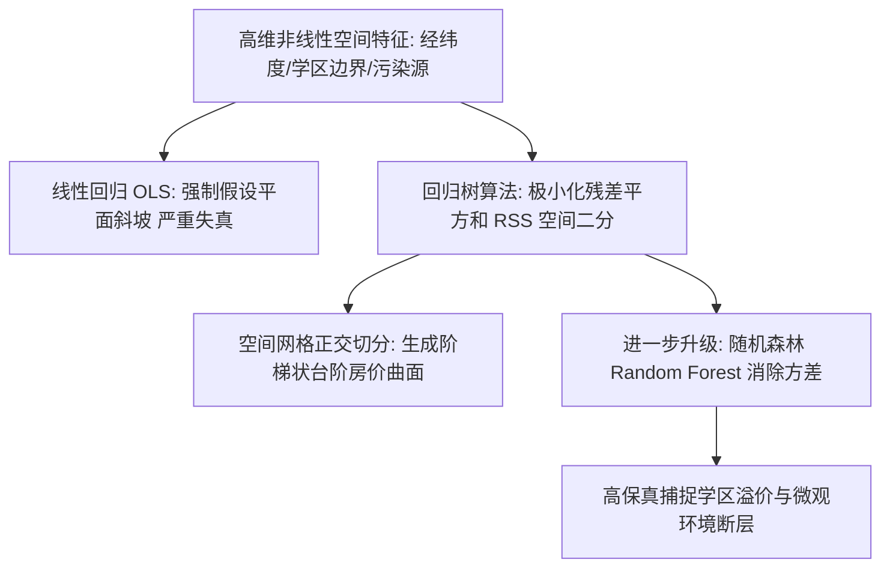

# Lec 11 房地产空间价值建模：回归树在房价预测中的非线性优势 (Regression Trees for Housing Data: Location, Location, Location)

> MIT 15.071 数据分析优势 · 讲义 11 · 授课教师：Prof. Dimitris Bertsimas / Allison O'Hair

## TL;DR

- 房地产界“地段、地段、还是地段（Location, Location, Location）”的格言体现了空间价值的极度非线性。
- 线性回归模型在拟合地理坐标经纬度时存在先天结构缺陷，无法表达跳跃式阶梯边界。
- 回归树（Regression Trees）通过最小化残差平方和（RSS），在多维空间中自动生成正交阶梯面。
- 随机森林（Random Forests）通过 Bagging 与特征随机子采样，在保留树模型非线性优势的同时极大削减了单树方差。

## 1. 地理空间价值的断裂性与线性模型的挫败

在经典城市经济学与房地产评估中，房产的价值不仅取决于其建筑本身的物理属性（如房间数量、建筑面积、建造年份），更在根本上受制于其**不可移动的空间地理区位（Spatial Location）**。

传统的多元线性回归在处理地理坐标（经度 Longitude 与纬度 Latitude）时，往往暴露出严重的结构性硬伤：
$$P = \beta_0 + \beta_1 (\text{Lat}) + \beta_2 (\text{Lon}) + \dots$$
该公式暗含着一个荒谬的假定：房价随着纬度向北推进呈现单调平滑的线性增减。

然而在现实城市空间中，地理溢价是**断裂且非连续的**：
- 隔着一条查尔斯河（Charles River），北岸的剑桥市哈佛大学学区与南岸的普通街区，每平方英尺单价可能相差数倍；
- 隔着一条市政公立学区划分红线，同一条街两侧完全相同的两座独立屋，售价能相差上百万元；
- 紧邻高污染重型化工厂或高速公路立交桥 200 米内的住宅，噪音和空气废气会导致价格发生悬崖式跳水，而一旦离开该微观区域，价格立刻反弹。

这种典型的非线性、多峰分布与空间台阶跳跃，正是**回归树（Regression Trees）**大显身手的天然舞台。

## 2. 回归树算法原理：以极小化方差为导向

当因变量 $Y$ 是连续实数（如房屋中位数售价，单位千美元）时，CART 算法的分裂准则从分类树的基尼指数平滑切换为**残差平方和（Residual Sum of Squares, RSS）**。

### 2.1 叶节点的预测值与残差测算

设当前树将特征空间划分为 $M$ 个不相交的超矩形子区域 $R_1, R_2, \dots, R_M$。
对于落在区域 $R_m$ 内的任意新样本，回归树给出的预测值恒等于该区域内所有训练样本的**算术平均值**：
$$\hat{c}_m = \text{mean}(y_i \mid x_i \in R_m) = \frac{1}{N_m} \sum_{x_i \in R_m} y_i$$

全模型的总残差平方和定义为：
$$RSS = \sum_{m=1}^M \sum_{i \in R_m} (y_i - \hat{c}_m)^2$$

### 2.2 贪心分裂过程

算法在每个节点搜索使全系统 $RSS$ 下降幅度最大的最优特征 $j$ 与最佳切分点 $s$：
$$\min_{j, s} \left[ \sum_{x_i \in R_1(j, s)} (y_i - \hat{c}_1)^2 + \sum_{x_i \in R_2(j, s)} (y_i - \hat{c}_2)^2 \right]$$
其中 $R_1(j, s) = \{X \mid X_j \le s\}$，而 $R_2(j, s) = \{X \mid X_j > s\}$。

## 3. 经典案例剖析：波士顿住房数据集（Boston Housing）

波士顿住房数据集（由 Harrison & Rubinfeld 于 1978 年收集）是全美数据科学界最著名的基准数据集之一。包含波士顿大都会区 506 个普查街区的房屋中位数售价（$MEDV$）及 13 项环境与人口特征：
- **RM**：住宅平均房间数（物理属性）；
- **LSTAT**：社区低收入人口比例（社会经济属性，$\%$）；
- **CRIM**：人均犯罪率；
- **NOX**：一氧化氮空气污染浓度（一氧化氮以千万分之一为单位）；
- **CHAS**：是否紧邻查尔斯河（0-1 虚拟变量）；
- **LAT & LON**：地理纬度与经度。

### 3.1 线性回归 vs 回归树对空间网格的拟合对比

当仅使用地理坐标经纬度（LAT, LON）预测房价时：
1. **多元线性回归**输出一个毫无生气的倾斜平面，决定系数 $R^2$ 仅为 **0.18**，残差呈现巨大的系统性偏误；
2. **回归树（经过剪枝后拥有 12 个叶节点）**自动对大波士顿地图切出了 12 个正交矩形区块，决定系数 $R^2$ 跃升至 **0.55**！
   - 树模型的第一道根节点切分立刻锁定了波士顿核心富人区（Beacon Hill 与 Back Bay 所在的狭小高纬度低经度区块）；
   - 在远离市中心的次级区域，模型依据经纬度自动分化出剑桥大学城与南部工业走廊。

当引入全维度特征（包含房间数 RM 与低收入比例 LSTAT）时，回归树的预测精度将达到惊人的高度：
根节点首要分裂特征为 **RM（房间数）**：
- 若 $\text{RM} \ge 6.94$（大户型豪宅）：直接划入高价区域，次级节点依据犯罪率与学区进一步切分；
- 若 $\text{RM} < 6.94$：下一级核心分裂特征立刻切换为 **LSTAT（社区贫困率）**。若贫困率高于 $14.4\%$，房价预期跌破 1.5 万美元。

## 4. 随机森林（Random Forests）：驯服方差的集成利刃

单棵回归树虽然直观易懂，但正如前文所述，它具有很高的预测方差（High Variance），容易受到个别奇异值样本的摆布。利奥·布雷曼于 2001 年提出了革命性的**随机森林（Random Forests）**集成算法：

::: theorem [随机森林的双重随机化机制]
随机森林由数百棵独立的回归树（通常 $B = 500$）投票组合而成，通过两层强有力的去相关随机化瓦解方差：
1. **样本层面的 Bootstrap 采样（Bagging）**：每棵树的训练样本是通过对原始数据集进行有放回的独立随机抽样（约抽取 $63.2\%$ 的不重复样本，剩余为袋外样本 OOB）；
2. **特征层面的随机子空间采样（Feature Subsampling）**：在树向下生长的**每一个节点**决定分裂时，算法不考察全部 $p$ 个特征，而是随机抽取一个子集（回归问题通常取 $m = p/3$，分类问题取 $m = \sqrt{p}$），只在候选特征子集内寻找最佳分裂点！
:::

通过特征子采样，算法有效防止了一两个超级主导特征（如房间数 RM）在每一棵树的根节点都重复出现，从而使各个决策树之间保持高度的**去相关性（De-correlation）**。最终集成预测值为所有单树的平均：
$$\hat{f}_{\text{RF}}(x) = \frac{1}{B} \sum_{b=1}^B \hat{f}_b(x)$$
波士顿数据集在随机森林上的测试集预测误差（Out-of-Bag RMSE）相比单棵回归树大幅缩减了近 $40\%$！

::: pitfall [回归树无法外推（Extrapolation Failure）]
由于回归树叶节点的输出永远是某个训练子集内样本均值，因此**回归树在数学上绝对不可能预测出任何超出训练集目标变量最大值或最小值的数值**！若历史上波士顿最高房价记录是 50 万美元，即便未来某座全新超级海景顶层豪宅的所有特征都突破天际，树模型的预测上限也永远被死死卡在 50 万美元。在具有强烈通胀趋势的外推场景中必须警惕此陷阱。
:::

::: insight [我的理解：随机森林是统计学版本的群体智慧]
在古老的集市上，让一位最聪明的屠夫去猜测一头公牛的重量，其误差往往远大于让八百个普通村民的猜测取平均值。单棵决策树就像一个执拗但容易走极端的个人专家，他可能会被某一次偶然的经历带偏；而随机森林构筑了一个庞大的多元化专家智库，每位专家被剥夺了一部分视野（随机特征），从而被迫从不同的侧面审视现实。正是这种刻意制造的差异化与去中心化，让森林最终汇聚出惊人的理性洞察。
:::
