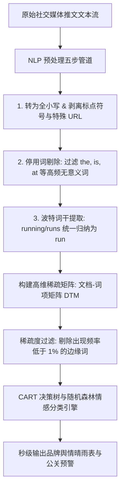

# Lec 12 文本分析与情感挖掘：从推特舆情中提炼商业洞见 (Sentiment Detection & Text Analytics: Turning Tweets into Knowledge)

> MIT 15.071 数据分析优势 · 讲义 12 · 授课教师：Prof. Dimitris Bertsimas / Allison O'Hair

## TL;DR

- 现代企业产生的数据超过 $80\%$ 是以电子邮件、社交媒体、客服工单等非结构化文本形式存在的。
- 文本挖掘标准管道涵盖字符清洗、标点过滤、小写归一化、停用词剔除与词干提取（Stemming）。
- 词袋模型（Bag-of-Words）将变长自然语言序列转译为高维稀疏的文档-词项矩阵（DTM）。
- 在推特情感分析实战中，分类树与随机森林能够秒级识别品牌负面公关危机与消费者偏好脉动。

## 1. 非结构化数据宝藏与自然语言挑战

在进入信息时代的最初几十年，商业数据科学主要专注于处理高度规整的结构化二维表格（Relational Tables）：每一行代表一个客户，每一列代表一个数值（如年龄、收入、交易额）。

然而，现实商业中最鲜活、最富含情感倾向与先导预警信号的信息，往往沉睡在海量的**非结构化文本（Unstructured Text）**之中：
- 社交网络（Twitter/X、Reddit）上用户对新款智能手机的实时吐槽与点赞；
- 亚马逊平台上成千上万条商品买家真实评论；
- 华尔街财报电话会议（Earnings Call Transcripts）中 CEO 的措辞微妙语调变化。

计算机如何理解人类充满歧义、多义词、俚语与拼写错误的自然语言？**文本分析（Text Analytics）**的核心任务，就是构建一套标准化的形式化数学管道，将人类写下的字符串，精确投影到计算机可以进行代数运算的高维向量空间中。



## 2. 文本挖掘标准预处理流水线

处理自然语言必须严格遵循五步过滤工序，消除海量表面形态差异，提取核心语义词项：

### 2.1 步骤 1：文本正则化与清洗（Normalization & Cleaning）
将所有文本统一强制转换为小写（Lowercasing），消除“Apple”与“apple”被系统误判为两个独立词汇的伪分化；运用正则表达式剥离所有标点符号、特殊字符（`@`、`#`、`$`）以及无语义价值的网页超链接（`http://...`）。

### 2.2 步骤 2：停用词剔除（Stop Words Removal）
在任何语言中，都存在大量出现频次极高、但几乎不传达任何特定领域情感倾向的语法功能词：如英语中的冠词、介词、连词（`the`, `is`, `are`, `at`, `which`, `on`, `and`）。在 R 语言的 `tm` 包中，直接加载权威停用词字典予以批量剔除。

### 2.3 步骤 3：波特词干提取（Porter Stemming Algorithm）
人类语言具有丰富的语法屈折变化（时态、单复数、分词）。例如：`argue`, `argued`, `arguing`, `argues`。在情感倾向分析中，它们表达的核心语义完全一致。波特词干提取器通过严格的语素规则将这些变体统一截断并还原为其词根形态：`argu`。

## 3. 词袋模型（Bag-of-Words）与文档-词项矩阵（DTM）

预处理完成后，文本分析采用了最具突破性的向量化范式——**词袋模型（Bag-of-Words, BoW）**。
该模型暂时忽略文本的语法结构与单词出现的先后语序，仅仅把整篇推文视为一个“装满了单词的袋子”，通过统计各个单词在文档中的出现频次来表征语义。

::: definition [文档-词项矩阵 (Document-Term Matrix, DTM)]
设语料库（Corpus）包含 $N$ 条推文，全语料库经清洗后包含 $M$ 个唯一的词根词项。
文档-词项矩阵 $A \in \mathbb{R}^{N \times M}$ 是一个巨大的二维矩阵：
- **行（Rows）**：对应数据集中的每一条独立推文（Document $i$）；
- **列（Columns）**：对应词汇表中的每一个独立单词（Term $j$）；
- **元素值 $A_{ij}$**：单词 $j$ 在推文 $i$ 中出现的频次（Term Frequency）。
:::

### 3.1 稀疏性诅咒与剪枝（Sparsity Pruning）

在真实的推特语料库中，词汇量往往高达上万个，但单条推特通常仅包含十几个单词。这意味着 DTM 矩阵的绝大多数单元格数值都是 **0**（稀疏度通常超过 $99.5\%$）。

过高的维度会导致维数灾难并引发剧烈过拟合。在 R 中必须执行**稀疏度修剪（Remove Sparse Terms）**：
```r
frequencies <- removeSparseTerms(dtm, 0.995)
```
该命令指示算法：**只保留那些在全网至少 $0.5\%$ 的推文中出现过的核心高频词**，将几万维的冗余矩阵大幅压缩为几十或几百个高价值特征列。

## 4. 商业实战：苹果公司（Apple Inc.）推特情感分类

在 15.071 案例中，分析团队抓取了 Twitter 上 1,181 条关于科技巨头苹果公司（Apple Inc.）的真实英文推文，由人工预先标注了其真实情感倾向（因变量 `Negative`：1 为负面抱怨吐槽，0 为中性或积极正面）。

### 4.1 核心情感特征词浮现

在构建并修剪 DTM 矩阵后，高维矩阵被转化为标准的数据框（Data Frame）。观察列名，一系列极具商业警示色彩的高频特征词跃然纸上：
`freak`（抓狂）、`hate`（痛恨）、`suck`（太烂了）、`batteri`（电池故障）、`crash`（系统崩溃）、`itun`（iTunes 卡死）、`replac`（申请售后更换）。

### 4.2 CART 决策树训练与分类路径

利用 `rpart` 包训练分类决策树，算法自动生成的分类规则展现了极高的人类可读性：

```mermaid
flowchart TD
    Root["根节点: 推文中是否包含词项 'freak' / 'hate' / 'suck'?"]
    Root -->|是 (包含明显负面情绪词)| LeafNeg["判定为负面推文 (负面概率 88%)"]
    Root -->|否| Node2["是否包含词项 'batteri' (电池) 或 'crash' (闪退)?"]
    Node2 -->|是| Node3["是否伴随客服 @AppleSupport 呼叫?"]
    Node3 -->|是| LeafNeg2["判定为产品质量售后投诉 (负面概率 76%)"]
    Node3 -->|否| LeafNeutral["判定为普通使用探讨 (负面概率 18%)"]
    Node2 -->|否| LeafPos["判定为正面积极/中性讨论 (负面概率 8%)"]
```

::: example [自动化品牌声誉风控大屏]
苹果公关与客户体验团队将这套 CART 与随机森林管道接入推特官方 API 实时数据流：
- 每秒钟扫描全网数以万计的推特动态；
- 一旦某款最新发布的 iOS 系统补丁更新后，包含 `batteri` 与 `drain`（电池骤降）的负面分类推文在过去 15 分钟内激增超过 500 次；
- 系统立刻自动触发全天候红字告警，向库比蒂诺总部的软件工程主管推送排查工单，在媒体全面报道前完成紧急公关介入。
:::

::: pitfall [反讽与双重否定陷阱（Sarcasm Failure）]
词袋模型的阿喀琉斯之踵在于它彻底丧失了单词先后的句法上下文。例如一位愤怒的用户发推讽刺：“苹果的新键盘真是太棒了，买来才三天就坏了两个键（Apple's new keyboard is SO great, two keys broke in 3 days）！”由于包含 `great` 单词且缺乏复杂反讽语义分析，朴素词袋模型容易将其误判为正面赞美。在现代高级应用中，必须升级为融合 Transformer / BERT 的序列语义模型。
:::

::: insight [我的理解：文本挖掘让无声的群众发出清晰的信号]
在互联网出现之前，一家大公司想要了解用户对自己产品的真实看法，需要耗费数月时间在商场门口做昂贵且样本失真的焦点访谈（Focus Group）；而今天，全世界每一个真实的消费者每分每秒都在互联网上自由宣泄他们的热爱与愤怒。文本分析不是简单的词语统计，它是一座桥梁，把亿万普通人散落在大街小巷的碎片化心声，汇聚成一张实时跳动的商业全景脉搏图。
:::
