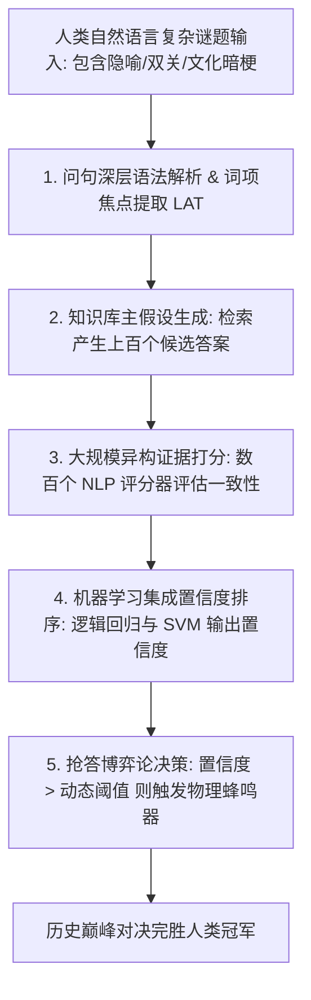
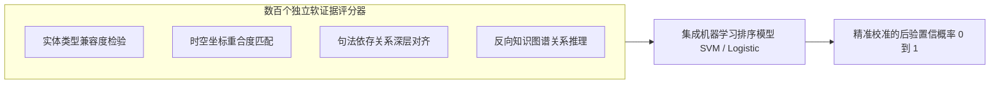

# Lec 13 IBM 沃森问答系统：自然语言理解如何击败人类《危险边缘》冠军 (IBM Watson: How to Build a Jeopardy Champion)

> MIT 15.071 数据分析优势 · 讲义 13 · 授课教师：Prof. Dimitris Bertsimas / Allison O'Hair

## TL;DR

- IBM 沃森（Watson）在 2011 年《危险边缘》（Jeopardy!）大赛中完胜人类历史上最强两位智力冠军。
- 《危险边缘》题目充满复杂的隐喻、双关语、讽刺反语与歧义，对经典规则系统构成降维打击。
- DeepQA 系统架构融合了开放域信息检索、假设生成、多维软证据打分与集成置信度校准。
- 沃森的重大技术突破确立了放弃单一完美算法、依托大规模异构弱证据集成的系统工程范式。

## 1. 人机对决的新纪元：从国际象棋到开放域问答

1997 年，IBM 的超级计算机“深蓝（Deep Blue）”击败了人类国际象棋世界冠军加里·卡斯帕罗夫。但计算机科学界普遍清醒地认识到：国际象棋是一个规则完全封闭、状态空间形式化且不存在任何语义歧义的博弈游戏。计算机通过每秒暴力搜索数亿个棋步即可靠算力取胜。

然而，人类日常使用的**自然语言（Natural Language）**则完全是另一个维度的挑战。2007 年，IBM 启动了更为雄心勃勃的“沃森（Watson）”项目，目标是挑战美国历史上收视率最高、难度最严苛的电视知识竞答节目——《危险边缘》（Jeopardy!）。

2011 年 2 月，沃森与《危险边缘》历史上连续 74 场不败纪录保持者肯·詹宁斯（Ken Jennings）以及累积奖金历史纪录保持者布拉德·鲁特（Brad Rutter）展开了一场轰动全球的三日电视巅峰人机对决。

## 2. 《危险边缘》竞赛的认知挑战与规则约束

《危险边缘》的比赛规则对于人工智能具有近乎残酷的约束：
1. **题目形式倒错**：主持人给出一段包含线索的“答案陈述”，选手必须以“提问形式”作答（例如题目是“1969 年踏上月球的美国宇航员”，选手必须回答“谁是尼尔·阿姆斯特朗？”）；
2. **极度复杂的双关语与修辞**：题目充斥着冷笑话、流行文化双关、历史谜语、讽刺反语与文学典故；
3. **物理蜂鸣器抢答机制**：不仅要答对，而且必须在主持人读完题目的 **3 秒钟内**完成答案检索并以毫秒级精度按下抢答蜂鸣器；若抢到后答错，将遭受**全额扣除对应奖金的严厉惩罚**！

::: example [典型题目中的语义迷宫]
- **题目**：*“A long, tiresome speech delivered by a frothy pie topping.”*（一种由松软起泡的馅饼顶料发表的冗长烦人的演讲）。
- **人类选手的思维跳跃**：馅饼顶料是“蛋白霜（Meringue）”；冗长演说是“长篇大论（Harangue）”；两者押韵，答案是：“What is a lemon meringue harangue?”
这种结合了语音押韵、隐喻与食品常识的高维联想，曾被认为是传统计算机绝对无法企及的人类智能禁区。
:::

## 3. DeepQA 核心系统架构剖析

IBM 首席科学家大卫·费鲁奇（David Ferrucci）率领的团队没有试图编写一套庞大且脆弱的“语法专家系统”，而是研发了革命性的 **DeepQA 架构**。该架构部署在由 90 台 IBM Power 750 服务器（包含 2,880 个计算核心、16 TB 内存）组成的离线集群上，完全脱离外部互联网。

### 3.1 步骤 1：问句分解与词汇答案类型（LAT）提取
系统首先对输入的线索文本进行依存句法分析，定位**词汇答案类型（Lexical Answer Type, LAT）**。LAT 锁定了答案属于哪一类实体（例如：是一座城市、一个化学元素、还是一名 19 世纪诗人？）。

### 3.2 步骤 2：主假设生成（Primary Hypothesis Generation）
系统利用全网抓取并本地索引的庞大知识库（维基百科全文、大英百科全书、世界年鉴、新闻档案与牛津字典，数据量超过 4 TB），以毫秒级速度并行检索，提炼出前 100 到 200 个潜在候选实体（Candidates）。

### 3.3 步骤 3：大规模异构证据打分（Massive Evidence Scoring）
这是 DeepQA 最核心的武器库。针对每一个候选答案，系统调用了数百个独立运行的专门算法（Scorers）从不同角度进行软证据评估：
- **分类一致性**：候选答案在知识图谱中是否确实符合 LAT 的类别范畴？
- **时间与地理对齐**：事件发生的年代与地理坐标是否与题目中的历史背景吻合？
- **语篇支持度**：在海量历史文献中，该候选词与题目中的其他关键词共同出现的共现统计显著性几何？

### 3.4 步骤 4：机器学习集成与置信度校准（Confidence Calibration）

在完成多维证据打分之后，系统为每一个候选答案构建了一个包含数百维特征的评估向量。然而，不同评分器在不同题目情境下的可靠性存在巨大差异：在历史年代题中，时间对齐评分器具有极高的区分度；而在文学隐喻题中，浅层的关键词共现往往充斥着误导性的噪声。

为了将这数百个异构打分维度熔炼为一个具备严谨统计意义的单一判定标尺，沃森采用了监督学习排序模型。系统基于历年数万道竞赛真题展开离线训练，利用逻辑回归（Logistic Regression）与支持向量机（SVM）拟合分类器。更关键的是，系统必须对原始预测输出进行**严格的置信度校准（Platt Scaling / Isotonic Regression）**，确保当模型给出 $85\%$ 的置信分值时，该答案在长期统计意义上的真实准确率确实精确逼近 $85\%$：

经过校准后的连续置信度概率值 $P(\text{Correct}) \in [0, 1]$，直接构成了沃森抢答控制核心的唯一输入参数。若最优候选答案的置信度低于动态安全底线，系统会坚决选择放弃抢答，宁可保持沉默也绝不冒险扣分；反之，一旦置信度突破门槛，系统将以毫秒级电脉冲直接向抢答器发出物理击发指令。

## 4. 抢答博弈论与比赛战果

沃森的卓越不仅体现在自然语言理解上，更体现在其精密的**博弈论抢答策略（Buzzer Strategy）**中：
- 沃森实时监控当前记分牌上的奖金差额与剩余题目数量；
- 若当前大幅领先，模型自发将抢答门槛从 $P \ge 0.60$ 提升到极度保守的 $P \ge 0.85$，避免答错送分；
- 若当前处于落后且比赛接近尾声，模型自发调低置信度阈值进行孤注一掷的激进抢答。

在为期三天的正式转播比赛中：
- 沃森展现出令全场窒息的恐怖统治力，以极快的电信号优势频频抢先按下蜂鸣器；
- 最终比分：**沃森斩获 77,147 美元**，而人类历史上最强的两位传奇大师肯·詹宁斯与布拉德·鲁特分别仅获得 24,000 美元与 21,600 美元；
- 詹宁斯在最后一道题目的答题板上风趣地写下著名感言：“*I for one welcome our new computer overlords.*（我谨代表个人，欢迎我们新的计算机霸主）”。

::: pitfall [脱离物理常识的“孤岛荒谬”错误]
尽管沃森整体战绩辉煌，但在比赛中也犯下了令人啼笑皆非的低级失误。在一道分类为“美国城市（U.S. Cities）”的题目中，沃森给出的答案竟然是加拿大城市“多伦多（Toronto）”。这是因为系统内部缺乏真正的世界物理常识常理推理链，当文本共现特征过于强烈时，微弱的常识否定无法压过海量统计分值。
:::

::: insight [我的理解：沃森是系统工程对唯算法论的伟大胜利]
很多初学者以为沃森的发明依赖于某种神秘莫测的单一“终极人工智能算法”。但费鲁奇团队的核心贡献恰恰在于打破了这种幼稚的幻想。沃森的强大，不是因为某一个打分算法天下无敌，而是因为它搭建了一座容纳数百种异构算法协同作战的超级民主议会。通过机器学习对海量弱证据进行加权与校准，系统工程的精密严谨战胜了单一模型的脆性。这才是现代数据分析最硬核的底色。
:::
