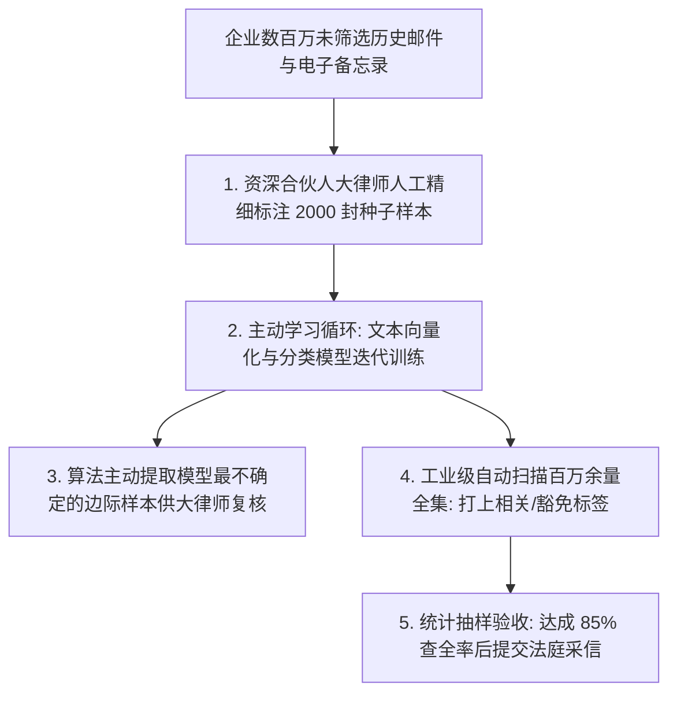

# Lec 14 法律电子取证（Predictive Coding）：以文本挖掘赋能法庭诉讼审判 (Predictive Coding: Bringing Text Analytics to the Courtroom)

> MIT 15.071 数据分析优势 · 讲义 14 · 授课教师：Prof. Dimitris Bertsimas / Allison O'Hair

## TL;DR

- 现代大型商业诉讼中的电子取证（E-Discovery）面临数百万封海量异构邮件的人工审查成本困境。
- 预测性编码（Predictive Coding）通过主动学习（Active Learning）与人在回路，构建高精度证据分类器。
- 查全率（Recall，不漏掉关键铁证）与查准率（Precision，降低无谓审查工时）是司法审判的核心权衡指标。
- 标志性判例 Da Silva Moore 案确立了机器学习证据分类在全美联邦法院的合法司法采纳地位。

## 1. 跨国巨额诉讼与电子取证的深渊

在现代大型民事诉讼中（如跨国反垄断调查、苹果与三星智能手机专利侵权案、安然与雷曼兄弟财务舞弊诉讼），原告与被告双方依据英美普通法系的**证据开示制度（Discovery）**，必须向法庭和对方律师团队如实移交所有与案件相关的内部通信文件。

在纸质文件时代，一个特大案件审查几十箱纸质档案已是极限；然而在数字化时代，一家财富 500 强跨国企业在短短几年内产生的内部电子邮件、即时通讯聊天记录与会议备忘录往往高达**数百万甚至上千万份**！

传统的**人工线性审查（Manual Document Review）**方式陷入了不可逾越的经济与生理绝境：
- 一位训练有素的年轻初级律师（Associate），每小时全神贯注只能审查大约 50 至 70 封复杂的商业邮件；
- 若要审查 200 万封邮件，需要耗费近 **35,000 个律师工时**；
- 按照华尔街顶级律所每小时 400 至 800 美元的计费费率，仅证据审查一项就要烧掉企业超过 **2,000 万美元**的现金！
- 更致命的是：面对枯燥重复的漫长审查，人类大脑极其容易发生严重的疲劳走神与标准漂移，导致极其致命的关键违法证据被意外漏看。

## 2. 预测性编码（Predictive Coding）与主动学习机制

为了攻克这一行业毒瘤，司法界与计算机科学界联合开发了**技术辅助审查（Technology Assisted Review, TAR）**，在法律实务中被称为**预测性编码（Predictive Coding）**。

### 2.1 人在回路（Human-in-the-Loop）工作流

预测性编码绝非用机器彻底取代人类法官，而是建立一套紧密协同的**主动学习（Active Learning）迭代闭环**：

1. **种子样本集标注（Seed Set Annotation）**：
   由最精通案件事实与法律争议的核心**资深合伙人高级大律师（Senior Partner）**，亲自人工精读并标注 1,000 至 3,000 封具有代表性的邮件样本（标注为：相关证据 `Responsive` 或 无关文件 `Non-responsive`）；
2. **文本特征工程与分类训练**：
   对种子样本集实施分词、停用词剔除、TF-IDF 逆文档频率加权，训练一个稳健的文本分类器（如支持向量机 SVM 或逻辑回归）；
3. **主动学习自适应抽样（Active Sampling）**：
   算法对剩余未标注的数百万封邮件进行全盘打分。算法并不随机抽样，而是专门挑选那些**预测概率恰好徘徊在 $0.50$ 决策边界附近、模型最拿不准、信息熵最大的极端疑难邮件**，交还给大律师进行第二轮定向判定；
4. **分类器收敛与全量推断**：
   经过 3 至 5 轮主动学习迭代后，分类器参数完全稳定。系统对全量数百万封文件进行全自动分类预测，自动分离出高概率证据集合并剔除无关垃圾。

## 3. 统计学质量控制：查全率（Recall）与查准率（Precision）的博弈

在法庭审判中，原告律师与法官最关心的是模型的**证据合法性与可靠性（Reliability）**。这通过信息检索领域最核心的双指标进行科学度量：

$$\text{查全率 (Recall)} = \frac{\text{系统成功识别出的相关证据数}}{\text{全集真实存在的全部相关证据总数}}$$
$$\text{查准率 (Precision)} = \frac{\text{系统标记为相关的邮件中真实相关的比例}}{\text{系统标记为相关的邮件总数}}$$

- **法律界的优先级排序**：法庭对**查全率（Recall）**的要求远高于查准率。如果查全率只有 $50\%$，意味着有一半可能证明被告欺诈的关键罪证被算法隐藏了，这构成了对司法公正的毁灭性破坏。
- **行业黄金验收标准**：在司法实务中，双方技术专家通常达成共识：算法必须在验证集抽样中达成至少 **$75\% \sim 85\%$ 的查全率**，同时将查准率维持在合理水平，以确保移交给法庭的文件不至于充斥垃圾。

::: example [真实诉讼成本与效率对决]
某大型能源反垄断诉讼涉及 150 万份内部通信文档：
- **纯人工审查方案**：耗时 14 个月，动用 80 名合同制初级律师，总开支 **1,450 万美元**，事后双盲抽检发现真实查全率仅为 **$60\% \sim 65\%$**（人类因疲劳漏看近三分之一！）；
- **预测性编码 TAR 方案**：由 3 名合伙人大律师深度标注 4,500 封种子样本，算法耗时 6 小时完成全集扫描分类。经法庭第三方中立统计专家抽样核验，最终查全率高达 **$87.3\%$**，总开销仅为 **180 万美元**（**节省了 $87.5\%$ 的诉讼费用与整整 12 个月的宝贵时间**）！
:::

## 4. 司法里程碑：Da Silva Moore 案判例与技术合法性

2012 年 2 月，美国纽约南区联邦地区法院著名联邦治安法官安德鲁·佩克（Andrew Peck）在审理 **Da Silva Moore v. Publicis Groupe (2012)** 案中，签发了全球司法史上第一份正式批准并强令当事双方采用计算机预测性编码（Predictive Coding）进行证据开示的划时代司法裁决。

法官佩克在长达数十页的里程碑判决书中留下了被全球法学界反复引用的名言：
*“计算机辅助审查技术不仅是完全可接受的，而且在海量电子数据面前，它的表现比纯人工审查更优秀、更廉价、且具有压倒性的统计学一致性。”*

这一判例彻底打消了全美跨国公司和诉讼法官对机器学习黑箱算法的法律合规疑虑，正式将现代数据科学确立为英美法系民事诉讼的标准通用基础设施。

::: pitfall [恶意隐蔽代号与语义漂移]
在涉及高管合谋操纵物价的跨国犯罪中，高管们在邮件中往往故意使用非标准的黑话和隐秘代号（如将回扣资金称为“去高尔夫球场的草皮维护费”）。若种子样本集未包含这一特定语境，词袋模型将彻底无法感知其背后的重大违法语义。因此，高级法务专家对公司业务背景的先验侦查依然是算法不可或缺的前提。
:::

::: insight [我的理解：算法没有消灭正义，算法让正义的成本被普通人承受]
在很多人的传统偏见中，法律是一门最讲究人文情怀与文字艺术的古老行当，似乎与冷冰冰的代码天然水火不容。但现实的冷酷之处在于：如果获取真相的代价是数千万美元的律师账单，那么只有超级垄断寡头才能打得起官司，普通平民与中小创新企业在诉讼深渊面前根本无力自拔。预测性编码的最大功绩，不在于帮顶级律所提高了多少利润，而是用数据技术将司法取证的边际成本压低了一个数量级，让法律面前人人平等的宪法理想在数字时代有了技术落地的可能。
:::
