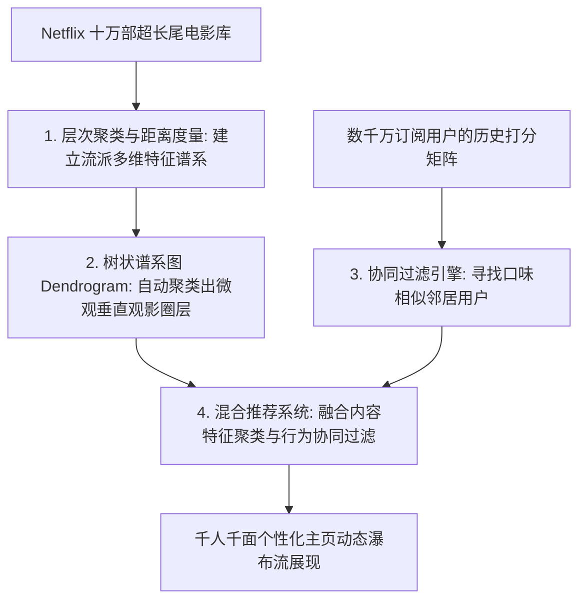
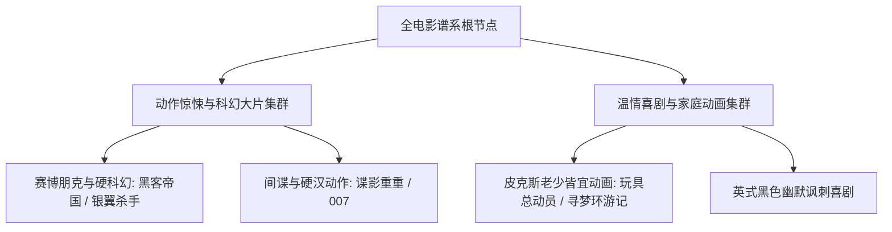

# Lec 15 Netflix 电影推荐系统：层次聚类与协同过滤算法 (Recommendation Systems: Netflix Movie Data & Hierarchical Clustering)

> MIT 15.071 数据分析优势 · 讲义 15 · 授课教师：Prof. Dimitris Bertsimas / Allison O'Hair

## TL;DR

- Netflix 的商业成功建立在跨越传统电视排播局限、依靠算法实现千人千面的个性化推荐引擎之上。
- 层次聚类（Hierarchical Clustering）通过自底向上的距离矩阵合并，构建直观的树状谱系图（Dendrogram）。
- 协同过滤（Collaborative Filtering）利用“相似用户喜欢相似物品”的社交几何邻域预测未知评分。
- 聚类驱动的混合推荐模型有效克服了数据极度稀疏与冷启动瓶颈，开创了流媒体算法推荐新范式。

## 1. 互联网长尾理论与推荐系统的战略霸权

在传统的实体录像带租赁连锁店时代（如曾经拥有数千家门店的百视达 Blockbuster），店铺的物理货架面积极其有限。为了最大化单平米营业额，店长只能将最显眼的黄金展位全部留给少数几十部好莱坞当季最热门的超级大片。那些相对小众、独立文艺或冷门经典的电影，几乎没有任何机会被大众读者发现。

2000 年代初，Netflix 创始人里德·哈斯廷斯（Reed Hastings）开启了互联网流媒体订阅模式。在线虚拟库房拥有超过 10 万部电影的无限货架。依据克里斯·安德森（Chris Anderson）提出的**长尾理论（The Long Tail）**：成千上万部小众冷门长尾电影的累计租赁量，完全可以汇聚成超过头部大片的庞大商业利润。

但长尾理论成立的唯一前提是：**系统必须具备能够帮每位用户在十万片汪洋大海中，精准钓出他最热爱的那部电影的算法引擎**！2006 年，Netflix 豪掷 100 万美元发起全球“Netflix Prize 推荐算法挑战赛”，要求全球科学家将其内部 Cinematch 推荐系统的均方根误差（RMSE）提升至少 $10\%$，彻底引爆了全球现代推荐系统的大规模工业革命。

## 2. 层次聚类（Hierarchical Clustering）的数学机制

无监督聚类（Unsupervised Clustering）的目标是：在没有任何人工预先指定标签（Label）的前提下，仅依靠数据自身的相似性度量，将距离较近的样本自动聚合成有机的微观圈层。

### 2.1 距离度量（Distance Metrics）

对于任意两部电影（或两个用户特征向量）$X_i$ 与 $X_j$：
- **欧几里得距离（Euclidean Distance）**：
  $$d(X_i, X_j) = \sqrt{\sum_{k=1}^p (X_{ik} - X_{jk})^2}$$
- **余弦相似度（Cosine Similarity，适用于高维稀疏评分）**：
  $$\cos(\theta) = \frac{X_i \cdot X_j}{\|X_i\| \|X_j\|}$$

### 2.2 聚合聚类流程（Agglomerative Hierarchical Clustering）

层次聚类采取“自底向上（Bottom-up）”的贪心合并策略：
1. **初始状态**：将数据集中的每一个样本点各自视为一个独立的单元素簇（包含 $N$ 个簇）；
2. **距离矩阵计算**：计算所有簇两两之间的距离；
3. **最近邻合并**：寻找当前距离最近的两个簇，将它们融合成一个新的大簇（剩余 $N-1$ 个簇）；
4. **循环往复**：重复执行合并步骤，直到所有样本点最终融合成唯一的超级大根节点。

在合并簇与簇之间时，距离的定义遵循**链接准则（Linkage Criteria）**：
- **单链接（Single Linkage）**：两簇最近点之间的距离（容易引发长链条拖尾效应）；
- **全链接（Complete Linkage）**：两簇最远点之间的距离（形成紧凑球形簇）；
- **Ward 最小方差法（Ward's Method）**：合并后使全系统内部方差增量极小化（工业界最常用）。

## 3. 树状谱系图（Dendrogram）与电影微观宇宙发现

层次聚类最令人叹为观止的特性，在于其产出物是一张极其优美的**树状谱系图（Dendrogram）**。图的横轴排列着各个样本，纵轴的高度严格对应于两个簇发生合并时的距离阈值。

分析师只需手持一把虚拟剪刀，在纵轴的某个特定高度水平横切一刀，整棵大树就会自然跌落成 $k$ 个互不重叠的高内聚子集。

在 15.071 经典 Netflix 电影数据集（包含经典电影在 19 个官方流派标签如 Action, Comedy, Drama, Romance, Sci-Fi 上的二值矩阵）实战中：
- 当设定 $k = 10$ 时，模型不仅完美重现了传统好莱坞的官方分类；
- 更自发提炼出了一系列极其精妙的**微观复合跨界子流派**：例如“浪漫公路喜剧（Romantic Road Comedies）”与“沉郁心理惊悚片（Dark Psychological Thrillers）”；
- 如果一位用户刚刚看完了《楚门的世界》，推荐系统无需依赖粗暴的“喜剧”大标签，而是沿着树状图的紧密分支，为其精准推送同样兼具哲学反思与荒诞温情的同源聚类影片。

## 4. 协同过滤与协同矩阵补全

纯粹基于电影内容的聚类存在局限：它无法度量电影本身的“制作质量好坏”（两部剧情简介完全一样的恐怖片，一部可能是传世杰作，另一部可能是粗制滥造的烂片）。必须引入数千万真实观众用脚投票的**协同过滤（Collaborative Filtering）**：

### 4.1 用户-物品评分矩阵与极度稀疏性

设全平台包含 $M$ 位用户和 $N$ 部电影。构建庞大的评分矩阵 $R \in \mathbb{R}^{M \times N}$：
- 矩阵中的元素 $R_{ui} \in \{1, 2, 3, 4, 5\}$ 为用户 $u$ 对电影 $i$ 的星级评分；
- 矩阵中超过 **$98\%$ 以上的格子都是空白的缺失值（Unobserved）**！
- 推荐系统的数学本质，就是**低秩矩阵补全（Low-Rank Matrix Completion）**：准确猜测出那些空白格子里，用户未来打出的分数是多少？

::: example [协同过滤与聚类的协同威力]
现代流媒体巨头采取**混合推荐架构（Hybrid Architecture）**：
1. 先利用层次聚类对长尾冷门电影进行内容流派画像打底；
2. 再利用基于用户的协同过滤，寻找全网观影打分口味与目标用户最相似的“前 50 位灵魂契合邻居”；
3. 将邻居们给出 5 星好评、且目标用户尚未看过的电影加权排序，直接推送到个性化 App 首页的首屏前三位。
:::

::: pitfall [推荐系统引发的“信息茧房（Filter Bubble）”]
若协同过滤算法过度追求局部预测准确率的收敛，系统会反复向用户推荐与其历史行为高度同质化的内容（看了三部漫威电影后，主页被塞满漫威周边），彻底抹杀了用户偶遇全新惊喜（Serendipity）的探索可能，导致用户趣味退化与审美疲劳。现代工业算法必须在“利用（Exploitation）”与“探索（Exploration）”之间保持合理的随机探索配额。
:::

::: insight [我的理解：算法推荐是一面照见人类隐秘共鸣的镜子]
在互联网之前，一个住在堪萨斯农场的小男孩如果狂热痴迷于 1950 年代法国新浪潮黑白实验电影，他可能会在周围人群的怪异目光中感到终生的孤独；而推荐算法的出现，在数学意义上瞬间拉近了整个星球的距离。它默默地在海量高维矩阵中找到了生活在东京、柏林和布宜诺斯艾利斯的另外几个同样为之动容的灵魂。层次聚类不仅是冰冷的向量几何，它是在浩瀚的人海中为你寻找志同道合者的无声引路人。
:::
