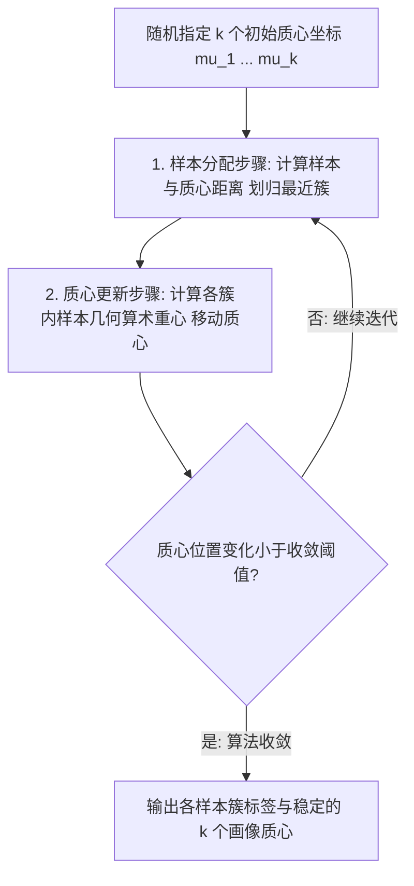

# Lec 16 客户细分与心脏病亚型发现：k-Means 聚类在精准营销与医学中的应用 (Clustering for Customer Segmentation & Patterns of Heart Attacks)

> MIT 15.071 数据分析优势 · 讲义 16 · 授课教师：Prof. Dimitris Bertsimas / Allison O'Hair

## TL;DR

- k-Means 聚类以极小化簇内平方和（WCSS）为核心目标，具有极高的工业计算可扩展性。
- 变量标准化（Normalization）是聚类算法不可妥协的铁律，杜绝大绝对量纲指标霸凌微观特征。
- 航空公司常旅客案例展示了如何将海量客户划分为价值各异的细分客群实施差异化忠诚度运营。
- 医学心脏病亚型聚类打破了传统综合征一刀切的诊断，开创了因型施治的精准医疗新纪元。

## 1. 规模化无监督学习与 k-Means 算法

在上一讲中，我们学习了层次聚类（Hierarchical Clustering）。然而层次聚类具有一个致命的算力软肋：其距离矩阵的计算与存储复杂度高达 $\mathcal{O}(N^2)$。当面对拥有数百万客户的电商平台或数十万患者的医疗影像库时，计算机内存将瞬间崩溃。

为了在海量大数据集上实现极速聚类分割，工业界最广泛采用的利刃是**k-均值聚类（k-Means Clustering）**。该算法由斯图尔特·劳埃德（Stuart Lloyd）于 1957 年在贝尔实验室作为脉冲编码调制技术提出，其计算复杂度关于样本量 $N$ 呈优雅的线性关系 $\mathcal{O}(N \cdot k \cdot I)$。

::: definition [k-Means 优化目标函数]
设样本集由 $N$ 个 $p$ 维实数向量构成。将样本划分为 $k$ 个互不重叠的集合 $S = \{S_1, S_2, \dots, S_k\}$。
k-Means 旨在寻找一组最优的聚类质心（Centroids）$\mu_1, \mu_2, \dots, \mu_k$，使得所有样本点到其所属簇质心的**簇内平方和（Within-Cluster Sum of Squares, WCSS）**达到全局极小：
$$\min_{S, \mu} \quad WCSS = \sum_{j=1}^k \sum_{x_i \in S_j} \|x_i - \mu_j\|^2$$
:::

## 2. 劳埃德迭代（Lloyd's Algorithm）与工程防坑指南

k-Means 的标准求解采用经典的**期望极大化（EM）两步交替迭代法**：
1. **分配步（Assignment Step）**：固定当前质心 $\mu_j$，将每个样本点 $x_i$ 分配给欧氏距离最近的质心所属的簇：
   $$S_j^{(t)} = \left\{ x_i \mid \|x_i - \mu_j^{(t)}\| \le \|x_i - \mu_l^{(t)}\|, \quad \forall 1 \le l \le k \right\}$$
2. **更新步（Update Step）**：固定簇的归属划分，将每个簇的质心重新计算为该簇内所有样本点的几何算术均值：
   $$\mu_j^{(t+1)} = \frac{1}{|S_j^{(t)}|} \sum_{x_i \in S_j^{(t)}} x_i$$
算法保证每一次迭代都会使目标函数 $WCSS$ 单调递减，并在有限步内必然收敛到局部极小点。

### 2.1 工业实操铁律：特征标准化（Normalization）

在运行 k-Means 之前，**必须对所有数值变量实施标准化（$Z$-Score 转换）或极差归一化**！
$$Z_j = \frac{X_j - \bar{X}_j}{s_j}$$

::: pitfall [未标准化的量纲霸凌灾难]
假设数据集中包含两个特征：`飞行里程数（Miles）`（数值通常在 5,000 至 100,000 之间波动）与 `持卡年限（Years）`（在 1 至 10 之间波动）。若不消除量纲直接计算欧氏距离，距离公式中的数值差几乎 $99.99\%$ 完全被飞行里程的平方所主宰，持卡年限这一关键指标的数学贡献被彻底缩减为零！任何未经标准化的距离算法都是纯粹的数值垃圾。
:::

## 3. 商业实战：航空公司常旅客精准客户画像细分

在 15.071 的经典案例中，某跨国大型航空公司拥有 3,999 名常旅客会员的详尽账户数据库。管理层希望通过客户细分（Customer Segmentation），打破一刀切的积分兑换政策，为不同客群定制差异化的留存与升舱策略。

模型输入特征涵盖：历史累计积分余额、过去一年飞行里程、过去一年非飞行联名信用卡消费金额、获得奖励免费机票张数以及入会时间长度。

经过肘部法则（Elbow Method）检验，确定最优簇数量为 **$k = 5$**。k-Means 算法在几秒内自动解构出五个极具商业张力的高内聚客群：

| 客群编号 | 客群画像标签 | 样本占比 | 核心特征质心描述 | 航空公司精准营销专属策略 |
| :--- | :--- | :--- | :--- | :--- |
| **Cluster 1** | **超级高频商务精英 (Elite Flyers)** | $15.2\%$ | 年飞行里程极大（85,000+）、入会时间长、极少看促销 | 提供尊贵机场贵宾厅、头等舱免费升舱券与专属私密客服 |
| **Cluster 2** | **沉睡高积分老客户 (Dormant Wealth)** | $18.5\%$ | 历史积分账户极厚，但过去一年飞行活跃度骤降 | 定向推送“积分限时兑换高档酒店/奢侈品”提醒，激活防流失 |
| **Cluster 3** | **联名信用卡重度羊毛党 (Card Spenders)**| $24.8\%$ | 飞行里程很少，但联名卡刷卡积分暴增 | 联合高端百货商场与银行推出多倍积分返现，巩固金融合作 |
| **Cluster 4** | **价格敏感型年轻新客 (New Budget)** | $28.3\%$ | 入会不满 1 年，仅在特价打折季飞行，积分余额极低 | 自动化推送淡季低价航线促销与青年旅行套票 |
| **Cluster 5** | **长途国际度假家庭 (Vacationers)** | $13.2\%$ | 偶尔长途飞行，通常一次性兑换多张家庭联程里程票 | 推介暑期与圣诞节夏威夷/加勒比海全家度假专属打包套餐 |

通过这套聚类画像，该航空公司将原本无差别的群发营销邮件，转化为千人千面的精准运营，营销点击转化率提升了近 **$45\%$**。

## 4. 医学前沿：重症心肌梗死隐藏亚型的无监督挖掘

无监督学习不仅能在商业上挖掘金矿，更在医学前沿深刻推动着从“经验医学”向“精准医学（Precision Medicine）”的历史跨越。

传统心血管医学长期将“急性冠脉综合征（ACS）”视为单一的疾病谱系。然而在临床救治中，心内科医生经常遭遇无法解释的困惑：两个年龄、血压完全相同、且都接受了相同支架介入手术的急性心梗患者，一个在术后三天顺利出院生龙活虎，另一个却在数周内发生进行性心力衰竭与心室重构猝死。

哈佛医学院与 MIT 联合团队对 1,200 名急性心梗患者的多维生化炎症标志物（超敏 C 反应蛋白 hs-CRP、肌钙蛋白 TnI、脑钠肽 BNP、内皮素及基因表达谱）实施 k-Means 聚类剖析：
- 算法在全无人工干预的情况下，自动识别出了**三种截然不同的分子病理亚型**；
- 其中“亚型 3”表现出极度特殊的“神经体液过度激活伴微循环无复流”特征，其致死率是普通亚型的整整 4 倍；
- 这一发现促使临床指南迅速修改：针对该特殊亚型患者，术后立即联合使用特异性抗纤维化拮抗剂，成功将该重症群体的远期死亡率斩断了三分之一！

::: pitfall [k-Means 随机初始点与非凸多边形簇陷阱]
k-Means 算法对初始质心 $\mu$ 的随机选择极其敏感。若运气不好抽到了糟糕的初始点，算法很容易收敛到极其次优的局部孤岛。在工程实战中，**必须运行多起点随机重启（设置 `nstart = 25` 以上），或使用改进的 k-Means++ 算法（使初始质心尽可能相互远离）**。此外，k-Means 仅擅长寻找各向同性的球形簇，面对环形或复杂流形簇时必须求助于基于密度的 DBSCAN 算法。
:::

::: insight [我的理解：无监督学习赋予我们在未知中发现未知的勇气]
监督学习（回归与分类）很强大，但它永远受到人类已有知识标签的禁锢：我们只能教算法预测那些我们早已知道的东西（如“是否违约”、“是否患癌”）。而无监督学习最迷人的地方，在于它让我们放下所有先入为主的傲慢与偏见。当数据矩阵在空间中自然舒展、凝聚成一个个前所未见的微观星系时，它是在替大自然向人类传话：看，这里存在着你们过去数百年医学教科书从未记载过的全新秩序。
:::
