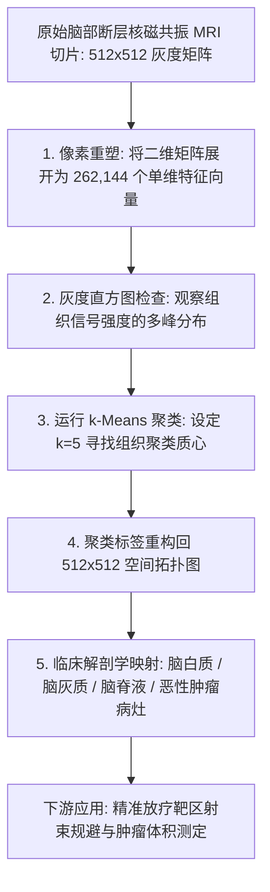

# Lec 17 图像分割与特征提取：用无监督聚类重构医学 MRI 像素 (Image Segmentation to Create Data)

> MIT 15.071 数据分析优势 · 讲义 17 · 授课教师：Prof. Dimitris Bertsimas / Allison O'Hair

## TL;DR

- 数字图像在计算机底层本质上是高维像素强度张量矩阵，天然具备直接进行几何量化分析的属性。
- 图像分割（Image Segmentation）将连续像素灰度聚类为具有明确解剖学与物理意义的连通语义区域。
- 医学脑部核磁共振（MRI）案例展示了利用 k-Means 精准分离脑灰质、脑白质、脑脊液与恶性胶质瘤病灶。
- 图像量化技术将非结构化医学影像无缝转译为可供下游生存回归与放疗优化直接调用的结构化特征。

## 1. 从神秘光影到实数张量：图像的数学本质

人类眼睛在注视一张医学 X 光胸片、核磁共振扫描图（MRI）或卫星遥感侦察照片时，看到的是柔和流动的灰度渐变、组织纹理与边缘轮廓。然而在计算机的世界里，既不存在所谓的“眼睛”，也不存在任何神秘的光影艺术——**图像本质上就是一个纯粹的二维数值矩阵（Matrix）或三维张量（Tensor）**。

对于一张标准的高分辨率黑白灰度图像：
- 图像被划分为 $R$ 行与 $C$ 列的微小矩形方格，每一个方格被称为一个**像素（Pixel）**；
- 每一个像素的明暗深浅，被严格量化为一个介于 $[0, 255]$ 之间的 8 位无符号整数（或归一化为 $[0.0, 1.0]$ 的浮点数）；
- 数值 $0$ 代表纯黑（完全无反射或完全吸收），数值 $255$ 代表纯白（最强信号强度），中间的实数构成平滑的灰度梯级。

医学影像科医生每天面对数以千计的断层扫描切片，其核心诊断任务之一就是**病灶轮廓勾画（Lesion Delineation）**：这块区域究竟是健康的脑组织，还是正在侵润扩散的脑胶质瘤？这块阴影的体积有多大？

手动用画笔在屏幕上逐层勾画病灶不仅极其耗费顶尖放射科医生的宝贵精力，而且不同医生之间的勾画公差差异巨大。**图像分割（Image Segmentation）**正是利用无监督聚类，将这一高难度艺术转化为可复现的自动化计算科学。



## 2. 图像聚类流水线：从矩阵到向量空间的映射

在 15.071 的经典案例中，我们处理了一位确诊脑胶质瘤（Glioblastoma）患者的真实脑部核磁共振 T1 加权增强切片。图像分辨率为 $512 \times 512$ 像素。

### 2.1 像素展平与特征矩阵重构

原始图像是一个包含 $512 \times 512 = 262,144$ 个像素点的二维数值表。在 R 语言中，我们将这个二维空间矩阵“展平（Flatten）”为一个拥有 **262,144 行、1 列（或包含空间坐标的 3 列）**的长向量数据框：
```r
healthyVector <- as.vector(healthyMatrix)
```
此时，每一行代表一个具体的像素点，特征值就是该点在 MRI 扫描仪下被激发出的电磁共振回波强度（Intensity）。

### 2.2 灰度直方图（Intensity Histogram）的生物物理透视

绘制这 26 万个像素强度的经验分布直方图，展现出令人惊叹的多峰（Multimodal）物理秩序：
1. **峰值 1（接近 0 的极暗区域）**：颅骨外部的空气背景与空腔；
2. **峰值 2（深灰区域）**：脑脊液（Cerebrospinal Fluid, CSF）；
3. **峰值 3（中灰区域）**：脑灰质（Gray Matter，主要由神经元胞体构成）；
4. **峰值 4（亮灰区域）**：脑白质（White Matter，主要由有髓鞘神经纤维构成）；
5. **异常极高亮区域（High Intensity Spike）**：由于血脑屏障遭到肿瘤破坏、造影剂高浓度沉积引发的**恶性肿瘤活动病灶（Tumor Tissue）**！

不同脑组织在水分含量、脂肪成分与细胞密度上的生化差异，天然将其回波强度分裂在不同的数值区间上。

## 3. k-Means 图像分割实战与解剖重构

我们在像素强度向量上部署 k-Means 聚类引擎。设定聚类数量 **$k = 5$**（分别对应背景、脑脊液、灰质、白质与肿瘤病灶）。

### 3.1 质心收敛与聚类标签赋值

在极短的时间内，算法收敛并输出了 5 个代表性聚类质心强度值：
$$\mu_1 = 0.02 \ (\text{背景}), \quad \mu_2 = 0.18 \ (\text{脑脊液}), \quad \mu_3 = 0.42 \ (\text{脑灰质}), \quad \mu_4 = 0.65 \ (\text{脑白质}), \quad \mu_5 = 0.89 \ (\text{肿瘤病灶})$$
全图 262,144 个像素根据其自身灰度值与这 5 个质心的距离，分别被赋予从 $1$ 到 $5$ 的离散聚类标签。

### 3.2 矩阵重塑（Reshaping）与伪彩色病灶可视化

将这个长度为 262,144 的聚类标签向量，依据原始的空间行列顺序，重新折叠回 $512 \times 512$ 的空间矩阵：
```r
dim(segmentedVector) <- c(512, 512)
image(segmentedVector, col = rainbow(5))
```

在伪彩色显示屏上，一幅震撼的医学奇迹展现出来：
- 原本混杂在一片混沌灰色阴影中的大脑结构被瞬间清晰分离；
- 恶性胶质瘤的边界轮廓像刀割一样清晰地以鲜红色高亮凸显在屏幕中央；
- 系统自动统计属于类别 5 的像素总数，乘以单像素的物理体素面积（如 $0.5 \text{ mm} \times 0.5 \text{ mm}$），在数秒内即可精准测算出**肿瘤的几何投影面积与浸润体积**！

::: example [将分割结果转化为结构化特征（Create Data）]
图像分割不仅为了好看，其最大战略意义在于标题所言——**“创造数据（Create Data）”**：
原始图像是无法直接丢进回归模型或线性规划的非结构化像素堆；而经过分割后，算法自动产出了一组高维结构化特征：
- 肿瘤体积大小（$V_{\text{tumor}}$）；
- 肿瘤边缘与重要运动语言脑区的最小欧氏安全距离（$D_{\text{critical}}$）；
- 水肿带扩散比率（$\text{Edema Ratio}$）。
这些结构化参数可以直接作为输入变量，注入下游的病患 5 年生存期预测模型，以及放射治疗射束角度优化的线性规划求解器中！
:::

## 4. 图像压缩与色彩量化（Color Quantization）

同样的无监督聚类原理被广泛应用于日常计算机视觉中的**有损图像压缩（Image Compression）**：
- 一张全彩 24 位 RGB 图像拥有 $2^{24} \approx 1,677$ 万种可能的色彩组合，文件体积庞大；
- 将每一个像素的三维颜色向量 $(R, G, B)$ 进行 $k = 16$ 聚类，提取出 16 种最核心的代表色彩质心（调色板）；
- 每一个像素仅需存储一个 4 位的调色板索引（$2^4 = 16$），图像文件体积瞬间暴降超过 **$80\%$**，而人类肉眼在常规视距下几乎察觉不到任何明显的画质失真。

::: pitfall [空间平滑度的缺失与孤立噪点伪影]
标准的单像素 k-Means 仅考虑了像素的灰度强度，完全忽略了空间邻域关系。如果某个健康组织内部恰好有一个像素点由于机器传感器热噪声发生了异常变亮，单点 k-Means 会武断地将这个孤立点判定为“肿瘤”。在高级医学图像处理中，必须在特征向量中追加该像素的空间坐标 $(X, Y)$，或采用马尔可夫随机场（MRF / CRF）施加空间连续性平滑正则化。
:::

::: insight [我的理解：算法赋予冰冷的矩阵以生命的意义]
当放射科医生指着屏幕上的阴影叹息时，他们凭借的是人类神经系统对形态的模糊感知；而数据科学用一段质朴的 k-Means 代码，向世人展示了数学理性的庄严与优雅。算法不知道什么是绝症，也不知道什么是悲伤，它只知道按照距离的最小化原则忠实地寻找秩序。正是这种不带任何主观情绪的纯粹计算，帮医生在生死攸关的毫厘之间，划出了一条区分健康与病魔的清晰分界线。
:::
