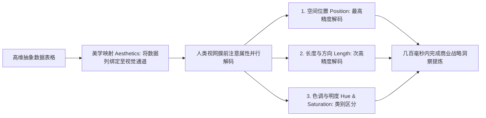
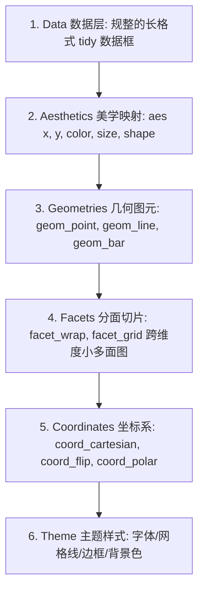

# Lec 18 数据可视化导论：从感知心理学到 ggplot2 图形语法 (Visualizing the World: Principles of Effective Data Visualization)

> MIT 15.071 数据分析优势 · 讲义 18 · 授课教师：Prof. Dimitris Bertsimas / Allison O'Hair

## TL;DR

- 数据可视化不是为了装饰美化报表，而是将高维结构高效解码进人类视网膜的高带宽通信管道。
- 人类视觉感知的认知心理学确立了视觉编码效能层级：空间位置绝对优于长度、角度与面积。
- 威金森（Wilkinson）与哈德利·威克姆（Hadley Wickham）的《图形语法》（Grammar of Graphics）重构了可视化代码范式。
- ggplot2 通过数据、美学映射（Aesthetics）与几何对象（Geometries）的分层解耦，赋予分析师无限表达自由。

## 1. 可视化的通信本质与认知带宽

在日常商业汇报中，数据分析师经常面临一个尴尬的困局：花费数周时间构建的精密回归方程与复杂的优化矩阵，在向董事会与非技术管理层汇报时，往往在密密麻麻的数字表格和符号面前遭遇受众的注意力涣散与理解障碍。

人类大脑的神经架构在漫长的进化中，从未被设计用来直接阅读数以千计的阿拉伯数字；相反，人类大脑有近 **$50\%$ 的皮层神经元直接参与视觉信号的并行处理**。

::: definition [数据可视化 (Data Visualization)]
数据可视化是一门将抽象的定性与定量数据映射为图形几何元素（点、线、面、颜色、空间拓扑），利用人类视觉系统的**前注意属性（Pre-attentive Attributes）**与认知直觉，极速传递系统模式、异常偏离与因果趋势的科学与艺术。
优秀的可视化具有三大不可替代的价值：
1. **高效模式识别**：在毫秒之内发现单变量或双变量的聚类、离群点与周期波动；
2. **直观说服力**：将冰冷的代数推导转化为让非技术决策者产生情感共鸣与战略决心的视觉证据；
3. **探索性洞察**：引导分析师在建模前发现被统计指标（如均值与方差）隐藏的深层结构。
:::

著名的**安斯库姆四重奏（Anscombe's Quartet）**深刻地证明了这一真理：四组数据拥有完全相同的均值、方差、相关系数与线性回归拟合线，然而一旦画成散点图，第一组是标准线性分布，第二组是强抛物线曲面，第三组是包含单一离群点的异常直线，第四组则是完全垂直的伪回归！如果不看图，盲目相信统计数字将导致毁灭性的战略误判。



## 2. 视觉感知的认知心理学层级

并非所有图表都是平等的。根据著名统计学家威廉·克利夫兰（William Cleveland）与罗伯特·麦吉尔（Robert McGill）在感知心理学上的经典双盲实验，人类视网膜在解码不同几何通道时的准确度存在着严格的**效能层级阶梯**：

| 视觉感知通道 (Visual Channel) | 人类解码准确度等级 | 认知心理学误差机制 | 推荐的最佳数据类型与图表 |
| :--- | :--- | :--- | :--- |
| **空间位置 (Position along common scale)**| **最高等级 (Tier 1)** | 视网膜对对齐基线上的空间位移极其敏感，误差 $< 2\%$ | 散点图 (Scatterplot)、折线图、标准条形图 |
| **长度 (Length)** | **高度准确 (Tier 2)** | 对长度相对比例的判断高度线性可靠 | 未对齐条形图、甘特图 (Gantt) |
| **方向与斜率 (Slope / Angle)** | **中度准确 (Tier 3)** | 人类容易高估钝角而低估锐角，判断存在系统偏差 | 面积坡度图 (Slope chart)、风向玫瑰图 |
| **面积 (Area)** | **较差准确度 (Tier 4)** | 著名的“史蒂文斯幂定律”：人类主观感知面积扩张速度显著慢于真实几何面积（存在严重低估）| 气泡图、树状树图 (Treemap) |
| **体积 (Volume / 3D)** | **极差准确度 (Tier 5)** | 视网膜在二维平面上还原三维透视存在灾难性畸变 | **工业界严厉禁止使用三维柱状图** |
| **颜色饱和度与色相 (Color)** | **仅适合分类定性** | 人眼无法定量精确比较颜色的“数值差”，受环境背景色干扰极重 | 热力图分级、分类标签着色区分 |

::: pitfall [三维立体饼图（3D Pie Charts）是数据可视化的犯罪]
许多商业分析师喜欢在 PowerPoint 中插入带有倾斜阴影的 3D 饼图。这是极其恶劣的视觉欺诈！
由于透视原理，靠近屏幕下方的扇区在三维投影下被强行拉伸变大，而远端的扇区被压缩变小。读者单凭肉眼根本无法判断哪一块份额更大。在严肃的商业决策中，**任何形式的 3D 装饰图表都应被彻底扫进垃圾堆，直接替换为清晰对齐的水平条形图（Horizontal Bar Charts）**。
:::

## 3. 哈德利·威克姆与 ggplot2 的图形语法范式

在 R 语言中，数据可视化经历了一场划时代的技术革命。新西兰统计学家哈德利·威克姆（Hadley Wickham）基于利兰·威金森（Leland Wilkinson）的名著《图形语法》（The Grammar of Graphics），开发了彻底改变数据科学界的开源库——**ggplot2**。

### 3.1 什么是“图形语法（Grammar of Graphics）”？

传统的绘图系统（如早期的 Excel 图表生成器或 R 语言底层自带的 `plot()` 函数）采用的是高度封闭的“成品模板装配模式”：软件为用户预制了孤立且僵化的图表类型（散点图、分组柱状图、堆叠面积图）。用户只能被动地将数据塞入这些模板中，微调字体大小与边框颜色。一旦面对复杂的探索性分析任务——例如希望在一张图上“既用散点展示微观样本点、又叠加核密度等高线、同时按大洲分面并按人均 GDP 调整透明度”时，传统模板化工具立刻陷入代码混乱与功能瘫痪的死胡同。

图形语法（Grammar of Graphics）彻底粉碎了这种按“图表类型”划分的陈旧思维。它将可视化提升到与自然语言语法相同的形式化哲学高度：正如人类语言可以通过“主语、谓语、宾语、状语”组合出无穷无尽、表达细腻的优美句子，**任何复杂的统计图表，本质上都可以被严谨解构为一套分层堆叠、正交独立的几何代数图层（Independent Graphic Layers）**：



在这套优雅的语法体系下，数据分析师不再是在数十种互不相通的图表模板中苦苦搜寻，而是直接扮演空间建筑师的角色：首先将干净规整的长格式数据框绑定到底层画布；接着通过美学映射（Aesthetics Mapping）将业务变量一一连接到坐标、色彩与点径通道；随后根据分析意图自由叠加点、线、平滑样条等几何图元（Geometries）；最后通过分面（Faceting）将高维变量拆解为矩阵式小多面图。代码的逻辑结构与人类大脑对数据的解构思路达成了完全一致的同步。

### 3.2 世界卫生组织（WHO）健康经济学实战代码剖析

在 15.071 经典实战中，我们通过分析 WHO 全球 194 个国家的预期寿命与经济指标，展示 ggplot2 的代码表现力：

```r
library(ggplot2)
# 优雅的分层构建全球国家健康全景气泡图
ggplot(data = WHO, aes(x = GNI, y = LifeExpectancy)) +
  geom_point(aes(color = Region, size = TotalFertilityRate), alpha = 0.7) +
  scale_x_log10(labels = scales::dollar) +
  geom_smooth(method = "loess", color = "darkblue", se = FALSE) +
  labs(
    title = "财富与长寿：全球国家人均国民总收入与预期寿命关系",
    subtitle = "气泡大小代表总生育率，颜色代表地理大区 (WHO 官方数据库)",
    x = "人均国民总收入 GNI (对数尺度)",
    y = "预期寿命 (岁)"
  ) +
  theme_minimal(base_size = 14)
```

::: example [几行代码背后的深邃商业与人文洞察]
上述代码绘制的图表在几秒内揭示了全球宏观发展的震撼模式：
1. **对数收入与健康的强相关**：在贫困国家阶段，人均 GNI 从 1,000 美元微增至 5,000 美元，预期寿命发生从 50 岁跃升至 70 岁的陡峭跳跃；
2. **边际效用递减平台期**：当人均 GNI 突破 20,000 美元（欧美富裕国家）后，曲线完全变平，金钱对寿命的额外拉动极其微弱；
3. **非洲大区的巨大落后孤岛**：深色非洲区域气泡紧紧聚集在左下角的低收入、低寿命、高生育率（巨型气泡）困境中。一张图胜过千言万语的联合国年度报告。
:::

::: insight [我的理解：可视化是让真相无声流淌的高级克制]
平庸的设计师总是在图表里堆砌花哨的渐变特效、炫目的三维光影和满屏的动态飞入，生怕别人不知道他用了复杂的软件；而真正顶级的可视化大师展现出的是一种极度的克制。他们像一位深沉的向导，悄无声息地抹去所有干扰人类视线的视觉垃圾，精准运用一条基线、一抹红灰对比、一次对齐，让数据中原本被埋没的真相，像泉水一样自然、清澈地流淌进读者的眼睛与心灵。
:::
