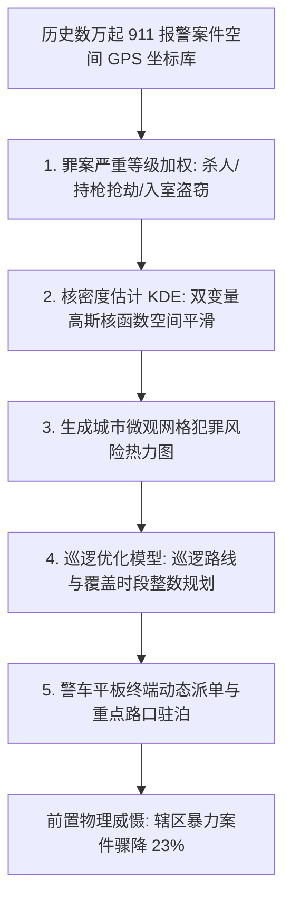

# Lec 19 预测性警务（Predictive Policing）：费城警局犯罪空间热力图与巡逻优化 (Visualization for Law and Order: Predictive Policing)

> MIT 15.071 数据分析优势 · 讲义 19 · 授课教师：Prof. Dimitris Bertsimas / Allison O'Hair

## TL;DR

- 预测性警务（Predictive Policing）利用空间统计学与地理信息系统，打破传统被动出警的滞后局限。
- 犯罪地理空间具有强烈的空间自相关性，集中分布在少数高危微观街区热点（Crime Hotspots）中。
- 核密度估计（Kernel Density Estimation, KDE）将离散离散案发坐标平滑为连续风险热力曲面。
- 将热点预测与警车巡逻排班线性规划相结合，在警力编制硬约束下实现了对暴力犯罪的精准前置阻吓。

## 1. 传统反应式警务的破产与预测性变革

在整个 20 世纪，全球主流大都市警察部门的运作机制主要遵循**反应式警务模式（Reactive Policing）**：警员在警局待命，直到市民拨打 911 紧急求助电话报告案发，警车才拉响警笛呼啸赶往现场。

这种模式具有不可逆转的被动性：当警笛响起时，凶案已经发生，受害者已经遭到创伤，企业财产已经遭受洗劫。警方的破案成本极其高昂，而社会治安恶化陷入恶性循环。

21 世纪初，随着地理信息系统（GIS）与移动终端在警务巡逻车中的普及，**预测性警务（Predictive Policing）**应运而生。其核心假定建立在犯罪环境学的基础公理之上：
**犯罪从来不是在城市空间中均匀随机分布的。违法犯罪活动在时间和空间上呈现出惊人的聚集性与重复受害模式（Repeat Victimization）**。盗窃团伙一旦发现某片街区缺乏监控且撤退路线便捷，会在随后的数天内反复在同一微观网格作案。



## 2. 空间核密度估计（Kernel Density Estimation, KDE）

宾夕法尼亚州费城警察局（Philadelphia Police Department, PPD）管理着全美犯罪率居高不下的历史名城。为了在有限的警力预算下压制持枪抢劫与凶杀案件，费城警局联合数据科学家开发了微观犯罪热点图谱系统。

### 2.1 从离散点到连续密度场

原始警务数据包含数万个离散的经纬度坐标 $(x_i, y_i)$。若直接在地图上打点，点位密集重叠，无法区分犯罪风险梯级。

核密度估计（KDE）在每一个历史案发坐标点上方放置一个平滑的钟形三维曲面（通常为二维高斯核函数），在整座城市坐标网格上累加所有核函数的贡献：

$$\hat{f}(x, y) = \frac{1}{n \cdot h^2} \sum_{i=1}^n K\left( \frac{\sqrt{(x - x_i)^2 + (y - y_i)^2}}{h} \right)$$
其中：
- $n$ 为历史案发样本总量；
- $h$ 为**平滑带宽（Bandwidth）**，决定了单个案件对周边社区辐射影响的物理搜索半径（通常设定为 200 至 500 米）；
- $K(\cdot)$ 为高斯核函数（Gaussian Kernel），赋予距离案发核心点越近的位置以越高的风险分值。

通过调整带宽 $h$，算法既能滤除个别偶然偶发案件的随机噪音，又能精准捕捉由毒品交易街角、深夜无照酒吧与废弃建筑物诱发的深层犯罪磁石热点。

## 3. 费城警务实战：空间热力图与巡逻路线优化

在 15.071 案例中，我们加载了费城过去一年的严重暴力犯罪空间数据集以及费城 35 个警区的行政矢量边界（Shapefile）。

### 3.1 ggplot2 空间图层叠加渲染

在地理信息系统（GIS）中，单一图层无法同时表达复杂的空间管辖边界与连续的风险密度场。我们必须遵循图形语法的分层叠加思想，在底层的城市行政区划矢量多边形之上，自下而上覆盖二维核密度多边形，最后在顶层锚定关键公共基础设施（警察局与执勤岗亭）的几何坐标点。

利用 R 语言中的 `ggplot2` 与空间扩展包，分析师可以通过简洁直观的代码链条，构建出兼具高精度统计学平滑与出版级审美的犯罪热力底图：

```r
library(ggplot2)
# 渲染费城街区犯罪热力分布
ggplot(data = phillyCrimes, aes(x = Longitude, y = Latitude)) +
  geom_polygon(data = phillyBorders, aes(x = long, y = lat, group = group), 
               fill = "gray95", color = "gray60") +
  stat_density2d(aes(fill = ..level.., alpha = ..level..), 
                 geom = "polygon", bins = 15) +
  scale_fill_gradient(low = "yellow", high = "red") +
  geom_point(data = policeStations, aes(x = Longitude, y = Latitude), 
             color = "blue", size = 3, shape = 18) +
  theme_void() +
  labs(title = "费城重特大暴力犯罪空间核密度热力图谱")
```

在这套代码中，`stat_density2d` 函数在底层自动执行二维高斯核平滑运算，将高密度的离散案件坐标切分为 15 个等高线梯级（Bins），并利用 `alpha` 参数将低密度边缘区域自然淡化透明，确保底层的街道网格清晰可辨。黄色到鲜红色的渐变色阶（Gradient Scale），精准引导执勤警长在几秒钟内锁定整个大都市区治安形势最严峻的咽喉要害。

输出的图形清晰展示出：
- 全市超过 $60\%$ 的涉枪恶性暴力事件，极度集中在北费城（North Philadelphia）与西费城仅仅 **$8\%$ 的狭小街区网格**之内；
- 某些警区的巡逻警车驻泊点（Police Stations）严重偏离了真实的高危热力中心，导致出警响应延迟过长。

### 3.2 运筹学结合：警力排班与路径覆盖整数规划

预测性警务的第二阶段是将密度热力图转化为具体的**运筹优化调度指令**：
- 将全辖区划分为数百个正方形小网格（Cells），每个网格赋予由 KDE 测算的预期案发风险权重 $w_i$；
- 设定决策变量 $x_{jt} \in \{0, 1\}$ 表示第 $j$ 辆警车在时段 $t$ 是否被派往巡逻网格 $i$；
- 目标函数：最大化巡逻警力对高危网格的综合加权覆盖率；
- 约束条件：警员轮班法定时长、警车往返加油基地的续航限制、以及对周边网格的 minimum 巡视频次保底要求。

费城警局在一项为期两年的对照实验中证明：**在热点高危网格安排警车进行随机、高频的短时间驻泊（每次 15 分钟），成功让该区域的街头抢劫案下降了 $23\%$，且未在周边社区引发明显的犯罪转移效应**。

::: pitfall [算法反馈回路（Feedback Loops）与偏见自我实现]
预测性警务最严峻的伦理隐患在于**算法偏见自强化**：如果警方将绝大多数警力派往历史犯罪率较高的少数族裔贫困社区，这些社区中微小的轻微违法（如吸食大麻、违章过马路）被警察发现并立案的几率就会大幅上升；这些新增的逮捕数据再次被送入模型重新训练，系统便得出“该社区犯罪率进一步飙升”的虚假结论，形成自我实现的压迫性恶性循环。
:::

::: insight [我的理解：数据技术的克制与敬畏决定了社会的善恶]
空间热力图是一柄极其锋利的双刃剑。在负责任的治安管理者手中，它是一张精准调配公共安全资源的保护伞，让无辜市民在深夜回家的路上多看见一盏警灯的庇护；但如果脱离了对宪法权利、程序正义与社会根源贫困的审慎思考，冷冰冰的代码很容易沦为加深社会阶层撕裂与歧视的机器道具。技术的最高境界，永远是对人性的审慎体察。
:::
