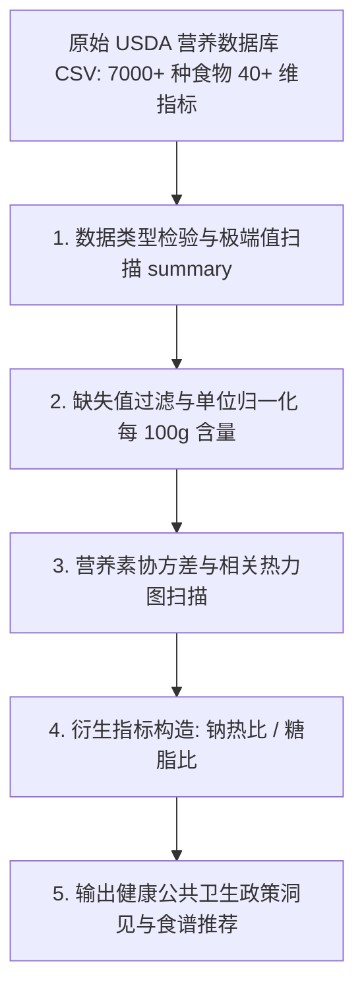

# Lec 2 营养膳食数据科学：从 USDA 数据库解析微量元素与健康 (Nutritional Education with Data)

> MIT 15.071 数据分析优势 · 讲义 2 · 授课教师：Prof. Dimitris Bertsimas / Allison O'Hair

## TL;DR

- 探索性数据分析（EDA）是任何高级机器学习与优化建模必须履行的第一道清洗与审计工序。
- 美国农业部（USDA）国家营养数据库包含数千种食物在宏量与微量营养素上的高维多指标测定。
- 通过数据重塑、缺失值插补、相关性过滤与散点投影，揭示食物类别之间的营养指纹差异。
- 数据驱动的公共卫生政策能够超越粗糙的“卡路里热量说”，精准定位高钠、高糖与饱和脂肪的慢性病风险源。

## 1. 探索性数据分析（EDA）的工程纪律

在现代数据科学教育中，人们常常急于直接拟合复杂的神经网络、随机森林或调用高深求解器。然而，行业实战的残酷现实是：**数据科学家超过 $80\%$ 的时间并非花费在调参上，而是耗费在数据清洗（Data Cleaning）、异常值剔除、缺失值推断与探索性可视化（EDA）之上**。

如果输入的是脏数据（Garbage in），无论后端采用多么先进的算法，产出的也只能是高保真的有毒结论（Garbage out）。

::: definition [探索性数据分析 (Exploratory Data Analysis, EDA)]
EDA 是由统计大师约翰·图基（John Tukey）倡导的数据分析哲学，其核心原则包括：
1. **分布感知**：审视单个变量的均值、极差、四分位距（IQR）与偏度，识别测量单位错误与异常录入值；
2. **结构关系探索**：通过双变量散点图、热力图与相关系数矩阵，定位潜在的多重共线性与非线性耦合；
3. **数据重构与特征清洗**：针对缺失数据（NA）实施物理常识校验，根据业务逻辑进行长宽表转换与衍生变量构造。
:::



## 2. USDA 数据库的特征工程与结构剖析

美国农业部（United States Department of Agriculture, USDA）发布的国家营养参考数据库包含了从日常生鲜农产品到高度精加工速食等超过 7,000 种食品的详尽实验室测定数据。

每种食物均在标准化的**每 100 克（100g edible portion）**基准下测定以下指标：
- **宏量营养素**：卡路里能量（Calories, kcal）、蛋白质（Protein, g）、总脂肪（Total Fat, g）、碳水化合物（Carbohydrate, g）；
- **微量矿物质**：钠（Sodium, mg）、钙（Calcium, mg）、铁（Iron, mg）、钾（Potassium, mg）；
- **维生素谱系**：维生素 A、C、D、E、B12 等；
- **品质分类标签**：Description（文本全称）、Food Group（食品大类，如 Dairy, Meat, Sweets, Vegetables）。

### 2.1 描述性统计的“听诊器”效应

在 R 语言中运行基础汇总统计：
```r
USDA <- read.csv("USDA.csv")
summary(USDA$Sodium)
```
输出往往暴露出令人震惊的数据结构：
- 钠含量（Sodium）的最小值是 0 mg，中位数为 232 mg，而最大值竟然高达 **38,758 mg**！
- 哪种食物每 100 克会含有接近 39 克的纯钠？通过条件过滤：
```r
USDA$Description[which.max(USDA$Sodium)]
# 输出: "SALT, TABLE" (普通食用食盐)
```
这体现了数据探索的重要价值：极端值并不一定是录入错误，它往往反映了数据的自然物理极端。但在分析“日常包装食品”时，若未将纯食盐、纯小苏打等调味品单独分层，整体统计均值将被严重拉偏。

## 3. 营养素相关性结构与公共卫生洞见

通过对所有食物的宏量营养素计算皮尔逊相关系数矩阵，可以清晰捕捉到人类食物演化与食品加工业的内在规律：

| 指标对 | 相关系数 $r$ | 统计强度 | 现实食品工艺学机理解读 |
| :--- | :--- | :--- | :--- |
| **脂肪 vs 卡路里** | **+0.804** | 极强正相关 | 1g 脂肪氧化释放 9 kcal 能量（碳水和蛋白质仅 4 kcal），脂肪是能量密度的首要决定要素 |
| **碳水化合物 vs 卡路里** | **+0.420** | 中度正相关 | 谷物与淀粉类主食提供基础热量支撑 |
| **蛋白质 vs 卡路里** | **+0.110** | 极弱相关 | 高蛋白食物（如鸡胸肉、海鲜）热量密度并不高，是理想的减脂增肌载体 |
| **总脂肪 vs 碳水化合物** | **-0.340** | 负相关 | 自然界原始天然食品很少同时兼具极高脂肪与极高碳水（通常非脂即淀）|

::: example [人造加工食品的“致命组合”]
自然界中，食物要么富含碳水（如土豆、水果、稻米），要么富含脂肪与蛋白质（如牛肉、三文鱼、坚果）。然而，现代工业深度精加工食品（Ultra-processed Foods，如甜甜圈、油炸薯片、夹心饼干）通过人工配方，强行将高饱和脂肪与高精制糖精妙调配在 $1:1$ 的热量比例上。这种自然界不存在的组合能够绕过人类漫长进化形成的饱腹感神经中枢，直接刺激多巴胺成瘾受体，造成无休止的过量摄入。
:::

### 3.2 衍生健康指标：高血压与心血管风险雷达

公共卫生专家极度关注现代饮食中的**钠热比（Sodium-to-Calorie Ratio）**与**糖热比**。高钠饮食是诱发高血压与中风的关键元凶。

在数据集上构造逻辑衍生特征：
- 定义高钠食物：$\text{HighSodium} = \mathbb{I}(\text{Sodium} > 1,000 \text{ mg / 100g})$；
- 联合分析食品大类（Food Group）：
  通过交叉分组统计，高钠比例最高的食品类别并非零食，而是“熟食冷肉与香肠制品（Deli Meats & Sausages）”以及“即食罐头汤（Canned Soups）”。一罐小小的浓缩番茄牛肉汤，其含钠量往往直接击穿成年人全天的推荐摄入上限（2,300 mg）。

::: pitfall [宏观卡路里等同论的误区]
许多初级健身者仅看卡路里总数（Calories in, Calories out）。但 USDA 数据清晰证明：100 kcal 来自羽衣甘蓝与 100 kcal 来自精炼玉米糖浆，其伴随摄入的微量元素抗氧化物与胰岛素血糖反应存在天壤之别。单维指标度量复杂生理系统是典型的伪理性。
:::

::: insight [我的理解：数据科学是破解现代商业营销迷雾的防弹衣]
现代食品工业每年耗费数百亿美元用于打造“全天然”、“非转基因”、“无添加”等概念营销，诱导消费者为所谓的健康溢价买单。而 USDA 营养数据库就像一剂深沉的解毒剂：只要把数据拉进 R 语言里做个简单的交叉透视，那些披着“低脂”外衣、实则为了保持口感疯狂添加精制糖的酸奶与燕麦棒，其高糖高钠的真面目在散点图上立刻暴露无遗。数据科学赋予每个普通公民用理性抵御商业话术操纵的清醒力量。
:::
