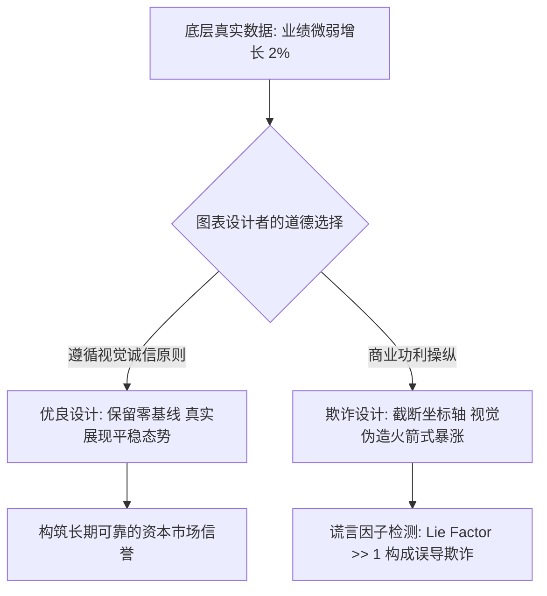
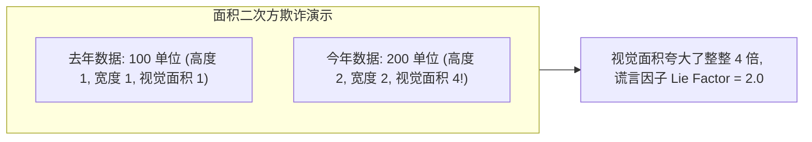

# Lec 20 图表伦理学与设计批判：良图、劣图与欺骗性视觉失真 (The Good, the Bad, and the Ugly: Visual Integrity & Design Grammar)

> MIT 15.071 数据分析优势 · 讲义 20 · 授课教师：Prof. Dimitris Bertsimas / Allison O'Hair

## TL;DR

- 数据可视化是一柄双刃剑，不严谨的设计或刻意的操纵能够将微弱的真实噪音包装成惊悚的商业谎言。
- 爱德华·塔夫特（Edward Tufte）确立了视觉诚信（Visual Integrity）原则与定量测算谎言因子（Lie Factor）的数学公式。
- 截断 Y 轴基线、双 Y 轴异步刻度、面积二次方夸张与选择性截取时间窗口是商业演示中四大典型欺骗手段。
- 数据墨水比（Data-Ink Ratio）最大化原则要求坚决剔除无信息价值的装饰性图表垃圾（Chartjunk）。

## 1. 视觉欺诈的泛滥与图表伦理危机

在现代商业财报路演、政治辩论电视直播以及大众社交媒体上，图表往往被公众视为“铁证如山”的客观代表。人们常说：“数字不会说谎（Numbers don't lie）。”

然而，正如统计学家达雷尔·哈夫（Darrell Huff）在名著《统计陷阱》（How to Lie with Statistics）中所深刻揭露的：**数字或许不会说谎，但说谎者善于利用图表制造谎言**。通过对坐标轴刻度、图表纵横比、几何投影与色彩暗示的巧妙操纵，图表设计者可以完全不篡改任何底层数据原始数值，却在观众视网膜上制造出完全颠倒黑白的心理暗示。

耶鲁大学政治与统计学名誉教授爱德华·塔夫特（Edward Tufte）在奠基性巨著《定量信息的视觉展示》（The Visual Display of Quantitative Information）中，开创了现代**图表伦理学（Visual Integrity）**的理论框架。

## 2. 塔夫特视觉诚信准则与谎言因子（Lie Factor）

为了量化图表在视觉传达上的失真程度，塔夫特给出了严格的数学检验公式：

::: definition [谎言因子 (Lie Factor)]
谎言因子度量了图表视觉元素所呈现的图形变化幅度，与底层数据真实物理变化幅度之间的比率：
$$\text{Lie Factor} = \frac{\text{图形中视觉表征的变化百分比}}{\text{数据中底层物理指标的真实变化百分比}} = \frac{|\Delta \text{Graphic}| / \text{Graphic}_{\text{initial}}}{|\Delta \text{Data}| / \text{Data}_{\text{initial}}}$$
- **诚信区间**：$0.95 \le \text{Lie Factor} \le 1.05$（视觉变化如实反映数据波动）；
- **夸大欺诈（Overstated）**：$\text{Lie Factor} > 1.05$（人为夸大了数据的变动幅度）；
- **隐匿掩盖（Understated）**：$\text{Lie Factor} < 0.95$（刻意抚平了真实的剧烈震荡）。
:::

在很多恶劣的广告营销图表中，谎言因子甚至高达 **10 至 50 倍**，严重破坏了资本市场的知情权。

## 3. 商业演示中四大典型视觉欺骗“酷刑”

### 3.1 罪状一：截断 Y 轴零基线（Truncated Y-Axis）
这是最常见、最隐蔽的视觉犯罪。在展示条形图时，设计者故意不从 $0$ 开始标注垂直坐标轴，而是从一个非常接近数据峰值的基数开始：
- **真实数据**：某公司过去两年的市场份额从 $38.5\%$ 微幅上升到 $39.2\%$（增幅仅有微弱的 $+1.8\%$）；
- **欺诈手法**：将 Y 轴的起始基线设定为 $38.0\%$，顶部设定为 $39.5\%$；
- **视觉谎言**：在屏幕上，第二年的柱状图高度竟然是第一年的整整 **3 倍之多**！读者一眼看去会产生“公司业绩取得爆炸式暴涨”的严重幻觉。

::: theorem [条形图必须严格包含零基线法则]
条形图（Bar Chart）的视觉解码通道完全依赖于**柱体的高度与长度（Length）**。因此，条形图的底部基线在几何上**必须严格锁定在零（Zero Baseline）**！
只有在时间序列折线图（Line Chart）中，由于视网膜主要解码的是线条的**斜率变化率（Slope）**，才允许在注明的情况下局部缩放 Y 轴。
:::

### 3.2 罪状二：面积二次方扩张陷阱（The Area-Volume Trap）
在信息图表（Infographics）中，设计者喜欢用具体实物的图标大小来替代普通的线条。
例如：表达某国今年石油进口量是去年的 **2 倍**：
- 设计者在图上画了一个高为 1 单位的油桶代表去年，画了一个高为 2 单位的油桶代表今年；
- 然而，图形是二维面积！当高度翻倍（$2\times$）时，图标的宽度也自发翻倍，其占用的屏幕像素面积实际上变成了去年的 **$2 \times 2 = 4$ 倍**！
- 如果是三维立体图标，体积更是暴增为 **$2^3 = 8$ 倍**！
谎言因子在这里直接飙升至 $200\% \sim 400\%$，对观众造成强烈的非理性恐吓。

### 3.3 罪状三：双 Y 轴刻度异步缩放（Dual-Axis Manipulation）
在一张折线图上同时绘制两个不同量纲的指标（左轴为产品销售额，右轴为广告支出），通过自由拉伸右轴的上下界，设计者可以强行让两条原本毫不相关的曲线在屏幕上完全贴合在一起，制造出“广告投入与销售额高度亦步亦趋、立竿见影”的伪因果神话。

### 3.4 罪状四：樱桃采摘时间切片（Cherry-Picking Timeframe）
某只对冲基金在过去 5 年累计亏损 $-40\%$，但在最近两周反弹了 $+5\%$。该基金在宣传单上故意只展示最近 14 天的净值走势图，把一条长期向下的绝望滑梯，伪装成一条凌厉向上的大牛市直线。

## 4. 优秀设计的灵魂：最大化数据墨水比（Data-Ink Ratio）

除了严惩视觉欺诈，塔夫特还树立了现代极简主义设计的工程标尺——**数据墨水比（Data-Ink Ratio）**：

$$\text{Data-Ink Ratio} = \frac{\text{用于直接展示核心数据的不可擦除墨水量}}{\text{打印全图所耗费的总墨水量}} = 1.0 - \text{无信息图表垃圾所占比例}$$

优秀的设计师必须对**图表垃圾（Chartjunk）**发起冷酷无情的宣战：
1. **彻底抹杀装饰性 3D 效果**；
2. **削弱甚至删除浓重杂乱的深色网格线**（仅保留微弱的浅灰辅助线）；
3. **消除大面积高饱和度的高对比度刺眼底色**；
4. **让数据墨水占据视觉绝对 C 位**：所有的线条、散点和标注，每一笔都必须为了传达真实的统计差异而服务。

::: example [优秀可视化与恶劣可视化的改版对比]
某制造企业展示四个季度的缺陷次品率：
- **恶劣设计（The Ugly）**：倾斜 3D 柱状图、粗大反光的彩虹色渐变、厚重黑色背景网格、截断在 $2.0\%$ 的 Y 轴、满屏漂浮无意义的立体阴影（数据墨水比仅 $0.25$）；
- **优雅设计（The Good）**：一张干净利落的极简水平点图（Dot Plot），对齐完整的 $0\%$ 基线，重点用鲜明红点标出超标的第三季度，旁边附有一行克制清晰的文字原因注释（数据墨水比高达 $0.85$）。
高管在 1 秒钟内即可看懂核心瓶颈，汇报沟通效率提升数倍。
:::

::: insight [我的理解：图表不仅关乎审美，更关乎契约与敬畏]
数据可视化是分析师与公众之间订立的一份信任契约。一个精通数学的骗子，可以利用复杂的公式在白纸黑字间隐藏破绽；而一个精通视觉心理学的骗子，则能直接在人类大脑的视神经通道中下毒。选择捍卫完整的零基线、选择擦除那些虚伪炫目的 3D 浮雕，不仅是追求美学上的克制，更是对事实与读者灵魂最庄严的诚实。
:::
