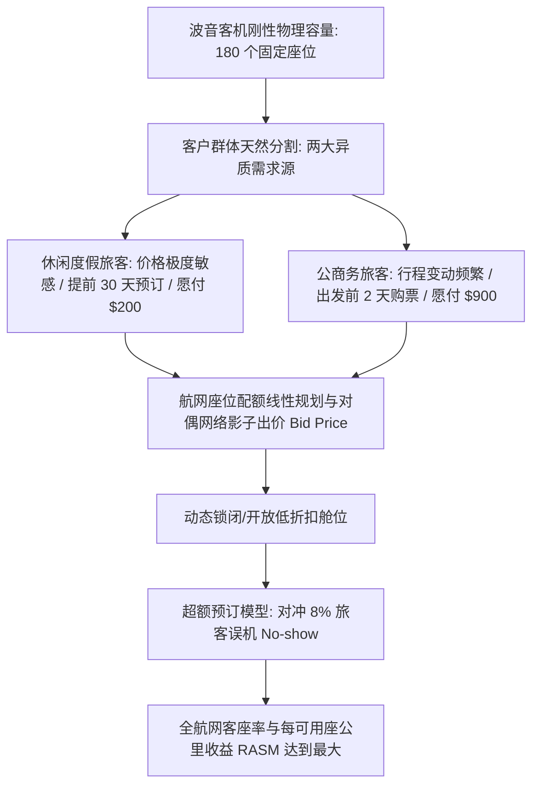

# Lec 21 航空收益管理与超额预订：线性优化在航班座位配额中的应用 (Airline Revenue Management: Linear Optimization)

> MIT 15.071 数据分析优势 · 讲义 21 · 授课教师：Prof. Dimitris Bertsimas / Allison O'Hair

## TL;DR

- 航空客运具有产能高度刚性、边际服务成本微弱且航班起飞后座位价值归零的易损特性。
- 收益管理线性规划模型通过网络流平衡，在复杂的轴辐式航网中为各舱位票价分配最优座位配额。
- 单航段座位的对偶影子价格（Bid Price）构成了决定是否接受跨航段联程旅客的核心机会成本门槛。
- 动态超额预订（Overbooking）利用报童分位数模型在旅客临阵误机（No-show）与拒载赔偿之间锁定极值。

## 1. 航空业的经济学悖论与收益管理革命

1978 年，美国通过《航空客运管制放松法案》（Airline Deregulation Act），彻底终结了由民航委员会（CAB）统一定价的垄断保护伞。达美航空、美国航空（AA）与美联航（United）等老牌全服务航空公司，瞬间被卷入与低成本航空（如人民快运 People Express）的残酷价格血战。

航空公司面临着现代商业世界中最极端的**经济学非对称结构**：
- **巨额沉没固定成本**：一架波音 777 飞机的购置或租赁费动辄数亿美元，机组薪资、机场停机费与航线燃油成本在航班排定后几乎是固定的；
- **微乎其微的边际成本**：飞机上一旦还有一个空位，多承运一名旅客所消耗的额外燃油与一罐花生米饮料的边际成本几乎**不到 10 美元**；
- **极端脆弱的易损性（Perishability）**：航班舱门关闭滑行起飞的瞬间，机舱内所有未售出的空座位，其商业价值将在物理意义上**瞬间暴跌为严格的 0 美元**！

如果航空公司统一打折，虽然能填满机舱，但原本愿意支付上千美元公款的高管商务客也会坐享低价；如果统一坚持高价，机舱内大片座位将永久空置。
美国航空（American Airlines）时任董事长罗伯特·克兰德尔（Robert Crandall）首次引入基于运筹优化的**收益管理（Revenue Management / Yield Management）**系统，被《福布斯》盛赞为“管制放松后民航业最重要的技术发明”。

## 2. 轴辐式航网（Hub-and-Spoke）座位配额线性规划

现代航空枢纽通常采用轴辐式网络架构。考虑美联航以芝加哥奥黑尔机场（ORD）为枢纽的简易网络：
- 航段 1：西雅图（SEA） $\to$ 芝加哥（ORD），物理机型容量 $C_1 = 150$ 座位；
- 航段 2：芝加哥（ORD） $\to$ 波士顿（BOS），物理机型容量 $C_2 = 120$ 座位。

该网络同时向市场销售三种旅行产品（Itineraries）：
1. **产品 A（SEA-ORD 直飞）**：全价商务票价 $P_A = \$500$，预测需求上限 $D_A = 80$；
2. **产品 B（ORD-BOS 直飞）**：全价商务票价 $P_B = \$400$，预测需求上限 $D_B = 60$；
3. **产品 C（SEA-BOS 跨枢纽联程联运）**：旅客搭乘同一张联程票，先后占用航段 1 和航段 2 的各一个座位！联程票价 $P_C = \$750$，预测需求上限 $D_C = 70$。

### 2.1 优化模型构建

定义决策变量：
- $x_A, x_B, x_C$ 分别为向三类产品分配的可售座位配额。

目标函数（极大化全航网总客票收入）：
$$\max \quad Z = 500 x_A + 400 x_B + 750 x_C$$

约束体系：
1. **航段 1 物理机型容量上限（SEA-ORD）**：
   $$x_A + x_C \le 150 \quad (\text{影子价格为 } y_1)$$
2. **航段 2 物理机型容量上限（ORD-BOS）**：
   $$x_B + x_C \le 120 \quad (\text{影子价格为 } y_2)$$
3. **各品类市场需求吸收上限**：
   $$x_A \le 80, \quad x_B \le 60, \quad x_C \le 70$$
4. **非负约束**：$x_A, x_B, x_C \ge 0$。

### 2.2 求解与网络对偶出价（Bid Price）的商业真谛

通过单纯形法求解，得到最优配额分配如下：
- $x_A^* = 80$（全部满足西雅图直飞商务客，消耗航段 1 座位 80 个）；
- 航段 1 剩余可用座位：$150 - 80 = 70$ 个；
- 联程产品 C 全额满足：$x_C^* = 70$（同时消耗航段 1 座位 70 个与航段 2 座位 70 个！）；
- 航段 2 剩余座位：$120 - 70 = 50$ 个；
- $x_B^* = 50$（由于航段 2 被联程客大量占用，只能满足 50 名波士顿直飞客，其余 10 名被拒载！）；
- 全网最高总收入：$Z^* = 500(80) + 400(50) + 750(70) = 40,000 + 20,000 + 52,500 = \mathbf{\$112,500}$。

::: example [网络影子价格在实时动态机票分销中的应用]
求解器输出了两个航段的影子价格：
- 航段 1 紧约束：$y_1^* = \$350$；
- 航段 2 紧约束：$y_2^* = \$400$。
两个航段的影子价格之和为：$y_1^* + y_2^* = 350 + 400 = \$750$（精确打平联程票价！）。
**网络出价法则（Bid Price Control）**：
当外部机票搜索引擎（如 Expedia / Google Flights）实时查询“是否接受一张西雅图经芝加哥到波士顿的特价休闲机票（报价 $650）”时，中央订座系统无需重新运行全局优化，只需检查该特价是否大于其所经过航段的影子价格之和：
$$\$650 < y_1^* + y_2^* = \$750$$
系统在 **5 毫秒内自动拒绝出票**！因为把这两个座位留给直飞高价值旅客能够多赚整整 100 美元。
:::

## 3. 动态超额预订（Overbooking）与报童临界分位数

即便机位全部按照高价售罄，航空公司依然面临不可抗力的乘客行为随机性：历史大数据显示，全美平均有 **$5\% \sim 10\%$ 的购票旅客在起飞当天因会议延误、堵车或生病未能登机（No-show）**。

如果不超额售票，哪怕系统显示满员，飞机起飞时依然会有十几个座位空置。为此，航司引入了**超额预订（Overbooking）模型**：

设航班物理容量为 $C$，决定超额发售 $B$ 张机票（总售票量为 $C + B$）。
到达登机口的真实旅客数 $X$ 是一个随机变量：
- **欠售成本（Cost of Underage, $C_u$）**：若到达人数 $X < C$，造成机位空置（Spoilage），每空一个座位损失票价净毛利 $P$；
- **超售成本（Cost of Overage, $C_o$）**：若到达人数 $X > C$，发生**非自愿拒载（Bumping / Denied Boarding）**，航司必须向旅客支付免费改签下一班、高端酒店住宿券与高达 400% 票价的法定民航局现金补偿金，设综合惩罚为 $K$。

依据报童模型（Newsvendor Problem），最优超额预订停止门槛满足临界分位数（Critical Fractile）：
$$P(X \le C) = \frac{C_o}{C_o + C_u} = \frac{K}{K + P}$$

::: pitfall [公关危机与人权尊严的不可承受之重]
数学模型假定所有的超售都可以通过金钱赔偿平滑解决。然而，2017 年美联航 3411 航班强行将一名亚裔医生暴力拖拽出机舱以腾出座位给内部机组人员，引发全球舆论海啸，导致美联航母公司市值单日蒸发近 10 亿美元。运筹优化模型必须将社会舆论的极端声誉风险设为不可逾越的硬性安全红线。
:::

::: insight [我的理解：收益管理是算法对时间折现与流动性的深刻洞察]
在物理学家眼里，机舱里的每一个座位是由金属和海绵构成的静止物体；而在运筹学家的眼里，每一个座位本质上是一份行权期截至航班关闭瞬间的金融欧式看跌期权。收益管理的精妙之处，不在于贪婪地榨取每一分钱，而在于它通过对偶影子价格，在全网极其复杂的千百条时空交错的管道中，为那些最紧迫、最具经济创造力的出行需求开辟了一条畅通无阻的通道。
:::
