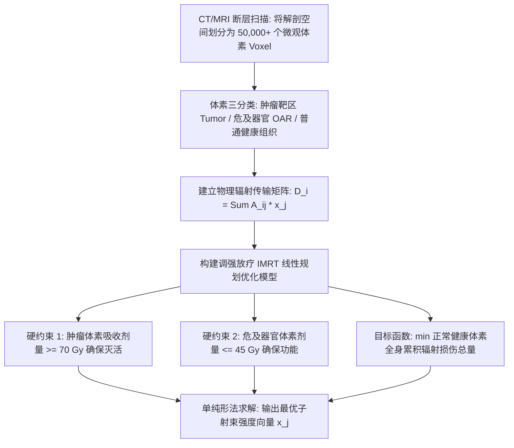
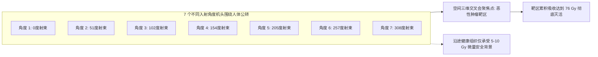

# Lec 22 肿瘤放射治疗规划：利用线性规划平衡照射剂量与健康组织保护 (Radiation Therapy Planning: Beam Angle & Dose Optimization)

> MIT 15.071 数据分析优势 · 讲义 22 · 授课教师：Prof. Dimitris Bertsimas / Allison O'Hair

## TL;DR

- 调强放射治疗（IMRT）是恶性肿瘤非侵入性治疗的现代利器，其核心矛盾在于杀灭肿瘤与保护健康器官的双重诉求。
- 人体解剖切片被离散化为数万个体素（Voxels），射束细分为数千个可独立调节强度的子射束（Beamlets）。
- 线性规划（LP）模型在体素剂量吸收方程下，精确寻找满足肿瘤最低杀伤阈值并极小化健康组织辐射的射束强度配置。
- 影子价格量化了危及器官（OAR）安全耐受极限放宽对肿瘤全剂量覆盖的边际临床贡献。

## 1. 放射治疗的物理悖论与两难博弈

恶性肿瘤（癌症）是威胁全人类生命健康的头号杀手之一。除手术切除与全身化学药物治疗外，**放射治疗（Radiation Therapy）**是根治或局部控制实体肿瘤最关键的现代医疗手段。全美超过 $50\%$ 的癌症患者在病程中需要接受高能电离辐射治疗。

现代医用直线加速器（Linear Accelerator）发射出数百万伏特的高能 X 射线（光子束），通过打断肿瘤癌细胞的 DNA 双螺旋链，使其丧失分裂能力并诱导凋亡。

然而，放射肿瘤科医生面临着一个残酷的**物理学与解剖学两难悖论**：
- 高能光子束具有强大的组织穿透力。射线在从体外穿入、经过人体到达深部肿瘤靶区（Tumor Target Volume）的过程中，以及穿透肿瘤继续射出体外的路径上，**必然会将其携带的杀伤能量无差别地倾泻在沿途所有健康的正常细胞与关键脏器之上**！
- 恶性肿瘤往往紧贴甚至包绕着人类最脆弱的核心功能中枢——**危及器官（Organs at Risk, OAR）**：
  - 在前列腺癌治疗中，前列腺紧紧夹在膀胱（Bladder）与直肠（Rectum）之间，过量辐射会导致永久性尿失禁与肠道大出血坏死；
  - 在头颈部鼻咽癌或脑胶质瘤治疗中，肿瘤紧邻脑干（Brainstem，负责心跳呼吸生命中枢）与视交叉神经（视力中枢），任何辐射超标都将直接导致失明甚至脑死亡！

传统的简易放疗采用固定两到三个大角度直接照射，为了保全患者性命，医生只能被迫大幅压低照射总剂量，导致肿瘤复发率极高。

## 2. 调强放疗（IMRT）与线性剂量矩阵离散化

麻省理工学院运筹学中心 Dimitris Bertsimas 教授与哈佛医学院麻省总医院（MGH）放射肿瘤学团队深度合作，将这一复杂的生物物理过程形式化为标准的**大规模线性规划（Large-Scale Linear Program）**。

这项突破得益于**调强放射治疗技术（Intensity Modulated Radiation Therapy, IMRT）**的硬件进化：加速器机头上安装了由上百片高密度钨合金制成的**多叶准直器（Multileaf Collimators, MLC）**。这使得从任何一个照射角度射出的宽大光束，都可以被物理细分为成百上千个微小的铅笔状**子射束（Beamlets）**，每个子射束的开关时长与辐射强度都可以完全独立控制！

### 2.1 体素化与剂量沉积矩阵 $A$

将患者的三维立体 CT/MRI 图像切分为数以万计的细小立方体，每个立方体被称为一个**体素（Voxel）**：
- 设全身体素总数为 $M$（通常 $M \approx 30,000 \sim 100,000$ 个体素）；
- 设机头预设的可选子射束总数为 $N$（来自 5 至 9 个不同入射角度，包含 $N \approx 1,000 \sim 3,000$ 个子射束）；
- 定义决策变量：$x_j \ge 0$ 为第 $j$ 个子射束的照射强度（$j = 1, 2, \dots, N$）。

利用复杂的蒙特卡洛光子输运模拟物理引擎，预先离线计算出**剂量沉积技术系数矩阵 $A \in \mathbb{R}^{M \times N}$**：
$A_{ij}$ 精确表示：**当第 $j$ 个子射束以单位强度照射时，第 $i$ 个体素所吸收的辐射剂量（单位：戈瑞 Gray, Gy）**。

依据辐射生物物理学的线性可加性原理，第 $i$ 个体素最终吸收的实际累积总辐射剂量为所有子射束贡献的线性代数和：
$$D_i = \sum_{j=1}^N A_{ij} x_j, \quad i = 1, 2, \dots, M$$

## 3. 放疗规划线性规划模型（IMRT-LP）

将全部体素集合严格划分为互不重叠的三大解剖集合：
1. **$\mathcal{T}$（肿瘤靶区体素集）**
2. **$\mathcal{O}$（危及器官体素集，如脑干、视神经、直肠）**
3. **$\mathcal{N}$（其余普通健康正常组织体素集）**

### 3.1 代数方程构建

$$\min_{x} \quad \sum_{i \in \mathcal{N}} w_i D_i + \sum_{k \in \mathcal{O}} \lambda_k D_k = \sum_{i \in \mathcal{N} \cup \mathcal{O}} c_i \left( \sum_{j=1}^N A_{ij} x_j \right)$$
$$\text{s.t.} \quad \sum_{j=1}^N A_{ij} x_j \ge \text{Dose}_{\text{prescribed}}, \quad \forall i \in \mathcal{T} \quad (\text{肿瘤处方剂量下限硬约束})$$
$$\sum_{j=1}^N A_{ij} x_j \le \text{Dose}_{\text{max}}, \quad \forall i \in \mathcal{T} \quad (\text{防范肿瘤中心局部剂量过热烧蚀})$$
$$\sum_{j=1}^N A_{ik} x_j \le \text{Tolerance}_k, \quad \forall k \in \mathcal{O} \quad (\text{危及器官最大容许安全耐受极限})$$
$$x_j \ge 0, \quad \forall j = 1, 2, \dots, N$$

其中：
- 肿瘤处方剂量（通常设定为 $70 \sim 80 \text{ Gy}$），必须 $100\%$ 保证肿瘤体素内每一个点都能吃饱足够的致死剂量；
- 危及器官耐受极限（如脊髓不得超过 $45 \text{ Gy}$，脑干不得超过 $54 \text{ Gy}$），构成绝对不可逾越的红线；
- 目标函数通过赋予不同健康组织以权重 $c_i$，极小化正常人体吸收的无谓散射总量。

### 3.2 优化结果展现：几何“交叉火力（Crossfire）”的奇迹

线性规划求解器在几分钟内即可求得数千个子射束强度的全局最优配置向量 $x^*$：

通过 7 个不同入射方向的精巧强度调制，模型实现了物理学上的**“交叉火力汇聚效应”**：
- 单个子射束穿透健康皮肤与危及器官时，由于强度被精确削弱，正常组织单次仅吸收微不足道的安全剂量（完全在人体自身修复能力之内）；
- 然而，当来自 7 个不同方向的数百个子射束在深部肿瘤靶区空间精准三维重叠聚焦时，肿瘤中心瞬间爆发出高达 $76 \text{ Gy}$ 的毁灭性致死剂量峰值！

::: example [影子价格在临床放疗多学科会诊中的决断价值]
在某些极其棘手的复杂脑胶质瘤中，初始 LP 模型可能返回“无可行解（Infeasible）”——因为肿瘤浸润过深，物理上不存在一套射束能够既让肿瘤达到 70 Gy、又让紧邻的视神经低于 45 Gy。
此时，对偶影子价格派上了用场：
- 对偶灵敏度报告清晰指明：**视神经耐受约束的影子价格高达 $-145.2$**；
- 放射肿瘤科主任与神经外科大夫联合会诊：如果经过医学评估，允许将视神经某一边缘微小体素的耐受上限谨慎放宽 $1.5 \text{ Gy}$（患者可能会有轻微视野缺损但绝不致盲），全模型瞬间恢复可行解，且肿瘤杀灭率从原本的 $65\%$ 跃升至 **$98\%$**！影子价格为医生权衡生存率与并发症提供了最清晰的医学决策度量衡。
:::

::: pitfall [患者器官生理运动引发的“脱靶（Geometric Miss）”]
在胸部肺癌与腹部肝癌放疗中，患者每一次自然的胸腔呼吸运动，都会导致肿瘤和隔膜发生上下数厘米的物理位移。如果优化模型完全基于静态的某一张 CT 切片求解，在实际治疗中可能会出现“子射束全打在空处，而肿瘤完全脱靶”的灾难。现代前沿优化必须引入**鲁棒优化（Robust Optimization）**，将呼吸运动的轨迹椭球作为不确定性集合纳入约束。
:::

::: insight [我的理解：运筹学在毫厘之间为生命护航]
在商学院的黑板上，单纯形法的转轴操作只是为了给公司多赚几百块钱利润；而在这间挂满核磁共振灯箱的肿瘤放疗机房里，线性规划的每一次矩阵转轴，都是在微米级的尺度上与死神竞速。每一个非负决策变量 $x_j$ 的升降，目标函数每减少一个单位的多余辐射，就意味着一位父亲在战胜绝症之后，能够完好无损地保住他的记忆、语言与光明。这是应用数学能够对人类社会做出的最崇高奉献。
:::
