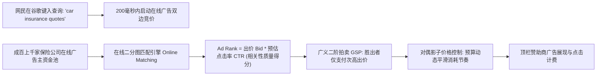

# Lec 23 谷歌 AdWords 在线广告匹配：受限预算下的双边拍卖动态优化 (Google AdWords: Optimizing Online Advertising & Keyword Matching)

> MIT 15.071 数据分析优势 · 讲义 23 · 授课教师：Prof. Dimitris Bertsimas / Allison O'Hair

## TL;DR

- 谷歌（Google）年营收数千亿美元的商业帝国，本质上是由一套庞大的实时在线运筹优化匹配引擎支撑的。
- 广义二阶拍卖（Generalized Second-Price Auction, GSP）将广告主出价与质量得分（Quality Score）结合确定展示排位。
- 在线对偶影子价格（Dual Shadow Prices）解决了广告主日度预算受限条件下的跨周期动态平滑配额难题。
- 贪心算法在在线流数据中具有盲目性，必须依托竞争比（Competitive Ratio）算法对抗未知的未来查询分布。

## 1. 200 毫秒内的千亿美元数字拍卖场

每当全球任意一位网民在谷歌搜索框中输入一个搜索词（Query，例如 `"best auto insurance"`、`"buy running shoes"`、`"mesothelioma lawyer"`），在点击回车到搜索结果页（SERP）渲染完成的短短 **200 毫秒（0.2 秒）**之内，谷歌庞大的分布式数据中心内部就完成了一场人类商业史上最精密的在线运筹优化与算法拍卖。

与传统报纸、电视广告“按季度买断版面”的离线模式不同，谷歌 **AdWords（现 Google Ads）** 实现了搜索意图与商业广告的**瞬时纳米级动态精准匹配**：
- 广告主只在网民真正点击了广告后才向谷歌支付费用（按点击付费，Cost-per-Click / CPC）；
- 广告主并不直接锁定某个具体用户，而是针对一系列核心**关键词（Keywords）**提交最高出价（Maximum Bid $b_i$），并设定了严苛的**每日总预算上限（Daily Budget $B_i$）**。

如何在一秒钟内涌入的数十万次异构搜索查询流中，既最大化谷歌平台的全天商业营收，又确保广告主的预算不被过早恶意烧尽，同时为网民匹配到最相关的商业结果？这构成了现代计算机科学与运筹学最迷人的前沿交叉课题。

## 2. 广义二阶拍卖机制（Generalized Second-Price Auction, GSP）

谷歌在广告位排序中并没有采用简单的“价高者得”原则。如果只看谁给的钱多，搜索结果顶端很快会被毫无相关性的垃圾诈骗网站占领，导致网民不再信任并拒绝点击搜索广告。

### 2.1 广告排名分值（Ad Rank）与质量得分

谷歌为每一个参与竞价的广告主计算**广告排名分值（Ad Rank）**：
$$\text{Ad Rank}_i = \text{Bid}_i \times \text{Quality Score}_i$$
其中，**质量得分（Quality Score）**的核心支柱是**预估点击率（Predicted CTR）**、落地页体验（Landing Page Experience）以及广告文本与查询词的语义相关度。
- 即使某家小广告主出价仅为 $5 美元，但由于其广告极其精准，预估点击率为 $10\%$，$\text{Ad Rank} = 0.50$；
- 某家大财阀出价高达 $20 美元，但由于广告粗制滥造无人点击，预估点击率仅为 $1\%$，$\text{Ad Rank} = 0.20$；
- 谷歌坚决将第一位广告位分配给小广告主！这不仅保护了用户体验，而且在期望收益上：$5 \times 0.10 = 0.50 > 20 \times 0.01 = 0.20$，平台同样赚取了更高的期望收益！

### 2.2 计费机制：广义二阶密封计费（GSP）

胜出者最终被扣除的点击单价（Actual CPC），并不等于其自身提交的最高出价，而是**刚好能够保住其当前排名所必须支付的最低价格（即下一名竞争对手的 Ad Rank 除以自身质量得分）**：
$$P_i = \frac{\text{Ad Rank}_{i+1}}{\text{Quality Score}_i} + \$0.01$$
这种二阶拍卖机制极大地削弱了广告主频繁试探性微调出价的博弈损耗，鼓励广告主按照自己的真实心理估值如实报价（Truthful Bidding）。

## 3. 在线二分图匹配与受限预算优化模型

广告分配的真正运筹学核心在于**跨时段受限预算分配（Budget-Constrained Online Allocation）**。

假设某天全网预期发生 $T$ 次搜索查询（记为集合 $J = \{1, 2, \dots, T\}$），平台拥有 $M$ 个广告主（记为集合 $I = \{1, 2, \dots, M\}$）：
- 广告主 $i$ 的每日法宝预算上限为 $B_i$（例如每天最多花费 500 美元）；
- 当查询 $j$ 到来时，若向其展示广告主 $i$ 的广告并被点击，广告主愿意支付的有效净收益为 $c_{ij}$。

若在全知全能的上帝视角下（离线离线优化，全部查询已知），最优广告分配是一个标准的**最大权二分图匹配线性规划（Bipartite Matching LP）**：

$$\max_{x} \quad \sum_{i=1}^M \sum_{j=1}^T c_{ij} x_{ij}$$
$$\text{s.t.} \quad \sum_{j=1}^T c_{ij} x_{ij} \le B_i, \quad \forall i = 1, \dots, M \quad (\text{广告主每日总预算硬约束，对偶变量 } \alpha_i)$$
$$\sum_{i=1}^M x_{ij} \le 1, \quad \forall j = 1, \dots, T \quad (\text{每次查询至多展示一个主赞助商，对偶变量 } \beta_j)$$
$$0 \le x_{ij} \le 1$$

### 3.1 贪心算法的致命短视（The Greedy Trap）

在现实中，网民的查询 $j$ 是一次一个、实时动态到来的流数据（Data Stream）。谷歌在清晨 8 点做决策时，根本不知道下午 3 点会不会出现更优质的高出价查询。

若采取朴素的**贪心算法（Greedy Algorithm）**：每当一个查询到来，直接分配给当前出价最高且预算尚存的广告主。
- **灾难后果**：出价高且预算充足的大广告主，在早晨 9 点就被成千上万个转化率极其平庸的低价值泛搜索词吃光了全部 500 美元预算；
- 等到下午和傍晚，真正意图极强、客单价极高的垂直核心长尾搜索爆发时，该大广告主由于预算早已归零而被迫强行下线！
- 平台总收益遭到严重截断，广告主也因为获客质量糟糕而怨声载道。

### 3.2 对偶影子价格与自适应平滑（AdWords Dual Pacing）

运筹学大师卡普（Richard Karp）与现代算法团队提出了基于**在线对偶规划（Online Primal-Dual）的竞争比算法**。

仔细审视上述线性规划中预算约束的**对偶变量 $\alpha_i$（影子价格）**：
$\alpha_i$ 代表广告主 $i$ 的预算稀缺性惩罚因子！
- 当某广告主刚刚进入新的一天、预算尚且极其充裕时，其预算约束未饱和，$\alpha_i \approx 0$；
- 随着白天预算不断被消耗，剩余额度越来越紧张，对偶影子价格 $\alpha_i$ 自发非线性飙升！

谷歌在线分配算法在实时裁决时，不再单纯依据原始出价 $c_{ij}$，而是依据**经对偶影子价格贴现后的有效虚拟竞价（Discounted Virtual Bid）**：
$$\text{Virtual Bid}_{ij} = c_{ij} \times \left( 1 - \psi\left(\frac{\text{Spent}_i}{B_i}\right) \right)$$
其中 $\psi(f) = e^{f-1}$ 为经典的指数惩罚权重函数。
- 当广告主已消耗了 $80\%$ 的预算时，系统自发对其中庸查询进行出价打折压制，将其宝贵的剩余 $20\%$ 预算如同狙击手一样，严密锁定在全天最顶级的高净值搜索词之上！

::: theorem [Mehta-Saberi-Vazirani-Vazirani 在线竞争比定理 (2007)]
在完全无需预知任何未来查询概率分布的最坏情况下，基于对偶平滑的在线分配算法，能够保证其实际收益至少达到离线全知最优收益的：
$$1 - \frac{1}{e} \approx 63.2\%$$
这是任何在线确定性算法在数学理论上能够达到的绝对理论竞争比上限（Competitive Ratio Lower Bound）！
:::

::: pitfall [恶意点击欺诈（Click Fraud）对优化系统的侵蚀]
在 CPC 模式下，存在竞争对手雇佣“水军”或编写机器人脚本恶意高频点击对手广告以快速消耗其日预算的恶意攻击行为。若优化系统缺乏严格的 IP 聚类与行为指纹反作弊过滤，算法的对偶预算控制将被假流量彻底操纵，导致广告主预算被无效蒸发。
:::

::: insight [我的理解：AdWords 是将运筹学直接铸造为货币的数字炼金术]
在公众眼中，谷歌是一家科技公司、一家搜索公司或一家人工智能公司；但在商业底层，谷歌是一座运转着人类有史以来最庞大对偶线性规划方程组的数字金融交易所。没有复杂的厂房、不需要任何实体原料，成百上千个约束方程在内存中高速旋转，每一秒钟都在数以亿计的意图与资产之间寻找着对偶平衡点。这就是数据、模型与运筹优化融合所能释放的最震撼的商业伟力。
:::
