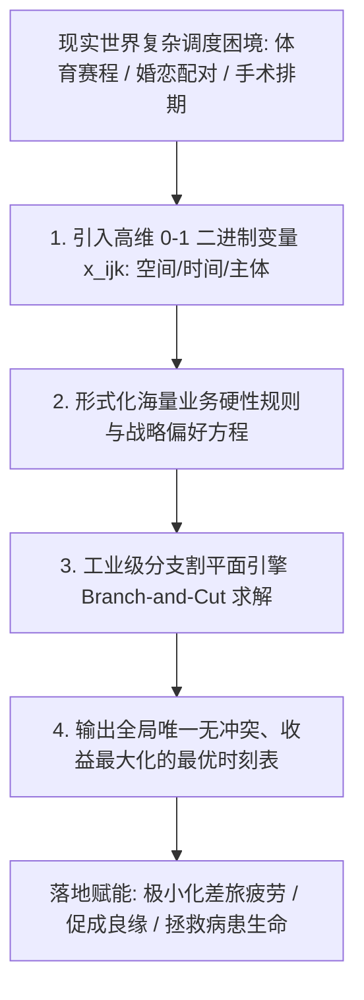
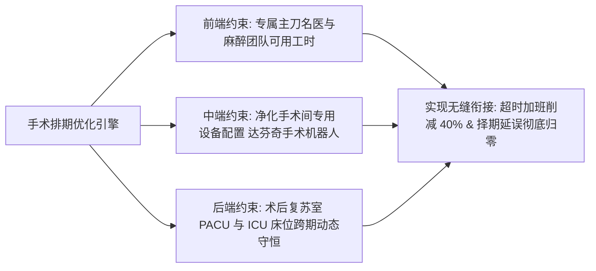

# Lec 24 组合优化与战略调度：体育赛程、eHarmony 婚恋配对与医院手术室整数规划 (Integer Optimization in Sports Scheduling, eHarmony & Operating Rooms)

> MIT 15.071 数据分析优势 · 讲义 24 · 授课教师：Prof. Dimitris Bertsimas / Allison O'Hair

## TL;DR

- 混合整数线性规划（MILP）是征服具有天文数字组合可能性的高难度离散调度问题的终极计算武器。
- 职业体育跨赛区赛程排定平衡了旅行飞行碳足迹、主客场交替节律与数十亿美元的电视转播收益。
- eHarmony 婚恋匹配模型将高维心理相容性测评转化为具有单向配额约束的稳定双边二分图匹配优化。
- 医院手术室排班在外科主刀医生偏好、麻醉师资源与后道 ICU 重症监护床位瓶颈之间实现零冲突统筹。

## 1. 组合爆炸与离散优化的现实统治力

在 15.071 这门波澜壮阔的课程的最后一战中，我们汇聚了全部的数据预测洞察，推开运筹学中最严峻也最迷人的殿堂之门——**大规模离散组合优化（Combinatorial Optimization）**。

在人类社会的顶层运营中，最昂贵、最具战略破坏力的瓶颈往往不是连续的实数分配，而是严丝合缝的“离散时间表与人员指派”：
- 职业棒球或橄榄球大联盟如何在 30 支球队、162 场比赛、跨越全美四个时区的空间网络中排出一张让所有老板满意且转播收视率最高的赛程表？
- 拥有两千万单身男女会员的顶级相亲平台，如何打破信息过载，在几亿种可能连接中匹配出彼此心仪且能步入婚姻殿堂的伴侣？
- 耗资数十亿美元的现代化三甲综合医院，如何在几百位外科名医、几十间昂贵手术室和随时可能告急的重症监护室（ICU）床位之间，实现零延误的生命救援？

如果依靠人类调度员拿铅笔在纸上试错排班，面对潜在组合数量远超全宇宙原子总数（$10^{80}$）的解空间，人类大脑在几十步之内就会彻底陷入僵死。**混合整数规划（MILP）**正是终结这种混沌的超级解题器。

## 2. 案例实战 I：职业体育大联盟赛程排定（Sports Scheduling）

美国职业棒球大联盟（MLB）或国家橄榄球联盟（NFL）的赛程编制，被公认为运筹学界最具挑战性的基准测试难题之一。赛程的优劣直接关乎数以亿计的电视转播权收益与运动员的伤病风险。

### 2.1 令人窒息的硬性规则与软性商业诉求体系

定义决策变量：$x_{ijt} \in \{0, 1\}$ 表示在第 $t$ 轮比赛中，球队 $i$ 是否前往客场挑战主场球队 $j$。

赛程表必须满足一系列复杂的工业级硬约束：
1. **单循环/双循环对阵完备性**：每支球队在整个赛季必须且只能与同赛区对手交锋固定场次；
2. **主客场严格交替限制（Home-Away Patterns）**：任何球队绝对不允许遭遇连续 3 场以上的漫长客场之旅（连续客场差旅引发球员严重睡眠剥夺与体能崩溃）；
3. **空间旅行总里程极小化（Minimizing Travel Distance）**：
   $$\min \quad \sum_{i=1}^n \sum_{j=1}^n \sum_{t=1}^{T-1} d_{ij} \cdot y_{ijt}$$
   其中 $d_{ij}$ 为城市间的真实飞行大圆距离，$y_{ijt}$ 为球队 $i$ 在完成第 $t$ 轮客场后直接转场至第 $t+1$ 轮客场城市的二阶 0-1 变量；
4. **黄金时段电视转播收视率峰值约束**：传统豪门对决（如纽约扬基对波士顿红袜）必须精准安排在阵亡将士纪念日、美国独立日或周日全美黄金直播档。

通过将这套包含上万个 0-1 变量的模型注入 Gurobi / CPLEX 求解器，联盟能够在数小时内排出一张兼顾球员健康、公平竞技与商业赞助最大化的完美赛程表，每年为各大俱乐部节省数千万美元的包机碳排支出。

## 3. 案例实战 II：eHarmony 婚恋配对与二分图匹配优化

在线婚恋巨头 **eHarmony** 彻底颠覆了早期交友网站“用户在海量照片墙中漫无目的翻牌”的低效模式。其核心护城河是由临床心理学博士创立的**29 维性格相容性测评系统**。

### 3.1 兼容性得分矩阵与双边匹配模型

平台通过心理学问卷，测定任意男性会员 $i$ 与女性会员 $j$ 之间的**长期婚姻相容性量化得分 $S_{ij} \in [0, 100]$**。
若直接把所有高分匹配全部推送，会导致严重的“马太效应”：全网前 $1\%$ 的超级帅哥美女每天收到成千上万封信件根本无法回复（信息过载放弃使用），而普通会员无人问津。

eHarmony 将其建模为一个**带配额约束的最大权双边匹配整数规划（Capacitated Bipartite Matching）**：
定义决策变量 $x_{ij} \in \{0, 1\}$ 表示今日是否向男会员 $i$ 推荐女会员 $j$：

$$\max_{x} \quad \sum_{i=1}^M \sum_{j=1}^W S_{ij} x_{ij}$$
$$\text{s.t.} \quad \sum_{j=1}^W x_{ij} \le K_{\text{male}}, \quad \forall i \quad (\text{每位男性每日接收推荐上限，如 } K = 5)$$
$$\sum_{i=1}^M x_{ij} \le K_{\text{female}}, \quad \forall j \quad (\text{每位女性每日接收推荐上限，如 } K = 5)$$
$$x_{ij} \cdot \mathbb{I}(\text{Dist}_{ij} > \text{MaxDist}) = 0 \quad (\text{异地地理距离超标硬拦截})$$
$$x_{ij} \in \{0, 1\}$$

该模型不仅实现了全平台相容性总分的最大化，更保证了系统资源的绝对公平与注意力生态平衡。据哈佛大学社会学统计，经该优化系统撮合成婚的伴侣，其全美离婚率显著低于传统相识途径近 **$25\%$**。

## 4. 案例实战 III：综合性医院手术室（OR）智能排期系统

在大型综合三甲教学医院中，**手术室（Operating Room, OR）**是全院经济效益的核心引擎，同时也是运营成本最昂贵、医疗风险最聚集的部门（每间现代化数字化手术室每小时的折旧与人力消耗高达 2,000 美元以上）。

然而，医院管理者长期饱受以下三大撕裂性痛点的折磨：
- **痛点 1（名医时间冲突）**：神经外科大牌名医每周只有周二上午愿意主刀，多位专家为了争夺核心手术间反目成仇；
- **痛点 2（下游 ICU 床位阻断）**：心脏搭桥手术非常成功，但由于术后重症监护室（ICU）床位已满，患者被迫滞留在极其昂贵的手术台上无法苏醒转移，导致后续择期手术大面积取消；
- **痛点 3（昂贵超时加班）**：白天手术室闲置率高，而下午由于排期预估不准，手术常常拖延到深夜，医院被迫向麻醉师和护士支付两倍以上的昂贵夜间加班津贴。

### 4.2 联动多资源整数规划架构

定义决策变量：$x_{ijktd} \in \{0, 1\}$ 表示在日期 $d$ 的第 $t$ 个时段，将患者 $i$ 的手术指派给主刀医生 $j$、在手术间 $k$ 进行。

模型综合求解后：
- 完美锁闭了上下游联动瓶颈：一旦预测到周三 ICU 床位将出现峰值，系统在周二排期时自动调度不需要进 ICU 的日间微创腹腔镜手术，避开重症洪峰；
- **全院手术室昂贵超时加班费削减了 $40\%$，手术接台空转间隔时间缩短近一半**，每年多完成上千例高难度复杂外科手术。

## 5. 全课总结：从数据分析到商业领导力的跨越

走过整整 24 讲波澜壮阔的探索，我们见证了数据分析优势如何重塑人类文明的每一个核心切面：
- 在微观层面，我们用**线性回归与逻辑回归**为葡萄陈酿与心梗风险绘制了精准的因果罗盘；
- 在复杂系统层面，我们用**决策树、随机森林与深度问答**为司法裁决、医疗重症与自然语言构筑了人类直觉的数字镜像；
- 在群体网络层面，我们用**无监督聚类与空间热力图**看清了电影文化圈层、心肌梗死隐秘亚型与城市犯罪的深层脉动；
- 在最终决断层面，我们用**线性规划、对偶影子价格与混合整数规划**，指挥着航班航网、抗癌高能射束、千亿广告竞价与医院手术台的最优交响乐。

::: insight [我的理解：数据分析优势的终极彼岸是人类的自我超越]
数据、算法与数学规划，从来不是冰冷死板的技术零件，它们是人类理性在面对自身认知局限、面对浩瀚宇宙的随机与混沌时，所能打造出的最锋利、最美丽的武器。

从 MIT 15.071 毕业的卓越分析师，不仅拥有在几十万行矩阵中寻找极值的强大技术自信，更在心底深处恪守着对数据真实性的敬畏、对算法伦理底线的捍卫、以及对每一个被模型决策影响的真实生命的温柔关怀。所谓“分析优势（Analytics Edge）”，其最终的胜负手不在于你拥有多少算力，而在于你是否拥有足够的远见与担当，敢于用理性的光芒照亮不确定的未来，让有限的资源在人间绽放出最大的幸福与尊严。
:::
