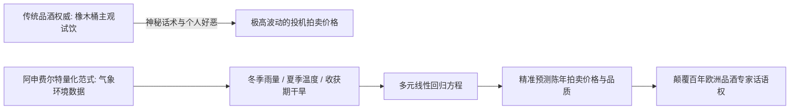

# Lec 3 波尔多葡萄酒品质预测：一元与多元线性回归的奠基之作 (Predicting the Quality of Wine: Linear Regression)

> MIT 15.071 数据分析优势 · 讲义 3 · 授课教师：Prof. Dimitris Bertsimas / Allison O'Hair

## TL;DR

- 普林斯顿经济学家奥利·阿申费尔特（Orley Ashenfelter）用多元回归挑战了数百年法国葡萄酒鉴赏权威。
- 波尔多葡萄酒的成熟品质与当年葡萄生长季的降雨量与平均气温高度线性耦合。
- 回归模型在葡萄酒尚在橡木桶陈酿、未开瓶品尝之前，即可精准预测其数十年后的拍卖价格。
- 该案例确立了量化预测对抗主观专家经验偏见（Expert Fallacy）的经典范式。

## 1. 葡萄酒评鉴的传统专家霸权

法国波尔多（Bordeaux）产区出产着全球最昂贵、最负盛名的顶级红葡萄酒（如拉菲、玛歌、拉图）。长期以来，波尔多期酒（En Primeur）的拍卖价格完全被少数极具权势的“品酒权威专家（Wine Critics）”（如罗伯特·帕克 Robert Parker）的主观品评词汇所主宰。

每年春季，评酒专家们前往波尔多酒庄，从刚刚酿造几个月、尚未在橡木桶中成熟浑浊的年轻酒桶中舀出酒样品尝，随后在专业杂志上给出评分。全世界的收藏家与投资机构完全依据这几个权威的舌头，决定数十亿美元的资金投向。

传统品酒界坚称：**葡萄酒的品质取决于土壤中不可言说的“风土（Terroir）”、酿酒大师的神秘艺术以及年份的独特造化，没有任何数学公式能够度量这种崇高的液体**。

直到 1990 年，普林斯顿大学经济学教授奥利·阿申费尔特（Orley Ashenfelter）发表了一篇震撼全欧洲的实证论文，彻底打破了这一神话。

## 2. 阿申费尔特波尔多气象回归模型

阿申费尔特基于坚实的植物生理学常识提出了一个极其优雅的假说：**葡萄树不是神仙，它只是一种植物。优质葡萄的成熟完全取决于其在生长周期内所经历的光照与水分物理环境**。

### 2.1 特征变量定义与数据采集

针对 1952 年至 1978 年共计 27 个成熟历史年份的波尔多葡萄酒展开研究：
- **因变量 $Y = \ln(\text{Price})$**：取自然对数的相对拍卖价格（以 1961 年公认世纪绝佳年份的价格为基准 100 分）；
- **自变量 1（冬季降雨量，WinterRain, mm）**：前一年 10 月至当年 3 月的降雨总量。冬季雨量充沛能够补足深层地下水，促进葡萄树根系吸水；
- **自变量 2（生长季平均气温，AGST, $^\circ\text{C}$）**：当年 4 月至 9 月的平均气温。夏季炎热能够促进葡萄果实充分成熟并积累高浓度糖分；
- **自变量 3（收获期降雨量，HarvestRain, mm）**：当年 8 月至 9 月采摘期的降雨量。收获期暴雨会导致葡萄吸水膨胀变淡，且诱发严重的霉菌腐烂；
- **自变量 4（陈酿年份，Age, 年）**：葡萄酒瓶装陈年时长（优质红酒随时间陈酿升值）。

### 2.2 样本回归结果与统计检验

在统计软件中拟合普通最小二乘回归：
$$\ln(\widehat{\text{Price}}) = -12.145 + 0.616 (\text{AGST}) + 0.00117 (\text{WinterRain}) - 0.00386 (\text{HarvestRain}) + 0.0238 (\text{Age})$$

模型统计诊断指标：
- 样本容量 $n = 27$
- 决定系数 $R^2 = 0.828$，调整后 $\bar{R}^2 = 0.797$
- 全模型 $F$ 统计量 $= 26.5 \ (p < 10^{-7})$

各个解释变量的 t 检验与经济学直觉高度吻合：
1. **生长季温度 AGST（$t = 6.47, p < 0.001$）**：
   系数为 $+0.616$。生长季平均气温每升高 $1^\circ\text{C}$，葡萄酒最终拍卖价格预期暴涨整整 $61.6\%$！这是决定波尔多是否能成为超级伟大年份的最强支柱。
2. **收获期降雨 HarvestRain（$t = -4.78, p < 0.001$）**：
   系数为 $-0.00386$。采摘前夕降雨每增加 100 毫米，酒价预期重挫近 $38.6\%$！雨水是好年份的致命杀手。
3. **冬季降雨 WinterRain（$t = 2.45, p = 0.023$）**：
   显著为正，为葡萄藤储备水份提供底层保障。

## 3. 历史实战：1986 年与 1989 年世纪预言

阿申费尔特的模型在提出之初，遭到了法国著名品酒大师罗伯特·帕克等人的公开嘲讽。帕克讥讽阿申费尔特是“一个不会品酒、只能对着温度计自慰的荒谬经济学家”。

然而，历史在随后的两个标志性年份中，用真金白银给出了无情的裁判：

### 3.1 1986 年份之争

波尔多酒商与法国专家对 1986 年份赞不绝口，将其炒作并以高昂的期货价格向全球散户抛售。阿申费尔特把 1986 年的气象数据代入模型：虽然夏天很热，但收获期遭遇了连续大暴雨（HarvestRain 高达 171 毫米）。模型预测：**1986 年只是一款平庸的普通酒，绝无收藏价值**。十年后，1986 年份酒体严重失衡，二级市场价格腰斩惨败。

### 3.2 1989 年与 1990 年的世纪逆袭

1989 年夏天，波尔多遭遇了极度干旱炎热的天气。当葡萄刚刚采摘、还躺在发酵罐里没有变成酒时，阿申费尔特就在其个人刊物《Liquid Assets》上发表通告：**1989 年将是继传奇 1961 年之后，波尔多历史上最伟大的世纪特优年份！紧接着的 1990 年同样是超级大年！**

专家们最初极力否认，认为新酒单宁粗糙难以下咽。然而数年后，当 1989 和 1990 年份拉菲与柏翠在佳士得拍卖行屡屡拍出创纪录天价时，全欧洲的葡萄酒投资界彻底臣服于这套只有四个变量的简单回归方程。

::: example [回归模型的超前预测能力]
阿申费尔特模型的最大商业威力在于**信息时间差（Information Time Advantage）**。传统专家必须等到新酒酿好（滞后 6-12 个月）才能给出评价；而阿申费尔特在每年 9 月 30 日葡萄刚刚采摘入库、甚至发酵还没开始的当天下午，就能直接在电脑上敲回车，给出未来 20 年的酒价精准预测。这为对冲基金与大宗现货贸易商提供了长达半年的绝密套利窗口。
:::

::: pitfall [外部有效性与气候变暖带来的模型漂移]
阿申费尔特模型基于 20 世纪冷凉气候下的波尔多数据。进入 21 世纪后，全球气候变暖导致夏季极端高温频发，当气温超过 $35^\circ\text{C}$ 时，葡萄树会为了防止脱水主动关闭气孔停止光合作用（Heat Stress）。此时线性增长假设不再成立，必须引入气温的二次方惩罚项以防范过拟合外推失效。
:::

::: insight [我的理解：数据分析是破除精英傲慢的民主化武器]
波尔多酒庄的庄主们和巴黎的鉴赏家们之所以对阿申费尔特恨之入骨，并不是因为他的模型算错了，恰恰是因为他算得太准了。他的公式扒掉了围绕在高端红酒周围数百年之久的神秘主义贵族光环。它向世人证明：哪怕在被视为最主观、最依赖艺术灵感的味觉领域，底层的物理规律与自然因果依然拥有无可辩驳的绝对统治力。量化分析不是冰冷的机械主义，它用客观的真实打破了权威的垄断。
:::
