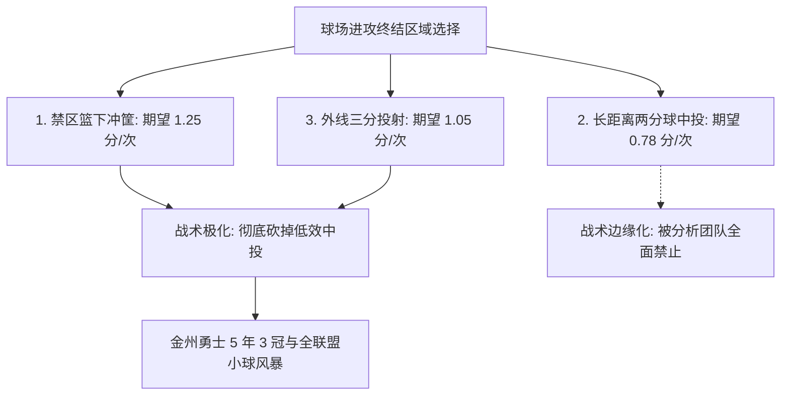

# Lec 5 NBA 篮球高阶数据分析：节奏、空间与投篮期望值革命 (Playing Moneyball in the NBA)

> MIT 15.071 数据分析优势 · 讲义 5 · 授课教师：Prof. Dimitris Bertsimas / Allison O'Hair

## TL;DR

- NBA 数据革命将分析重心从传统的场均得分（PPG）转向每回合期望产出（Efficiency per Possession）。
- 投篮期望值公式彻底瓦解了长两分中投的战术地位，催生了三分球与禁区攻筐的“魔球理论（Moreyball）”。
- 进阶攻防净效率（Net Rating）与真实正负值（RPM）剥离了比赛节奏快慢对传统数据的虚假膨胀。
- 空间牵引力（Gravity）与防守多功能性重塑了现代职业篮球的阵容构建逻辑。

## 1. 传统篮球统计的局限与“回合制”范式跃迁

在 2010 年以前，NBA 球队评价球星的主要依据是经典的传统数据栏（Box Score）：场均得分（Points）、场均篮板（Rebounds）、场均助攻（Assists）以及投篮命中率（Field Goal %）。

然而，这种朴素的绝对量统计存在严重的系统性扭曲：
一支比赛风格飞快、攻防转换频繁的球队（如唐·尼尔森执教的金州勇士队），全场可能拥有 110 次进攻机会；而一支打法沉稳、主打半场阵地防守战的铁血球队（如波波维奇的圣安东尼奥马刺队），全场可能仅有 88 次进攻机会。
- 前者的球员即便进攻效率低下，也能轻松刷出场均 25 分；
- 后者的核心球员虽然每回合产出极高，但场均得分往往只有 19 分。

::: definition [回合归一化与攻防效率 (Possessions & Advanced Ratings)]
为了在公平基准上衡量战力，现代篮球数据科学引入了**每 100 回合进攻与防守效率（Per 100 Possessions）**：
$$Possessions \approx 0.96 \times \left( FGA + 0.44 \times FTA - OREB + TOV \right)$$
- **进攻效率（Offensive Rating, ORtg）**：球队或球员在场时，每 100 回合的平均净得分；
- **防守效率（Defensive Rating, DRtg）**：球队或球员在场时，每 100 回合的平均失分；
- **净胜分率（Net Rating）**：$NetRating = ORtg - DRtg$。
:::

通过回合归一化，数据分析师彻底滤除了比赛节奏快慢带来的虚假繁荣，直接锁定了比赛生杀予夺的本质——**回合期望值（Expected Value per Possession）**。

## 2. 投篮期望值革命与长两分的消亡

达雷尔·莫雷（Daryl Morey，斯隆体育分析峰会发起人之一）与休斯顿火箭队分析团队，开启了职业体育史上最激进的战术实验。

### 2.1 三大投篮区域期望产出测算

考虑一名 NBA 顶级球员在球场不同位置的投篮数学期望：
$$E[\text{Points per Shot}] = \text{Shot Value} \times P(\text{Make})$$

依据全联盟数百万次真实出手的统计测算：

| 投篮区域划分 | 分值 | 联盟平均命中率 $P(\text{Make})$ | 单次出手期望收益 $E[\text{Points}]$ | 战术评价与真实经济学地位 |
| :--- | :--- | :--- | :--- | :--- |
| **篮下合理冲撞区 (0-3 英尺)** | 2 分 | **$63.0\%$** | $2 \times 0.63 = \mathbf{1.26}$ 分 | **超高效**（同时伴随极高造犯规罚球率）|
| **底角三分球 (Corner 3)** | 3 分 | **$39.0\%$** | $3 \times 0.39 = \mathbf{1.17}$ 分 | **极高效**（距篮筐仅 22 英尺，距离最短的三分）|
| **弧顶与45度三分 (Above the Break 3)**| 3 分 | **$35.5\%$** | $3 \times 0.355 = \mathbf{1.065}$ 分 | **高效** |
| **中距离两分球 (10-16 英尺)** | 2 分 | $41.0\%$ | $2 \times 0.41 = \mathbf{0.82}$ 分 | **低效垃圾区间** |
| **长两分球 (16 英尺至三分线内)** | 2 分 | $39.5\%$ | $2 \times 0.395 = \mathbf{0.79}$ 分 | **球场毒瘤**（承担三分的防守距离，仅拿两分）|

::: theorem [期望收益碾压定理]
一个命中率仅有 $33.3\%$ 的普通三分投手，其每次出手的期望收益为 $3 \times 0.333 = 1.00$ 分；
而一名被誉为主打“古典美如画中投”的球星，必须将命中率投到不可思议的 **$50.0\%$**，才能在期望产出上勉强追平这名普通三分投手！
在漫长的 82 场赛季、成千上万次出手复利叠加下，长两分的期望劣势会在记分牌上累积成无法逾越的鸿沟。
:::

其结果是震撼性的：休斯顿火箭队与金州勇士队几乎从战术手册中彻底删除了罚球线附近的非受迫性急停中投，球场进攻极端两极化为“篮下上篮/扣篮”与“外线三分雨”。

## 3. 真实正负值（RPM）与空间牵引力（Gravity）

除了进攻终结，数据分析更重构了对球员隐藏防守价值的量化认知。

### 3.1 正负值（Plus/Minus）的算法演进

朴素正负值（Raw +/-）仅仅记录某球员在场时球队的净胜分，容易受到“躺赢（乘顺风车）”队友的严重污染。分析师相继开发了：
1. **调整后正负值（Adjusted Plus/Minus, APM）**：将每场比赛切分为数千个换人子区间（Stints），运用岭回归（Ridge Regression / Tikhonov Regularization）控制场上其余 9 名球员的协变量影响；
2. **真实正负值（Real Plus/Minus, RPM / EPM）**：结合光学追踪摄影机（SportVU）测算的位置移动、对位防守降准率与球场空间牵引力（Gravity），精准分离个体真实阿尔法贡献。

::: example [肖恩·巴蒂尔（Shane Battier）的防守无形资产]
肖恩·巴蒂尔在传统数据统计上平平无奇（场均仅 6 分 4 篮板），在传统球探眼里属于平庸角色球员。但高级数据模型显示：
- 当他在场时，对手核心超级巨星的有效命中率出现悬崖式下跌；
- 他通过极其精准的数据球探报告（Scouting Report），永远迫使右路突破手走他不擅长的左路，逼迫对手在极其别扭的姿势下投出长两分；
- 迈阿密热火队在季后赛关键战役完全依据数据分析为其定制防守策略，成功锁死杜兰特等顶尖得分手，拿下两座总冠军。
:::

::: pitfall [战术单一化与季后赛针对性反制]
“纯粹魔球理论”在追求极致数学期望时，容易忽略战术可预测性带来的博弈反噬。2018 年西区决赛抢七大战中，火箭队面对勇士队高强度外线轮转扑防，在魔球信条指引下死板拒绝任何中距离过渡，结果遭遇极其罕见的**连续 27 记三分球不中**的历史惨剧。在最高水平博弈中，多样化的战术期权本身具有战略抗扰动溢价。
:::

::: insight [我的理解：高阶数据不是削平个性，而是重新定义空间价值]
很多人抱怨数据分析抹杀了 NBA 过去那种单打独斗的英雄主义浪漫，让比赛变成了千篇一律的三分大赛。但从数学本质来看，金州勇士队的斯蒂芬·库里（Stephen Curry）用他的射程在球场上制造出了一片物理学上的“强引力场”。当两名防守者不得不扑到半场LOGO处防守他时，篮下那片原本拥挤不堪的禁区就变成了开阔的平原。数据分析不是束缚运动员的枷锁，它是看穿物理空间弹性的一副 X 光眼镜。
:::
