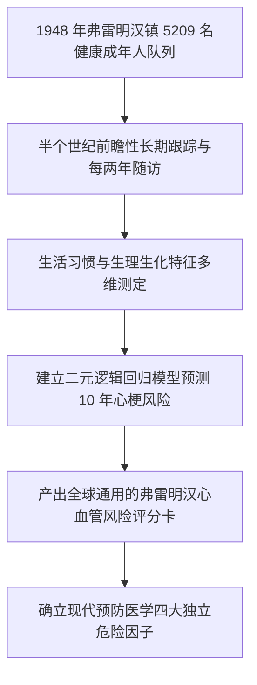

# Lec 7 弗雷明汉心脏研究：心血管疾病 10 年风险因果评估与救命模型 (The Framingham Heart Study: Evaluating Risk Factors)

> MIT 15.071 数据分析优势 · 讲义 7 · 授课教师：Prof. Dimitris Bertsimas / Allison O'Hair

## TL;DR

- 弗雷明汉心脏研究（Framingham Heart Study）是现代流行病学与预防医学的奠基石。
- 逻辑回归模型确立了高血压、高胆固醇、吸烟与糖尿病作为心血管疾病独立危险因子的定量贡献。
- 接收者操作特征曲线（ROC）与曲线下面积（AUC）综合量化了模型的辨识效能。
- 临床决策阈值的设定必须权衡假阴性（漏诊致命心梗）与假阳性（不必要他汀类药物副作用）的不对称成本。

## 1. 20 世纪中叶的医学迷雾与弗雷明汉研究起源

在第二次世界大战结束前夕，心血管疾病（Cardiovascular Disease, CVD）在美国呈现爆发式蔓延，成为夺取美国人生命的第一大杀手。1945 年，美国总统富兰克林·罗斯福在雅尔塔会议期间突发严重脑溢血猝死，其临终前测得的血压高达令人难以置信的 $300 / 190 \text{ mmHg}$。而在当时，医学界普遍盲目认为：高血压是随着年龄增长而自然发生的“代偿性良好生理反应”，不需要也无法人为干预。

为了解开这一夺命迷雾，美国国家心脏研究所（NHLBI）于 1948 年在马萨诸塞州波士顿郊外的弗雷明汉镇（Framingham）启动了流行病学史上最伟大的前瞻性队列研究。

研究团队招募了该镇 5,209 名无任何已知心血管疾病的成年健康男女居民，对其展开每两年一次的持续全生命周期医学随访，详尽记录他们的日常饮食、吸烟饮酒习惯、生理化验指标以及心绞痛与心梗的发生情况。

## 2. 预测模型的构建与因果特征提取

在 15.071 的案例中，我们使用包含 4,240 名患者基线数据的清洗样本，因变量为患者在未来 10 年内是否首发致死或非致死性冠心病（$\text{TenYearCHD} \in \{0, 1\}$）。

### 2.1 候选危险因子集

经过多轮特征工程筛选，模型纳入了以下关键生理与生活方式自变量：
- **人口统计学**：年龄（Age，岁）、性别（Male，1 为男性，0 为女性）、教育水平（Education）；
- **行为习惯**：当前是否吸烟（currentSmoker）、每日吸烟支数（cigsPerDay）；
- **临床既往史**：是否服用降压药（BPMeds）、既往卒中史（prevalentStroke）、高血压史（prevalentHyp）、糖尿病（diabetes）；
- **生理生化化验**：总胆固醇水平（totChol，mg/dL）、收缩压（sysBP，mmHg）、舒张压（diaBP，mmHg）、身体质量指数（BMI）、心率（heartRate）、空腹血糖（glucose，mg/dL）。

### 2.2 逻辑回归实证输出与特征剔除

在 R 语言中运行逐步回归，排除具有严重多重共线性与统计不显著的变量（如舒张压 diaBP 与 BMI），得到精简后的最优逻辑回归模型：

| 自变量名称 | 估计系数 $\beta_j$ | 统计量 (z value) | p 值 ($P > |z|$) | 优势比 (Odds Ratio, $e^\beta$) | 临床病理学解释 |
| :--- | :--- | :--- | :--- | :--- | :--- |
| **Intercept** | -9.126 | -14.8 | $< 2 \times 10^{-16}$ | — | 基准先验常数项 |
| **Male (男)** | **+0.531** | 5.02 | $5.1 \times 10^{-7}$ | **1.70** | 男性患心血管疾病的几率是同龄女性的 1.70 倍 |
| **Age (年龄)**| **+0.065** | 10.45 | $< 2 \times 10^{-16}$ | **1.067** | 年龄每增长 1 岁，发病几率上升 $6.7\%$（血管自然硬化）|
| **cigsPerDay**| **+0.019** | 3.28 | 0.0010 | **1.019** | 每日每多吸 1 支烟，发病几率上升 $1.9\%$（1 包烟提升 $45\%$）|
| **totChol** | **+0.002** | 2.05 | 0.0402 | **1.002** | 血液总胆固醇沉积诱发动脉粥样硬化斑块 |
| **sysBP** | **+0.017** | 8.35 | $< 2 \times 10^{-16}$ | **1.017** | 收缩压是强劲的致命自变量（每高 20 毫米汞柱风险增 $40\%$）|
| **glucose** | **+0.007** | 2.98 | 0.0028 | **1.007** | 高血糖引发全身微血管内皮细胞慢性炎症损伤 |

::: example [弗雷明汉评分卡实战测算]
考虑一位 55 岁男性患者，每天吸烟 10 支，体检总胆固醇 240 mg/dL，收缩压高达 160 mmHg，血糖 110 mg/dL：
$$\text{Logit} = -9.126 + 0.531(1) + 0.065(55) + 0.019(10) + 0.002(240) + 0.017(160) + 0.007(110) = -1.144$$
代入逻辑斯蒂函数：
$$P(\text{TenYearCHD} = 1) = \frac{1}{1 + e^{1.144}} = \frac{1}{1 + 3.139} \approx \mathbf{24.16\%}$$
该患者在未来 10 年内有高达近四分之一的概率遭遇心肌梗死！临床医生必须坚决指示其戒烟、服用降压药（氨氯地平）与降脂药（他汀），将其收缩压压回 120 以下。
:::

## 3. 模型验证：混淆矩阵与 ROC-AUC 曲线

在医疗诊断模型中，因变量通常呈现天然的不均衡分布（弗雷明汉样本中仅约 $15\%$ 的人真正发生 CHD）。若采用朴素的“预测所有人都不发病”策略，模型在纸面上的准确率就能达到 $85\%$，但这对于预防医学而言毫无意义。

### 3.1 混淆矩阵（Confusion Matrix）与阈值设定

设分类阈值为 $t$（若 $P \ge t$ 则判定为高危预警）：
- **真正例（True Positive, TP）**：实际发病，且成功预测预警（挽救生命）；
- **假正例（False Positive, FP）**：实际健康，但被错误预警（造成过度恐慌与不必要药物花费）；
- **假反例（False Negative, FN）**：实际发病，但模型未能发出预警（致命医疗事故！）；
- **真反例（True Negative, TN）**：实际健康，模型正确排除。

两个核心度量指标：
$$\text{敏感度 (Sensitivity / True Positive Rate)} = \frac{TP}{TP + FN}$$
$$\text{特异度 (Specificity / True Negative Rate)} = \frac{TN}{TN + FP}$$

### 3.2 接收者操作特征曲线（ROC）与 AUC

通过将分类阈值 $t$ 从 1 连续变动到 0，以**假阳性率（$1 - \text{Specificity}$）为横坐标**，以**真正率（$\text{Sensitivity}$）为纵坐标**绘制的平滑轨迹，即为 **ROC 曲线**。

::: definition [AUC (Area Under the ROC Curve)]
曲线下面积（AUC）的值域在 $[0.5, 1.0]$ 之间：
- $AUC = 0.50$：等同于抛硬币瞎猜；
- $AUC = 1.00$：完美的零误差分类神作；
- 统计学深刻本质：**AUC 等价于从阳性样本与阴性样本中各随机抽取一人，模型为真阳性患者给出的预测概率严格大于真阴性患者的数学概率**。
弗雷明汉逻辑回归模型的测试集 AUC 达到 **0.74 左右**，展现了极其坚实可靠的临床预后区分能力。
:::

::: pitfall [将降脂药当成万能解药]
弗雷明汉模型揭示了心血管风险的多维叠加乘数效应。单一指标（如总胆固醇）轻微超标，若无吸烟与高血压，绝对风险依然极低；反之，若同时伴有高血压和重度吸烟，即使胆固醇完全正常，发病几率也是常人的数倍。机械地为每个胆固醇稍高的人滥开他汀，是忽略全局系统的片面行医。
:::

::: insight [我的理解：算法赋能的预防医学是一场静默的奇迹]
外科手术台上惊心动魄的开胸抢救往往最能博得公众的赞叹与眼泪。然而，弗雷明汉研究用冷冰冰的逻辑回归公式，在半个世纪里拯救的人类生命，超过了全球所有顶级心脏外科名医的总和。它在患者尚未感到任何不适的十年前，就准确发出了红字警报，用每天几毛钱的降压药和一纸戒烟令，悄无声息地化解了一场场注定发生的家庭悲剧。这是数据科学赠予人类最深沉的慈悲。
:::
