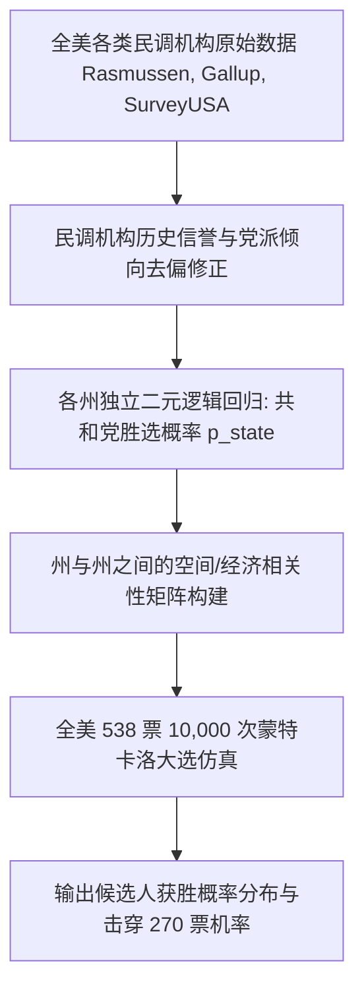

# Lec 8 选战风云：基于民调与人口统计学的总统大选胜选预测 (Election Forecasting: Predicting the Winner Before Votes are Cast)

> MIT 15.071 数据分析优势 · 讲义 8 · 授课教师：Prof. Dimitris Bertsimas / Allison O'Hair

## TL;DR

- 美国总统选举由各州选举人团（Electoral College）制度决定，要求必须进行州级颗粒度的概率建模。
- 逻辑回归模型综合全美权威机构历史民调、选区党派底盘与宏观基本面，校正单一民调机构的采样偏差。
- 蒙特卡洛全美大选仿真遍历摇摆州（Swing States）的相关性涨落，输出精准的胜选概率分布。
- 选战预测必须严加警惕无应答偏误（Non-response Bias）与赫芬顿邮报 2016 年的伪确定性预测陷阱。

## 1. 选举人团制度与现代政治数据科学

美国总统大选并非采用全国普选票（Popular Vote）简单多数决定制，而是依托于《美利坚合众国宪法》确立的**选举人团制度（Electoral College System）**：
- 全美 50 个州与华盛顿特区共计分配 **538 张选举人票**；
- 候选人必须在全美累计斩获至少 **270 张选举人票**方能成功问鼎白宫；
- 除内布拉斯加和缅因两州外，其余 48 个州均实行残酷的**“赢者通吃（Winner-take-all）”法则**：哪怕某位候选人在该州仅仅以 $0.1\%$ 的微弱优势领先，也能全盘独吞该州所有的选举人票！

这种制度特征导致全国层面的宏观大盘民调（National Polls）存在巨大的欺骗性。候选人完全可以在加州或纽约州狂揽数百万张普选票净胜差，但在决定大选胜负的关键摇摆州（如宾夕法尼亚、威斯康星、佛罗里达、俄亥俄）以几万票的微弱劣势惜败，最终在普选票领先的情况下痛失总统宝座（如 2000 年戈尔 vs 小布什，2016 年希拉里 vs 特朗普）。

因此，现代选战分析大师（如 Nate Silver）的核心任务，是**以每一个州为独立基本盘，构建高保真的州级胜选后验概率模型**。



## 2. 州级胜选逻辑回归模型构建

在 15.071 经典选战案例中，我们选取了 2004 年至 2012 年全美各州的历次大选真实民调与选举结果数据集。

### 2.1 变量工程与特征提取

每个样本对应某一届大选中的某一个具体的州（例如 2012 年的俄亥俄州）：
- **因变量 $Y \in \{0, 1\}$**：共和党候选人是否在该州最终获胜（$1$ 为共和党胜，$0$ 为民主党胜）；
- **自变量 1（RasmussenPoll）**：大选前夕 Rasmussen 机构民调中共和党支持率减去民主党支持率的净差额（例如 $+4.0$ 代表民调领先 4 个百分点）；
- **自变量 2（SurveyUSA）**：SurveyUSA 机构民调中共和党的净领先差额；
- **自变量 3（DiffCount）**：全美所有机构在该州进行的民调中，支持共和党领先的民调次数与支持民主党领先的民调次数之差。

### 2.2 逻辑回归求解与概率平滑

利用 R 语言构建模型：
$$\text{Logit}(P(\text{Republican Win})) = \beta_0 + \beta_1 (\text{RasmussenPoll}) + \beta_2 (\text{SurveyUSA}) + \beta_3 (\text{DiffCount})$$

通过最大似然估计求解：
$$\text{Logit}(p) = 0.05 + 0.56 (\text{Rasmussen}) + 0.68 (\text{SurveyUSA}) + 0.35 (\text{DiffCount})$$

::: example [民调误差下的摇摆州后验概率]
假设在决战时刻的关键摇摆州佛罗里达（拥有 29 张选举人票）：
- Rasmussen 民调显示共和党落后 1 个点（$-1.0$）；
- SurveyUSA 民调显示两党战平（$0.0$）；
- 全网民调计数差为 $-1$：
$$\text{Logit}(p) = 0.05 + 0.56(-1.0) + 0.68(0.0) + 0.35(-1) = 0.05 - 0.56 - 0.35 = -0.86$$
$$p(\text{共和党赢下佛州}) = \frac{1}{1 + e^{0.86}} = \frac{1}{1 + 2.363} \approx \mathbf{29.7\%}$$
这意味着，即使民调轻微落后 1 个点，由于抽样误差（通常民调置信区间为 $\pm 3.5\%$），共和党在该州依然保留着近三成的逆风翻盘概率，绝不能提前将其标记为不可撼动的“蓝州”！
:::

## 3. 从单州概率到全美大选的蒙特卡洛仿真

计算出全美 50 个州各自的胜选概率 $p_1, p_2, \dots, p_{50}$ 之后，许多初级分析师常犯的致命错误是：将每个州视为**独立的伯努利试验**，然后简单相加。

这是极其荒谬的。在真实政治地理学中，各州之间的投票倾向存在强烈的**宏观空间协方差（Spatial & Demographic Correlation）**：
- 铁锈地带（Rust Belt）的威斯康星州、密歇根州与宾夕法尼亚州，拥有极其相似的蓝领制造业工人人口结构与对自由贸易协议的抗拒心理；
- 如果计票当晚威斯康星州的民调误差向共和党偏移了 $+3\%$，那么密歇根州与宾州极大概率也会发生完全同向的 $+3\%$ 偏移！

::: definition [关联蒙特卡洛大选仿真]
通过在 50 个州之间引入多元正态潜变量相关系数矩阵 $\Sigma$，运行 $N = 10,000$ 次全美大选联合模拟抽样：
1. 每次模拟生成一组协同波动的州级大选结果；
2. 统计当次模拟中两党各自斩获的选举人票总数；
3. 统计 10,000 次模拟中候选人达到 $\ge 270$ 票的累计频次百分比，输出最终白宫胜选概率。
:::

```mermaid
flowchart LR
    subgraph Simulation [全美 10,000 次模拟路径分布]
        PathA[模拟 1: 铁锈带翻红 --> 共和党 285 票 (胜)]
        PathB[模拟 2: 阳光带守住 --> 民主党 332 票 (胜)]
        PathC[模拟 3: 极端均势 --> 269 对 269 票 (平局)]
    end
```

## 4. 2016 年选战灾难：赫芬顿邮报的“伪确定性”之耻

在 2016 年希拉里对决特朗普的世纪大选中，许多主流媒体与统计机构交出了一份载入史册的羞耻答卷：
- 《赫芬顿邮报》（The Huffington Post）在大选前夜高调宣称：希拉里获胜的概率为 **$98.2\%$**；
- 普林斯顿选举联盟（PEC）预测胜率为 **$99\%$**。
而 Nate Silver 的 538 网站给出的希拉里胜率仅为 **$71\%$**，留出了接近 $30\%$ 的冷门翻盘敞口。最终特朗普逆风赢下三大摇摆州，成功当选。

为什么那些看似高深的机构会集体爆雷？
1. **未受过大学教育的白人群体无应答偏误（Non-response Bias）**：支持特朗普的蓝领选民拒绝接听民调机构电话；
2. **相关性遗漏（Zero Correlation Assumption）**：赫芬顿邮报错误地假设威斯康星、密歇根与宾夕法尼亚的民调误差相互独立，认为三州同时翻红的概率是“三个小概率事件的乘积（极小）”，彻底忽略了系统性区域共振。

::: pitfall [将不确定性压缩为单点预测]
管理层与公众往往渴望得到非黑即白的确定性承诺（“到底谁会赢？”）。负责任的数据科学家必须抵制这种诱惑，如实捍卫置信区间与后验分布的宽度。将 $70\%$ 的优势过度解读为“板上钉钉”，是伪科学的最典型特征。
:::

::: insight [我的理解：民调科学是一面映射社会撕裂的曲面镜]
选民在电话机里对民调员说的话，与他们走进隔绝外界目光的投票箱时按下的按钮，永远隔着一层幽暗的人性防御。数据科学不仅需要高深的逻辑回归与协方差矩阵，更需要对现实社会的田野体察与政治心理学的谦卑理解。选战预测的价值从来不是充当先知，而是用量化镜头诚实记录时代巨浪的涌动。
:::
