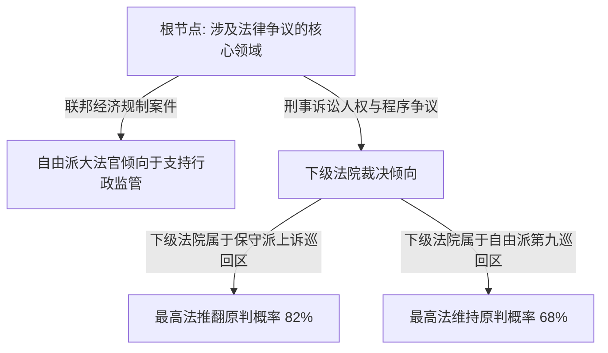

# Lec 9 决策树模型导论：以 CART 预测美国最高法院判决 (Forecasting Supreme Court Decisions: An Introduction to Trees)

> MIT 15.071 数据分析优势 · 讲义 9 · 授课教师：Prof. Dimitris Bertsimas / Allison O'Hair

## TL;DR

- 分类与回归树（CART）通过递归二分法，将高维特征空间切分为易于人类直觉理解的矩形决策区域。
- 基尼不纯度（Gini Impurity）度量了集合内类别的混乱度，构成了最优分裂节点遴选的数学准则。
- 复杂度参数（$cp$）与交叉验证剪枝（Pruning）有效遏制了树模型的过拟合野蛮生长。
- 在预测美国最高法院判决的巅峰对决中，极简的 CART 决策树以 $75\%$ 准确率完胜全美顶尖法学教授委员会。

## 1. 规则系统的局限与非线性白盒模型的诉求

在处理极其复杂的人类制度裁决时（如司法审判、企业风控合规、复杂的医疗多学科会诊），线性模型与逻辑回归往往显得力不从心。线性模型假定每个解释变量具有全局恒定的加性边际贡献；但在现实法理中，因果逻辑充满了**深度的前置条件嵌套（Hierarchical Interactions）**：
“只有当案件涉及联邦宪法第一修正案（言论自由）、且原告属于公立大学学生、且言论发生地点在校外时，某项法律原则才被触发生效；若上述任一前提不满足，该法条完全无关。”

这种天然的树状推理结构，催生了现代机器学习中最直观、最具可解释性的白盒模型——**分类与回归树（Classification and Regression Trees, CART）**。

## 2. CART 算法机制：递归二分与基尼不纯度

CART 算法由统计学泰斗利奥·布雷曼（Leo Breiman）等人在 1984 年正式提出。其本质是一种贪心算法（Greedy Algorithm），自顶向下将样本空间切分为互不重叠的正交超矩形区域。

### 2.1 分裂纯度准则：基尼不纯度（Gini Impurity）

设某个节点 $m$ 包含来自 $K$ 个类别的样本，第 $k$ 类的经验频率记为 $p_{mk}$。节点 $m$ 的基尼不纯度定义为：
$$I_G(m) = 1 - \sum_{k=1}^K p_{mk}^2 = \sum_{k=1}^K p_{mk} (1 - p_{mk})$$
- **完全纯净（Pure Node）**：所有样本全部属于同一类别，则某一 $p_{mk} = 1$，其余为 0，基尼指数达到理论极小值 $I_G = 0$；
- **极度混乱（Maximal Impurity）**：各类别样本数量完全均等（二分类时 $p_1 = p_2 = 0.5$），基尼指数达到极大值 $I_G = 1 - (0.25 + 0.25) = 0.50$。

### 2.2 最优分割点选择

算法遍历所有可用的自变量 $X_j$ 以及所有可能的切分阈值 $s$。将父节点 $D$ 分裂为左子集 $D_L$ 与右子集 $D_R$：
$$\Delta I_G = I_G(D) - \left( \frac{|D_L|}{|D|} I_G(D_L) + \frac{|D_R|}{|D|} I_G(D_R) \right)$$
算法选取能够使**加权基尼不纯度下降幅度最大（纯度增益最大）**的特征与切分点作为当前分裂规则。

### 2.3 树的剪枝（Pruning）与复杂度参数 $cp$

若允许树无限生长，直到每个叶子节点仅包含单个样本，模型将在训练集上达到完美的 $100\%$ 准确率，但在测试集上遭遇毁灭性的过拟合灾难。

为了控制树的体量，引入成本复杂度损失函数（Cost-Complexity Criterion）：
$$R_\alpha(T) = R(T) + \alpha \cdot |T|$$
其中 $R(T)$ 为树的误分类误差率，$|T|$ 为叶节点总数，$\alpha \ge 0$ 为惩罚系数（在 R 语言的 `rpart` 包中归一化为**复杂度参数 $cp$**）。
通过 $K$ 折交叉验证（Cross-Validation），选取使验证集误差最小的最优 $cp$ 值对大树实施由下而上的**剪枝（Pruning）**。

## 3. 世纪巅峰对决：CART 树大战最高法院法律专家

2002 年，华盛顿大学法学院与圣路易斯大学的学者设计了一场前所未有的图灵测试实验：
在 2002 年 10 月开庭期的美国最高法院审理的所有 68 起重大案件判决前，两支阵营同时提交独立的预测预告：
- **阵营 A（人类专家委员会）**：汇聚了全美 83 位顶尖法律学者、宪法学教授、前最高法院大法官法官助理以及最高法院出庭专职资深大律师；
- **阵营 B（计算机 CART 决策树模型）**：仅依据历史判决数据训练的简单分类树，变量仅涵盖下级巡回法院代码、案件争议类型、原告性质（个人 vs 联邦政府）以及大法官过去的意识形态评分。

### 3.1 预测表现与最终战果

当 68 起案件在数月后全部宣判、尘埃落定之时，最终战报震惊了全美司法界与社会科学界：

| 参赛阵营 | 评估对象与决策机制 | 全案最终预测准确率 | 核心大法官 (如奥康纳、肯尼迪) 准确率 |
| :--- | :--- | :--- | :--- |
| **全美顶尖法学专家委员会**| 83 位人类专家深度审阅诉状、辩词与个人直觉经验 | **59.1%** | 约 58% |
| **CART 计算机决策树模型**| 仅凭 6 个离散分类特征构建的 7 层剪枝二叉决策树 | **75.0%** | **高达 84%**！ |

计算机决策树以整整 **16 个百分点的巨大优势**全面碾压了人类顶尖专家！

::: example [关键枢纽大法官的决策树分枝]
最高法院当时最重要的中间派摇摆票是桑德拉·戴·奥康纳（Sandra Day O'Connor）大法官。人类专家陷入对其深奥判词哲学的主观解读；而 CART 树仅仅提取了三条干脆利落的规则：
1. 案件是否涉及对联邦监管法律的挑战？
2. 下级审理法院是否来自自由派的第九巡回上诉法院？
3. 原告是否具有工会或民权组织背景？
决策树准确捕捉到了奥康纳在行政程序与州权边界上的稳定条件反射，从而在关键摇摆案件中全部押中。
:::

::: pitfall [单棵决策树的高方差（High Variance）]
CART 算法具有先天的结构脆性：如果在根节点附近的训练数据发生微小的几条扰动，可能导致根节点分裂为另一个自变量，进而使得整棵决策树后续的几百个分枝结构发生面目全非的剧变。这一缺陷直接促使利奥·布雷曼在随后开发了基于集成学习的**随机森林（Random Forest）**。
:::

::: insight [我的理解：决策树证明了复杂的制度背后往往遵循朴素的逻辑]
人类专家往往具有过度把世界复杂化的倾向。法学家们习惯于用厚达数百页的拉丁文法学引注、精巧的哲学思辨去包装一份判决；但 CART 决策树无情地证明了：在最高法院九位终身制大法官的脑海深处，绝大多数裁决在案情要素摆上桌面的前几分钟，就已经被几条坚固的内在直觉规则锁定了。决策树并不是比法学大师更懂宪法，它只是用极度诚实的贪心二分，看清了人类大脑最真实的决策骨架。
:::
